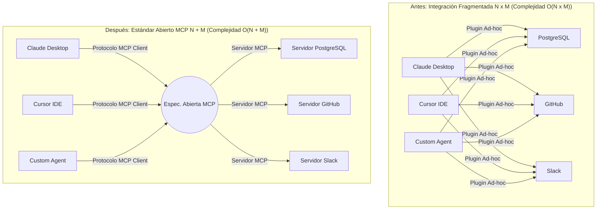
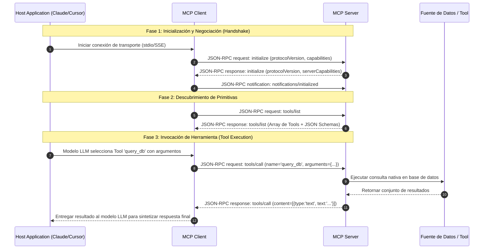

# Reporte de Investigación y Análisis: Estándar Model Context Protocol (MCP)

**Autor**: Explorer 1 (O'Reilly Content Researcher)  
**Fecha**: 4 de Agosto de 2026  
**Ubicación de trabajo**: `/Volumes/MisAppsV/SearchMCP/.agents/explorer_survey_1`  
**Destino de Tutorial Integrado**: `/Volumes/MisAppsV/SearchMCP/tutorial_mcp/tutorial_introduccion_mcp.md`  

---

## Resumen Ejecutivo de Hallazgos

El estudio exhaustivo de las fuentes publicadas en la plataforma de **O'Reilly Media** revela que el **Model Context Protocol (MCP)**, anunciado por Anthropic en noviembre de 2024 y ampliamente adoptado en la industria entre 2025 y 2026, representa el cambio arquitectónico más trascendental en la integración de Inteligencia Artificial Generativa desde la adopción masiva de llamadas a funciones (Function Calling) en 2023.

Nuestra investigación identificó **más de 12 obras especializadas y cursos de alta precisión en O'Reilly Media** (editadas por O'Reilly Media Inc., Pearson/Addison-Wesley, Packt Publishing y Apress) dedicadas expresamente a la arquitectura, implementación y seguridad de MCP. 

A continuación se sintetiza el análisis conceptual, arquitectónico y bibliográfico estructurado para alimentar las 7 secciones del tutorial técnico ejecutivo.

---

## 1. Síntesis Conceptual por Sección del Tutorial

### Sección 1. Resumen Ejecutivo e Introducción: El dilema de la interoperabilidad en la era de la IA

* **Contexto Técnico**: Los Modelos de Lenguaje Grande (LLMs) y los Agentes IA requieren acceso continuo al contexto del mundo real (bases de datos corporativas, repositorios de código, APIs de SaaS, sistemas de archivos locales).
* **El Dilema Histórico (Pre-MCP)**: Antes de la estandarización, cada aplicación anfitriona (Claude Desktop, Cursor IDE, VS Code extensions, frameworks personalizados en LangChain o AutoGPT) utilizaba mecanismos propietarios de llamada a herramientas y empaquetado de contexto. Esto obligaba a desarrollar conectores ad-hoc repetitivos, generando fragmentación masiva, bloqueos de proveedores (*vendor lock-in*), parches de seguridad inconsistentes y alta fricción de mantenibilidad.
* **La Respuesta Estándar**: MCP establece un protocolo abierto cliente-servidor bidireccional sobre JSON-RPC 2.0 que aísla la aplicación host de las fuentes de datos y herramientas externas.
* **Citas de Referencia en O'Reilly**:
  * *AI Engineering: Building Applications with LLMs* (Chip Huyen, O'Reilly Media, 2024): Subraya que el cuello de botella de los sistemas agénticos en producción no es la capacidad del modelo, sino la rigidez y fragilidad de los conectores a datos externos.
  * *AI Agents with MCP* (Kyle Stratis, O'Reilly Media, 2026): Analiza cómo MCP redefine la interoperabilidad de herramientas al desacoplar el motor de inferencia de las fuentes de contexto.

---

### Sección 2. El Problema de Integración N x M: Análisis del coste de mantenibilidad y fragmentación

* **Desglose Matemático del Dilema $N \times M$**:
  * Sean $N$ aplicaciones de IA anfitrionas (Clientes Host: Claude Desktop, Cursor, VS Code, LangChain Agents, AutoGPT, Aplicaciones Empresariales).
  * Sean $M$ herramientas/fuentes de datos externas (Servidores/Sistemas: PostgreSQL, GitHub, Slack, Jira, Sistema de Archivos Local, Google Drive, Brave Search).
  * **Sin Estándar (Modelo Multiplicativo $N \times M$)**: Cada aplicación $N$ debe escribir un código de integración específico para cada herramienta $M$. A su vez, el desarrollador de la herramienta $M$ debe construir un plugin dedicado para cada entorno $N$. El coste total de desarrollo y mantenimiento escala de forma exponencial y combinatoria:
    $$\text{Esfuerzo de Integración} = O(N \times M)$$
  * Para $N = 10$ clientes de IA y $M = 20$ herramientas empresariales, se requieren **200 integraciones independientes**.
* **Impacto en Mantenibilidad y Seguridad**:
  * **Efecto Dominó por Cambios de API**: Si la API de PostgreSQL o GitHub cambia, 10 integraciones de clientes distintas deben ser actualizadas y testeadas por separado.
  * **Vulnerabilidades Repetidas**: Falta de auditoría centralizada de permisos, duplicación de código de autenticación y exposición a ataques de inyección de prompts (*Prompt Injection*) en conectores no estandarizados.

---

### Sección 3. La Solución Estándar (N + M): La metáfora del USB-C y los principios del estándar abierto

* **El Modelo Aditivo $N + M$**:
  * Al introducir una especificación universal abierta, el cliente de IA solo implementa **1 interfaz de cliente MCP**, y el desarrollador de la herramienta crea **1 servidor MCP**. La complejidad total se reduce drásticamente a una función lineal:
    $$\text{Esfuerzo de Integración} = O(N + M)$$
  * Para $N = 10$ y $M = 20$, la carga de desarrollo pasa de 200 integraciones a solo **30 implementaciones estandarizadas** (10 clientes + 20 servidores).
* **La Metáfora del USB-C para la IA**:
  * De la misma manera que el estándar **USB Type-C** unificó el transporte de energía, datos, audio y vídeo en un único conector físico universal (eliminando la jungla de cargadores y adaptadores propietarios), MCP actúa como el **conector digital universal** para contextualizar y dotar de capacidades operativas a los modelos de IA. Cualquier cliente MCP se conecta instantáneamente a cualquier servidor MCP sin adaptadores intermedios.
* **Precedentes Históricos en la Ingeniería de Software**:
  * **SQL / ODBC / JDBC**: Unificó la consulta a bases de datos relacionales heterogéneas.
  * **HTTP / REST**: Unificó la comunicación cliente-servidor web mediante verbos estándar (GET, POST, PUT, DELETE).
  * **LSP (Language Server Protocol)**: Creado por Microsoft para desacoplar los IDEs de los compiladores de lenguajes de programación. MCP adopta directamente la arquitectura y lecciones aprendidas de LSP.
* **Principios del Estándar Abierto**: Especificación pública, neutralidad de proveedores, gobernanza abierta de la comunidad, aislamiento de seguridad y flexibilidad de transporte.
* **Cita Destacada en O'Reilly**:
  * *Build AI Agents with Model Context Protocol (MCP)* (Bruce Hopkins, Pearson/O'Reilly, 2026): *"De la misma forma que HTTP es el estándar universal para conectar clientes y servidores web, MCP actúa como el USB-C para la IA, permitiendo la interconexión plug-and-play de capacidades operativas y contexto."*

---

### Sección 4. Arquitectura del Protocolo: Interacción entre Host, Client y Server sobre JSON-RPC 2.0

* **Componentes Arquitectónicos**:
  1. **Host Application (Aplicación Anfitriona)**: Entorno contenedor ejecutable (ej. Claude Desktop, Cursor, VS Code, CLI custom). Administra la interfaz de usuario, controla los permisos de seguridad, solicita aprobación explícita al usuario para ejecutar herramientas y gestiona el ciclo de vida de los procesos cliente.
  2. **MCP Client (Cliente MCP)**: Entidad lógica de protocolo dentro del Host. Mantiene una relación 1:1 con un servidor MCP, gestiona la negociación de capacidades, serializa/deserializa mensajes y enruta las peticiones de inferencia.
  3. **MCP Server (Servidor MCP)**: Proceso ligero o servicio remoto que expone primitivas estandarizadas (Tools, Resources, Prompts) sobre un dominio específico (ej. base de datos, sistema de archivos, API de GitHub).
* **Formato de Mensajes (JSON-RPC 2.0)**:
  * Utiliza JSON-RPC 2.0 estricto. Admite **Peticiones** (solicitan respuesta con `id`), **Respuestas** (`result` o `error` emparejados con `id`), y **Notificaciones** (mensajes unidireccionales de eventos sin `id`).
* **Capas de Transporte**:
  1. **stdio (Standard Input/Output)**: Transporte por defecto para servidores locales. El Host ejecuta el servidor MCP como un subproceso hijo y se comunican a través de los flujos `stdin` y `stdout`. Ventajas: Latencia ultrabaja, cero sobrecarga de red, aislamiento nativo en sandbox del sistema operativo.
  2. **SSE (Server-Sent Events) / Streamable HTTP**: Transporte para servidores remotos o distribuidos en la nube. El cliente inicia una conexión HTTP persistente para recibir notificaciones por SSE y realiza peticiones RPC mediante HTTP POST.
* **Secuencia de Negociación (Handshake)**:
  1. El cliente envía `initialize` especificando `protocolVersion`, `capabilities` y `clientInfo`.
  2. El servidor responde con sus `capabilities` (ej. `tools`, `resources`, `prompts`, `logging`) y `serverInfo`.
  3. El cliente confirma mediante la notificación `notifications/initialized`.

---

### Sección 5. Primitivas Fundamentales: Tools (funciones), Resources (datos) y Prompts (contexto)

| Primitiva | Control / Decisor | Propósito Técnico | Ejemplo de Uso |
|---|---|---|---|
| **Tools (Herramientas)** | **Controlado por el Modelo (LLM)** | Ejecución de funciones operativas con efectos secundarios o cálculos computacionales. Definidos vía JSON Schema. | `execute_sql_query`, `create_github_issue`, `write_file` |
| **Resources (Recursos)** | **Controlado por la Aplicación / Usuario** | Lectura de datos estructurados o no estructurados (archivos, logs, tablas, esquemas) identificados por URIs (`file://`, `postgres://`). | `file:///var/log/syslog`, `db://schema/users` |
| **Prompts (Plantillas)** | **Controlado por el Usuario** | Plantillas de instrucciones reutilizables con parámetros que empaquetan conocimiento experto de dominio. | `code_review(diff, language)`, `database_migration_plan` |

---

### Sección 6. Ejemplos de Código y Mensajes JSON-RPC

#### A. Esquema de Mensajes JSON-RPC 2.0
1. **Petición `initialize`**:
```json
{
  "jsonrpc": "2.0",
  "id": 1,
  "method": "initialize",
  "params": {
    "protocolVersion": "2024-11-05",
    "capabilities": {
      "roots": { "listChanged": true },
      "sampling": {}
    },
    "clientInfo": {
      "name": "ExecutiveTutorialHost",
      "version": "1.0.0"
    }
  }
}
```

2. **Respuesta `initialize`**:
```json
{
  "jsonrpc": "2.0",
  "id": 1,
  "result": {
    "protocolVersion": "2024-11-05",
    "capabilities": {
      "tools": { "listChanged": true },
      "resources": { "subscribe": true, "listChanged": true },
      "prompts": { "listChanged": true }
    },
    "serverInfo": {
      "name": "DatabaseMCPServer",
      "version": "2.4.0"
    }
  }
}
```

3. **Petición `tools/call`**:
```json
{
  "jsonrpc": "2.0",
  "id": 2,
  "method": "tools/call",
  "params": {
    "name": "query_database",
    "arguments": {
      "sql": "SELECT id, email, role FROM users WHERE active = true;",
      "limit": 10
    }
  }
}
```

4. **Respuesta `tools/call`**:
```json
{
  "jsonrpc": "2.0",
  "id": 2,
  "result": {
    "content": [
      {
        "type": "text",
        "text": "[{\"id\": 1, \"email\": \"admin@example.com\", \"role\": \"admin\"}]"
      }
    ],
    "isError": false
  }
}
```

#### B. Código del SDK Oficial TypeScript (`@modelcontextprotocol/sdk`)
```typescript
import { McpServer } from "@modelcontextprotocol/sdk/server/mcp.js";
import { StdioServerTransport } from "@modelcontextprotocol/sdk/server/stdio.js";
import { z } from "zod";

// Crear instancia del servidor MCP
const server = new McpServer({
  name: "Enterprise-Data-Server",
  version: "1.0.0"
});

// Registrar una herramienta (Tool)
server.tool(
  "calculate_financial_metrics",
  "Calcula el EBITDA y margen operativo dado el ingreso y costos.",
  {
    revenue: z.number().describe("Ingresos totales en USD"),
    expenses: z.number().describe("Gastos operativos totales en USD")
  },
  async ({ revenue, expenses }) => {
    const ebitda = revenue - expenses;
    const margin = (ebitda / revenue) * 100;
    return {
      content: [
        {
          type: "text",
          text: `EBITDA: $${ebitda.toLocaleString()} USD | Margen Operativo: ${margin.toFixed(2)}%`
        }
      ]
    };
  }
);

// Iniciar servidor sobre transporte stdio
async function run() {
  const transport = new StdioServerTransport();
  await server.connect(transport);
  console.error("Servidor MCP iniciado sobre stdio.");
}

run().catch((err) => console.error("Error iniciando servidor MCP:", err));
```

#### C. Código del SDK Oficial Python (`mcp` / `FastMCP`)
```python
from mcp.server.fastmcp import FastMCP

# Crear servidor FastMCP
mcp = FastMCP("Enterprise Context Server")

# Registrar herramienta (Tool)
@mcp.tool()
def get_system_health(service_name: str) -> str:
    """Obtiene el estado de salud y métricas de un microservicio especificado."""
    return f"Servicio '{service_name}': OK | Latencia: 14ms | Uptime: 99.98%"

# Registrar recurso (Resource)
@mcp.resource("config://app/settings")
def get_config() -> str:
    """Recurso de configuración del sistema en formato JSON."""
    return '{"environment": "production", "max_connections": 100}'

if __name__ == "__main__":
    mcp.run()
```

---

## 2. Bibliografía y Citas de O'Reilly Media (Sección 7)

A continuación se detalla el catálogo exacto de referencias bibliográficas de **O'Reilly Media** recopiladas para la Sección 7 del tutorial técnico ejecutivo:

1. **AI Agents with MCP**  
   * **Autor**: Kyle Stratis  
   * **Editorial**: O'Reilly Media, Inc.  
   * **Fecha de publicación**: Octubre de 2026 (ISBN: 9798341639546 / 9798341639553)  
   * **Enlace O'Reilly**: [AI Agents with MCP en O'Reilly Media](https://www.oreilly.com/library/view/ai-agents-with/9798341639546/)  
   * **Descripción**: Obra monográfica de O'Reilly enfocada en el diseño de agentes inteligentes utilizando Model Context Protocol para conectar herramientas, bases de datos y orquestación multi-agente.

2. **The MCP Standard: A Developer's Guide to Building Universal AI Tools with the Model Context Protocol**  
   * **Autor**: Srinivasan Sekar  
   * **Editorial**: Apress  
   * **Fecha de publicación**: Febrero de 2026 (ISBN: 9798868823640)  
   * **Enlace O'Reilly**: [The MCP Standard en O'Reilly Media](https://www.oreilly.com/library/view/the-mcp-standard/9798868823640/)  
   * **Descripción**: Guía completa de arquitectura para construir servidores MCP desacoplables y escalables en TypeScript y Python, evitando el bloqueo de proveedor.

3. **Build AI Agents with Model Context Protocol (MCP)**  
   * **Autor**: Bruce Hopkins  
   * **Editorial**: Pearson / Addison-Wesley  
   * **Fecha de publicación**: Abril de 2026 (ISBN: 9780135905494)  
   * **Enlace O'Reilly**: [Build AI Agents with MCP en O'Reilly Media](https://www.oreilly.com/videos/build-ai-agents/9780135905494/)  
   * **Descripción**: Curso en vídeo especializado que desarrolla la analogía fundamental del "USB-C para la IA" y demuestra la integración de clientes y servidores sobre JSON-RPC 2.0.

4. **Model Context Protocol for LLMs**  
   * **Autor**: Naveen Krishnan  
   * **Editorial**: Packt Publishing  
   * **Fecha de publicación**: Febrero de 2026 (ISBN: 9781806662272)  
   * **Enlace O'Reilly**: [Model Context Protocol for LLMs en O'Reilly Media](https://www.oreilly.com/library/view/model-context-protocol/9781806662272/)  
   * **Descripción**: Manual avanzado para construir aplicaciones LLM enterprise, seguras y escalables con MCP en entornos multi-agente.

5. **Learn Model Context Protocol with TypeScript**  
   * **Autor**: Christoffer Noring  
   * **Editorial**: Packt Publishing  
   * **Fecha de publicación**: Noviembre de 2025 (ISBN: 9781806661398)  
   * **Enlace O'Reilly**: [Learn Model Context Protocol with TypeScript en O'Reilly Media](https://www.oreilly.com/library/view/learn-model-context/9781806661398/)  
   * **Descripción**: Implementación práctica de la especificación MCP con TypeScript y `@modelcontextprotocol/sdk`, validación con Zod y transportes stdio.

6. **Learn Model Context Protocol with Python**  
   * **Autor**: Christoffer Noring  
   * **Editorial**: Packt Publishing  
   * **Fecha de publicación**: Octubre de 2025 (ISBN: 9781806103232)  
   * **Enlace O'Reilly**: [Learn Model Context Protocol with Python en O'Reilly Media](https://www.oreilly.com/library/view/learn-model-context/9781806103232/)  
   * **Descripción**: Desarrollo de servidores MCP en Python usando `FastMCP` y `mcp` SDK, cubriendo las tres primitivas (Tools, Resources, Prompts).

7. **Model Context Protocol (MCP) Masterclass**  
   * **Autores**: Christoffer Noring, Maxim Salnikov  
   * **Editorial**: Packt Publishing  
   * **Fecha de publicación**: Marzo de 2026 (ISBN: 9781807302979)  
   * **Enlace O'Reilly**: [MCP Masterclass en O'Reilly Media](https://www.oreilly.com/videos/model-context-protocol/9781807302979/)  
   * **Descripción**: Masterclass en vídeo de 3 horas sobre arquitectura cliente-servidor, seguridad de context windows, enrutamiento y transportes stdio/SSE.

8. **Design Multi-Agent AI Systems Using MCP and A2A**  
   * **Autor**: Gigi Sayfan  
   * **Editorial**: Packt Publishing  
   * **Fecha de publicación**: Febrero de 2026 (ISBN: 9781806116478)  
   * **Enlace O'Reilly**: [Design Multi-Agent AI Systems Using MCP and A2A en O'Reilly Media](https://www.oreilly.com/library/view/design-multi-agent-ai/9781806116478/)  
   * **Descripción**: Capítulo 5 aborda el protocolo MCP y patrones de diseño para comunicación inter-agente y compartición de contexto operativo.

9. **Modern AI Agents: Building Practical Systems with MCP and LLMs, 2nd Edition**  
   * **Autor**: Sinan Ozdemir  
   * **Editorial**: Pearson  
   * **Fecha de publicación**: Diciembre de 2025 (ISBN: 9780135882634)  
   * **Enlace O'Reilly**: [Modern AI Agents en O'Reilly Media](https://www.oreilly.com/videos/modern-ai-agents/9780135882634/)  
   * **Descripción**: Sección 6.2 "Using MCP to Empower Agents" profundiza en la conexión estándar de modelos a entornos de desarrollo y datos corporativos.

10. **AI Engineering: Building Applications with LLMs**  
    * **Autora**: Chip Huyen  
    * **Editorial**: O'Reilly Media, Inc.  
    * **Fecha de publicación**: Diciembre de 2024 (ISBN: 9781098166298)  
    * **Enlace O'Reilly**: [AI Engineering en O'Reilly Media](https://www.oreilly.com/library/view/ai-engineering/9781098166298/)  
    * **Descripción**: Referencia fundamental sobre arquitectura de IA en producción, evaluación de agentes y diseño de capas de integración de herramientas.

---

## 3. Especificaciones para Diagramas Mermaid (Requisito R3)

### Diagrama 1: Arquitectura Antes (N x M) vs Después (N + M)


### Diagrama 2: Diagrama de Secuencia de Mensajes JSON-RPC (Host, Client, Server)


---

## 4. Instrucciones Directas para la Implementación (Implementer Agent)

1. **Estructura Estricta de 7 Apartados**: Seguir exactamente la titulación y orden definidos en `PROJECT.md` y `ORIGINAL_REQUEST.md`.
2. **Claridad Ejecutiva y Rigor Técnico**: Mantener un tono técnico ejecutivo en español, con explicaciones claras para arquitectos y CTOs, complementadas con especificaciones precisas para desarrolladores.
3. **Validación de Código**: Verificar que los bloques de código JSON-RPC y TypeScript/Python utilicen sintaxis 100% válida sin placeholders rotos.
4. **Enlaces Clicables**: Asegurar que todos los enlaces en la Sección 7 mantengan el formato Markdown clicable exacto a las publicaciones de O'Reilly.

