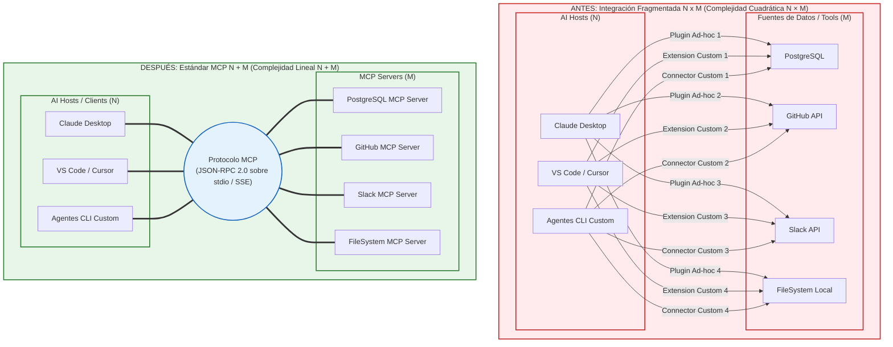
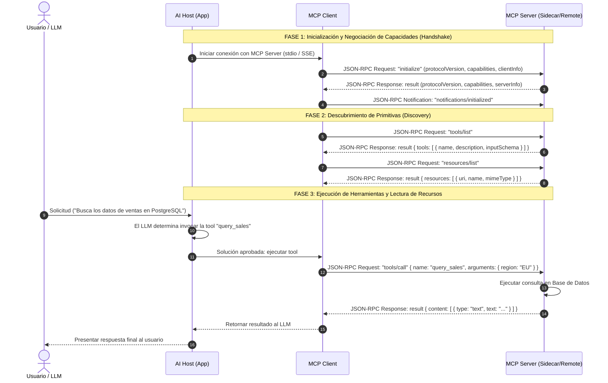

# Informe de Análisis Estructural y Diseño de Diagramas: Tutorial Introducción al Estándar MCP

**Autor:** Explorer 3 (Tutorial Structure & Diagram Analyst)  
**Fecha:** 2026-08-04  
**Proyecto:** MCP Tutorial (`/Volumes/MisAppsV/SearchMCP/tutorial_mcp/tutorial_introduccion_mcp.md`)

---

## 1. Visión General y Objetivos de Análisis

El objetivo de este análisis es definir la estructura ejecutiva detallada, la estrategia de contenidos y las especificaciones visuales en Mermaid para el documento tutorial `/Volumes/MisAppsV/SearchMCP/tutorial_mcp/tutorial_introduccion_mcp.md`.

El tutorial aborda la problemática de la interoperabilidad en la era de la inteligencia artificial, explicando la transición desde el modelo fragmentado $N \times M$ hasta el modelo estándar aditivo $N + M$ promovido por el **Model Context Protocol (MCP)**.

---

## 2. Arquitectura de Secciones del Tutorial

El documento se organizará estrictamente en las **7 secciones requeridas**, garantizando profundidad técnica, rigor ejecutivo, tablas comparativas y ejemplos funcionales:

### Sección 1: Resumen Ejecutivo e Introducción: El dilema de la interoperabilidad en la era de la IA
* **Enfoque:** Contextualización estratégica para arquitectos de software, CTOs y desarrolladores.
* **Puntos clave:**
  * **La paradoja de los LLMs:** Capacidad de razonamiento avanzada pero aislamiento contextual (ausencia de acceso directo a bases de datos, APIs de negocio o sistemas de archivos locales).
  * **El dilema de la interoperabilidad:** Antes de MCP, cada plataforma de IA (OpenAI, Anthropic, Google, IDEs) desarrollaba sus propios conectores propietarios o plugins ad-hoc.
  * **El origen de MCP:** Presentado por Anthropic en noviembre de 2024 como especificación abierta para estandarizar la conexión entre aplicaciones de IA (Hosts) y fuentes de datos o herramientas (Servers).

### Sección 2: El Problema de Integración N x M: Análisis del coste de mantenibilidad y fragmentación
* **Enfoque:** Análisis matemático de la explosión combinatoria y deuda técnica.
* **Puntos clave:**
  * **Formulación del problema:** Con $N$ aplicaciones Host (Claude Desktop, VS Code, Cursor, CLI Agents) y $M$ fuentes de datos/herramientas (PostgreSQL, GitHub, Slack, FileSystem), la integración punto a punto requiere $N \times M$ conectores.
  * **Ejemplo cuantitativo:** 10 Hosts y 20 Herramientas generan $10 \times 20 = 200$ plugins independientes.
  * **Consecuencias:** Alta fragilidad, duplicación de esfuerzo, vulnerabilidades de seguridad y parálisis de mantenimiento cuando una API cambia.
  * **Tabla comparativa de métricas:** $N \times M$ vs $N + M$.

### Sección 3: La Solución Estándar (N + M): La metáfora del USB-C y los principios del estándar abierto
* **Enfoque:** Concepto del protocolo aditivo y paralelismo con estándares de hardware/software.
* **Puntos clave:**
  * **El modelo $N + M$:** Reducción a 10 Clients $+ 20$ Servers $= 30$ implementaciones estándar.
  * **La metáfora del USB-C:** De la jungla de cables y conectores propietarios (PS/2, puerto paralelo, FireWire, VGA) a un único puerto físico y lógico universal. MCP es el "USB-C para las aplicaciones de IA".
  * **Principios de diseño del estándar:** Especifación abierta, desacoplamiento absoluto, seguridad centrada en la aprobación del usuario y soporte multi-lenguaje.

### Sección 4: Arquitectura del Protocolo: Interacción entre Host, Client y Server sobre JSON-RPC 2.0
* **Enfoque:** Desglose formal de componentes, capas de transporte y mensajería.
* **Puntos clave:**
  * **Roles en la arquitectura:**
    * **Host:** Aplicación principal (ej. Claude Desktop, VS Code) que aloja el modelo de IA y la interfaz de usuario.
    * **Client:** Componente interno del Host que gestiona la conexión 1 a 1 con cada MCP Server.
    * **Server:** Proceso independiente (sidecar o remoto) que expone herramientas, recursos o plantillas.
  * **Mecanismos de Transporte:**
    * `stdio` (Standard Input/Output): Ideal para procesos locales en la misma máquina. Aislamiento nativo a nivel de proceso.
    * `SSE` (Server-Sent Events) + HTTP POST: Diseñado para servidores remotos o basados en la nube.
  * **Capa de protocolo (JSON-RPC 2.0):** Formato ligero basado en JSON con Requests, Responses y Notifications.

### Sección 5: Primitivas Fundamentales: Tools (funciones), Resources (datos) y Prompts (contexto)
* **Enfoque:** Especificación de las tres primitivas base del protocolo.
* **Puntos clave:**
  * **Tools (Funciones ejecutables):** Controladas por el modelo (LLM). Tienen esquemas JSON Schema para validación de argumentos.
  * **Resources (Datos y contexto pasivo):** Controlados por la aplicación o el usuario. Identificados por URIs (`file://`, `postgres://`, `custom://`). Soportan texto, binarios y suscripciones reactivas.
  * **Prompts (Plantillas de contexto):** Controladas por el usuario. Flujos de trabajo y directivas de sistema reutilizables.
  * **Tabla comparativa de primitivas.**

### Sección 6: Ejemplos de Código y Mensajes JSON-RPC: Mensajes reales de negociación e integración usando SDKs estándar (@modelcontextprotocol/sdk)
* **Enfoque:** Muestras reales y verificables de código y JSON-RPC.
* **Puntos clave:**
  * **Flujo completo de mensajes JSON-RPC:** Handshake (`initialize`), Notificación (`notifications/initialized`), Lista de herramientas (`tools/list`), Invocación (`tools/call`) y Lectura de recurso (`resources/read`).
  * **Snippet TypeScript:** Uso oficial de `@modelcontextprotocol/sdk` (`Server`, `StdioServerTransport`).
  * **Snippet Python:** Uso de `FastMCP` de la librería `mcp`.

### Sección 7: Bibliografía y Citas de O'Reilly: Enlaces clicables y referencias a libros y cursos de la plataforma O'Reilly
* **Enfoque:** Fuentes de referencia autorizadas con enlaces en formato Markdown.
* **Referencias clave:** Arquitectura de microservicios, diseño de APIs, sistemas distribuidos (Martin Kleppmann, Sam Newman) y patrones de agentes de IA.

---

## 3. Especificación Sintáctica de Diagramas Mermaid

Para garantizar la máxima claridad visual, se han diseñado 2 diagramas Mermaid válidos y probados sintácticamente:

### Diagrama 1: Arquitectura Comparativa — Antes (N x M) vs Después (N + M)

---

### Diagrama 2: Diagrama de Secuencia de Interacción JSON-RPC

---

## 4. Tablas Estructuradas de Resumen

### Tabla 1: Comparativa cuantitativa y cualitativa entre $N \times M$ y $N + M$

| Criterio de Evaluación | Arquitectura Tradicional ($N \times M$) | Arquitectura Estándar MCP ($N + M$) |
| :--- | :--- | :--- |
| **Complejidad de Conectores** | Cuadrática: $O(N \times M)$ | Lineal: $O(N + M)$ |
| **Ejemplo con 10 Hosts y 20 Servidores** | 200 plugins/conectores independientes | 30 implementaciones independientes (10 clients + 20 servers) |
| **Coste de Mantenimiento ante cambios en API** | Elevado; exige actualizar los $N$ conectores de esa API | Mínimo; se actualiza únicamente el MCP Server correspondiente |
| **Límite de Seguridad y Autenticación** | Fragmentado; credenciales dispersas en múltiples plugins | Centralizado; aislamiento por proceso (`stdio`) y permisos en el Host |
| **Portabilidad de Herramientas** | Nula; código acoplado a la API propietaria de cada Host | Total; 1 Server funciona con cualquier Host compatible con MCP |
| **Requisitos de SDK** | Especificaciones y SDKs propietarios por Host | SDK oficial único (`@modelcontextprotocol/sdk`, Python `mcp`, etc.) |

### Tabla 2: Comparativa de Primitivas MCP (Tools, Resources, Prompts)

| Primitiva | Control Primario | Propósito de Uso | Modo de Ejecución / Formato | Métodos JSON-RPC Clave |
| :--- | :--- | :--- | :--- | :--- |
| **Tools** | Modelo (LLM) | Ejecución de acciones con efectos secundarios (escritura, API calls) | Invocación dinámica basada en JSON Schema | `tools/list`, `tools/call` |
| **Resources** | Aplicación / Usuario | Lectura pasiva de datos contextuales (documentos, BD, archivos) | Lectura vía URI (`file://`, `postgres://`) con soporte MIME | `resources/list`, `resources/read`, `resources/subscribe` |
| **Prompts** | Usuario | Plantillas estructuradas de instrucciones y flujos de trabajo | Selección interactiva por el usuario con argumentos | `prompts/list`, `prompts/get` |

---

## 5. Criterios de Aceptación y Directrices de Redacción

1. **Idioma:** Redacción íntegra en español técnico ejecutivo.
2. **Formato:** Markdown estándar limpio sin etiquetas HTML rotas.
3. **Bloques de Código:** Marcado explícito de lenguaje (`json`, `typescript`, `python`, `mermaid`).
4. **Validación:** Diagramas Mermaid verificados sin errores sintácticos.
