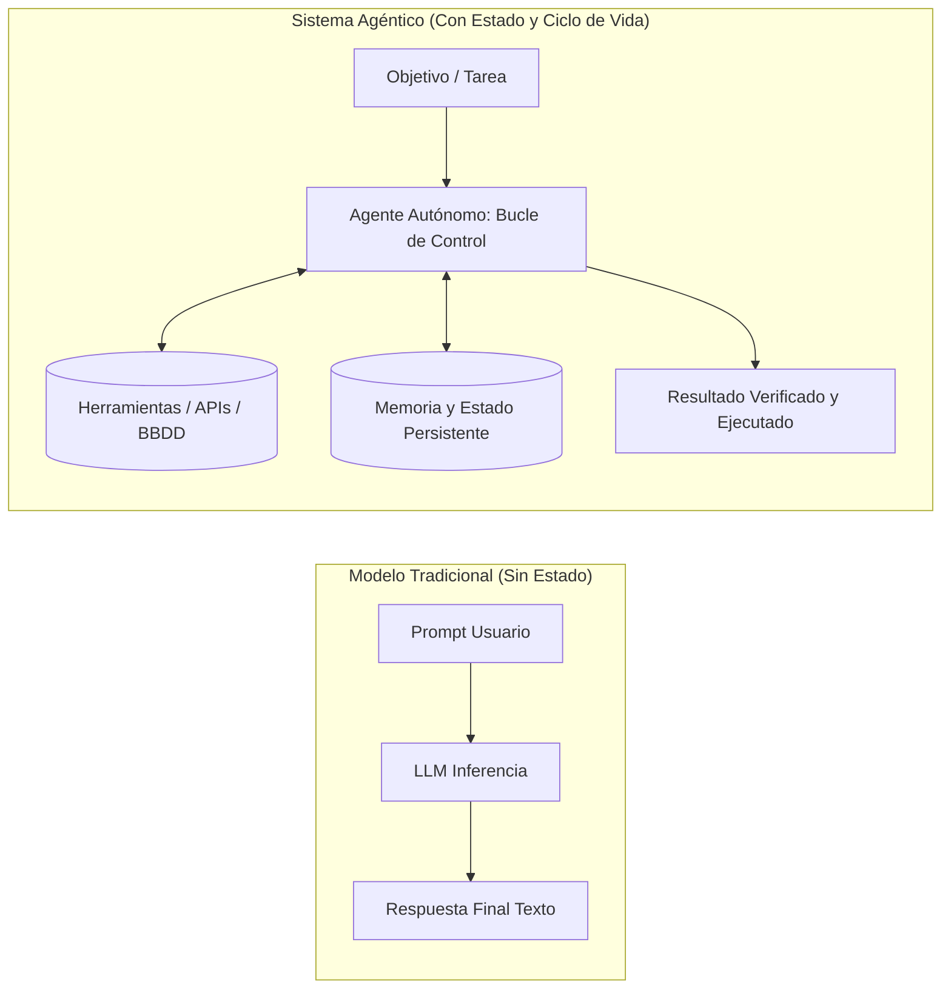
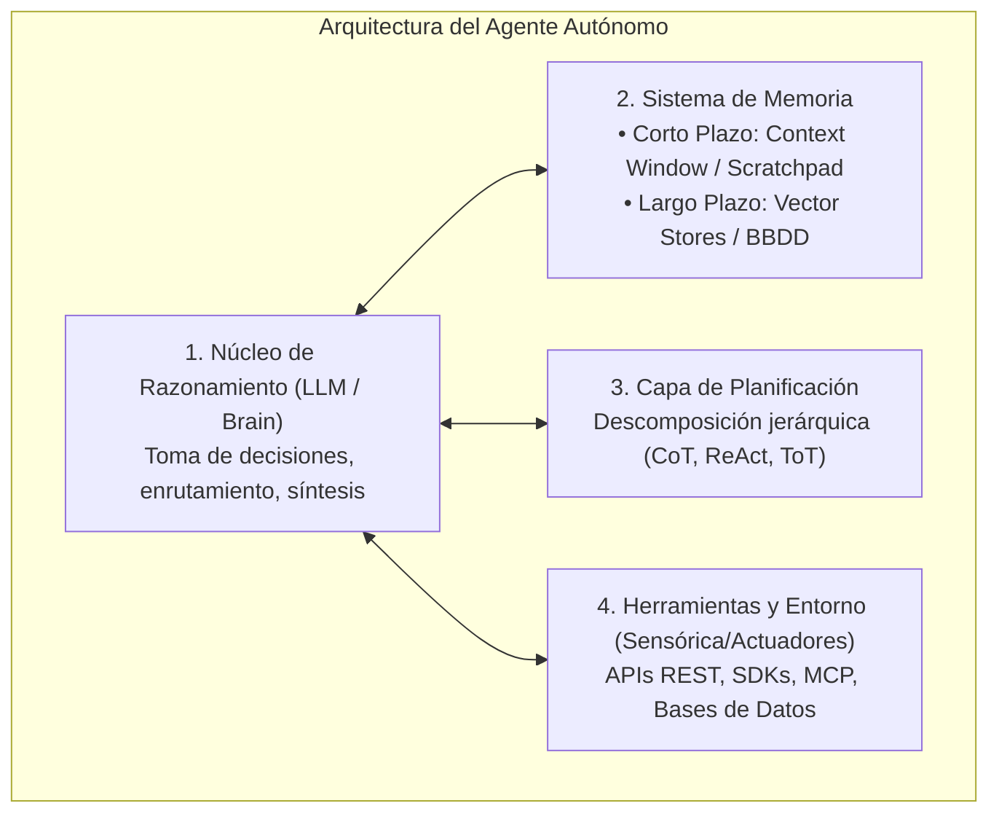
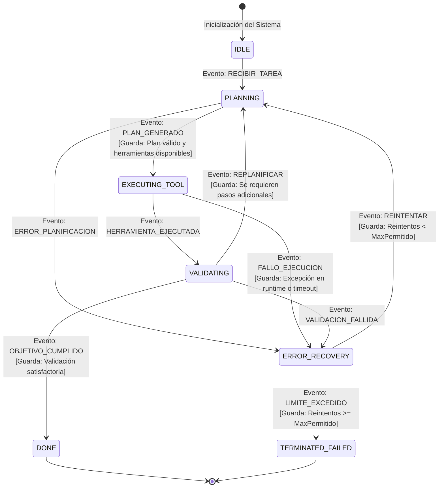

# Tutorial Técnico: De LLMs a Agentes Autónomos y Máquinas de Estados Finitos (FSM)
**Serie:** Guía Práctica de Arquitectura y Desarrollo de Agentes de IA  
**Basado en:** *AI Agents: The Definitive Guide: Design, Deployment, and Evaluation for Production* (Capítulo 1) por Nicole Koenigstein (O\'Reilly Media)  
**Referencia O\'Reilly:** [Capítulo 1: From LLMs to Agents (0642572416744 / ch01.html#FSM)](https://learning.oreilly.com/library/view/ai-agents-the/0642572247775/ch01.html#FSM)  
**Enfoque:** Arquitectura Conceptual, Control de Flujo Determinista y Práctica en Python

---

## 1. Introducción: La Gran Transición de Modelos Estáticos a Agentes Autónomos

Durante los primeros años de la Inteligencia Artificial Generativa (2022–2024), la interacción con los Modelos de Lenguaje Grande (LLMs) se limitó a un paradigma puramente **estático y sin estado (*stateless*)**: el usuario enviaba un prompt, y el modelo respondía prediciendo la secuencia estadísticamente más probable de tokens (*Next-Token Prediction*).

Sin embargo, en entornos de producción e ingeniería de software, las tareas reales rara vez se resuelven con un único texto generado. Requieren:
1. **Acceso dinámico a información externa** (consultar bases de datos, APIs, documentos).
2. **Ejecución de acciones con efectos secundarios** (enviar un correo, modificar código, crear un ticket).
3. **Razonamiento en múltiples etapas** (planificar pasos, verificar resultados intermedios y corregir errores).



### 1.1. ¿Qué es realmente un Agente de IA?
Un **Agente de IA** no es un modelo más grande ni un prompt más elaborado. Un agente es un **sistema de software que envuelve a un modelo de razonamiento dentro de un bucle de control dinámico**, dotándolo de:
* **Percepción:** Capacidad de observar el estado del entorno y los resultados de sus acciones.
* **Memoria:** Retención de contexto a corto plazo (diálogo, pasos previos) y a largo plazo (conocimiento persistente, políticas).
* **Planificación:** Capacidad de descomponer metas complejas en subtareas ordenadas.
* **Acción:** Capacidad de invocar herramientas e interactuar con el mundo exterior.

---

## 2. Los 4 Pilares de la Arquitectura de un Agente

Para construir sistemas robustos en producción, el Capítulo 1 desglosa la anatomía del agente en cuatro componentes cardinales:



### Tabla Comparativa de Componentes
| Pilar | Responsabilidad Técnica | Retos en Producción |
|---|---|---|
| **Núcleo (LLM)** | Inferencia, comprensión contextual y selección de intenciones. | Latencia, coste por token, no-determinismo y alucinaciones. |
| **Memoria** | Mantenimiento del historial conversacional y recuperación de contexto (RAG). | Desbordamiento de ventana de contexto (*Context Window Drift*), pérdida de memoria intermedia. |
| **Planificación** | Generación de planes paso a paso y replanificación ante fallos. | Bucles infinitos (*Infinite Loops*), degradación de planes largos. |
| **Herramientas** | Ejecución de funciones externas y parseo de respuestas. | Errores de tipado en argumentos, fallos de red, riesgos de inyección de código. |

---

## 3. El Dilema del No-Determinismo: Por qué los Bucles Abiertos Fracasan

El principal error al diseñar agentes novatos es implementar un bucle `while True` no regulado donde se le pide al LLM: *"Decide qué hacer a continuación hasta terminar"*.

Este enfoque de **bucle abierto (*Open Loop*)** colapsa rápidamente en entornos reales por tres motivos:
1. **Deriva de Estado (*State Drift*):** A medida que la conversación crece, el LLM olvida el objetivo original o repite la misma llamada a una herramienta.
2. **Bucles de Fallo Infinitos:** Si una API devuelve un error 404 o un argumento inválido, el LLM a menudo insiste en llamar a la misma función con los mismos parámetros erróneos.
3. **Falta de Transiciones Predecibles:** Es imposible garantizar a nivel de negocio qué caminos puede tomar la aplicación, lo que impide auditorías de seguridad y gobernanza.

---

## 4. La Solución de Ingeniería: Máquinas de Estados Finitos (FSM) y Máquinas Jerárquicas (HSM)

Para transformar la impredecibilidad del LLM en un sistema de producción confiable, Nicole Koenigstein propone aplicar un principio clásico de la ciencia de la computación: **las Máquinas de Estados Finitos (Finite State Machines - FSM)**.

### 4.1. Concepto Formal de FSM en Sistemas Agénticos
Una **FSM** aplicada a la IA define rigurosamente:
* **Estados ($S$):** Un conjunto finito de modos bien delimitados en los que puede encontrarse el agente (ej. `IDLE`, `PLANNING`, `EXECUTING_TOOL`, `VALIDATING`, `ERROR_RECOVERY`, `DONE`).
* **Eventos / Disparadores ($E$):** Señales que provocan una evaluación de cambio (ej. `START_TASK`, `TOOL_SUCCESS`, `TOOL_FAILED`, `VALIDATION_PASSED`).
* **Guardas ($G$):** Condiciones lógicas deterministas que deben cumplirse antes de permitir una transición (ej. *"¿el contador de reintentos es < 3?"* o *"¿la respuesta contiene JSON válido?"*).
* **Transiciones ($\delta$):** Reglas formales que mueven al sistema del estado actual $S_i$ al nuevo estado $S_{j}$.
* **Acciones ($A$):** Operaciones ejecutadas al entrar, permanecer o salir de un estado.

### 4.2. Diagrama de la Máquina de Estados del Agente
A continuación se ilustra la máquina de estados completa de un agente resiliente con rutas de recuperación y guardas:



---

## 5. Implementación Práctica: Creando un Agente FSM en Python

A continuación se detalla la implementación completa, estructurada y comentada paso a paso de un **Agente Basado en Máquina de Estados Finitos (FSM)**. Esta versión incluye control riguroso de excepciones, guardas de seguridad contra bucles infinitos y auto-recuperación ante fallos de infraestructura.

> 💡 **Archivo de Código Ejecutable:** Puedes abrir y ejecutar directamente este script en [](file:///Volumes/MisAppsV/SearchMCP/tutorial_ai_agents/fsm_agent_capitulo_01.py) en tu editor.

### 5.1. Código Fuente Completo y Comentado

```python
"""
Implementación de un Agente Basado en Máquina de Estados Finitos (FSM)
Basado en: AI Agents: The Definitive Guide (Capítulo 1) - Nicole Koenigstein
"""

import time
import json
from enum import Enum, auto
from typing import Dict, Any, Optional, List


# ==============================================================================
# [PASO 1] DECLARACIÓN DE ESTADOS Y EVENTOS FORMALES (ENUMS)
# ==============================================================================
# Definimos el conjunto cerrado de modos posibles (Estados) y señales (Eventos).
# El uso de Enums garantiza seguridad de tipos y previene "strings mágicos".

class AgentState(Enum):
    IDLE = auto()               # Reposo: Esperando asignación de objetivo
    PLANNING = auto()           # Planificación: LLM genera/revisa el plan de acción
    EXECUTING_TOOL = auto()     # Ejecución: Llamada a APIs, bases de datos o scripts
    VALIDATING = auto()         # Validación: Verificación de calidad y consistencia
    ERROR_RECOVERY = auto()     # Recuperación: Manejo controlado de excepciones
    DONE = auto()               # Terminal Exitoso: Tarea completada y verificada
    TERMINATED_FAILED = auto()  # Terminal Fallido: Límite de reintentos agotado


class AgentEvent(Enum):
    START = auto()
    PLAN_READY = auto()
    TOOL_SUCCESS = auto()
    TOOL_FAILED = auto()
    VALIDATION_PASSED = auto()
    NEED_MORE_STEPS = auto()
    RETRY_AUTHORIZED = auto()
    MAX_RETRIES_REACHED = auto()


# ==============================================================================
# [PASO 2] ESTRUCTURA DE CONTEXTO Y PERSISTENCIA DE MEMORIA (AgentContext)
# ==============================================================================
# Este objeto encapsula todo el estado mutable (memoria a corto plazo, plan,
# datos recolectados y logs). Permite serializar el estado en checkpoints.

class AgentContext:
    def __init__(self, task: str, max_retries: int = 3):
        self.task: str = task                     # Meta global asignada al agente
        self.max_retries: int = max_retries       # Guarda: Límite máximo de fallos tolerados
        self.retry_count: int = 0                 # Contador de intentos fallidos
        self.plan: List[str] = []                 # Lista ordenada de subtareas
        self.current_step_index: int = 0          # Índice del paso en ejecución
        self.execution_results: Dict[str, Any] = {} # Almacén de salidas intermedias
        self.last_error: Optional[str] = None     # Registro del último fallo capturado
        self.final_output: Optional[str] = None   # Resultado final sintetizado
        self.history_log: List[str] = []          # Bitácora cronológica de auditoría

    def log(self, message: str) -> None:
        """Registra eventos con marca temporal para auditoría y depuración."""
        entry = f"[{time.strftime("%H:%M:%S")}] {message}"
        self.history_log.append(entry)
        print(f"  📌 {entry}")


# ==============================================================================
# [PASO 3] CLASE PRINCIPAL DE LA FSM Y AUDITORÍA DE TRANSICIONES (FSMAgent)
# ==============================================================================
class FSMAgent:
    def __init__(self, context: AgentContext):
        self.context = context
        self.state = AgentState.IDLE
        self.context.log(f"Agente inicializado en estado: {self.state.name}")

    def transition_to(self, new_state: AgentState, reason: str = "") -> None:
        """Ejecuta y registra una transición formal de estado con su justificación."""
        self.context.log(f"TRANSICIÓN: {self.state.name} ➡️ {new_state.name} | Motivo: {reason}")
        self.state = new_state


    # ==========================================================================
    # [PASO 4] CONTROLADORES DE ESTADO ESPECIALIZADOS (STATE HANDLERS)
    # ==========================================================================

    # --- 4.1. Handler de Reposo (IDLE) ---
    def handle_idle(self) -> None:
        """Evalúa la tarea de entrada y dispara la transición a planificación."""
        self.context.log(f"Tarea asignada recibida: \"{self.context.task}\"")
        self.transition_to(AgentState.PLANNING, "Iniciando análisis y descomposición de la meta")

    # --- 4.2. Handler de Planificación (PLANNING) ---
    def handle_planning(self) -> None:
        """Simula la invocación del LLM para descomponer el objetivo en subtareas."""
        self.context.log("Cerebro (LLM) analizando el objetivo y formulando el plan de acción...")
        
        # En producción, aquí se invoca al modelo con Few-Shot o Chain-of-Thought
        if "financiero" in self.context.task.lower():
            self.context.plan = [
                "fetch_financial_data",      # Paso 1: Consultar API de datos
                "calculate_ebitda_margins",   # Paso 2: Calcular métricas operativas
                "generate_executive_report"  # Paso 3: Redactar síntesis final
            ]
            self.context.current_step_index = 0
            self.context.log(f"Plan generado con éxito: {self.context.plan}")
            self.transition_to(AgentState.EXECUTING_TOOL, "Plan validado; procediendo a ejecutar paso 1")
        else:
            self.context.last_error = "El LLM no pudo reconocer el dominio de la tarea."
            self.transition_to(AgentState.ERROR_RECOVERY, "Fallo en generación de plan")

    # --- 4.3. Handler de Ejecución de Herramientas (EXECUTING_TOOL) ---
    def handle_executing_tool(self) -> None:
        """Invoca la herramienta correspondiente al paso actual con control de excepciones."""
        step = self.context.plan[self.context.current_step_index]
        self.context.log(f"Ejecutando herramienta ({self.context.current_step_index + 1}/{len(self.context.plan)}): [{step}]")

        try:
            if step == "fetch_financial_data":
                # Simulación de fallo transitorio en el primer intento para probar resiliencia
                if self.context.retry_count == 0 and "forzar_fallo" in self.context.task:
                    raise ConnectionError("Timeout 504: El servidor de datos financieros no respondió.")
                
                # Datos simulados recibidos de la API
                self.context.execution_results["raw_data"] = {"ingresos": 1500000, "gastos": 950000}
                self.context.log("Herramienta [fetch_financial_data] completada con éxito.")
                self.transition_to(AgentState.VALIDATING, "Datos obtenidos; enviando a validación")

            elif step == "calculate_ebitda_margins":
                raw = self.context.execution_results["raw_data"]
                ebitda = raw["ingresos"] - raw["gastos"]
                margen = (ebitda / raw["ingresos"]) * 100
                self.context.execution_results["metrics"] = {"ebitda": ebitda, "margen": margen}
                self.context.log(f"Cálculo realizado: EBITDA=${ebitda:,.2f} USD | Margen={margen:.2f}%")
                self.transition_to(AgentState.VALIDATING, "Cálculos completados; verificando integridad")

            elif step == "generate_executive_report":
                metrics = self.context.execution_results["metrics"]
                self.context.final_output = (
                    f"INFORME EJECUTIVO Q3: EBITDA registrado de ${metrics[ebitda]:,.2f} USD "
                    f"con un margen operativo del {metrics[margen]:.2f}%."
                )
                self.context.log("Síntesis del informe generada por el LLM.")
                self.transition_to(AgentState.VALIDATING, "Documento redactado; validando salida final")

        except Exception as e:
            # Captura de cualquier excepción de runtime para evitar que el proceso colapse
            self.context.last_error = str(e)
            self.context.log(f"❌ Excepción en ejecución de herramienta: {e}")
            self.transition_to(AgentState.ERROR_RECOVERY, "Fallo en tiempo de ejecución capturado")

    # --- 4.4. Handler de Validación (VALIDATING) ---
    def handle_validating(self) -> None:
        """Verifica que las salidas cumplan los criterios de calidad y decide el avance."""
        self.context.log("Validando consistencia y completitud del paso actual...")
        step = self.context.plan[self.context.current_step_index]

        if step in ["fetch_financial_data", "calculate_ebitda_margins"]:
            # Guarda: Si el resultado intermedio es válido, avanzamos el cursor del plan
            self.context.current_step_index += 1
            if self.context.current_step_index < len(self.context.plan):
                self.transition_to(AgentState.EXECUTING_TOOL, "Paso validado; pasando a la siguiente herramienta")
            else:
                self.transition_to(AgentState.DONE, "Todos los pasos del plan han sido completados")

        elif step == "generate_executive_report":
            # Guarda: Verificación de que la salida final no esté vacía ni corrupta
            if self.context.final_output and len(self.context.final_output) > 20:
                self.transition_to(AgentState.DONE, "Validación final satisfactoria; objetivo cumplido")
            else:
                self.context.last_error = "El informe final no cumple los estándares de calidad mínimos."
                self.transition_to(AgentState.ERROR_RECOVERY, "Fallo en la validación de calidad final")

    # --- 4.5. Handler de Recuperación de Errores (ERROR_RECOVERY) ---
    def handle_error_recovery(self) -> None:
        """Aplica la política de reintentos y retroceso exponencial antes de abortar."""
        self.context.retry_count += 1
        self.context.log(
            f"Evaluando recuperación ante desastres (Intento {self.context.retry_count}/{self.context.max_retries})..."
        )

        # GUARDA DETERMINISTA: ¿Quedan reintentos disponibles?
        if self.context.retry_count <= self.context.max_retries:
            backoff_delay = 0.5 * (2 ** (self.context.retry_count - 1)) # Retroceso exponencial: 0.5s, 1.0s...
            self.context.log(f"Aplicando pausa de mitigación de {backoff_delay:.1f}s. Causa: {self.context.last_error}")
            time.sleep(backoff_delay)
            self.transition_to(AgentState.EXECUTING_TOOL, "Reintento de la herramienta autorizado")
        else:
            # Si se supera el umbral, pasamos a estado terminal fallido sin bucles infinitos
            self.context.log("❌ Límite de reintentos alcanzado. Abortando para evitar gasto innecesario de tokens.")
            self.transition_to(AgentState.TERMINATED_FAILED, "Umbral máximo de fallos superado sin éxito")


    # ==========================================================================
    # [PASO 5] BUCLE PRINCIPAL DE DESPACHO Y CONTROL (RUN LOOP)
    # ==========================================================================
    def run(self) -> Dict[str, Any]:
        """Ejecuta el bucle de despacho determinista hasta alcanzar un estado terminal."""
        self.context.log("🚀 Iniciando bucle de control del agente...")
        
        while self.state not in [AgentState.DONE, AgentState.TERMINATED_FAILED]:
            if self.state == AgentState.IDLE:
                self.handle_idle()
            elif self.state == AgentState.PLANNING:
                self.handle_planning()
            elif self.state == AgentState.EXECUTING_TOOL:
                self.handle_executing_tool()
            elif self.state == AgentState.VALIDATING:
                self.handle_validating()
            elif self.state == AgentState.ERROR_RECOVERY:
                self.handle_error_recovery()

        # Determinación del resultado final
        is_success = (self.state == AgentState.DONE)
        self.context.log(f"🏁 FIN DE EJECUCIÓN. Estado: {self.state.name} | Éxito: {is_success}")
        
        return {
            "success": is_success,
            "final_state": self.state.name,
            "final_output": self.context.final_output,
            "retries_used": self.context.retry_count,
            "history_log": self.context.history_log
        }


# ==============================================================================
# [PASO 6] PUNTO DE ENTRADA Y DEMOSTRACIÓN DE RESILIENCIA OPERATIVA
# ==============================================================================
if __name__ == "__main__":
    print("=" * 80)
    print("DEMOSTRACIÓN: Ejecución con Fallo Transitorio de Red y Auto-Recuperación")
    print("=" * 80)

    # Creamos el contexto solicitando forzar un fallo inicial
    contexto = AgentContext(
        task="Generar informe financiero Q3 (forzar_fallo_red_inicial)",
        max_retries=3
    )

    # Instanciamos y ejecutamos la FSM
    agente = FSMAgent(contexto)
    resultado = agente.run()

    print("
" + "=" * 80)
    print("RESUMEN DE SALIDA:")
    print(f"• Estado Final:  {resultado[final_state]}")
    print(f"• Éxito Global:  {resultado[success]}")
    print(f"• Reintentos:    {resultado[retries_used]}")
    print(f"• Informe Final: {resultado[final_output]}")
    print("=" * 80)
```

---

### 5.2. Desglose Técnico y Análisis Paso a Paso del Código

A continuación se explica en detalle qué hace cada uno de los bloques numerados y por qué su diseño responde a los principios de arquitectura de agentes en producción:

#### 🔹 Paso 1: Tipado Estricto de Estados y Eventos (`AgentState`, `AgentEvent`)
* **Por qué se hace así:** En lugar de utilizar cadenas de texto dispersas (`"planning"`, `"error"`), la declaración mediante `Enum` de Python garantiza que el compilador y los linters detecten cualquier error tipográfico antes del despliegue.
* **Aspecto clave:** Define de antemano el espacio de estados finito y cerrado ($S$), asegurando que el agente solo pueda existir en modos válidos y formalmente contemplados.

#### 🔹 Paso 2: Desacoplamiento de Memoria y Contexto (`AgentContext`)
* **Por qué se hace así:** La clase `AgentContext` actúa como el contenedor de estado (*State Container*) separado de la lógica del agente.
* **Aspecto clave:** Esta separación limpia es la base para permitir **puntos de control (*Checkpoints*)**: si el proceso se detiene o el servidor se reinicia, el objeto `AgentContext` se puede serializar a JSON/BBDD y reanudar exactamente en el mismo punto sin re-ejecutar llamadas previas.

#### 3. Paso 3: Trazabilidad y Transiciones Explícitas (`FSMAgent.transition_to`)
* **Por qué se hace así:** Cada cambio de estado debe ser intencional y documentado.
* **Aspecto clave:** El método `transition_to` imprime y guarda en la bitácora (`history_log`) tanto el estado origen, el estado destino y el **motivo del negocio**. Esto resulta crítico para la observabilidad y auditoría de agentes en entornos regulados.

#### 🔹 Paso 4: Aislamiento Modular de Responsabilidades (Handlers 4.1 a 4.5)
* **4.1 (`handle_idle`):** Punto de entrada que valida que la tarea esté presente.
* **4.2 (`handle_planning`):** Representa la interacción con el LLM para descomponer la tarea. Si la meta no es comprensible, no se ejecuta código a ciegas; transiciona limpiamente a recuperación.
* **4.3 (`handle_executing_tool`):** Aísla las llamadas a herramientas externas bajo bloques `try/except`. Si una API remota falla con timeout o error 500, el agente **no colapsa**, sino que captura el error y redirige el flujo al estado de recuperación.
* **4.4 (`handle_validating`):** Implementa la **guarda de calidad**. Ningún resultado pasa a completado (`DONE`) sin superar una verificación explícita de consistencia.
* **4.5 (`handle_error_recovery`):** Aplica la **guarda determinista** de reintentos (`retry_count <= max_retries`) con retroceso exponencial (*Exponential Backoff*). Esto elimina por completo el riesgo de entrar en un bucle infinito que queme tokens o sature APIs externas.

#### 🔹 Paso 5: Bucle de Control Central Determinista (`run`)
* **Por qué se hace así:** El bucle `while` está gobernado exclusivamente por la máquina de estados, no por la voluntad del LLM. Solo sale cuando se alcanza un estado terminal (`DONE` o `TERMINATED_FAILED`).
* **Aspecto clave:** Garantiza que el ciclo de vida del agente sea determinista, predecible y termine siempre en un tiempo y coste acotados.

#### 🔹 Paso 6: Demostración de Resiliencia Operativa
* **Resultado en ejecución:** Cuando la herramienta `fetch_financial_data` falla en el intento 1 por un error 504 simulado, el agente:
  1. Captura la excepción sin detenerse.
  2. Pasa al estado `ERROR_RECOVERY`.
  3. Comprueba la guarda de reintentos ($1 \le 3$).
  4. Aplica una pausa controlada.
  5. Vuelve a ejecutar la herramienta con éxito y concluye el informe en `DONE`.

---

## 6. Evolución a Grafos de Estado Modernos (LangGraph y Arquitecturas de Producción)

Las **FSMs** proporcionan la disciplina matemática fundamental, pero a medida que los flujos agénticos crecen (con bifurcaciones paralelas, agentes subordinados e intervención humana), la industria ha evolucionado hacia **Grafos de Estado (*State Graphs*)**, popularizados por frameworks como **LangGraph**.

```mermaid
graph TD
    subgraph "Mapeo de Conceptos FSM a LangGraph"
        S[Estados de la FSM] --> N[Nodos del Grafo (Funciones de Transformación)]
        T[Transiciones y Guardas] --> E[Bordes Condicionales (Router Functions)]
        C[Contexto / Memoria] --> ST[State Schema (TypedDict / Pydantic)]
        ERR[Error Recovery] --> CK[Checkpoints y Reanudación (Time Travel)]
    end
```

### Principios Clave en Producción:
1. **Puntos de Control (*Checkpoints*):** Guardar el estado completo en cada nodo permite recuperar la sesión tras una caída del servidor sin repetir llamadas costosas al LLM.
2. **Humano en el Bucle (*Human-in-the-Loop* - HITL):** Modelar la autorización humana como un estado específico de la FSM (ej. `AWAITING_APPROVAL`) antes de ejecutar acciones de alto riesgo (borrado de datos, transacciones monetarias).
3. **Aislamiento de Errores:** Evitar que una excepción no controlada en una herramienta tumbe el proceso principal, enrutándola siempre al nodo de recuperación.

---

## 7. Conclusiones y Próximos Pasos (Hacia el Capítulo 2)

El **Capítulo 1** de *AI Agents: The Definitive Guide* sienta las bases indispensables para superar la etapa de prototipado ingenuo:
* Un agente no es un prompt mágico: es una **arquitectura de software estructurada** alrededor de un bucle de control.
* El no-determinismo de los LLMs debe ser encauzado mediante **estados finitos, guardas y transiciones deterministas**.
* La combinación de **FSMs + Memoria + Herramientas desacopladas** es la única vía para construir agentes fiables y auditables en producción.

> **Próximo Capítulo (Capítulo 2):**  
> *Architectures and Patterns: Planning, Reactivity, and Multi-Agent Systems* — Donde exploraremos arquitecturas avanzadas como ReAct, Reflexion, agentes jerárquicos y protocolos de comunicación inter-agente (A2A).
