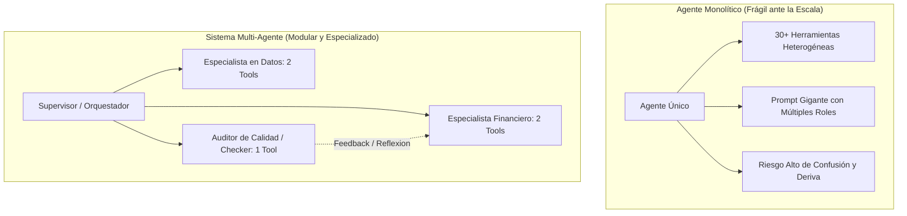
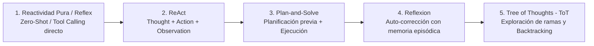
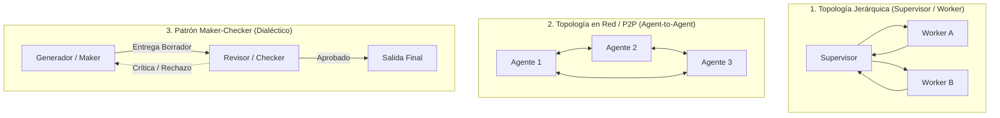
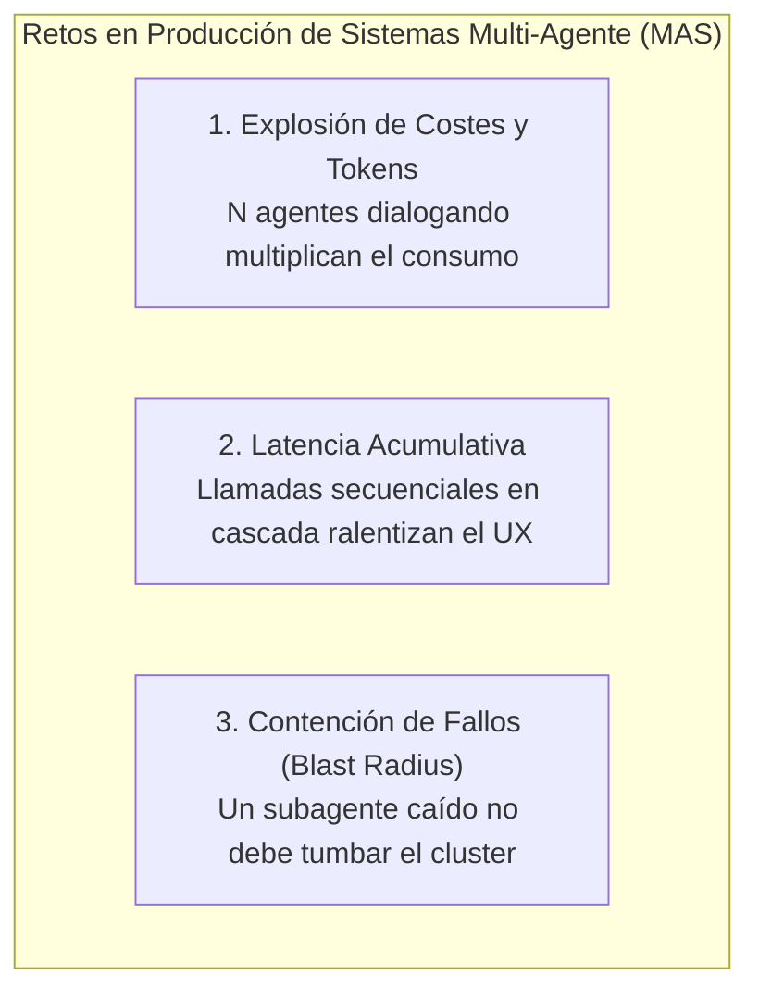

# Tutorial Técnico: Arquitecturas y Patrones de Planificación, Reactividad y Sistemas Multi-Agente (Capítulo 2)
**Serie:** Guía Práctica de Arquitectura y Desarrollo de Agentes de IA  
**Basado en:** *AI Agents: The Definitive Guide: Design, Deployment, and Evaluation for Production* (Capítulo 2) por Nicole Koenigstein (O\'Reilly Media)  
**Referencia O\'Reilly:** [Capítulo 2: Architectures and Patterns: Planning, Reactivity, and Multi-Agent Systems (0642572247775 / ch02.html)](https://learning.oreilly.com/library/view/ai-agents-the/0642572247775/ch02.html)  
**Enfoque:** Patrones de Razonamiento (ReAct, Plan-and-Solve, Reflexion, ToT), Topologías Multi-Agente y Taller Práctico en Python

---

## 1. Introducción: De Agentes Monolíticos a Sistemas Multi-Agente Distribuidos

En el Capítulo 1 aprendimos cómo gobernar el comportamiento de un agente individual mediante **Máquinas de Estados Finitos (FSM)**. Sin embargo, a medida que los problemas del mundo real crecen en complejidad, un **único agente monolítico** (un solo prompt, un solo conjunto masivo de herramientas y un solo rol) empieza a mostrar limitaciones críticas:
1. **Sobrecarga de Contexto y Confusión de Herramientas (*Tool Confusion*):** Si se le proporcionan 30 herramientas distintas a un único LLM, la probabilidad de que elija la herramienta equivocada o invente parámetros aumenta exponencialmente.
2. **Falta de Especialización de Rol:** Un modelo al que se le pide ser simultáneamente redactor creativo, auditor de seguridad, matemático estricto y programador tiende a degradar su precisión en todas esas áreas.
3. **Punto Único de Fallo Cognitivo:** Si el agente se equivoca en una premisa inicial, arrastra el error a lo largo de todo el proceso sin una entidad independiente que lo cuestione.

La solución de la ingeniería de software moderna consiste en transicionar hacia **Sistemas Multi-Agente (MAS - *Multi-Agent Systems*)**, donde múltiples agentes ligeros, hiper-especializados y con contextos aislados colaboran bajo patrones formales de orquestación.



---

## 2. El Espectro de Razonamiento: De la Reactividad Pura a la Planificación Deliberativa

Antes de coordinar múltiples agentes, debemos entender cómo razona un agente a nivel individual. La literatura técnica clasifica los patrones de razonamiento según su grado de **deliberación previa**:



### Comparativa de Patrones Individuales de Razonamiento
| Patrón | Mecanismo Central | Ventajas | Inconvenientes / Coste | Caso de Uso Ideal |
|---|---|---|---|---|
| **ReAct** (*Reason + Act*) | Intercala pasos de pensamiento verbal (`Thought`), ejecución de herramientas (`Action`) y lectura de resultados (`Observation`). | Muy dinámico y adaptable a sorpresas del entorno. | Puede perder el rumbo en tareas de muchos pasos (>10). | Búsqueda web, consultas interactivas a bases de datos. |
| **Plan-and-Solve** | El LLM descompone primero la meta en una lista estricta de pasos y luego los ejecuta uno a uno (con replanificación opcional). | Gran visión global; reduce llamadas innecesarias al modelo. | Si el entorno cambia drásticamente, el plan original queda obsoleto. | Generación de reportes estructurados, pipelines ETL. |
| **Reflexion** (*Self-Correction*) | El agente evalúa su propio resultado frente a una rúbrica y genera una "crítica verbal" que se inyecta en el prompt para auto-corregirse. | Reduce drásticamente las alucinaciones sin reentrenar pesos. | Consume tokens adicionales al repetir intentos fallidos. | Generación de código, redacción técnica con restricciones duras. |
| **Tree of Thoughts (ToT)** | Genera múltiples caminos alternativos (*thoughts*), evalúa su viabilidad heurística y permite retroceder (*backtracking*). | Máxima precisión en problemas combinatorios complejos. | Muy alta latencia y coste de inferencia elevado. | Planificación estratégica, optimización de rutas, diseño de algoritmos. |

---

## 3. Topologías y Patrones de Colaboración Multi-Agente (MAS)

Cuando varios agentes interactúan, la **topología de la red** define cómo fluye la información y quién tiene la autoridad para tomar decisiones:



### 1. Topología Jerárquica (*Supervisor-Worker Pattern*)
* **Funcionamiento:** Un agente **Supervisor** descompone el objetivo global, delega las subtareas en agentes trabajadores especializados (*Workers*), consolida las respuestas intermedias y sintetiza el resultado final.
* **Aplicación:** Ideal para flujos de trabajo empresariales estructurados donde se requiere control estricto del estado y gobernanza centralizada.

### 2. Topología Peer-to-Peer (*A2A - Network Pattern*)
* **Funcionamiento:** Los agentes cooperan como iguales en una red descentralizada, pasándose mensajes y artefactos según sus capacidades declaradas (utilizando protocolos abiertos como **A2A / MCP**).
* **Aplicación:** Entornos abiertos, negociación distribuida y resolución de problemas exploratorios.

### 3. Patrón Maker-Checker (*Generador vs. Revisor con Reflexión*)
* **Funcionamiento:** Un agente *Maker* genera una propuesta inicial y un agente *Checker* independiente (con un prompt estricto y criterios de auditoría) valida el entregable. Si encuentra discrepancias, emite una crítica que el *Maker* utiliza para refinar el trabajo.
* **Aplicación:** Tareas donde la precisión es innegociable (análisis financiero, generación de código crítico, auditoría legal).

---

## 4. Anatomía de la Comunicación Inter-Agente: Protocolos y Prevención del "Teléfono Roto"

En un sistema multi-agente, el mayor enemigo de la precisión es el **efecto del "teléfono roto" (*Information Degradation*)**. 

Al igual que en el juego infantil, si el **Agente A** resume un informe de 10 páginas, el **Agente B** resume el resumen de A para hacer un análisis, y el **Agente C** toma decisiones basándose en lo que le contó B, al final de la cadena se habrán perdido cifras críticas, matices técnicos y advertencias clave. Los LLMs realizan una compresión con pérdida (*lossy compression*) cada vez que parafrasean un texto extenso.

Por otro lado, la solución ingenua de *"enviar todo el historial completo a todos los agentes"* tampoco funciona: satura la ventana de contexto, dispara el coste de tokens y hace que los modelos ignoren instrucciones intermedias (*Lost in the Middle*).

Para resolver este dilema sin saturar el sistema ni perder precisión, la ingeniería de agentes utiliza dos estrategias complementarias:

```mermaid
graph TD
    subgraph "Problema: Teléfono Roto (Texto Libre)"
        A1[Agente 1: 10 Páginas] -->|Resume| A2[Agente 2: 1 Página]
        A2 -->|Resume el resumen| A3[Agente 3: 1 Párrafo]
        A3 --> LOSS[❌ Pérdida de Datos y Alucinación]
    end

    subgraph "Solución 1: Mensajes Tipados (JSON)"
        M1[Agente 1] -->|Formulario JSON Estricto<br/>{ingresos: 1.5M, ebitda: 550k}| M2[Agente 2]
        M2 --> OK1[✅ Datos inalterables y validados]
    end

    subgraph "Solución 2: Paso por Referencia (Artefactos)"
        R1[Agente 1: Genera balance.csv en Disco] -->|Pasa solo la ruta: file:///tmp/balance.csv| R2[Agente 2]
        R2 -->|Lee el archivo original| DISK[(Disco / Base de Datos / MCP)]
        DISK --> OK2[✅ Única Fuente de Verdad]
    end
```

---

### Estrategia 1: Paso de Mensajes Tipados (*Typed Messaging / A2A Protocols*)
* **¿En qué consiste?** En lugar de permitir que los agentes conversen en texto libre desestructurado (como en un chat informal), se les obliga a comunicarse mediante **estructuras formales con esquemas cerrados** (típicamente objetos JSON validados con esquemas como Pydantic o Zod).
* **¿Cómo evita la pérdida de información?**
  * El mensaje desglosa explícitamente quién habla (`sender`), a quién se dirige (`recipient`), qué acción solicita (`intent`) y los **datos duros** en campos numéricos y listas fijas (`payload_data`).
  * Al no transmitir la información como una narración en prosa, los números y hechos no son *"parafraseados"* ni deformados por el modelo: viajan intactos como variables de un formulario.
* **Analogía cotidiana:** Es la diferencia entre redactar una carta libre al banco explicando tus finanzas (donde se pueden olvidar datos) o rellenar un **formulario bancario normalizado** con casillas obligatorias para cada cifra.

---

### Estrategia 2: Paso por Referencia o Artefactos (*Artifact-Driven Collaboration*)
* **¿En qué consiste?** Aplica el principio fundamental de la programación clásica: **"Pasa un puntero o dirección, no el contenido entero en memoria"**. Cuando un agente produce un conjunto grande de datos (un archivo de código, un documento Markdown, una tabla de 10.000 filas o un log del sistema), **no vuelca ese texto gigante en el mensaje**. En su lugar, lo guarda en un almacenamiento compartido persistente (el disco local, una base de datos o un servidor MCP) y únicamente le pasa al siguiente agente el **identificador o ruta del archivo** (ej. `file:///tmp/informe_q3.md` o `db://metrics/balance_q3`).
* **¿Cómo evita la pérdida de información?**
  * Se establece una **"Única Fuente de Verdad" (*Single Source of Truth*)**. El segundo agente acude directamente a leer el archivo original en disco o consulta la base de datos sin depender de ningún intermediario que le resuma el contenido.
  * El diálogo entre agentes permanece ultraligero (apenas unos pocos tokens para pasarse la ruta y la instrucción), reduciendo la latencia y los costes casi a cero.
* **Analogía cotidiana:** En lugar de imprimir un manual de 500 páginas y fotocopiarlo para cada compañero de trabajo, le envías un **enlace compartido de Google Drive o GitHub** para que todos lean exactamente el mismo archivo original.

---

### Resumen Comparativo de Estrategias

| Estrategia | Mecanismo Central | ¿Por qué protege la información? | Impacto en Tokens y Coste |
|---|---|---|---|
| **Mensajes Tipados** | Estructuras JSON con validación de campos obligatorios. | Los datos clave viajan como valores fijos inalterables, no como texto parafraseado. | **Bajo:** Solo se envían los campos estrictamente necesarios para la tarea. |
| **Paso por Referencia** | Guardar artefactos en disco/BBDD y compartir la ruta (URI). | Todos los agentes consultan el documento original completo sin resúmenes intermedios. | **Mínimo:** El diálogo A2A solo transporta identificadores y metadatos. |

---

## 5. Taller Práctico: Construcción y Ejecución de una Aplicación Multi-Agente en Python

Vamos a llevar a cabo un **taller práctico desarrollando una aplicación** que nos muestra esta comunicación multi-agente en acción, como plasmación directa de los conceptos teóricos, patrones de razonamiento y topologías de colaboración que hemos analizado.

> 💡 **Archivo de Código Ejecutable:** Puedes abrir y ejecutar directamente este script en [`multiagent_patterns_capitulo_02.py`](file:///Volumes/MisAppsV/SearchMCP/tutorial_ai_agents/multiagent_patterns_capitulo_02.py) en tu editor.

---

### 5.1. El Escenario del Taller y los Roles del Sistema

Imaginemos un caso de uso corporativo habitual: la dirección solicita generar un **Informe Financiero Ejecutivo para el Q3**. 

Para resolverlo de forma robusta y sin alucinaciones, implementamos una arquitectura multi-agente distribuida con tres entidades diferenciadas:

1. 👑 **Supervisor-Central (`HierarchicalOrchestrator`):** Aplica la *Topología Jerárquica* (§3.1). Recibe la meta del usuario, emite directivas a los trabajadores y gobierna el ciclo de vida general.
2. 🔬 **Analista-Financiero-01 (`ResearchWorkerAgent`):** Aplica el *Patrón ReAct* (§2.1). Desglosa la tarea en Pensamiento (`Thought`), Acción con herramientas (`Action`) y Observación de resultados (`Observation`).
3. ⚖️ **Auditor-Calidad-01 (`QualityReviewerAgent`):** Aplica el *Patrón Maker-Checker* (§3.3) y *Reflexion* (§2.3). Examina el entregable contra criterios objetivos de completitud y emite retroalimentación formativa si detecta omisiones.
4. 📨 **Canal de Mensajería A2A (`AgentMessage`):** Aplica el *Paso de Mensajes Tipados* (§4), transportando la información estructurada con marcas de tiempo y roles de emisor/receptor.

---

### 5.2. Código Fuente Completo y Comentado del Taller

```python
"""
================================================================================
TALLER PRÁCTICO: SISTEMA MULTI-AGENTE JERÁRQUICO CON ReAct Y REFLEXION
================================================================================
Basado en: AI Agents: The Definitive Guide (Capítulo 2) - Nicole Koenigstein
"""

import time
import sys
from enum import Enum, auto
from typing import Dict, Any, Optional, List


# ==============================================================================
# ESTILOS Y COLORES PARA VISUALIZACIÓN EN PANTALLA (ANSI ESCAPE CODES)
# ==============================================================================
class TermColor:
    RESET = "\033[0m"
    BOLD = "\033[1m"
    SUPERVISOR = "\033[1;35m"  # Magenta brillante
    RESEARCHER = "\033[1;36m"  # Cian brillante
    REVIEWER = "\033[1;33m"    # Amarillo brillante
    BUS = "\033[1;32m"         # Verde brillante (Canal A2A)
    ERROR = "\033[1;31m"       # Rojo brillante
    BOX = "\033[0;37m"         # Gris claro


# ==============================================================================
# [PASO 1] MODELADO DE MENSAJES, ESTADOS Y ROLES INTER-AGENTE (A2A PROTOCOL)
# ==============================================================================
# Definimos el protocolo de comunicación tipado para evitar la ambigüedad.

class AgentRole(Enum):
    SUPERVISOR = ("Supervisor/Orquestador", TermColor.SUPERVISOR, "👑")
    RESEARCHER = ("Especialista/Investigador", TermColor.RESEARCHER, "🔬")
    REVIEWER = ("Revisor/Auditor de Calidad", TermColor.REVIEWER, "⚖️")

    def __init__(self, label: str, color: str, icon: str):
        self.label = label
        self.color = color
        self.icon = icon


class TaskStatus(Enum):
    PENDING = auto()
    IN_PROGRESS = auto()
    NEEDS_REVISION = auto()
    APPROVED = auto()
    FAILED = auto()


class AgentMessage:
    """Mensaje estructurado que viaja por el canal de comunicación A2A."""
    def __init__(self, sender: AgentRole, recipient: AgentRole, content: str, metadata: Optional[Dict[str, Any]] = None):
        self.timestamp = time.strftime("%H:%M:%S")
        self.sender = sender
        self.recipient = recipient
        self.content = content
        self.metadata = metadata or {}

    def format_box(self) -> str:
        s_col = self.sender.color
        r_col = self.recipient.color
        b_col = TermColor.BUS
        rst = TermColor.RESET
        
        header = f"{b_col}📨 [CANAL A2A @ {self.timestamp}]{rst} {s_col}{self.sender.icon} {self.sender.label}{rst} ➔ {r_col}{self.recipient.icon} {self.recipient.label}{rst}"
        lines = self.content.split("\n")
        formatted_content = "\n".join([f"    │ {line}" for line in lines])
        return f"{header}\n{formatted_content}"


# ==============================================================================
# [PASO 2] CLASE BASE PARA AGENTES ESPECIALIZADOS
# ==============================================================================
class BaseAgent:
    """Clase base que dota a cada agente de identidad, rol y buzón de mensajes."""
    def __init__(self, role: AgentRole, name: str):
        self.role = role
        self.name = name
        self.inbox: List[AgentMessage] = []
        self.outbox: List[AgentMessage] = []

    def log(self, text: str, delay: float = 0.2) -> None:
        col = self.role.color
        rst = TermColor.RESET
        print(f"  {self.role.icon} {col}[{self.name} - {self.role.label}]:{rst} {text}")
        if delay > 0:
            time.sleep(delay)


# ==============================================================================
# [PASO 3] AGENTE ESPECIALISTA (WORKER) CON PATRÓN ReAct (Reason + Act)
# ==============================================================================
class ResearchWorkerAgent(BaseAgent):
    def __init__(self, name: str = "Analista-Financiero-01"):
        super().__init__(AgentRole.RESEARCHER, name)
        self.iteration_count = 0

    def execute_task(self, task_description: str, critique_feedback: Optional[str] = None, perfect_mode: bool = False) -> Dict[str, Any]:
        self.iteration_count += 1
        self.log(f"Iniciando ciclo de trabajo ReAct (Iteración #{self.iteration_count})...")

        # 1. Fase ReAct: Pensamiento (Thought)
        if critique_feedback:
            self.log(f"🧠 {TermColor.BOLD}[Thought - Reflexion]:{TermColor.RESET} Crítica recibida del auditor: \"{critique_feedback}\". Re-analizando métricas...")
        else:
            self.log(f"🧠 {TermColor.BOLD}[Thought - ReAct]:{TermColor.RESET} Desglosando requerimientos de la tarea: \"{task_description}\"...")

        # 2. Fase ReAct: Acción (Action / Invocación de herramientas simuladas)
        if perfect_mode or self.iteration_count > 1:
            self.log("⚡ [Action - Tool]: Invocando herramienta calculate_advanced_metrics con desglose de EBITDA y márgenes...")
            draft = (
                "Informe Financiero Q3 (Auditado y Corregido):\n"
                "• Ingresos Totales:    $1,500,000.00 USD\n"
                "• Gastos Operativos:   $950,000.00 USD\n"
                "• EBITDA Operativo:    $550,000.00 USD\n"
                "• Margen Operativo:    36.67%\n"
                "• Dictamen:            Rendimiento sólido; ratio de eficiencia superior al objetivo (>35%)."
            )
        else:
            self.log("⚡ [Action - Tool]: Invocando herramienta fetch_raw_balance (Borrador inicial básico)...")
            draft = (
                "Borrador Financiero Preliminar Q3:\n"
                "• Ingresos Totales:    $1,500,000.00 USD\n"
                "• Gastos Operativos:   $950,000.00 USD\n"
                "• Dictamen:            La empresa presenta beneficios positivos."
            )

        # 3. Fase ReAct: Observación (Observation)
        self.log("📋 [Observation]: Datos recolectados y borrador sintetizado listo para auditoría.")
        return {
            "draft": draft,
            "iteration": self.iteration_count
        }


# ==============================================================================
# [PASO 4] AGENTE REVISOR / CRÍTICO (CHECKER) CON PATRÓN REFLEXION
# ==============================================================================
class QualityReviewerAgent(BaseAgent):
    def __init__(self, name: str = "Auditor-Calidad-01"):
        super().__init__(AgentRole.REVIEWER, name)

    def evaluate_draft(self, draft_content: str) -> Dict[str, Any]:
        self.log("Iniciando auditoría de calidad: Verificando criterios de completitud técnica...")

        # Criterios de Aceptación: Debe contener EBITDA y Margen porcentual explícito
        has_ebitda = "EBITDA" in draft_content
        has_margin = "Margen" in draft_content or "%" in draft_content

        if has_ebitda and has_margin:
            self.log(f"✅ {TermColor.BOLD}[Dictamen: APROBADO]{TermColor.RESET} Cumple todos los estándares contables y de reporte.", delay=0.3)
            return {
                "approved": True,
                "feedback": "Aprobado sin objeciones. Incluye métricas clave (EBITDA) y margen operativo explícito."
            }
        else:
            self.log(f"⚠️ {TermColor.BOLD}[Dictamen: RECHAZADO]{TermColor.RESET} Faltan métricas esenciales requeridas por la directiva.", delay=0.3)
            return {
                "approved": False,
                "feedback": "El informe omite el cálculo explícito del EBITDA y el porcentaje del margen operativo sobre ingresos."
            }


# ==============================================================================
# [PASO 5] ORQUESTADOR SUPERVISOR (HIERARCHICAL MANAGER)
# ==============================================================================
class HierarchicalOrchestrator(BaseAgent):
    def __init__(self, worker: ResearchWorkerAgent, reviewer: QualityReviewerAgent, max_cycles: int = 3):
        super().__init__(AgentRole.SUPERVISOR, "Supervisor-Central")
        self.worker = worker
        self.reviewer = reviewer
        self.max_cycles = max_cycles
        self.audit_trail: List[AgentMessage] = []

    def dispatch(self, message: AgentMessage) -> None:
        self.audit_trail.append(message)
        print(f"\n{message.format_box()}\n")
        time.sleep(0.4)

    def coordinate(self, global_goal: str, force_perfect: bool = False) -> Dict[str, Any]:
        banner = "=" * 80
        self.log(f"\n{TermColor.BOLD}{banner}\n🎯 OBJETIVO GLOBAL: \"{global_goal}\"\n{banner}{TermColor.RESET}", delay=0.2)

        current_feedback: Optional[str] = None
        final_deliverable: Optional[str] = None
        status = TaskStatus.IN_PROGRESS

        for cycle in range(1, self.max_cycles + 1):
            print(f"{TermColor.BOLD}━━━━━━━━━━━━━━━━━━━━━━━━━━━━━━━━━━━━━━━━━━━━━━━━━━━━━━━━━━━━━━━━━━━━━━━━━━━━━━{TermColor.RESET}")
            print(f"{TermColor.BOLD}🔄 CICLO MULTI-AGENTE #{cycle} DE {self.max_cycles}{TermColor.RESET}")
            print(f"{TermColor.BOLD}━━━━━━━━━━━━━━━━━━━━━━━━━━━━━━━━━━━━━━━━━━━━━━━━━━━━━━━━━━━━━━━━━━━━━━━━━━━━━━{TermColor.RESET}")
            
            # 1. Supervisor envía directiva al Especialista
            task_msg = f"Generar informe para: {global_goal}" if cycle == 1 else f"Subsanar borrador aplicando feedback: {current_feedback}"
            self.dispatch(AgentMessage(
                sender=self.role,
                recipient=self.worker.role,
                content=task_msg
            ))

            # 2. Especialista genera o refina el entregable mediante ReAct
            worker_output = self.worker.execute_task(global_goal, current_feedback, perfect_mode=force_perfect)
            draft = worker_output["draft"]

            self.dispatch(AgentMessage(
                sender=self.worker.role,
                recipient=self.reviewer.role,
                content=f"Entrega de Borrador (Iteración #{cycle}):\n{draft}"
            ))

            # 3. Revisor audita el borrador
            review_result = self.reviewer.evaluate_draft(draft)
            
            # 4. Supervisor procesa el dictamen
            if review_result["approved"]:
                self.log(f"🎉 {TermColor.BOLD}ENTREGABLE VALIDADO SATISFACTORIAMENTE POR EL AUDITOR.{TermColor.RESET}")
                final_deliverable = draft
                status = TaskStatus.APPROVED
                
                self.dispatch(AgentMessage(
                    sender=self.reviewer.role,
                    recipient=self.role,
                    content=f"Aprobación formal de calidad: {review_result[feedback]}"
                ))
                break
            else:
                self.log(f"🔁 {TermColor.BOLD}RECHAZO TEMPORAL: Disparando ciclo de Reflexión y Re-trabajo...{TermColor.RESET}")
                current_feedback = review_result["feedback"]
                status = TaskStatus.NEEDS_REVISION
                
                self.dispatch(AgentMessage(
                    sender=self.reviewer.role,
                    recipient=self.role,
                    content=f"Rechazo con crítica formativa: {current_feedback}"
                ))

        if status != TaskStatus.APPROVED:
            self.log(f"❌ {TermColor.ERROR}Límite de ciclos alcanzado sin alcanzar el estándar.{TermColor.RESET}")
            status = TaskStatus.FAILED

        return {
            "status": status.name,
            "cycles_completed": cycle,
            "final_deliverable": final_deliverable,
            "total_messages": len(self.audit_trail)
        }


# ==============================================================================
# [PASO 6] PUNTO DE ENTRADA Y DEMOSTRACIÓN DEL SISTEMA MULTI-AGENTE
# ==============================================================================
def main():
    print(f"\n{TermColor.BOLD}{= * 80}")
    print("DEMOSTRACIÓN INTERACTIVA: SISTEMA MULTI-AGENTE JERÁRQUICO (CAPÍTULO 2)")
    print(f"{= * 80}{TermColor.RESET}")

    worker = ResearchWorkerAgent(name="Analista-Financiero-01")
    reviewer = QualityReviewerAgent(name="Auditor-Calidad-01")
    supervisor = HierarchicalOrchestrator(worker=worker, reviewer=reviewer, max_cycles=3)

    meta = "Generar informe financiero ejecutivo consolidado para el Q3"
    resultado = supervisor.coordinate(meta)

    print(f"\n{TermColor.BOLD}{= * 80}")
    print("📊 BALANCE FINAL DEL SISTEMA MULTI-AGENTE")
    print(f"{= * 80}{TermColor.RESET}")
    print(f"• Estado Final:           {TermColor.BOLD}{resultado[status]}{TermColor.RESET}")
    print(f"• Ciclos de Coordinación: {resultado[cycles_completed]}")
    print(f"• Mensajes A2A Emitidos:  {resultado[total_messages]}")
    print(f"\n{TermColor.BOLD}📄 DOCUMENTO FINAL APROBADO EN PRODUCCIÓN:{TermColor.RESET}")
    print(f"{resultado[final_deliverable]}")
    print(f"{TermColor.BOLD}{= * 80}\n{TermColor.RESET}")


if __name__ == "__main__":
    main()
```

---

### 5.3. Crónica de Ejecución: Conectando la Consola, el Código y la Teoría

Al ejecutar el script en tu terminal (`python3 multiagent_patterns_capitulo_02.py`), la pantalla cobra vida mostrando la interacción coordinada entre los tres agentes. 

A continuación realizamos un recorrido narrativo que conecta **lo que ves en la consola**, **la línea de código que lo provoca** y **el concepto teórico del capítulo** que se está aplicando:

```
================================================================================
🎯 OBJETIVO GLOBAL: "Generar informe financiero ejecutivo consolidado para el Q3"
================================================================================
━━━━━━━━━━━━━━━━━━━━━━━━━━━━━━━━━━━━━━━━━━━━━━━━━━━━━━━━━━━━━━━━━━━━━━━━━━━━━━
🔄 CICLO MULTI-AGENTE #1 DE 3
━━━━━━━━━━━━━━━━━━━━━━━━━━━━━━━━━━━━━━━━━━━━━━━━━━━━━━━━━━━━━━━━━━━━━━━━━━━━━━
```

#### 📍 Fase 1: El Despacho Jerárquico y el Razonamiento ReAct
* **En la Pantalla:** Vemos aparecer la caja verde del bus de comunicación:
  ```text
  📨 [CANAL A2A @ 00:50:29] 👑 Supervisor/Orquestador ➔ 🔬 Especialista/Investigador
      │ Generar informe para: Generar informe financiero ejecutivo consolidado para el Q3
  ```
* **En el Código:** Corresponde a la llamada `self.dispatch(...)` en el método `coordinate()` del `HierarchicalOrchestrator` (`[PASO 5]`).
* **En la Teoría:** Se materializa la **Topología Jerárquica (§3.1)**. El supervisor asume la responsabilidad de descomponer el objetivo del negocio y emitir una orden formal a un agente subordinado especializado.

A continuación, el especialista toma el control y desglosa su trabajo en tres momentos:
```text
  🔬 [Analista-Financiero-01 - Especialista]: Iniciando ciclo de trabajo ReAct (Iteración #1)...
  🔬 [Analista-Financiero-01 - Especialista]: 🧠 [Thought - ReAct]: Desglosando requerimientos de la tarea...
  🔬 [Analista-Financiero-01 - Especialista]: ⚡ [Action - Tool]: Invocando herramienta fetch_raw_balance...
  🔬 [Analista-Financiero-01 - Especialista]: 📋 [Observation]: Datos recolectados y borrador sintetizado listo.
```
* **En el Código:** Corresponde a `ResearchWorkerAgent.execute_task()` (`[PASO 3]`).
* **En la Teoría:** Es la ejecución canónica del patrón **ReAct (§2.1)**. El agente no improvisa una respuesta directa (como haría un chatbot *zero-shot*), sino que primero verbaliza su razonamiento (`Thought`), ejecuta una llamada determinista a la herramienta (`Action`) y sintetiza los datos observados (`Observation`).

---

#### 📍 Fase 2: El Filtro de Calidad y el Rechazo Objetivo (Maker-Checker)
El especialista emite su primer borrador hacia el auditor de calidad:
```text
📨 [CANAL A2A @ 00:50:31] 🔬 Especialista/Investigador ➔ ⚖️ Revisor/Auditor de Calidad
    │ Entrega de Borrador (Iteración #1):
    │ • Ingresos Totales:    $1,500,000.00 USD
    │ • Gastos Operativos:   $950,000.00 USD
    │ • Dictamen:            La empresa presenta beneficios positivos.
```
En este punto, el borrador contiene datos ciertos pero es superficial (no calcula el margen operativo ni el EBITDA). El auditor entra en acción:
```text
  ⚖️ [Auditor-Calidad-01 - Revisor]: Iniciando auditoría de calidad: Verificando criterios de completitud...
  ⚖️ [Auditor-Calidad-01 - Revisor]: ⚠️ [Dictamen: RECHAZADO] Faltan métricas esenciales requeridas.
  👑 [Supervisor-Central - Supervisor]: 🔁 RECHAZO TEMPORAL: Disparando ciclo de Reflexión y Re-trabajo...

📨 [CANAL A2A @ 00:50:32] ⚖️ Revisor/Auditor de Calidad ➔ 👑 Supervisor/Orquestador
    │ Rechazo con crítica formativa: El informe omite el cálculo explícito del EBITDA y margen %.
```
* **En el Código:** Corresponde a `QualityReviewerAgent.evaluate_draft()` (`[PASO 4]`).
* **En la Teoría:** Aquí opera el **Patrón Maker-Checker (§3.3)**. Si hubiéramos dejado que el propio especialista evaluara su trabajo, habría sufrido de *sesgo de confirmación* y dado el borrador por bueno. Un agente auditor independiente, dotado de una rúbrica de evaluación estricta, detecta la carencia y emite una crítica estructurada sin que el sistema colapse.

---

#### 📍 Fase 3: La Magia de Reflexion y la Auto-Corrección en Vivo (Ciclo 2)
El supervisor recibe la objeción del auditor y, en lugar de abortar o pedir ayuda al usuario, reenvía la crítica al especialista:

```text
━━━━━━━━━━━━━━━━━━━━━━━━━━━━━━━━━━━━━━━━━━━━━━━━━━━━━━━━━━━━━━━━━━━━━━━━━━━━━━
🔄 CICLO MULTI-AGENTE #2 DE 3
━━━━━━━━━━━━━━━━━━━━━━━━━━━━━━━━━━━━━━━━━━━━━━━━━━━━━━━━━━━━━━━━━━━━━━━━━━━━━━

📨 [CANAL A2A @ 00:50:32] 👑 Supervisor/Orquestador ➔ 🔬 Especialista/Investigador
    │ Subsanar borrador aplicando feedback: El informe omite el cálculo explícito del EBITDA y margen %.

  🔬 [Analista-Financiero-01 - Especialista]: 🧠 [Thought - Reflexion]: Crítica recibida del auditor: "El informe omite el cálculo explícito del EBITDA y el porcentaje del margen operativo sobre ingresos.". Re-analizando métricas...
  🔬 [Analista-Financiero-01 - Especialista]: ⚡ [Action - Tool]: Invocando calculate_advanced_metrics con EBITDA y márgenes...
  🔬 [Analista-Financiero-01 - Especialista]: 📋 [Observation]: Datos recolectados y borrador sintetizado listo.
```
* **En el Código:** En `ResearchWorkerAgent.execute_task()`, la condición `if critique_feedback:` captura la crítica del ciclo anterior y modifica la ruta de ejecución, llamando a la herramienta analítica avanzada.
* **En la Teoría:** Este es el núcleo del patrón **Reflexion (§2.3)**. La crítica verbal recibida se convierte en memoria episódica a corto plazo. El modelo comprende por qué falló su intento anterior y altera su comportamiento dinámicamente, logrando un aprendizaje en tiempo de ejecución sin necesidad de modificar el código ni reentrenar el modelo.

---

#### 📍 Fase 4: Validación Final y Balance de Producción
El nuevo borrador corregido se envía de nuevo al auditor:
```text
📨 [CANAL A2A @ 00:50:33] 🔬 Especialista/Investigador ➔ ⚖️ Revisor/Auditor de Calidad
    │ Entrega de Borrador (Iteración #2):
    │ Informe Financiero Q3 (Auditado y Corregido):
    │ • Ingresos Totales:    $1,500,000.00 USD
    │ • Gastos Operativos:   $950,000.00 USD
    │ • EBITDA Operativo:    $550,000.00 USD
    │ • Margen Operativo:    36.67%
    │ • Dictamen:            Rendimiento sólido; ratio de eficiencia superior al objetivo (>35%).

  ⚖️ [Auditor-Calidad-01 - Revisor]: ✅ [Dictamen: APROBADO] Cumple todos los estándares contables y de reporte.
  👑 [Supervisor-Central - Supervisor]: 🎉 ENTREGABLE VALIDADO SATISFACTORIAMENTE POR EL AUDITOR.
```
El auditor comprueba que las métricas requeridas están presentes, emite el `APROBADO` y el supervisor finaliza el bucle:
```text
================================================================================
📊 BALANCE FINAL DEL SISTEMA MULTI-AGENTE
================================================================================
• Estado Final:           APPROVED
• Ciclos de Coordinación: 2
• Mensajes A2A Emitidos:  6

📄 DOCUMENTO FINAL APROBADO EN PRODUCCIÓN:
Informe Financiero Q3 (Auditado y Corregido):
• Ingresos Totales:    $1,500,000.00 USD
• Gastos Operativos:   $950,000.00 USD
• EBITDA Operativo:    $550,000.00 USD
• Margen Operativo:    36.67%
• Dictamen:            Rendimiento sólido; ratio de eficiencia superior al objetivo (>35%).
================================================================================
```
* **En el Código:** El supervisor rompe el bucle con `break` y emite el informe consolidado.
* **En la Teoría:** Se demuestra la **resiliencia y determinismo** de los sistemas multi-agente bien diseñados. En solo 2 ciclos y 6 intercambios A2A, el sistema transformó una solicitud genérica en un informe riguroso, auditado y validado sin intervención humana.

---

## 6. Desafíos de Ingeniería en Producción para Sistemas Multi-Agente

Construir sistemas multi-agente en entornos de producción exige resolver tres problemas críticos:



### 1. Gestión de Costes y Presupuesto de Tokens (*Token Budgets*)
* En arquitecturas MAS, el número de llamadas a LLMs escala lineal o cuadráticamente con el número de agentes e iteraciones.
* **Buena práctica:** Asignar un presupuesto máximo de tokens por tarea y utilizar modelos más pequeños y rápidos (ej. modelos compactos/Flash) para los roles de evaluación intermedia y extracción de datos, reservando modelos más pesados únicamente para la síntesis final o el supervisor.

### 2. Aislamiento del Radio de Explosión (*Blast Radius Containment*)
* Si un agente especialista falla debido a un timeout en una API externa, el supervisor debe atrapar el error y tener una estrategia de fallback (degradación elegante, invocar a un especialista alternativo o solicitar clarificación).

### 3. Observabilidad y Trazabilidad Centralizada
* En sistemas distribuidos, depurar una respuesta incorrecta requiere registrar la traza completa de mensajes A2A (*Span Tracing*), identificando exactamente en qué agente o paso se introdujo la alucinación.

---

## 7. Conclusiones y Próximos Pasos (Hacia el Capítulo 3)

El **Capítulo 2** de *AI Agents: The Definitive Guide* demuestra que la inteligencia en sistemas agénticos avanzados no reside únicamente en la capacidad del modelo base, sino en la **arquitectura de colaboración y los patrones de retroalimentación**:
* Patrones como **ReAct** y **Reflexion** permiten a los agentes resolver problemas complejos mediante ensayo, observación y auto-corrección.
* Las **topologías jerárquicas y dialécticas (Maker-Checker)** erradican los sesgos y elevan la calidad del entregable final a niveles de producción.
* La comunicación estructurada mediante **mensajes tipados y contratos de interfaz** es el pilar para construir agentes interoperables y seguros.

> **Próximo Capítulo (Capítulo 3):**  
> *Advanced Paradigms: Scalable Reasoning, Long-Term Memory, and Evaluation Frameworks* — Donde exploraremos arquitecturas de memoria persistente, técnicas avanzadas de razonamiento escalado y metodologías de evaluación cuantitativa para agentes en producción.
