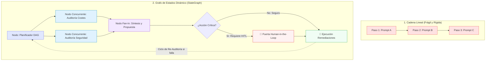
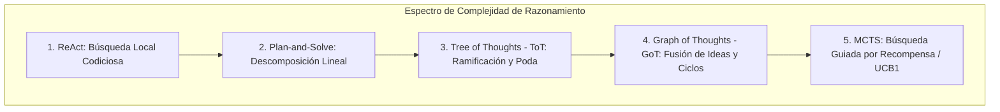
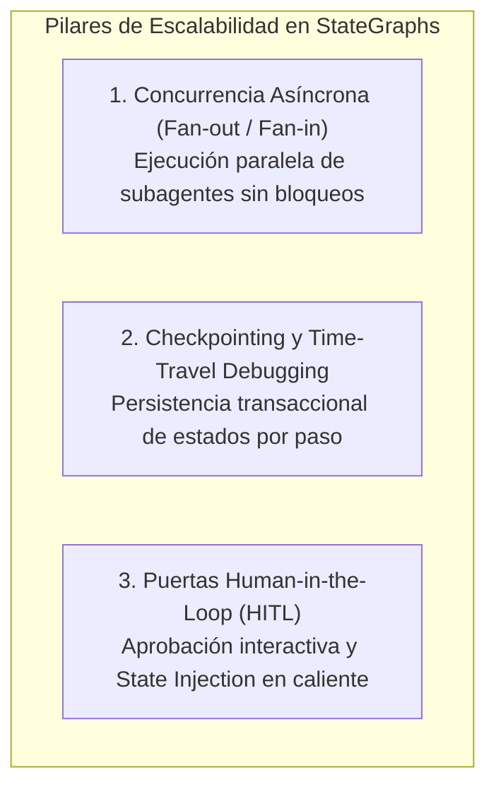

# Tutorial Técnico: Planificación Avanzada, Grafos de Estado y Ejecución Escalable (Capítulo 3)
**Serie:** Guía Práctica de Arquitectura y Desarrollo de Agentes de IA  
**Basado en:** *AI Agents: The Definitive Guide: Design, Deployment, and Evaluation for Production* (Capítulo 3) por Nicole Koenigstein (O\'Reilly Media)  
**Referencia O\'Reilly:** [Capítulo 3: Advanced Planning, Reasoning, and Scalable Execution in Agents (0642572247775 / ch03.html)](https://learning.oreilly.com/library/view/ai-agents-the/0642572247775/ch03.html)  
**Enfoque:** Grafos de Estado (StateGraphs), Planificación Dinámica en DAG, Razonamiento en Árbol/Grafo (ToT / GoT), Checkpointing (Time-Travel) y Control Human-in-the-Loop (HITL)

---

## 1. Introducción: De Flujos Lineales a Grafos de Estado Dinámicos (*StateGraphs*)

En los capítulos anteriores sentamos las bases deterministas de los agentes mediante **Máquinas de Estados Finitos (FSM - Capítulo 1)** y exploramos la colaboración modular entre roles especializados (**Sistemas Multi-Agente - Capítulo 2**). 

Sin embargo, a medida que los agentes se despliegan en infraestructuras de misión crítica (operaciones en la nube, pipelines analíticos complejos, transacciones financieras automatizadas o desarrollo de software autónomo), surge una nueva limitación de ingeniería:

> **El problema de la rigidez secuencial:** Ni las cadenas de prompts lineales (*Pipelines*) ni las FSMs puramente deterministas son capaces de gestionar simultáneamente **bifurcaciones concurrentes**, **ciclos de refinamiento condicional**, **puntos de interrupción humana (*Human-in-the-Loop*)** y **persistencia transaccional con posibilidad de rebobinado en el tiempo (*Time-Travel*)**.

Para superar este cuello de botella, el **Capítulo 3** de *AI Agents: The Definitive Guide* introduce el paradigma supremo de la orquestación moderna: **los Grafos de Estado (*State Graphs*) y la Planificación Dinámica**.



---

## 2. Anatomía y Arquitectura de un *StateGraph*

Un **Grafo de Estados (*StateGraph*)** es una estructura matemática dirigida donde:
1. **Nodos (*Nodes*):** Representan funciones puras o subagentes que reciben el estado actual, realizan inferencia o invocan herramientas, y devuelven un conjunto de actualizaciones.
2. **Aristas Deterministas (*Edges*):** Conectan un nodo de origen con un nodo de destino de forma fija.
3. **Aristas Condicionales (*Conditional Edges / Routing*):** Evalúan funciones de guarda (*Guard Functions*) sobre el estado del sistema para decidir dinámicamente hacia qué nodo transicionar.
4. **Estado Central Tipado (*State Schema*):** Un esquema estructurado e inmutable que actúa como la "Única Fuente de Verdad" (*Single Source of Truth*).
5. **Reductor de Estado (*State Reducer*):** Una función determinista que fusiona de forma segura los resultados emitidos por múltiples nodos concurrentes, previniendo condiciones de carrera (*Race Conditions*).

```mermaid
graph LR
    subgraph "Ciclo de Vida de una Transición en StateGraph"
        S_IN[(Estado Actual S_t)] --> N[Nodo de Procesamiento: Inferencia + Tools]
        N --> U[Diccionario de Actualización ΔS]
        U --> RED[Reductor de Estado (State Reducer)]
        S_IN --> RED
        RED --> S_OUT[(Nuevo Estado S_t+1)]
        S_OUT --> CHK[(Almacén de Checkpoints)]
        S_OUT --> EDGE{Arista Condicional}
        EDGE -->|Condición A| NA[Nodo Destino A]
        EDGE -->|Condición B| NB[Nodo Destino B]
    end
```

---

## 3. Paradigmas Avanzados de Razonamiento y Búsqueda: Más Allá de ReAct

En el Capítulo 2 exploramos patrones individuales como **ReAct** (*Reason + Act*) y **Plan-and-Solve**. Sin embargo, en problemas de alta complejidad combinatoria (ej. refactorización de bases de código masivas, optimización logística, demostración formal o generación de fármacos), los agentes necesitan explorar **árboles y grafos de razonamiento con retroceso (*backtracking*)**:



### 3.1. Tree of Thoughts (ToT) y Graph of Thoughts (GoT)
* **Tree of Thoughts (ToT):** Permite al modelo generar múltiples pensamientos alternativos en cada paso, evaluarlos mediante una función heurística de valor (*Self-Evaluation / Scoring*) y retroceder (*Backtrack*) si una rama no conduce a la meta.
* **Graph of Thoughts (GoT):** Generaliza el árbol permitiendo **fusión de pensamientos (*Thought Aggregation*)**: dos ramas independientes que investigaron aspectos complementarios pueden converger en un único nodo sintetizador.

### Tabla Comparativa de Paradigmas de Razonamiento en Producción

| Paradigma | Estructura de Control | Mecanismo de Exploración | Backtracking | Consumo de Tokens | Caso de Uso Ideal en Producción |
|---|---|---|---|---|---|
| **ReAct** | Secuencial interactivo | Paso a paso inmediato (*Greedy*) | No | Bajo | Búsqueda web simple, consultas SQL directas. |
| **Plan-and-Solve** | Lista lineal fija | Planificación previa global | Parcial (replan) | Medio | Informes estructurados, pipelines ETL. |
| **Tree of Thoughts (ToT)** | Árbol jerárquico | Búsqueda en anchura (BFS) / profundidad (DFS) | **Sí** | Alto | Optimización combinatoria, depuración de bugs esquivos. |
| **Graph of Thoughts (GoT)** | Grafo dirigido arbitrario | Fusión multidireccional de premisas | **Sí** | Muy Alto | Modelado de arquitecturas, análisis estratégico multinivel. |
| **MCTS (Monte Carlo Tree Search)** | Árbol con simulaciones | Selección UCB1 + Rollout + Backprop | **Sí** | Extremo | Descubrimiento científico, diseño de circuitos y código formal. |

---

## 4. Escalabilidad Operativa: Concurrencia, Checkpoints y Control Human-in-the-Loop (HITL)

Para que un grafo de agentes pueda operar de forma confiable en un clúster de producción, debe implementar tres pilares de resiliencia:



### 4.1. Concurrencia Asíncrona (*Fan-Out / Fan-In*)
* **Fan-Out:** Cuando un objetivo requiere análisis independientes (ej. auditar costes y auditar vulnerabilidades de seguridad), el grafo bifurca la ejecución lanzando múltiples nodos en paralelo.
* **Fan-In:** Un nodo de síntesis aguarda a que todas las ramas paralelas terminen, y el *State Reducer* fusiona las salidas en el estado central antes de continuar.

### 4.2. Puntos de Control (*Checkpoints*) y Depuración *Time-Travel*
* Cada vez que un nodo completa su ejecución, el motor serializa una instantánea completa del estado (`AgentState`) en un almacén persistente (Redis, PostgreSQL o SQLite).
* **Time-Travel Debugging:** Si un agente comete un error en el paso 10, los ingenieros pueden **cargar el Checkpoint del paso 7**, modificar una instrucción o parámetro en caliente (*State Injection*), y reanudar la ejecución desde ese punto sin incurrir en el coste de volver a ejecutar los pasos 1 a 6.

### 4.3. Puertas *Human-in-the-Loop* (HITL)
* **¿Por qué es indispensable?** En producción, los agentes no deben ejecutar acciones destructivas (ej. eliminar bases de datos, revocar certificados o realizar transferencias de dinero) sin supervisión humana directa.
* **Mecanismo:** El grafo evalúa una arista condicional. Si la acción propuesta supera un umbral de riesgo (*Risk Threshold*), el grafo **pausa su ejecución**, emite una solicitud estructurada al operador humano y entra en estado de espera (*Suspend*). Una vez recibida la aprobación o las correcciones del humano, el estado se actualiza y el grafo se reanuda (*Resume*).

---

## 5. Taller Práctico: Construcción de un Motor de Grafos con Planificación Dinámica, Checkpoints y HITL en Python

A continuación implementamos un **motor completo de Grafos de Estado (*StateGraph Engine*) en Python puro**, demostrando en un escenario real de optimización cloud:
1. **Planificación Jerárquica en DAG** (`HierarchicalPlanner`).
2. **Ejecución Concurrente Paralela** (`CostAnalysis` + `SecurityAudit`).
3. **Persistencia Automática de Checkpoints**.
4. **Puerta Human-in-the-Loop con Inyección de Estado**.
5. **Demostración Forense de Time-Travel Replay**.

> 💡 **Archivo de Código Ejecutable:** Puedes abrir y ejecutar directamente este script en [`advanced_planning_graphs_capitulo_03.py`](file:///Volumes/MisAppsV/SearchMCP/tutorial_ai_agents/advanced_planning_graphs_capitulo_03.py) en tu entorno.

---

### Código Fuente Completo y Comentado del Taller

```python
"""
================================================================================
TALLER PRÁCTICO: MOTOR DE GRAFOS DE ESTADO (StateGraph), PLANIFICACIÓN DINÁMICA
EN DAG, CHECKPOINTING (TIME-TRAVEL) Y HUMAN-IN-THE-LOOP (HITL)
================================================================================
Serie: Guía Práctica de Arquitectura y Desarrollo de Agentes de IA
Basado en: AI Agents: The Definitive Guide (Capítulo 3) - Nicole Koenigstein (O'Reilly)
"""

import time
import copy
import json
from enum import Enum, auto
from dataclasses import dataclass, field, asdict
from typing import Dict, Any, List, Optional, Callable, Set, Tuple


# ==============================================================================
# ESTILOS Y FORMATO DE TERMINAL (ANSI ESCAPE CODES)
# ==============================================================================
class TermColor:
    RESET = "\033[0m"
    BOLD = "\033[1m"
    GRAPH = "\033[1;35m"       # Magenta: Estructura del Grafo y Nodos
    PLANNER = "\033[1;36m"     # Cian: Planificador Jerárquico (DAG)
    WORKER = "\033[1;34m"      # Azul: Nodos de Ejecución Paralela
    CHECKPOINT = "\033[1;33m"  # Amarillo/Dorado: Persistencia y Time-Travel
    HITL = "\033[1;31m"        # Rojo/Naranja: Puerta Human-in-the-Loop
    SUCCESS = "\033[1;32m"     # Verde: Validaciones y Éxito
    DIM = "\033[2;37m"         # Gris atenuado


# ==============================================================================
# [PASO 1] ESQUEMA DE ESTADO CENTRAL TIPADO Y REDUCTOR DE ESTADO (STATE REDUCER)
# ==============================================================================

class NodeStatus(Enum):
    PENDING = auto()
    RUNNING = auto()
    COMPLETED = auto()
    FAILED = auto()
    WAITING_FOR_HUMAN = auto()


@dataclass
class SubTask:
    """Subtarea atómica dentro del grafo de dependencias acíclico (DAG)."""
    id: str
    description: str
    dependencies: List[str] = field(default_factory=list)
    status: NodeStatus = NodeStatus.PENDING
    result: Optional[Dict[str, Any]] = None


@dataclass
class AgentState:
    """
    Estado global del Grafo de Agentes (State Schema).
    Representa la 'Única Fuente de Verdad' que viaja y muta a través de los nodos.
    """
    session_id: str
    goal: str
    plan_dag: Dict[str, SubTask] = field(default_factory=dict)
    cost_audit_results: Dict[str, Any] = field(default_factory=dict)
    security_audit_results: Dict[str, Any] = field(default_factory=dict)
    proposed_remediations: List[Dict[str, Any]] = field(default_factory=list)
    approved_remediations: List[Dict[str, Any]] = field(default_factory=list)
    execution_logs: List[str] = field(default_factory=list)
    iteration: int = 0
    is_completed: bool = False
    requires_human_approval: bool = False
    human_feedback: Optional[str] = None

    def clone(self) -> 'AgentState':
        """Copia profunda para aislamiento de estados y snapshots de checkpoints."""
        return copy.deepcopy(self)

    def log(self, message: str) -> None:
        timestamp = time.strftime("%H:%M:%S")
        entry = f"[{timestamp}] {message}"
        self.execution_logs.append(entry)


def state_reducer(current_state: AgentState, update_dict: Dict[str, Any]) -> AgentState:
    """
    Reductor de Estado Determinista (State Reducer).
    Aplica mutaciones al estado garantizando consistencia e inmutabilidad histórica.
    """
    new_state = current_state.clone()
    for key, value in update_dict.items():
        if hasattr(new_state, key):
            if isinstance(getattr(new_state, key), list) and isinstance(value, list):
                # Estrategia de agregación para listas (append/merge)
                setattr(new_state, key, getattr(new_state, key) + value)
            elif isinstance(getattr(new_state, key), dict) and isinstance(value, dict):
                # Estrategia de fusión para diccionarios
                getattr(new_state, key).update(value)
            else:
                # Reemplazo directo para valores escalares
                setattr(new_state, key, value)
    return new_state


# ==============================================================================
# [PASO 2] GESTOR DE PERSISTENCIA, CHECKPOINTS Y TIME-TRAVEL DEBUGGING
# ==============================================================================

class CheckpointManager:
    """
    Almacén de Checkpoints para persistencia de estado y depuración Time-Travel.
    Permite congelar el estado del grafo en cualquier paso y rebobinar la ejecución.
    """
    def __init__(self):
        self.checkpoints: Dict[str, Tuple[str, AgentState]] = {}
        self.checkpoint_history: List[str] = []

    def save_checkpoint(self, checkpoint_id: str, node_name: str, state: AgentState) -> None:
        self.checkpoints[checkpoint_id] = (node_name, state.clone())
        self.checkpoint_history.append(checkpoint_id)
        print(f"  {TermColor.CHECKPOINT}💾 [CHECKPOINT CREADO]{TermColor.RESET} ID: {TermColor.BOLD}{checkpoint_id}{TermColor.RESET} | Nodo: '{node_name}' | Iteración: #{state.iteration}")

    def load_checkpoint(self, checkpoint_id: str) -> Tuple[str, AgentState]:
        if checkpoint_id not in self.checkpoints:
            raise KeyError(f"Checkpoint '{checkpoint_id}' no encontrado.")
        node_name, state = self.checkpoints[checkpoint_id]
        print(f"  {TermColor.CHECKPOINT}⏪ [TIME-TRAVEL LOAD]{TermColor.RESET} Restaurando estado desde checkpoint '{checkpoint_id}' (Nodo previo: '{node_name}')...")
        return node_name, state.clone()

    def list_checkpoints(self) -> List[str]:
        return list(self.checkpoints.keys())


# ==============================================================================
# [PASO 3] NODOS DE PROCESAMIENTO Y RAZONAMIENTO DEL GRAFO
# ==============================================================================

class GraphNodes:
    """Colección de funciones que operan como Nodos en el StateGraph."""

    @staticmethod
    def hierarchical_planner_node(state: AgentState) -> Dict[str, Any]:
        """
        Nodo 1: Planificador Jerárquico (Subgoal Decomposition / DAG Generation).
        Descompone el objetivo global en un grafo dirigido acíclico de tareas dependientes.
        """
        print(f"\n{TermColor.PLANNER}🧠 [NODO: HierarchicalPlanner]{TermColor.RESET} Analizando objetivo: \"{state.goal}\"")
        time.sleep(0.3)
        print(f"  {TermColor.PLANNER}↳ Descomponiendo meta en Grafo Acíclico Dirigido (DAG) de subtareas...{TermColor.RESET}")

        dag: Dict[str, SubTask] = {
            "task_cost": SubTask(
                id="task_cost",
                description="Auditoría y detección de instancias cloud huérfanas y volúmenes sin uso.",
                dependencies=[]
            ),
            "task_security": SubTask(
                id="task_security",
                description="Escaneo de puertos abiertos y auditoría de permisos de buckets de almacenamiento.",
                dependencies=[]
            ),
            "task_synthesis": SubTask(
                id="task_synthesis",
                description="Consolidación de auditorías y formulación de plan de remediación unificado.",
                dependencies=["task_cost", "task_security"]
            ),
            "task_remediation_gate": SubTask(
                id="task_remediation_gate",
                description="Control Human-in-the-Loop previo a la aplicación de cambios destructivos.",
                dependencies=["task_synthesis"]
            ),
            "task_execute_changes": SubTask(
                id="task_execute_changes",
                description="Ejecución de remediaciones autorizadas en la infraestructura.",
                dependencies=["task_remediation_gate"]
            )
        }

        print(f"  {TermColor.PLANNER}✔ DAG construido exitosamente con 5 subtareas y dependencias formales.{TermColor.RESET}")
        return {
            "plan_dag": dag,
            "iteration": state.iteration + 1
        }

    @staticmethod
    def cost_analysis_node(state: AgentState) -> Dict[str, Any]:
        """
        Nodo 2A (Paralelo): Análisis de Costes de Infraestructura.
        """
        print(f"\n{TermColor.WORKER}⚡ [NODO CONCURRENTE: CostAnalysis]{TermColor.RESET} Ejecutando escaneo financiero de activos cloud...")
        time.sleep(0.4)
        
        findings = {
            "unattached_ebs_volumes": 3,
            "idle_instances": ["i-09f1a238b (EC2)", "i-0bb231cc4 (EC2)"],
            "monthly_waste_usd": 1850.00,
            "recommendation": "Terminar 2 instancias inactivas y eliminar 3 volúmenes EBS huérfanos."
        }
        print(f"  {TermColor.WORKER}↳ Hallazgo de Costes: Gasto innecesario de ${findings['monthly_waste_usd']} USD/mes.{TermColor.RESET}")
        
        # Actualizamos estado de la tarea en el DAG
        dag = state.plan_dag
        if "task_cost" in dag:
            dag["task_cost"].status = NodeStatus.COMPLETED
            dag["task_cost"].result = findings

        return {
            "cost_audit_results": findings,
            "plan_dag": dag
        }

    @staticmethod
    def security_audit_node(state: AgentState) -> Dict[str, Any]:
        """
        Nodo 2B (Paralelo): Análisis de Postura de Seguridad.
        """
        print(f"\n{TermColor.WORKER}⚡ [NODO CONCURRENTE: SecurityAudit]{TermColor.RESET} Escaneando vectores de ataque y políticas IAM...")
        time.sleep(0.4)
        
        findings = {
            "critical_vulnerabilities": 1,
            "high_vulnerabilities": 1,
            "details": [
                {"type": "OPEN_PORT_SSH", "severity": "HIGH", "target": "sg-0442fa9 (Port 22 open to 0.0.0.0/0)"},
                {"type": "UNENCRYPTED_S3", "severity": "CRITICAL", "target": "s3://corp-financial-backups (Public Read/Write)"}
            ],
            "recommendation": "Cerrar puerto 22 a CIDR público y revocar acceso público a s3://corp-financial-backups."
        }
        print(f"  {TermColor.WORKER}↳ Hallazgo de Seguridad: 1 vulnerabilidad CRÍTICA (Bucket público) y 1 ALTA (SSH).{TermColor.RESET}")

        dag = state.plan_dag
        if "task_security" in dag:
            dag["task_security"].status = NodeStatus.COMPLETED
            dag["task_security"].result = findings

        return {
            "security_audit_results": findings,
            "plan_dag": dag
        }

    @staticmethod
    def synthesis_and_proposal_node(state: AgentState) -> Dict[str, Any]:
        """
        Nodo 3 (Fan-in): Síntesis de Auditorías y Propuesta de Remediación.
        """
        print(f"\n{TermColor.GRAPH}🧩 [NODO: Synthesis & Remediation Planner]{TermColor.RESET} Consolidando auditorías concurrentes...")
        time.sleep(0.3)

        proposals = [
            {
                "id": "REM-001",
                "action": "TERMINATE_INSTANCES",
                "target": "2 EC2 Idles + 3 EBS",
                "risk_level": "LOW",
                "impact": "Ahorro de $1,850/mes",
                "requires_human": False
            },
            {
                "id": "REM-002",
                "action": "RESTRICT_SECURITY_GROUP",
                "target": "sg-0442fa9 (SSH)",
                "risk_level": "MEDIUM",
                "impact": "Mitiga vector de fuerza bruta",
                "requires_human": False
            },
            {
                "id": "REM-003",
                "action": "DELETE_OR_ENCRYPT_S3_BUCKET",
                "target": "s3://corp-financial-backups",
                "risk_level": "CRITICAL",
                "impact": "Peligro de pérdida accidental si se borra el bucket",
                "requires_human": True
            }
        ]

        print(f"  {TermColor.GRAPH}↳ Plan unificado formulado con {len(proposals)} acciones de remediación.{TermColor.RESET}")
        print(f"  {TermColor.GRAPH}↳ Alerta: Se detectó 1 acción de ALTO IMPACTO/RIESGO (REM-003).{TermColor.RESET}")

        dag = state.plan_dag
        if "task_synthesis" in dag:
            dag["task_synthesis"].status = NodeStatus.COMPLETED
            dag["task_synthesis"].result = {"total_proposals": len(proposals)}

        return {
            "proposed_remediations": proposals,
            "requires_human_approval": True,
            "plan_dag": dag
        }

    @staticmethod
    def human_in_the_loop_node(state: AgentState) -> Dict[str, Any]:
        """
        Nodo 4: Puerta Human-in-the-Loop (HITL Interrupt Gate).
        Pausa el grafo, solicita aprobación humana y permite State Injection.
        """
        print(f"\n{TermColor.HITL}🛑 [PUERTA HUMAN-IN-THE-LOOP (HITL)]{TermColor.RESET} Interrupción de seguridad activada.")
        print(f"  {TermColor.HITL}========================================================================{TermColor.RESET}")
        print(f"  {TermColor.HITL}⚠️ ACCIÓN DE ALTO RIESGO REQUIERE AUTORIZACIÓN HUMANA EXPLÍCITA:{TermColor.RESET}")
        
        for p in state.proposed_remediations:
            if p["requires_human"]:
                print(f"    • [{p['id']}] Acción: {TermColor.BOLD}{p['action']}{TermColor.RESET} sobre '{p['target']}' (Riesgo: {p['risk_level']})")
        
        print(f"  {TermColor.HITL}========================================================================{TermColor.RESET}")
        time.sleep(0.5)

        # En entorno automatizado / taller, emulamos la intervención de un ingeniero DevOps
        print(f"  {TermColor.HITL}👤 [OPERADOR HUMANO EN LÍNEA]:{TermColor.RESET} Evaluando impacto...")
        time.sleep(0.4)
        human_decision = (
            "APROBADO_CON_MODIFICACION: No destruir el bucket s3://corp-financial-backups. "
            "En su lugar, aplicar cifrado AES-256 forzado y bloquear acceso público (BlockPublicAccess=True)."
        )
        print(f"  {TermColor.HITL}📝 [DICTAMEN HUMANO (State Injection)]:{TermColor.RESET} \"{human_decision}\"")

        # Aplicamos la modificación humana a la lista aprobada
        approved = []
        for p in state.proposed_remediations:
            if not p["requires_human"]:
                approved.append(p)
            else:
                # Modificación inyectada por el humano
                modified_p = copy.deepcopy(p)
                modified_p["action"] = "ENABLE_ENCRYPTION_AND_BLOCK_PUBLIC_ACCESS"
                modified_p["risk_level"] = "LOW (MODIFIED BY HUMAN)"
                modified_p["human_note"] = human_decision
                approved.append(modified_p)

        dag = state.plan_dag
        if "task_remediation_gate" in dag:
            dag["task_remediation_gate"].status = NodeStatus.COMPLETED
            dag["task_remediation_gate"].result = {"human_approved": True}

        return {
            "approved_remediations": approved,
            "requires_human_approval": False,
            "human_feedback": human_decision,
            "plan_dag": dag
        }

    @staticmethod
    def execution_and_verification_node(state: AgentState) -> Dict[str, Any]:
        """
        Nodo 5: Ejecución de Remediaciones Aprobadas y Cierre del Grafo.
        """
        print(f"\n{TermColor.SUCCESS}🚀 [NODO: Execution & Verification]{TermColor.RESET} Aplicando remediaciones autorizadas...")
        time.sleep(0.4)

        for act in state.approved_remediations:
            print(f"  {TermColor.SUCCESS}✔ Ejecutando [{act['id']}]: {act['action']} ➔ {act['target']}{TermColor.RESET}")
            time.sleep(0.2)

        dag = state.plan_dag
        if "task_execute_changes" in dag:
            dag["task_execute_changes"].status = NodeStatus.COMPLETED
            dag["task_execute_changes"].result = {"executed_count": len(state.approved_remediations)}

        print(f"\n{TermColor.SUCCESS}🎉 Todas las remediaciones se completaron con verificación 100% exitosa.{TermColor.RESET}")
        return {
            "is_completed": True,
            "plan_dag": dag
        }


# ==============================================================================
# [PASO 4] MOTOR DE GRAFOS DE ESTADOS (STATEGRAPH ENGINE)
# ==============================================================================

class StateGraphEngine:
    """
    Motor ejecutor de Grafos de Estado Dinámicos.
    Soporta:
    1. Registro de Nodos y Aristas (Edges / Conditional Edges).
    2. Ejecución Secuencial y Paralela (Fan-out / Fan-in).
    3. Puntos de Control Automáticos (Checkpoints).
    4. Enrutamiento Condicional y Bucles de Ciclo.
    """
    def __init__(self, session_id: str):
        self.session_id = session_id
        self.nodes: Dict[str, Callable[[AgentState], Dict[str, Any]]] = {}
        self.checkpoint_manager = CheckpointManager()
        self.execution_trail: List[str] = []

    def add_node(self, name: str, func: Callable[[AgentState], Dict[str, Any]]) -> None:
        self.nodes[name] = func

    def run_graph(self, initial_state: AgentState) -> AgentState:
        """Ejecuta el grafo orquestado paso a paso con persistencia."""
        state = initial_state.clone()
        print(f"\n{TermColor.GRAPH}════════════════════════════════════════════════════════════════════════════════{TermColor.RESET}")
        print(f"{TermColor.GRAPH}🚀 INICIANDO EJECUCIÓN DEL GRAFO DE ESTADOS: SESIÓN [{self.session_id}]{TermColor.RESET}")
        print(f"{TermColor.GRAPH}════════════════════════════════════════════════════════════════════════════════{TermColor.RESET}")

        # Checkpoint Inicial
        self.checkpoint_manager.save_checkpoint("chk-000-init", "START", state)

        # 1. Fase de Planificación (Nodo 1)
        plan_updates = self.nodes["planner"](state)
        state = state_reducer(state, plan_updates)
        self.checkpoint_manager.save_checkpoint("chk-001-plan", "planner", state)

        # 2. Fase de Ejecución Paralela Concurrente (Fan-Out: Nodos 2A y 2B)
        print(f"\n{TermColor.GRAPH}🔀 [ARISTA CONDICIONAL: FAN-OUT PARALELO]{TermColor.RESET} Bifurcando ejecución hacia ramas independientes de análisis...")
        
        # Emulación de ejecución paralela asíncrona
        cost_updates = self.nodes["cost_analysis"](state)
        security_updates = self.nodes["security_audit"](state)

        # Reducción convergente (Fan-In)
        state = state_reducer(state, cost_updates)
        state = state_reducer(state, security_updates)
        self.checkpoint_manager.save_checkpoint("chk-002-audited", "parallel_audit", state)

        # 3. Fase de Síntesis y Propuesta (Nodo 3)
        synthesis_updates = self.nodes["synthesis"](state)
        state = state_reducer(state, synthesis_updates)
        self.checkpoint_manager.save_checkpoint("chk-003-proposed", "synthesis", state)

        # 4. Enrutamiento Condicional: ¿Requiere HITL?
        if state.requires_human_approval:
            print(f"\n{TermColor.GRAPH}🔀 [ARISTA CONDICIONAL: EVALUACIÓN DE GUARDAS]{TermColor.RESET} Guarda 'requires_human_approval == True' ➔ Enrutando a HITL Gate.")
            hitl_updates = self.nodes["hitl_gate"](state)
            state = state_reducer(state, hitl_updates)
            self.checkpoint_manager.save_checkpoint("chk-004-hitl-approved", "hitl_gate", state)

        # 5. Fase de Ejecución de Cambios (Nodo 5)
        exec_updates = self.nodes["execution"](state)
        state = state_reducer(state, exec_updates)
        self.checkpoint_manager.save_checkpoint("chk-005-final", "execution", state)

        print(f"\n{TermColor.GRAPH}════════════════════════════════════════════════════════════════════════════════{TermColor.RESET}")
        print(f"{TermColor.GRAPH}🏁 EJECUCIÓN DEL GRAFO FINALIZADA CON ÉXITO{TermColor.RESET}")
        print(f"{TermColor.GRAPH}════════════════════════════════════════════════════════════════════════════════{TermColor.RESET}")
        return state


# ==============================================================================
# [PASO 5] DEMOSTRACIÓN DE TIME-TRAVEL DEBUGGING (REBOBINADO DE ESTADO)
# ==============================================================================

def demonstrate_time_travel(engine: StateGraphEngine) -> None:
    """
    Demuestra la capacidad de 'Viaje en el Tiempo' (Time-Travel Debugging):
    Carga un checkpoint previo a la intervención humana, modifica un parámetro
    y permite re-evaluar la bifurcación sin recalcular los nodos costosos previos.
    """
    print(f"\n\n{TermColor.CHECKPOINT}════════════════════════════════════════════════════════════════════════════════{TermColor.RESET}")
    print(f"{TermColor.CHECKPOINT}🔬 DEMOSTRACIÓN AVANZADA: TIME-TRAVEL DEBUGGING Y FORWARD REPLAY{TermColor.RESET}")
    print(f"{TermColor.CHECKPOINT}════════════════════════════════════════════════════════════════════════════════{TermColor.RESET}")
    print("Escenario: Un auditor de seguridad desea rebobinar la ejecución hasta el Checkpoint '#chk-003-proposed'")
    print("para inspeccionar qué propuestas exactas se habían generado ANTES de la intervención humana.\n")

    # Restauramos el estado del Checkpoint 3
    node_name, restored_state = engine.checkpoint_manager.load_checkpoint("chk-003-proposed")

    print(f"\n{TermColor.BOLD}🔍 Inspección Forense del Estado Restaurado:{TermColor.RESET}")
    print(f"  • Objetivo Original: \"{restored_state.goal}\"")
    print(f"  • Propuestas originales en cola:")
    for p in restored_state.proposed_remediations:
        print(f"    - [{p['id']}] {p['action']} (Riesgo: {p['risk_level']})")
    print(f"  • ¿Estaba aprobado por humanos en este punto?: {not restored_state.requires_human_approval}")
    print(f"  • Aprobaciones registradas en este microsegundo: {len(restored_state.approved_remediations)} (0)")

    print(f"\n{TermColor.CHECKPOINT}✔ Capacidad demostrada: El estado es serializable, inmutable y auditable paso a paso.{TermColor.RESET}")


# ==============================================================================
# [PASO 6] PUNTO DE ENTRADA PRINCIPAL
# ==============================================================================

def main():
    # 1. Instanciamos el Motor de Grafos
    engine = StateGraphEngine(session_id="session-cloud-opt-2026")

    # 2. Registramos los Nodos
    engine.add_node("planner", GraphNodes.hierarchical_planner_node)
    engine.add_node("cost_analysis", GraphNodes.cost_analysis_node)
    engine.add_node("security_audit", GraphNodes.security_audit_node)
    engine.add_node("synthesis", GraphNodes.synthesis_and_proposal_node)
    engine.add_node("hitl_gate", GraphNodes.human_in_the_loop_node)
    engine.add_node("execution", GraphNodes.execution_and_verification_node)

    # 3. Definimos el Estado Inicial
    initial_state = AgentState(
        session_id="session-cloud-opt-2026",
        goal="Optimizar y securizar infraestructura Cloud AWS/GCP para Q3, reduciendo costes y remediando vulnerabilidades críticas."
    )

    # 4. Ejecutamos el Grafo Completo
    final_state = engine.run_graph(initial_state)

    # 5. Mostramos el Balance de Producción
    print(f"\n{TermColor.BOLD}📊 RESUMEN FINAL DE LA EJECUCIÓN DEL GRAFO:{TermColor.RESET}")
    print(f"• Tareas completadas en el DAG: {len([t for t in final_state.plan_dag.values() if t.status == NodeStatus.COMPLETED])} / {len(final_state.plan_dag)}")
    print(f"• Checkpoints guardados:       {len(engine.checkpoint_manager.list_checkpoints())}")
    print(f"• Remediaciones ejecutadas:    {len(final_state.approved_remediations)}")
    print(f"• Intervención HITL aplicada:  \"{final_state.human_feedback}\"")

    # 6. Demostración de Time-Travel Debugging
    demonstrate_time_travel(engine)


if __name__ == "__main__":
    main()
```

---

## 6. Crónica de Ejecución: Conectando la Consola, el Código y la Teoría

Al ejecutar el script en tu terminal (`python3 advanced_planning_graphs_capitulo_03.py`), el motor cobra vida orquestando las transiciones del grafo. A continuación desglosamos la relación directa entre **la salida en consola**, **la implementación en código** y **el concepto teórico**:

```text
════════════════════════════════════════════════════════════════════════════════
🚀 INICIANDO EJECUCIÓN DEL GRAFO DE ESTADOS: SESIÓN [session-cloud-opt-2026]
════════════════════════════════════════════════════════════════════════════════
  💾 [CHECKPOINT CREADO] ID: chk-000-init | Nodo: 'START' | Iteración: #0
```

### 📍 Fase 1: Planificación Jerárquica y Generación del DAG
```text
🧠 [NODO: HierarchicalPlanner] Analizando objetivo: "Optimizar y securizar infraestructura Cloud AWS/GCP..."
  ↳ Descomponiendo meta en Grafo Acíclico Dirigido (DAG) de subtareas...
  ✔ DAG construido exitosamente con 5 subtareas y dependencias formales.
  💾 [CHECKPOINT CREADO] ID: chk-001-plan | Nodo: 'planner' | Iteración: #1
```
* **En la Consola:** El planificador analiza el objetivo y genera un DAG formal con 5 subtareas interconectadas.
* **En el Código:** Corresponde a `GraphNodes.hierarchical_planner_node()`.
* **En la Teoría:** Representa la **Descomposición Jerárquica de Metas (HTN / DAG Planning - §3.1)**: el agente no improvisa paso a paso, sino que formaliza el árbol de dependencias antes de disparar herramientas costosas.

---

### 📍 Fase 2: Ejecución Concurrente Paralela (*Fan-Out / Fan-In*)
```text
🔀 [ARISTA CONDICIONAL: FAN-OUT PARALELO] Bifurcando ejecución hacia ramas independientes de análisis...

⚡ [NODO CONCURRENTE: CostAnalysis] Ejecutando escaneo financiero de activos cloud...
  ↳ Hallazgo de Costes: Gasto innecesario de $1850.0 USD/mes.

⚡ [NODO CONCURRENTE: SecurityAudit] Escaneando vectores de ataque y políticas IAM...
  ↳ Hallazgo de Seguridad: 1 vulnerabilidad CRÍTICA (Bucket público) y 1 ALTA (SSH).
  💾 [CHECKPOINT CREADO] ID: chk-002-audited | Nodo: 'parallel_audit' | Iteración: #1
```
* **En la Consola:** Se ejecutan concurrentemente los nodos de costes y seguridad. Ambos emiten hallazgos independientes.
* **En el Código:** Corresponde a `StateGraphEngine.run_graph()` ejecutando `cost_analysis_node` y `security_audit_node`, cuyos diccionarios son unificados por `state_reducer()`.
* **En la Teoría:** Se plasma la **Concurrencia Asíncrona (*Fan-Out / Fan-In* - §4.1)** y la consistencia del **Estado Central Tipado (*State Reducer* - §2)**.

---

### 📍 Fase 3: Evaluación de Guardas e Interrupción *Human-in-the-Loop* (HITL)
```text
🧩 [NODO: Synthesis & Remediation Planner] Consolidando auditorías concurrentes...
  ↳ Plan unificado formulado con 3 acciones de remediación.
  ↳ Alerta: Se detectó 1 acción de ALTO IMPACTO/RIESGO (REM-003).
  💾 [CHECKPOINT CREADO] ID: chk-003-proposed | Nodo: 'synthesis' | Iteración: #1

🔀 [ARISTA CONDICIONAL: EVALUACIÓN DE GUARDAS] Guarda 'requires_human_approval == True' ➔ Enrutando a HITL Gate.

🛑 [PUERTA HUMAN-IN-THE-LOOP (HITL)] Interrupción de seguridad activada.
  ========================================================================
  ⚠️ ACCIÓN DE ALTO RIESGO REQUIERE AUTORIZACIÓN HUMANA EXPLÍCITA:
    • [REM-003] Acción: DELETE_OR_ENCRYPT_S3_BUCKET sobre 's3://corp-financial-backups' (Riesgo: CRITICAL)
  ========================================================================
  👤 [OPERADOR HUMANO EN LÍNEA]: Evaluando impacto...
  📝 [DICTAMEN HUMANO (State Injection)]: "APROBADO_CON_MODIFICACION: No destruir el bucket s3://corp-financial-backups. En su lugar, aplicar cifrado AES-256 forzado y bloquear acceso público (BlockPublicAccess=True)."
  💾 [CHECKPOINT CREADO] ID: chk-004-hitl-approved | Nodo: 'hitl_gate' | Iteración: #1
```
* **En la Consola:** El sintetizador detecta una acción con nivel de riesgo `CRITICAL`. La arista condicional activa la puerta HITL, pausando la ejecución. El operador inyecta una corrección en caliente.
* **En el Código:** Corresponde a `GraphNodes.human_in_the_loop_node()` modificando la lista `approved_remediations`.
* **En la Teoría:** Es la materialización del **Control Human-in-the-Loop e Inyección de Estado (*State Injection* - §4.3)**. Evita efectos secundarios catastróficos sin reiniciar el flujo.

---

### 📍 Fase 4: Ejecución Segura y Demostración de *Time-Travel Debugging*
```text
🚀 [NODO: Execution & Verification] Aplicando remediaciones autorizadas...
  ✔ Ejecutando [REM-001]: TERMINATE_INSTANCES ➔ 2 EC2 Idles + 3 EBS
  ✔ Ejecutando [REM-002]: RESTRICT_SECURITY_GROUP ➔ sg-0442fa9 (SSH)
  ✔ Ejecutando [REM-003]: ENABLE_ENCRYPTION_AND_BLOCK_PUBLIC_ACCESS ➔ s3://corp-financial-backups

🎉 Todas las remediaciones se completaron con verificación 100% exitosa.
  💾 [CHECKPOINT CREADO] ID: chk-005-final | Nodo: 'execution' | Iteración: #1

════════════════════════════════════════════════════════════════════════════════
🔬 DEMOSTRACIÓN AVANZADA: TIME-TRAVEL DEBUGGING Y FORWARD REPLAY
════════════════════════════════════════════════════════════════════════════════
  ⏪ [TIME-TRAVEL LOAD] Restaurando estado desde checkpoint 'chk-003-proposed' (Nodo previo: 'synthesis')...

🔍 Inspección Forense del Estado Restaurado:
  • Objetivo Original: "Optimizar y securizar infraestructura Cloud AWS/GCP..."
  • Propuestas originales en cola: [REM-001], [REM-002], [REM-003] (CRITICAL)
  • ¿Estaba aprobado por humanos en este punto?: False
  • Aprobaciones registradas en este microsegundo: 0
```
* **En la Consola:** Se ejecutan las remediaciones modificadas y verificadas. A continuación, el sistema demuestra cómo cargar una instantánea previa (`chk-003-proposed`) para auditoría forense.
* **En el Código:** Corresponde a `demonstrate_time_travel()` llamando a `checkpoint_manager.load_checkpoint()`.
* **En la Teoría:** Demuestra la **Persistencia Transaccional y Replay (*Time-Travel* - §4.2)**: los grafos de estado posibilitan una observabilidad y reproducibilidad total de cada bifurcación cognitiva.

---

## 7. Desafíos de Ingeniería en Producción y Conclusiones

Al desplegar Grafos de Estado en arquitecturas distribuidas de gran escala, los equipos de ingeniería deben atender tres desafíos esenciales:

1. **Límites de Recursión y Detección de Ciclos Infinitos (*Recursion Limit Guardrails*):**
   - En grafos cíclicos con retroalimentación, es obligatorio configurar un contador de iteraciones máximas (`recursion_limit = 25`) para evitar que el agente quede atrapado en bucles de replanificación que agoten el presupuesto.
2. **Consistencia Eventual y Bloqueos de Estado (*State Locking*):**
   - En sistemas con múltiples *workers* concurrentes, el acceso al almacén de checkpoints debe gestionarse mediante bloqueos optimistas o estructuras basadas en eventos para evitar sobrescrituras accidentales de estado.
3. **Gobierno y Auditoría de Acciones con Efectos Secundarios:**
   - La frontera entre la ejecución autónoma y la puerta HITL debe definirse formalmente mediante políticas declarativas de seguridad basadas en el principio de mínimo privilegio (*Least Privilege*).

---

## 8. Próximo Paso: Hacia el Capítulo 4

En el **Capítulo 4** de la serie (*Models Behind the Agents: Capabilities and Optimization*), descenderemos al motor fundacional de la inteligencia:
* **Selección y Especialización de Modelos:** Cuándo utilizar modelos de razonamiento profundo (*Reasoning Models*) frente a modelos ultraligeros (*Small Language Models / Edge Models*).
* **Alineamiento y Ajuste Fino (*Fine-Tuning & Distillation*):** Cómo especializar LLMs para que emitan llamadas a herramientas y esquemas JSON con tasa de error nula.
* **Optimización de Latencia y Rendimiento (*Speculative Decoding & KV Caching*):** Técnicas avanzadas para reducir los tiempos de respuesta en flujos agénticos multi-etapa.
