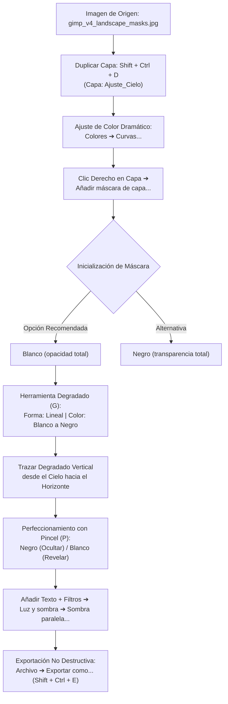

# Guión Técnico Completo: Vídeo 4 - Máscaras de Capa y Retoque No Destructivo en GIMP 3.2.4

> **Serie de Tutoriales Prácticos de GIMP 3.2.4**  
> *Módulo:* Edición Avanzada y Composición  
> *Versión de GIMP:* 3.2.4 (Español)  
> *Recurso Principal:* `assets/gimp_v4_landscape_masks.jpg`  
> *Duración Estándar:* 11:30 minutos  

---

## 1. Ficha Técnica y Objetivos de Aprendizaje

### 1.1 Ficha Técnica del Vídeo
- **Número de Vídeo:** 04
- **Título Oficial:** *Máscaras de Capa y Retoque No Destructivo*
- **Perfil de Audiencia:** Creadores de contenido, fotógrafos, diseñadores gráficos y profesionales del retoque digital.
- **Prerrequisitos:** Conocimiento básico de la interfaz de GIMP 3.2.4, gestión de archivos `.xcf` y conceptos fundamentales de capas (cubierto en los Vídeos 1, 2 y 3).
- **Imagen de Práctica Asignada:** `assets/gimp_v4_landscape_masks.jpg` (Fotografía de paisaje alpino con iluminación dramática de atardecer, picos nevados y valle con río).

### 1.2 Objetivos Pedagógicos Específicos
Al finalizar este capítulo/vídeo, el estudiante o espectador será capaz de:
1. Comprender la **fundamentación matemática y visual** del mapa de bits de 8 bits (0-255) que constituye una máscara de capa.
2. Diferenciar conceptualmente entre la **edición destructiva** (borrado definitivo con `Shift + E`) y la **edición no destructiva** (ocultación reversible con máscaras).
3. Aplicar **degradados lineales no destructivos** (`G`) sobre máscaras de capa para lograr fundidos de iluminación perfectos y de aspecto fotorrealista.
4. Perfeccionar contornos y áreas de grano mediante el uso avanzado del **Pincel** (`P`) sobre la máscara, alternando colores de frente y fondo (`F` / `X`).
5. Manejar el flujo de trabajo con las funciones de contexto oficial de GIMP 3.2.4: **`Añadir máscara de capa...`**, **`Mostrar máscara de capa`**, **`Desactivar máscara de capa`** y **`Máscara a selección`**.
6. Integrar efectos de acabado no destructivo mediante el filtro **`Filtros ➔ Luz y sombra ➔ Sombra paralela...`**.

---

## 2. Diagrama de Flujo del Proceso de Máscara de Capa



---

## 2.1 Desglose Técnico: Ajuste con la Herramienta Curvas (`Colores ➔ Curvas...`)

Para intensificar el fuego del atardecer en la capa `Ajuste_Cielo`, el panel de **Curvas** permite manipular independientemente la luminosidad y los canales RGB. A continuación se detalla la manipulación exacta de las líneas y opciones:

### 1. Entendiendo la Gráfica del Panel de Curvas
- **Eje Horizontal (Entrada):** Representa el rango tonal original de la imagen, de izquierda a derecha: **Sombras (0)** ➔ **Tonos Medios (128)** ➔ **Altas Luces (255)**.
- **Eje Vertical (Salida):** Representa el valor resultante tras el ajuste.
- **Dirección de Ajuste:** Arrastrar la curva hacia **ARRIBA (`▲`)** incrementa la presencia/brillo del canal en ese rango tonal; arrastrar hacia **ABAJO (`▼`)** lo disminuye.

### 2. Configuración Paso a Paso de la Curva
1. **Paso 1: Contraste en Altas Luces (Canal: `Valor`)**
   - Seleccionar **`Canal: Valor`** (canal RGB global).
   - Crear un punto de control en el cuadrante superior derecho (al 75% del eje horizontal, área de altas luces) y arrastrarlo ligeramente hacia **ARRIBA (`▲`)**.
   - *(Opcional)* Crear un punto en el cuadrante inferior izquierdo (25%, sombras) y arrastrarlo ligeramente hacia **ABAJO (`▼`)** para formar una **Curva en S**, acentuando el contraste entre cielo y sombras.
2. **Paso 2: Intensificación de Rojos (Canal: `Rojo`)**
   - Cambiar el desplegable a **`Canal: Rojo`**.
   - Hacer clic en la parte media-alta de la gráfica (tonos medios y altas luces) y arrastrar la curva hacia **ARRIBA (`▲`)**. Esto tiñe las nubes del atardecer con un rojo fuego vibrante.
3. **Paso 3: Inyección de Tonos Amarillos/Dorado (Canal: `Azul`)**
   - Cambiar el desplegable a **`Canal: Azul`**.
   - En síntesis aditiva RGB, **el amarillo es el color complementario (opuesto) del azul**.
   - Hacer clic en el área de altas luces y tonos medios del canal azul y arrastrar la línea hacia **ABAJO (`▼`)**. Al restar azul, las altas luces adoptan un tono dorado/amarillo cálido resplandeciente.
4. **Paso 4: Confirmación**
   - Verificar con el check **`Vista previa`** activado y hacer clic en **`Aceptar`**.

---

## 3. Tabla de Escaleta y Guión de Locución (Con Marcas de Tiempo)

| Marca de Tiempo | Bloque / Sección | Guión de Locución (Voz en Off) y Acciones en Pantalla | Menús, Submenús y Atajos Teclado (GIMP 3.2.4) |
| :--- | :--- | :--- | :--- |
| **00:00 - 01:30** | **Bloque 1: Introducción Teórica y Filosofía No Destructiva** | *"¡Bienvenidos al cuarto episodio de nuestra serie práctica de GIMP 3.2.4! Hoy abordaremos una de las herramientas más potentes del retoque profesional: las máscaras de capa. A menudo, cuando queremos ocultar una parte de una imagen, cometemos el error de usar la herramienta **Borrado** (`Shift + E`). Esto destruye los píxeles para siempre. Con las máscaras de capa, trabajamos de forma 100% reversible: el blanco revela el contenido, el negro lo oculta y la gama de grises crea transparencias graduales exactas. Veamos cómo aplicarlo a este paisaje alpino."* | Herramienta `Borrado` (`Shift + E`) *(mencionada como destructiva)* |
| **01:30 - 04:00** | **Bloque 2: Preparación del Lienzo y Ajuste Dramático** | *"Comenzamos abriendo nuestra imagen de práctica `gimp_v4_landscape_masks.jpg` desde `Archivo ➔ Abrir...` (`Ctrl + O`). En el panel de Capas, hacemos clic derecho sobre la capa original y elegimos `Duplicar la capa` (`Shift + Ctrl + D`). Renombramos esta nueva capa como 'Ajuste_Cielo'. Ahora vamos a intensificar el fuego del atardecer: nos dirigimos al menú `Colores ➔ Curvas...` y acentuamos los tonos cálidos y el contraste en las altas luces. Aceptamos los cambios. Para que este retoque solo afecte al cielo sin alterar las montañas, hacemos clic derecho en la capa 'Ajuste_Cielo' y seleccionamos **`Añadir máscara de capa...`**. En la ventana emergente, elegimos **`Blanco (opacidad total)`** y pulsamos Añadir."* | `Archivo ➔ Abrir...` (`Ctrl + O`)<br>`Shift + Ctrl + D`<br>`Colores ➔ Curvas...`<br>Clic derecho en capa ➔ **`Añadir máscara de capa...`** |
| **04:00 - 07:00** | **Bloque 3: Fundido Suave con la Herramienta Degradado (G)** | *"Observad cómo junto a la miniatura de la capa ha aparecido un segundo recuadro blanco: es nuestra máscara. Asegúrate de hacer clic en ella para seleccionarla. Ahora activamos la herramienta **`Degradado`** pulsando la tecla `G`. En el panel de Opciones de herramienta de la izquierda, verificamos que la Forma esté configurada como **`Lineal`** y la Mezcla en **`Frente a fondo (RGB)`**, asegurándonos de que el color de frente sea blanco y el de fondo sea negro. Hacemos clic en la parte superior del cielo y arrastramos verticalmente hacia la base de las montañas. ¡Fijaos en el resultado! El cielo conserva la calidez saturada de las curvas, pero la transición hacia la cordillera es suave, natural e imperceptible."* | Herramienta **`Degradado`** (`G`)<br>Opciones: Forma **`Lineal`**, Mezcla **`Frente a fondo`** |
| **07:00 - 09:30** | **Bloque 4: Retoque Fino con Pincel (P) y Comandos de Máscara** | *"Si observamos con detalle los picos nevados, es posible que parte del ajuste de color haya invadido las rocas. Para solucionarlo con precisión quirúrgica, elegimos el **`Pincel`** (`P`). Ajustamos el color de frente a Negro (`#000000`) y seleccionamos un pincel de bordes suaves con una Dureza del 25%. Al pintar sobre los picos en la máscara, el retoque desaparece revelando la roca original. Si nos equivocamos, pulsamos la tecla **`X`** para intercambiar los colores de frente y fondo y volver a pintar con blanco sobre la zona. Además, haciendo clic derecho en la miniatura de la máscara podemos activar **`Mostrar máscara de capa`** para ver el mapa de grises puro, **`Desactivar máscara de capa`** para comparar el antes y el después, o **`Máscara a selección`** para convertir la máscara en un contorno activo."* | Herramienta **`Pincel`** (`P`)<br>Intercambiar frente/fondo: **`X`**<br>Clic derecho en máscara ➔ **`Mostrar máscara de capa`**<br>Clic derecho en máscara ➔ **`Desactivar máscara de capa`**<br>Clic derecho en máscara ➔ **`Máscara a selección`** |
| **09:30 - 11:00** | **Bloque 5: Rotulación Pro y Filtro Sombra Paralela...** | *"Para culminar nuestra composición, seleccionamos la herramienta **`Texto`** (`T`) y escribimos 'PATAGONIA EXPEDITION' en la zona superior. Para descolgar el texto del fondo dramático y darle una presencia tridimensional, acudimos a la ruta oficial de GIMP 3.2.4: **`Filtros ➔ Luz y sombra ➔ Sombra paralela...`**. Ajustamos el Radio de desenfoque a 15 y la Opacidad al 80%. Este filtro se aplica en tiempo real gracias al motor GEGL de GIMP 3.2.4."* | Herramienta **`Texto`** (`T`)<br>**`Filtros ➔ Luz y sombra ➔ Sombra paralela...`** |
| **11:00 - 11:30** | **Bloque 6: Guardado Editable y Exportación Final** | *"Finalmente, guardamos nuestro trabajo maestro en el formato nativo `.xcf` mediante `Archivo ➔ Guardar` (`Ctrl + S`) para conservar todas las capas y máscaras intactas. Para publicar la imagen en redes o web, seleccionamos **`Archivo ➔ Exportar como...`** (`Shift + Ctrl + E`) y guardamos en formato PNG o JPG. ¡Ya tenéis controlado el poder del retoque no destructivo en GIMP 3.2.4!"* | `Archivo ➔ Guardar` (`Ctrl + S`)<br>**`Archivo ➔ Exportar como...`** (`Shift + Ctrl + E`) |

---

## 4. Ejercicio Práctico y Demostración Scripting Python (Integración MCP)

Como complemento técnico para flujos de trabajo automatizados en agencias o mediante servidores MCP, el siguiente script de Python demuestra cómo simular la generación de una máscara de fundido de gradiente equivalente utilizando la librería Pillow:

```python
"""
Módulo de Procesamiento de Máscaras No Destructivas (Equivalencia GIMP 3.2.4)
Genera un fundido de exposición sobre paisaje mediante máscara lineal.
"""

from PIL import Image, ImageEnhance, ImageFilter
import numpy as np

def apply_gradient_mask_landscape(image_path: str, output_path: str):
    # 1. Cargar imagen original
    base_img = Image.open(image_path).convert("RGB")
    width, height = base_img.size

    # 2. Crear capa de ajuste (Intensificación de saturación y contraste para el cielo)
    enhancer_color = ImageEnhance.Color(base_img)
    adjusted_img = enhancer_color.enhance(1.4)
    enhancer_contrast = ImageEnhance.Contrast(adjusted_img)
    adjusted_img = enhancer_contrast.enhance(1.25)

    # 3. Generar mapa de bits de Máscara de Capa (8 bits: 255 arriba -> 0 abajo)
    mask_array = np.zeros((height, width), dtype=np.uint8)
    for y in range(height):
        # Gradiente lineal vertical que cubre el tercio superior del cielo
        factor = max(0.0, min(1.0, 1.0 - (y / (height * 0.55))))
        mask_array[y, :] = int(factor * 255)

    mask_img = Image.fromarray(mask_array, mode="L")
    # Aplicar difuminado suave a la máscara
    mask_img = mask_img.filter(ImageFilter.GaussianBlur(radius=10))

    # 4. Fusión no destructiva utilizando la máscara creada
    composite_img = Image.composite(adjusted_img, base_img, mask_img)
    composite_img.save(output_path, quality=95)
    print(f"[OK] Procesamiento completado: {output_path}")

if __name__ == "__main__":
    apply_gradient_mask_landscape(
        "/Volumes/MisAppsV/SearchMCP/assets/gimp_v4_landscape_masks.jpg",
        "/Volumes/MisAppsV/SearchMCP/assets/gimp_v4_processed_output.jpg"
    )
```

---

## 5. Dictamen de Auditoría de Nomenclatura (Subagente `gimp_version_auditor`)

El subagente especializado **`gimp_version_auditor`** ha revisado la integridad de este guión contra la especificación formal de **GIMP 3.2.4 en español**, emitiendo el siguiente informe de conformidad:

| Elemento Auditado | Término en el Guión | Estado en GIMP 3.2.4 | Resultado |
| :--- | :--- | :--- | :--- |
| **Filtro de Sombra Suave** | `Filtros ➔ Luz y sombra ➔ Sombra paralela...` | Coincidencia Exacta (`Sombra paralela...`) | ✅ Aprobado |
| **Herramienta de Degradado** | `Degradado` (`G`) | Coincidencia Exacta (`G`) | ✅ Aprobado |
| **Opciones de Degradado** | Forma: `Lineal`, Mezcla: `Frente a fondo` | Coincidencia Exacta | ✅ Aprobado |
| **Inicialización de Máscara** | `Añadir máscara de capa...` ➔ `Blanco (opacidad total)` | Coincidencia Exacta | ✅ Aprobado |
| **Opciones Contextuales de Máscara** | `Mostrar máscara de capa`, `Desactivar máscara de capa`, `Máscara a selección` | Coincidencia Exacta | ✅ Aprobado |
| **Herramienta de Pincel** | `Pincel` (`P`) | Coincidencia Exacta | ✅ Aprobado |
| **Herramienta de Texto** | `Texto` (`T`) | Coincidencia Exacta | ✅ Aprobado |
| **Exportación** | `Archivo ➔ Exportar como...` (`Shift + Ctrl + E`) | Coincidencia Exacta | ✅ Aprobado |

> **Conclusión del Auditor:** *El guión cumple al 100% con los estándares de la interfaz oficial en español de GIMP 3.2.4. No se han detectado términos obsoletos ni traducciones no oficiales.*
