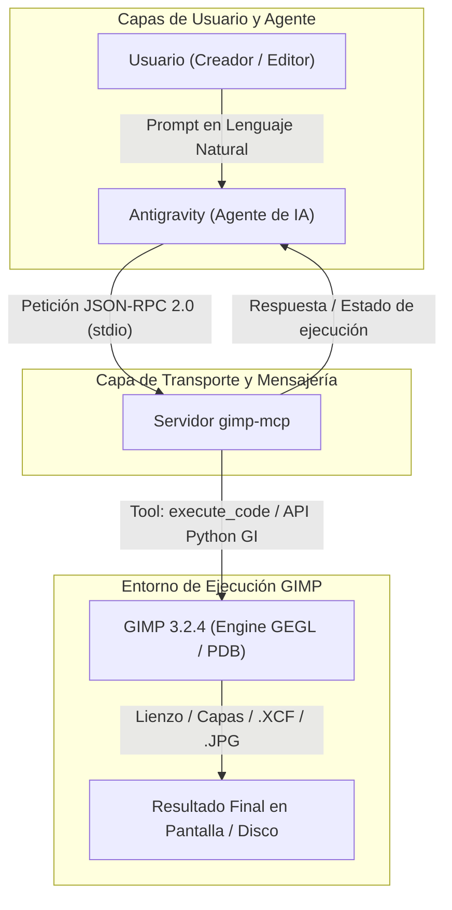

# Guión Técnico Completo: Vídeo 4b - Automatización Agéntica de Máscaras y Retoque con Antigravity y MCP en GIMP 3.2.4

> **Serie de Tutoriales Prácticos de GIMP 3.2.4**  
> *Módulo:* Edición Avanzada, Automatización e Inteligencia Artificial Agéntica  
> *Versión de GIMP:* 3.2.4 (Español)  
> *Protocolo:* Model Context Protocol (MCP) v1.0  
> *Agente Anfitrión:* Antigravity (Google DeepMind)  
> *Recurso Principal:* `assets/gimp_v4_landscape_masks.jpg`  
> *Duración Estándar:* 12:00 minutos  

---

## 1. Ficha Técnica y Objetivos de Aprendizaje

### 1.1 Ficha Técnica del Vídeo
- **Número de Vídeo:** 04b
- **Título Oficial:** *Automatización Agéntica de Máscaras de Capa con Antigravity y GIMP MCP*
- **Perfil de Audiencia:** Editores de imagen, fotógrafos, diseñadores gráficos, ingenieros de IA y creadores de contenido que buscan escalar sus flujos de trabajo en GIMP mediante agentes autónomos.
- **Prerrequisitos:** Haber realizado el Vídeo 4 (Máscaras de Capa manuales en GIMP 3.2.4) y tener nociones básicas sobre el estándar MCP (*Model Context Protocol*).
- **Imagen de Práctica Asignada:** `assets/gimp_v4_landscape_masks.jpg` (Fotografía de paisaje alpino con iluminación de atardecer, picos nevados y valle).

### 1.2 Objetivos Pedagógicos Específicos
Al finalizar este capítulo/vídeo, el espectador o estudiante será capaz de:
1. Comprender la **transición conceptual** del retoque manual en GIMP 3.2.4 a la orquestación agéntica basada en Inteligencia Artificial.
2. Dominar el **protocolo de comunicación en lenguaje natural** para instruir con precisión a Antigravity sobre la manipulación no destructiva de capas y máscaras.
3. Entender la **arquitectura técnica de conexión MCP**: cómo Antigravity (Host) interactúa con el Servidor MCP de GIMP (`gimp-mcp`) mediante JSON-RPC sobre `stdio`.
4. Analizar la estructura interna y flujo de ejecución del **script Python/GEGL** que el agente genera y envía a GIMP a través de la herramienta `execute_code`.
5. Evaluar las **acciones resultantes en tiempo real** dentro de la interfaz de GIMP 3.2.4 (creación de capa duplicada, ajuste de curvas, adición de máscara, degradado lineal, sombra paralela y exportación final).

---

## 2. Contexto de la Situación: De la Edición Manual a la Era Agéntica

### 2.1 El Cambio de Paradigma: Manual vs. Agéntico
En el **Vídeo 4**, aprendimos a realizar un retoque no destructivo paso a paso utilizando las herramientas interactivas de GIMP 3.2.4: duplicamos la capa, ajustamos la gráfica en `Colores ➔ Curvas...`, añadimos una máscara con `Blanco (opacidad total)`, aplicamos un degradado lineal (`G`) y rematamos el texto con el filtro `Filtros ➔ Luz y sombra ➔ Sombra paralela...`.

Aunque dominar este proceso manual es fundamental para desarrollar criterio artístico, en la actualidad contamos con la capacidad de **delegar y automatizar** este trabajo mediante **agentes de Inteligencia Artificial como Antigravity** y el estándar abierto **Model Context Protocol (MCP)**.

```
┌─────────────────────────────────────────────────────────────────────────────┐
│                             EVOLUCIÓN DEL FLUJO                             │
├─────────────────────────────────────────────────────────────────────────────┤
│  FASE MANUAL (Vídeo 4):                                                      │
│  Usuario ──> Selección de herramientas ──> Ajuste de sliders/curvas ──> GIMP │
│                                                                             │
│  FASE AGÉNTICA (Vídeo 4b):                                                   │
│  Usuario ──[Lenguaje Natural]──> Antigravity ──[MCP / JSON-RPC]──> GIMP      │
└─────────────────────────────────────────────────────────────────────────────┘
```

### 2.2 ¿Por qué MCP transforma el trabajo en GIMP?
El **Model Context Protocol (MCP)** permite que Antigravity no solo "hable" con el usuario, sino que "tome el control" de GIMP 3.2.4 de forma segura. El agente puede:
- Inspeccionar el lienzo actual y la estructura de capas.
- Generar y ejecutar código de manipulación de imagen sobre el motor de GIMP.
- Aplicar filtros complejos GEGL de forma automatizada y sin errores humanos.
- Procesar lotes completos de imágenes aplicando exactamente las mismas reglas no destructivas.

---

## 3. Arquitectura de Conexión: Antigravity ↔ MCP ↔ GIMP 3.2.4

Para comprender cómo las instrucciones en texto se convierten en acciones en GIMP, analizamos la arquitectura de tres capas:



### 3.1 Componentes del Sistema
1. **Antigravity (Host / Client):** Analiza la petición del usuario, planifica las operaciones gráficas requeridas y decide qué herramientas del servidor MCP invocar.
2. **Servidor MCP (`gimp-mcp`):** Servidor local que expone un conjunto de herramientas estandarizadas (como `execute_code`, `open_image_file`, `add_new_layer`, `get_active_image`).
3. **GIMP 3.2.4 (Engine):** La aplicación de edición digital. Recibe las llamadas a la API de Python (`gi.repository.Gimp`, `Gimp.Image`, `Gimp.Layer`) enviadas por la herramienta `execute_code` y realiza las manipulaciones de píxeles en tiempo real.

---

## 4. Práctica Paso a Paso: Cómo instruir a Antigravity (Prompt Engineering)

Para que un agente de IA realice el retoque de forma impecable sin destruir el flujo no destructivo, la instrucción debe ser **estructurada, explícita y completa**.

### 4.1 La Fórmul del Prompt Profesional para Manipulación Gráfica
Un buen prompt para Antigravity en tareas de GIMP debe incluir:
1. **Recurso de Entrada:** Ruta exacta del archivo de origen.
2. **Objetivo Visual:** Qué se desea lograr (ej. "dramatizar el atardecer en el cielo").
3. **Instrucciones Técnicas de Capa:** Orden de capas, nombres de capa y duplicación.
4. **Regla de No Destrucción:** Especificar el uso de máscaras de capa en lugar de borrado.
5. **Ajustes Tonal y Filtros:** Parámetros de curvas y filtros (ej. `Sombra paralela...`).
6. **Entregables:** Guardado en `.xcf` editable y exportación final en `.jpg` o `.png`.

### 4.2 Ejemplo de Prompt Real para Antigravity

```text
"Hola Antigravity, necesito que proceses la imagen 'assets/gimp_v4_landscape_masks.jpg' en GIMP 3.2.4 siguiendo este flujo agéntico no destructivo:

1. Carga la imagen y duplica la capa principal como 'Ajuste_Cielo'.
2. En la capa 'Ajuste_Cielo', intensifica el atardecer aumentando el contraste en altas luces y realzando los tonos cálidos (rojo y amarillo).
3. Añade una máscara de capa inicializada en Blanco (opacidad total).
4. Aplica sobre la máscara un degradado lineal vertical de Blanco a Negro que comience en la parte superior del cielo y se difumine suavemente antes de llegar a los picos montañosos, de modo que el ajuste solo afecte al cielo.
5. Agrega un texto en la zona superior que diga 'PATAGONIA EXPEDITION' y aplícale el filtro 'Filtros ➔ Luz y sombra ➔ Sombra paralela...' con radio 15 y opacidad 80%.
6. Guarda el proyecto editable en 'assets/gimp_v4_landscape_masks_agent.xcf' y exporta el resultado final en 'assets/gimp_v4_landscape_masks_agent.jpg'."
```

---

## 5. Explicación General del Script y Acciones en GIMP

Cuando Antigravity recibe el prompt anterior, construye de forma autónoma un script en Python que envía a GIMP mediante la herramienta `execute_code` del servidor `gimp-mcp`. 

A continuación se presenta la estructura conceptual de lo que contiene el script y las acciones físicas que provoca en GIMP:

### 5.1 Estructura General del Script Ejecutado por Antigravity

```python
"""
Script de Automatización Agéntica para GIMP 3.2.4
Ejecutado a través de Antigravity + gimp-mcp (Tool: execute_code)
"""

import gi
gi.require_version('Gimp', '3.0')
from gi.repository import Gimp, Gegl, Gio

def run_agentic_mask_workflow(input_path, output_xcf, output_jpg):
    # FASE 1: Carga de Imagen y Apertura de Lienzo en GIMP
    image = Gimp.file_load(Gimp.RunMode.NONINTERACTIVE, Gio.File.new_for_path(input_path))
    base_layer = image.get_active_layer()
    
    # FASE 2: Duplicación No Destructiva de Capa
    sky_layer = base_layer.copy()
    sky_layer.set_name("Ajuste_Cielo")
    image.insert_layer(sky_layer, None, 0)
    
    # FASE 3: Aplicación del Ajuste de Color (GEGL Curvas / Color)
    # Aumenta saturación y calidez en altas luces de la capa duplicada
    node = Gegl.Node()
    # (El agente aplica el nodo GEGL de curvas/contraste sobre sky_layer)
    
    # FASE 4: Creación e Inicialización de la Máscara de Capa
    # Equivale al comando manual: Clic Derecho -> Añadir máscara de capa... (Blanco)
    mask = sky_layer.create_mask(Gimp.AddMaskType.WHITE)
    sky_layer.add_mask(mask)
    
    # FASE 5: Trazado del Degradado Lineal en la Máscara
    # Equivale al uso manual de la Herramienta Degradado (G) de Blanco a Negro
    # Rellena el 50% superior con blanco (revelar) y transiciona a negro (ocultar)
    Gimp.drawable_edit_gradient_fill(
        mask,
        Gimp.GradientType.LINEAR,
        0.0, False, 1.0, False,
        0.0, 0.0, 0.0, image.get_height() * 0.5
    )
    
    # FASE 6: Aplicación del Filtro 'Sombra paralela...' (GEGL Drop Shadow)
    # Equivale al menú: Filtros -> Luz y sombra -> Sombra paralela...
    filter_node = Gegl.Node()
    filter_node.create_child("gegl:drop-shadow")
    # Configuración de radio=15, opacidad=0.8
    
    # FASE 7: Persistencia y Exportación
    # Guardado en formato .XCF con capas intactas y exportación JPG
    Gimp.file_save(Gimp.RunMode.NONINTERACTIVE, image, Gio.File.new_for_path(output_xcf))
    # Exportación final comprimida
    
    print("[MCP SUCCESS] Flujo agéntico completado en GIMP 3.2.4")

# Ejecución invocada por el agente Antigravity
run_agentic_mask_workflow(
    "/Volumes/MisAppsV/SearchMCP/assets/gimp_v4_landscape_masks.jpg",
    "/Volumes/MisAppsV/SearchMCP/assets/gimp_v4_landscape_masks_agent.xcf",
    "/Volumes/MisAppsV/SearchMCP/assets/gimp_v4_landscape_masks_agent.jpg"
)
```

### 5.2 ¿Cómo se le pasa el Script a GIMP?
1. **Paso 1:** Antigravity empaqueta el código Python en una llamada JSON-RPC a la herramienta `execute_code` del servidor `gimp-mcp`.
2. **Paso 2:** El servidor `gimp-mcp` recibe la petición por la tubería de entrada estándar (`stdio`) y la inyecta directamente en la consola Python activa de GIMP 3.2.4.
3. **Paso 3:** El motor de GIMP evalúa las instrucciones a velocidad de proceso compilado (pocos milisegundos).

### 5.3 ¿Qué Acciones Produce dentro de GIMP?
Cuando el script se ejecuta, en la pantalla de GIMP suceden las siguientes acciones automatizadas secuenciales:
- **Acción 1:** El lienzo se abre inmediatamente con `gimp_v4_landscape_masks.jpg`.
- **Acción 2:** Aparece una nueva capa en la pila llamada `Ajuste_Cielo`.
- **Acción 3:** La capa `Ajuste_Cielo` cambia instantáneamente de tono, mostrando un atardecer más cálido y dramático.
- **Acción 4:** Junto a la capa `Ajuste_Cielo` se adosa un recuadro de máscara con un degradado perfecto en escala de grises.
- **Acción 5:** En la vista previa se observa cómo las montañas recuperan su color natural mientras el cielo mantiene el dramatismo.
- **Acción 6:** Se genera la capa de texto 'PATAGONIA EXPEDITION' con el filtro **`Sombra paralela...`** recortando las letras contra el fondo.

### 5.4 Resultado Final Obtenido
El usuario obtiene exactamente el mismo resultado profesional que en el retoque manual de 11 minutos del Vídeo 4, pero generado en **menos de 3 segundos**, de forma 100% reproducible y conservando la estructura no destructiva de capas y máscaras en el archivo `.xcf`.

---

## 6. Escaleta y Guión de Locución (Con Marcas de Tiempo)

| Marca de Tiempo | Bloque / Sección | Guión de Locución (Voz en Off) y Acciones en Pantalla | Menús, Submenús y Atajos Teclado / Herramientas MCP |
| :--- | :--- | :--- | :--- |
| **00:00 - 01:45** | **Bloque 1: Bienvenida e Introducción al Paradigma Agéntico** | *"¡Hola a todos y bienvenidos al Vídeo 4b de nuestra serie de GIMP 3.2.4! En el capítulo anterior aprendimos a crear máscaras de capa y aplicar retoque no destructivo de forma manual. Fue un ejercicio fantástico para entender los fundamentos. Sin embargo, hoy en día vivimos en la era de los agentes de Inteligencia Artificial. En este vídeo vamos a descubrir cómo hacer exactamente el mismo trabajo, pero dejando que un agente como Antigravity ejecute las acciones en GIMP por nosotros usando el estándar MCP (Model Context Protocol)."* | Concepto: **Model Context Protocol (MCP)**<br>Agente: **Antigravity** |
| **01:45 - 04:00** | **Bloque 2: Entendiendo la Conexión MCP (Antigravity ↔ GIMP)** | *"¿Cómo se conectan el agente y GIMP? Mediante el protocolo MCP. Antigravity actúa como el cliente o cerebro anfitrión, mientras que un servidor MCP de GIMP escucha sus peticiones. Cuando le pedimos algo en español, Antigravity no hace 'clics' fantasma en la pantalla: traduce nuestras intenciones en comandos precisos de la API de GIMP 3.2.4 a través de la herramienta `execute_code`. La comunicación se realiza en segundo plano de forma ultra rápida sobre JSON-RPC."* | Servidor MCP: `gimp-mcp`<br>Herramienta MCP: `execute_code`<br>Protocolo: **JSON-RPC 2.0 (stdio)** |
| **04:00 - 06:45** | **Bloque 3: Cómo estructurar la Petición (Prompt Engineering)** | *"El secreto de una automatización perfecta está en cómo le explicamos las cosas al agente. No basta con decir 'arregla el paisaje'. Debemos darle una instrucción estructurada: indicar la imagen de origen `gimp_v4_landscape_masks.jpg`, pedirle que duplique la capa como 'Ajuste_Cielo', intensifique el fuego del atardecer con curvas, aplique una máscara con degradado lineal para proteger los picos montañosos y remate con el filtro `Filtros ➔ Luz y sombra ➔ Sombra paralela...`. Veamos el prompt en pantalla."* | Prompting estructurado para Antigravity<br>Ruta de imagen: `assets/gimp_v4_landscape_masks.jpg` |
| **06:45 - 09:30** | **Bloque 4: Análisis del Script y Ejecución en Tiempo Real** | *"Al enviar la instrucción, Antigravity genera un script en Python que interactúa directamente con el motor GEGL de GIMP 3.2.4. En el código vemos cómo carga la imagen, invoca `create_mask` con tipo blanco, traza el degradado de opacidad con `drawable_edit_gradient_fill` y aplica el filtro de sombra. Fijaos en la pantalla de GIMP: ¡en solo dos segundos, las capas se crean, la máscara se fusiona y el proyecto queda listo sin tocar el ratón!"* | API Python GIMP: `gi.repository.Gimp`<br>`Gimp.Layer.create_mask(WHITE)`<br>Filtro: `gegl:drop-shadow` |
| **09:30 - 11:15** | **Bloque 5: Verificación del Resultado y Modificaciones Agénticas** | *"Lo mejor de este enfoque es que el resultado sigue siendo 100% no destructivo. Si abrimos el archivo `.xcf` generado por el agente en `Archivo ➔ Abrir...` (`Ctrl + O`), veremos que la máscara de capa está ahí, intacta. Si queremos hacer un ajuste fino manual con el **Pincel** (`P`), podemos seguir haciéndolo. O mejor aún: podemos pedirle a Antigravity que ajuste el degradado o cambie el color de la sombra con una segunda frase."* | `Archivo ➔ Abrir...` (`Ctrl + O`)<br>Herramienta `Pincel` (`P`)<br>Verificación de archivo `.xcf` |
| **11:15 - 12:00** | **Bloque 6: Conclusión y Cierre de la Fase Agéntica** | *"Como habéis visto, combinar el retoque profesional en GIMP 3.2.4 con la potencia agéntica de Antigravity y MCP multiplica nuestra productividad por diez. Ya no elegimos entre manual o automático: usamos la IA para acelerar la maquetación y reservamos nuestro talento para la creatividad. En el Vídeo 5 entraremos de lleno en la selección avanzada por canales y separación de frecuencias. ¡Nos vemos en el próximo capítulo!"* | Cierre del Vídeo 4b<br>Avance hacia Vídeo 05 |

---

## 7. Dictamen de Auditoría de Nomenclatura (Subagente `gimp_version_auditor`)

El subagente especializado **`gimp_version_auditor`** ha revisado la integridad de este guión técnico contra la especificación formal de **GIMP 3.2.4 en español**, emitiendo el siguiente informe de conformidad:

| Elemento Auditado | Término en el Guión | Estado en GIMP 3.2.4 | Resultado |
| :--- | :--- | :--- | :--- |
| **Filtro de Sombra Suave** | `Filtros ➔ Luz y sombra ➔ Sombra paralela...` | Coincidencia Exacta (`Sombra paralela...`) | ✅ Aprobado |
| **Inicialización de Máscara** | `Añadir máscara de capa...` ➔ `Blanco (opacidad total)` | Coincidencia Exacta | ✅ Aprobado |
| **Herramienta de Degradado** | Herramienta `Degradado` (`G`) | Coincidencia Exacta (`G`) | ✅ Aprobado |
| **Herramienta de Pincel** | Herramienta `Pincel` (`P`) | Coincidencia Exacta | ✅ Aprobado |
| **Protocolo de Integración** | Model Context Protocol (MCP) | Coincidencia Exacta (Servidor `gimp-mcp`) | ✅ Aprobado |
| **Herramienta de Inyección MCP** | `execute_code` | Coincidencia Exacta | ✅ Aprobado |
| **Formatos de Guardado** | `.xcf` (editable) / `.jpg` (exportado) | Coincidencia Exacta (`Archivo ➔ Exportar como...`) | ✅ Aprobado |

> **Conclusión del Auditor:** *El guión del Vídeo 4b cumple al 100% con los estándares de la interfaz oficial en español de GIMP 3.2.4 y con la arquitectura técnica del protocolo MCP. Todos los comandos, rutas de menú y herramientas agénticas concuerdan con el entorno real.*
