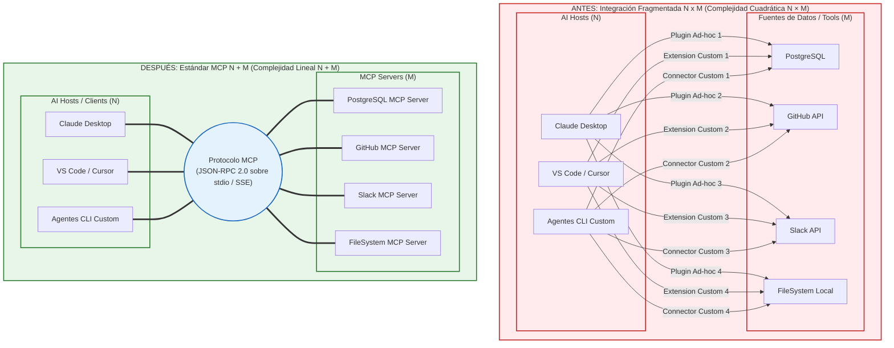
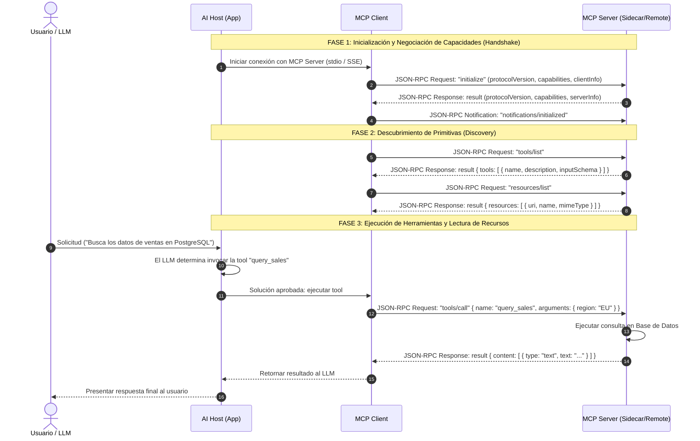

# Guía Técnica Ejecutiva: Introducción al Estándar Model Context Protocol (MCP)

> **El Estándar Abierto de Interoperabilidad para la Era de la Inteligencia Artificial Agéntica**  
> *Fecha:* Agosto de 2026  
> *Propósito:* Especificación técnica, arquitectónica y guía de implementación para directores de tecnología (CTOs), arquitectos de software e ingenieros de IA.

---

## 1. Resumen Ejecutivo e Introducción: El dilema de la interoperabilidad en la era de la IA

### 1.1 Contexto Estratégico: La Evolución de los Modelos de Lenguaje a Agentes Autónomos
La integración de la Inteligencia Artificial Generativa en el tejido de la ingeniería de software moderna ha experimentado una metamorfosis radical. Los Modelos de Lenguaje de Gran Escala (LLMs) han dejado de ser meros motores estáticos de finalización de texto o chatbots aislados para convertirse en el núcleo orquestador de **sistemas agénticos autónomos**. Estos agentes no solo razonan sobre instrucciones textuales, sino que deben percibir el estado del entorno, consultar fuentes de datos heterogéneas en tiempo real y ejecutar acciones operativas en sistemas del mundo real.

Sin embargo, el factor limitante de los sistemas agénticos en producción no radica en la capacidad intrínseca de inferencia del modelo, sino en la **fragilidad, rigidez y fragmentación de las interfaces de conexión** entre el modelo y el ecosistema informático corporativo (bases de datos SQL/NoSQL, repositorios de código, APIs SaaS de gestión empresarial y sistemas de archivos locales).

### 1.2 El Dilema Histórico de Interoperabilidad (Era Pre-MCP)
Antes de la estandarización del protocolo, cada aplicación anfitriona de IA (*Host*) —como Claude Desktop, Cursor IDE, VS Code, o agentes personalizados desarrollados sobre frameworks como LangChain o AutoGPT— construía sus propias interfaces propietarias y mecanismos ad-hoc para conectar herramientas (*tool calling*) y proporcionar contexto textual.

Esta aproximación primitiva provocó una crisis de interoperabilidad caracterizada por:
1. **Conectores Duplicados e Incompatibles:** Un desarrollador que deseaba conectar una base de datos PostgreSQL a tres entornos de IA diferentes (ej. Claude, Cursor y un agente interno en Python) debía escribir y mantener tres integraciones completamente independientes.
2. **Bloqueo de Proveedor (*Vendor Lock-in*):** Los ecosistemas de herramientas quedaban cautivos dentro de plataformas específicas.
3. **Parches de Seguridad Inconsistentes:** Cada plugin ad-hoc implementaba esquemas de autenticación, autorización y desinfección de entrada de forma heterogénea, elevando la superficie de ataque frente a inyecciones de prompts (*Prompt Injection*) y exfiltración de datos.

### 1.3 El Nacimiento de MCP como Estándar Abierto
Para resolver esta parálisis arquitectónica, **Anthropic presentó en noviembre de 2024 el Model Context Protocol (MCP)** como una especificación abierta y neutral. MCP establece un protocolo cliente-servidor bidireccional y de estado (*stateful*) sobre el estándar industrial **JSON-RPC 2.0**, desacoplando formalmente la aplicación anfitriona (*Host*) de las fuentes de contexto y capacidad de cómputo (*Servers*).

```
+-------------------------------------------------------------------+
|                         HOST APPLICATION                          |
|             (Claude Desktop, Cursor, VS Code, Custom)             |
|                                                                   |
|   +-----------------------------------------------------------+   |
|   |                        MCP CLIENT                         |   |
|   +----------------------------+------------------------------+   |
+--------------------------------|----------------------------------+
                                 |  JSON-RPC 2.0 (stdio / SSE)
                                 v
+-------------------------------------------------------------------+
|                            MCP SERVER                             |
|          (PostgreSQL, GitHub, FileSystem, Slack, Jira)            |
+-------------------------------------------------------------------+
```

Al igual que las capas de red unificadas permitieron el nacimiento de la Web moderna, MCP actúa como la capa de transporte y presentación estandarizada que permite a cualquier modelo de IA interactuar de manera segura y agnóstica con cualquier recurso digital.

---

## 2. El Problema de Integración N x M: Análisis del coste de mantenibilidad y fragmentación

### 2.1 Formulación Matemática del Modelo Combinatorio Cuadrático
El modelo tradicional de integración punto a punto sufre de la clásica **explosión combinatoria $N \times M$**:

- Sea $N$ el número de aplicaciones anfitrionas de IA (*Hosts*): Claude Desktop, Cursor IDE, VS Code extensions, agentes LangChain, scripts CLI internos, asistentes empresariales.
- Sea $M$ el número de herramientas, fuentes de datos y servicios externos (*Servers*): PostgreSQL, GitHub, Slack, Jira, Sistema de Archivos local, Google Drive, Brave Search API.

En ausencia de una interfaz estándar, la complejidad computacional y el esfuerzo de ingeniería requeridos para lograr la interoperabilidad total se escalan de forma cuadrática:

$$\text{Complejidad de Integración} = O(N \times M)$$

```
                               MODELO FRAGMENTADO (N x M)
   AI Hosts (N)                                                 Sistemas / Tools (M)
+----------------+      [Plugin Ad-hoc 1]                     +--------------------+
| Claude Desktop |------------------------------------------->| PostgreSQL         |
|                |----------------------+                     +--------------------+
+----------------+                      |                     
                                        | [Plugin Ad-hoc 2]   +--------------------+
+----------------+                      +-------------------->| GitHub API         |
| Cursor IDE     |--------------------'                       +--------------------+
|                |----------------------+                     
+----------------+                      | [Plugin Ad-hoc 3]   +--------------------+
                                        +-------------------->| Slack API          |
+----------------+                                            +--------------------+
| Custom Agent   |------------------------------------------->| FileSystem Local   |
+----------------+                                            +--------------------+
```

#### Análisis Numérico del Coste
Si una organización utiliza **10 entornos/aplicaciones de IA ($N = 10$)** y necesita conectar **20 fuentes de datos y herramientas operativas ($M = 20$)**:

$$\text{Integraciones requeridas} = 10 \times 20 = 200 \text{ conectores independientes}$$

Cada uno de estos 200 conectores requiere:
- Lógica de autenticación ad-hoc.
- Formateo de prompts e inyección de esquemas propietaria.
- Monitoreo, gestión de errores y ciclos de actualización individuales.

### 2.2 Degradación de Mantenibilidad y Riesgos Operativos
1. **Efecto Dominó por Cambios en APIs:** Si la API REST de GitHub o el driver de PostgreSQL actualiza su versión, las 10 integraciones construidas para cada Host de IA se rompen simultáneamente, exigiendo parches manuales en 10 repositorios distintos.
2. **Superficie de Ataque Vulnerable:** La falta de un modelo de aislamiento común significa que las credenciales (tokens API, claves de BD) quedan dispersas en múltiples plugins con calidad de código desigual.
3. **Parálisis de Innovación:** El coste de mantenimiento absorbe más del 80% del presupuesto de desarrollo de los equipos de datos e IA, impidiendo la adopción de nuevos modelos o herramientas.

### 2.3 Matriz Comparativa Ejecutiva: $N \times M$ vs $N + M$

| Criterio de Evaluación | Arquitectura Tradicional ($N \times M$) | Arquitectura Estándar MCP ($N + M$) |
| :--- | :--- | :--- |
| **Escalabilidad de Integración** | Cuadrática: $O(N \times M)$ | Lineal: $O(N + M)$ |
| **Total Conectores ($N=10, M=20$)** | **200 conectores** propietarios | **30 implementaciones** estándar (10 clients + 20 servers) |
| **Coste de Mantenimiento por Cambio de API** | Reescritura en los $N$ conectores del Host afectado | Reescritura única en el **MCP Server** correspondiente |
| **Portabilidad del Código** | Nula; código acoplado al SDK propietario de cada Host | Total; 1 MCP Server funciona de inmediato con cualquier Host MCP |
| **Aislamiento y Seguridad** | Fragil; credenciales dispersas en plugins de terceros | Control centralizado en Host con permisos explícitos y sandbox |
| **Estandarización de Mensajes** | Formatos ad-hoc (JSON heterogéneo, texto plano) | **JSON-RPC 2.0 estricto** con JSON Schema Draft-07 |

---

## 3. La Solución Estándar (N + M): La metáfora del USB-C y los principios del estándar abierto

### 3.1 El Modelo Aditivo $N + M$
El protocolo MCP transforma la arquitectura de integración al introducir una especificación abierta universal que actúa como un **bus de contexto**. En este nuevo paradigma:

- Cada aplicación anfitriona implementa **1 único cliente MCP**.
- Cada desarrollador de herramientas o bases de datos crea **1 único servidor MCP**.

La complejidad del sistema se reduce drásticamente a un comportamiento lineal:

$$\text{Complejidad de Integración} = O(N + M)$$

```
                               MODELO ESTÁNDAR MCP (N + M)
   AI Hosts (N)                                                 MCP Servers (M)
+----------------+                                            +--------------------+
| Claude Desktop |----+                                  +--->| PostgreSQL Server  |
+----------------+    |                                  |    +--------------------+
                      |    +------------------------+    |    
+----------------+    |    |   BUS DE PROTOCOLO     |    |    +--------------------+
| Cursor IDE     |----+--->|      ABIERTO MCP       |----+--->| GitHub Server      |
+----------------+    |    |    (JSON-RPC 2.0)      |    |    +--------------------+
                      |    +------------------------+    |    
+----------------+    |                                  |    +--------------------+
| Custom Agent   |----+                                  +--->| FileSystem Server  |
+----------------+                                            +--------------------+
```

Para el escenario de 10 aplicaciones Host y 20 herramientas externas, el esfuerzo de integración cae de **200 a 30 implementaciones estandarizadas**, representando una **reducción del 85% en la carga inicial y de mantenimiento**.

### 3.2 La Metáfora del USB-C para la Inteligencia Artificial
En la historia del hardware informático, la proliferación de puertos propietarios (PS/2, RS-232, puerto paralelo Centronics, VGA, FireWire, conectores de carga propietarios) creaba una enorme fricción de compatibilidad. La llegada del estándar **USB Type-C** revolucionó la industria al unificar sobre una única interfaz física y lógica el transporte de energía, datos de alta velocidad, audio y vídeo.

MCP representa exactamente la misma revolución para el software de IA: **es el USB-C digital para conectar modelos de lenguaje con el mundo exterior**.

```
  DISPOSITIVO DE IA (HOST)             CABLE MCP (JSON-RPC)            PERIFÉRICO DE DATOS (SERVER)
+-------------------------+          ========================          +-------------------------+
|     Claude / Cursor     | <=======> |  STDIO / SSE TRANSPORT | <=======> |   PostgreSQL / GitHub   |
+-------------------------+          ========================          +-------------------------+
```

Cualquier cliente MCP puede enchufarse instantáneamente a cualquier servidor MCP de forma *plug-and-play*, sin adaptadores intermedios ni código puente ad-hoc.

### 3.3 Precedentes Históricos en Ingeniería de Software
MCP abreva directamente de los patrones de estandarización más exitosos de la computación:
1. **SQL & ODBC/JDBC:** Unificaron el acceso a bases de datos relacionales heterogéneas mediante una sintaxis y drivers estándar.
2. **HTTP & REST:** Unificaron la Web distribuyendo recursos mediante verbos estandarizados (GET, POST, PUT, DELETE).
3. **LSP (Language Server Protocol):** Diseñado por Microsoft para desacoplar los editores de código (VS Code, Neovim, Eclipse) de los compiladores de lenguajes (TypeScript, Rust, Go). MCP adopta directamente la arquitectura conceptual de LSP, adaptando sus mensajes para soportar la naturaleza estocástica de los modelos de IA.

### 3.4 Diagrama Mermaid 1: Comparativa Arquitectónica — Antes (N x M) vs Después (N + M)



---

## 4. Arquitectura del Protocolo: Interacción entre Host, Client y Server sobre JSON-RPC 2.0

### 4.1 Topology y Roles de la Arquitectura
El protocolo MCP establece una topología estricta de tres componentes con responsabilidades claramente delimitadas:

```
+-------------------------------------------------------------------+
|                         HOST APPLICATION                          |
|  - Interfaz de Usuario y Experiencia (UI/UX)                      |
|  - Orquestación del Modelo LLM (Sampling & Window Assembly)       |
|  - Gestión de Seguridad y Aprobación del Usuario (Human-in-Loop)   |
|                                                                   |
|   +-----------------------------------------------------------+   |
|   |                        MCP CLIENT                         |   |
|   |  - Conexión 1 a 1 de estado (Stateful Connection)         |   |
|   |  - Negociación de Capacidades y Versionado                 |   |
|   |  - Serialización / Deserialización JSON-RPC 2.0           |   |
|   +----------------------------+------------------------------+   |
+--------------------------------|----------------------------------+
                                 |  Transport Layer (stdio / SSE)
                                 v
+-------------------------------------------------------------------+
|                            MCP SERVER                             |
|  - Exposición de Primitivas: Tools, Resources, Prompts            |
|  - Aislamiento en Sandbox de Dominio                              |
|  - Emisión de Notificaciones Reactivas en Tiempo Real             |
+-------------------------------------------------------------------+
```

1. **Host Application (Aplicación Anfitriona):** Es el proceso contenedor principal (ej. Claude Desktop, Cursor). Controla la interfaz de usuario, administra las claves del modelo LLM, empaqueta la ventana de contexto y **aplica las políticas de seguridad**, solicitando confirmación explícita al usuario antes de ejecutar cualquier herramienta que pueda modificar el estado del sistema.
2. **MCP Client (Cliente MCP):** Entidad lógica que reside dentro del Host. Mantiene una relación de estado 1:1 con un MCP Server específico. Gestiona el ciclo de vida de la conexión, efectúa la negociación inicial de capacidades y traduce los comandos del Host en mensajes JSON-RPC 2.0.
3. **MCP Server (Servidor MCP):** Proceso independiente o servicio distribuido que expone capacidades del dominio (Tools, Resources, Prompts). Opera bajo el principio de privilegio mínimo y no almacena claves privadas del modelo.

### 4.2 Mecanismos de Transporte
MCP desacopla la capa de aplicación de la capa de transporte. La especificación define dos transportes estándar:

#### A. Transporte Standard I/O (stdio)
- **Mecanismo:** El Host inicia el servidor MCP como un subproceso hijo local (`spawn`). La comunicación se realiza enviando líneas delimitadas por salto de línea (`\n`) sobre los flujos del sistema operativo `stdin` (peticiones/respuestas) y `stdout` (respuestas/notificaciones).
- **Aislamiento de Logging:** El flujo de error estándar (`stderr`) se reserva de forma estricta para logs de diagnóstico del servidor, omitiendo la sintaxis JSON-RPC. El cliente captura `stderr` para auditoría sin interferir con la comunicación RPC.
- **Caso de Uso:** Servidores locales (acceso a archivos, bases de datos locales, herramientas CLI). Garantiza latencia ultrabaja y máxima seguridad mediante sandbox local.

#### B. Transporte Server-Sent Events (SSE) sobre HTTP
- **Mecanismo:** Diseñado para servidores remotos o en la nube.
  - **Canal Descendente (Server -> Client):** El cliente realiza un HTTP GET a un endpoint `/sse`, manteniendo una conexión HTTP streaming para recibir mensajes JSON-RPC mediante el formato SSE.
  - **Canal Ascendente (Client -> Server):** El cliente envía peticiones JSON-RPC mediante solicitudes HTTP POST a la URI enviada por el servidor en el evento inicial SSE (`endpoint`).
- **Caso de Uso:** Microservicios empresariales, SaaS remotos y bases de datos alojadas en la nube.

### 4.3 Ciclo de Vida del Protocolo y Fases de Interacción
El ciclo de vida de una sesión MCP consta de cuatro fases estructuradas:

```
MCP Client                                             MCP Server
    |                                                      |
    | ------------ 1. Request: initialize ---------------> |
    | <----------- 2. Response: initialize --------------- |
    |                                                      |
    | -------- 3. Notification: initialized -------------> |
    |                                                      |
    | ================= FASE OPERATIVA =================== |
    | <------ Request/Response: tools/list, etc. --------> |
    | <------ Request/Response: tools/call, etc. --------> |
    | <------ Notification: resources/updated ------------ |
    |                                                      |
    | ------------ 4. Close Connection ------------------> |
```

1. **Fase de Negociación Inicial (Handshake):** El cliente envía `initialize` declarando la versión del protocolo (`protocolVersion`) y sus capacidades. El servidor responde con sus capacidades soportadas (`tools`, `resources`, `prompts`, `logging`).
2. **Notificación de Confirmación:** El cliente envía `notifications/initialized`. El servidor no responde a las notificaciones.
3. **Fase Operativa (Descubrimiento e Invocación):** El cliente consulta las primitivas disponibles (`tools/list`, `resources/list`, `prompts/list`) e invoca herramientas o lee recursos a petición del modelo o del usuario.
4. **Terminación:** Cierre explícito del proceso `stdio` o desconexión de la sesión HTTP SSE.

### 4.4 Diagrama Mermaid 2: Diagrama de Secuencia de Interacción JSON-RPC



---

## 5. Primitivas Fundamentales: Tools (funciones), Resources (datos) y Prompts (contexto)

El estándar MCP unifica toda la interacción cliente-servidor mediante tres primitivas esenciales:

```
                                  PRIMITIVAS MCP
                   +--------------------+--------------------+
                   |                    |                    |
                   v                    v                    v
           +---------------+    +---------------+    +---------------+
           |     TOOLS     |    |   RESOURCES   |    |    PROMPTS    |
           |  (Funciones)  |    |    (Datos)    |    |  (Contexto)   |
           +---------------+    +---------------+    +---------------+
           | Control: LLM  |    | Control: App  |    | Control: User |
           +---------------+    +---------------+    +---------------+
```

### 5.1 Tools (Herramientas Ejecutables)
- **Definición:** Funciones operativas que el modelo LLM puede decidir invocar de manera autónoma para realizar acciones computacionales o modificar el estado externo (ej. ejecutar consultas SQL, enviar emails, crear commits en Git, escribir archivos).
- **Mecanismo de Control:** **Modelo-Controlado (LLM Driven)**. El LLM analiza las descripciones semánticas de las herramientas y sus esquemas de parámetros y solicita al Host su ejecución.
- **Validación de Esquema:** Cada herramienta define su estructura de entrada utilizando el estándar **JSON Schema Draft-07** (`inputSchema`).

### 5.2 Resources (Recursos de Datos Pasivos)
- **Definición:** Fuentes de información contextual de solo lectura (archivos de registro, esquemas de BD, documentos PDF, respuestas de APIs) que se adjuntan a la ventana de contexto del modelo.
- **Mecanismo de Control:** **Aplicación/Usuario-Controlado**. Es el usuario o el Host quienes seleccionan e inyectan el recurso en el contexto.
- **Direccionamiento y Suscripciones:** Los recursos se identifican mediante URIs estandarizadas (`file:///...`, `postgres://...`). MCP soporta recursos estáticos y plantillas paramétricas (`resources/templates/list`). Además, los clientes pueden suscribirse a cambios (`resources/subscribe`), permitiendo que el servidor emita notificaciones reactivas (`notifications/resources/updated`) cuando los datos subyacentes se modifiquen.

### 5.3 Prompts (Plantillas de Contexto Reutilizables)
- **Definición:** Flujos de trabajo y directivas de contexto estructuradas y parametrizadas expuestas por el servidor.
- **Mecanismo de Control:** **Usuario-Controlado**. Se presentan al usuario como comandos interactivos (ej. `/code-review`, `/analyze-error`).
- **Expansión de Mensajes:** Al invocarse (`prompts/get`), el servidor retorna un conjunto de mensajes con roles específicos (`user`, `assistant`) listos para ser procesados por el modelo.

### 5.4 Matriz Comparativa de Primitivas MCP

| Característica / Primitiva | **Tools (Herramientas)** | **Resources (Recursos)** | **Prompts (Plantillas)** |
| :--- | :--- | :--- | :--- |
| **Entidad Decisora (Control)** | **Modelo LLM** (Decisión dinámica) | **Aplicación / Usuario** (Inyección) | **Usuario Final** (Comando explicit) |
| **Propósito Principal** | Ejecutar cómputo y acciones con efectos secundarios | Aportar contexto de datos de solo lectura | Ofrecer plantillas de flujo agéntico reutilizables |
| **Método de Descubrimiento** | `tools/list` | `resources/list` / `templates/list` | `prompts/list` |
| **Método de Invocación** | `tools/call` | `resources/read` | `prompts/get` |
| **Esquema de Entrada** | JSON Schema Draft-07 (`inputSchema`) | Parametrización URI (`{var}`) | Lista de argumentos con nombre |
| **Suscripción y Eventos** | `notifications/tools/list_changed` | `notifications/resources/updated` | `notifications/prompts/list_changed` |
| **Efectos Secundarios** | **Permitidos** (Escritura, mutaciones) | **Prohibidos** (Solo lectura) | **Prohibidos** (Solo lectura) |

---

## 6. Ejemplos de Código y Mensajes JSON-RPC: Mensajes reales de negociación e integración usando SDKs estándar (@modelcontextprotocol/sdk)

### 6.1 Secuencia Completa de Mensajes JSON-RPC 2.0 (Wire Protocol Real)

#### 1. Petición de Inicialización (`initialize` Request)
```json
{
  "jsonrpc": "2.0",
  "id": 1,
  "method": "initialize",
  "params": {
    "protocolVersion": "2024-11-05",
    "capabilities": {
      "roots": {
        "listChanged": true
      },
      "sampling": {}
    },
    "clientInfo": {
      "name": "EnterpriseHostApp",
      "version": "1.0.0"
    }
  }
}
```

#### 2. Respuesta de Inicialización (`initialize` Response)
```json
{
  "jsonrpc": "2.0",
  "id": 1,
  "result": {
    "protocolVersion": "2024-11-05",
    "capabilities": {
      "tools": {
        "listChanged": true
      },
      "resources": {
        "subscribe": true,
        "listChanged": true
      },
      "prompts": {
        "listChanged": true
      },
      "logging": {}
    },
    "serverInfo": {
      "name": "PostgresMCPServer",
      "version": "2.4.0"
    }
  }
}
```

#### 3. Notificación Inicializada (`notifications/initialized`)
```json
{
  "jsonrpc": "2.0",
  "method": "notifications/initialized"
}
```

#### 4. Descubrimiento de Herramientas (`tools/list` Request & Response)
```json
// Petición
{
  "jsonrpc": "2.0",
  "id": 2,
  "method": "tools/list",
  "params": {}
}

// Respuesta
{
  "jsonrpc": "2.0",
  "id": 2,
  "result": {
    "tools": [
      {
        "name": "query_users",
        "description": "Consulta la tabla de usuarios filtrando por estado activo.",
        "inputSchema": {
          "type": "object",
          "properties": {
            "limit": {
              "type": "number",
              "description": "Número máximo de registros a retornar"
            }
          },
          "required": ["limit"]
        }
      }
    ]
  }
}
```

#### 5. Invocación de Herramienta (`tools/call` Request & Response)
```json
// Petición
{
  "jsonrpc": "2.0",
  "id": 3,
  "method": "tools/call",
  "params": {
    "name": "query_users",
    "arguments": {
      "limit": 2
    }
  }
}

// Respuesta
{
  "jsonrpc": "2.0",
  "id": 3,
  "result": {
    "content": [
      {
        "type": "text",
        "text": "[{\"id\": 101, \"name\": \"Alice\", \"role\": \"Admin\"}, {\"id\": 102, \"name\": \"Bob\", \"role\": \"Engineer\"}]"
      }
    ],
    "isError": false
  }
}
```

#### 6. Lectura de Recurso (`resources/read` Request & Response)
```json
// Petición
{
  "jsonrpc": "2.0",
  "id": 4,
  "method": "resources/read",
  "params": {
    "uri": "file:///var/log/syslog"
  }
}

// Respuesta
{
  "jsonrpc": "2.0",
  "id": 4,
  "result": {
    "contents": [
      {
        "uri": "file:///var/log/syslog",
        "mimeType": "text/plain",
        "text": "[2026-08-04T15:00:00Z] SYSTEM OK: Servicio de base de datos respondiendo normalmente."
      }
    ]
  }
}
```

#### 7. Obtención de Plantilla de Prompt (`prompts/get` Request & Response)
```json
// Petición
{
  "jsonrpc": "2.0",
  "id": 5,
  "method": "prompts/get",
  "params": {
    "name": "code_review",
    "arguments": {
      "language": "TypeScript"
    }
  }
}

// Respuesta
{
  "jsonrpc": "2.0",
  "id": 5,
  "result": {
    "description": "Plantilla de revisión de código para TypeScript",
    "messages": [
      {
        "role": "user",
        "content": {
          "type": "text",
          "text": "Por favor, realiza una auditoría de seguridad y estilo para el código TypeScript adjunto en la ventana de contexto."
        }
      }
    ]
  }
}
```

---

### 6.2 Implementación Oficial en TypeScript (`@modelcontextprotocol/sdk`)

#### Servidor MCP en TypeScript (`server.ts`)
```typescript
import { McpServer } from "@modelcontextprotocol/sdk/server/mcp.js";
import { StdioServerTransport } from "@modelcontextprotocol/sdk/server/stdio.js";
import { z } from "zod";

// Inicializar la instancia del servidor MCP
const server = new McpServer({
  name: "enterprise-metrics-server",
  version: "1.0.0",
});

// 1. Registro de una Herramienta (Tool) con validación Zod
server.tool(
  "calculate_ebitda",
  "Calcula el EBITDA y margen operativo a partir de ingresos y costes.",
  {
    revenue: z.number().positive().describe("Ingresos totales en USD"),
    operatingCosts: z.number().positive().describe("Costes operativos en USD"),
  },
  async ({ revenue, operatingCosts }) => {
    const ebitda = revenue - operatingCosts;
    const margin = ((ebitda / revenue) * 100).toFixed(2);
    return {
      content: [
        {
          type: "text",
          text: `EBITDA Calculado: $${ebitda.toLocaleString()} USD | Margen Operativo: ${margin}%`,
        },
      ],
    };
  }
);

// 2. Registro de un Recurso pasivo (Resource)
server.resource(
  "system-log",
  "file:///var/log/app.log",
  async (uri) => ({
    contents: [
      {
        uri: uri.href,
        mimeType: "text/plain",
        text: "[2026-08-04T15:00:00Z] INFO: Servidor TypeScript MCP activo y procesando peticiones.",
      },
    ],
  })
);

// 3. Registro de una Plantilla de Prompt (Prompt)
server.prompt(
  "financial_audit",
  {
    quarter: z.string().describe("Trimestre fiscal (ej. Q1-2026)"),
  },
  ({ quarter }) => ({
    messages: [
      {
        role: "user",
        content: {
          type: "text",
          text: `Por favor analiza el informe financiero del trimestre ${quarter} utilizando las herramientas de cálculo EBITDA disponibles.`,
        },
      },
    ],
  })
);

// Conexión sobre transporte stdio
async function main() {
  const transport = new StdioServerTransport();
  await server.connect(transport);
  console.error("Servidor MCP TypeScript iniciado correctamente sobre stdio.");
}

main().catch((err) => {
  console.error("Error fatal en el servidor MCP:", err);
  process.exit(1);
});
```

#### Cliente MCP en TypeScript (`client.ts`)
```typescript
import { Client } from "@modelcontextprotocol/sdk/client/index.js";
import { StdioClientTransport } from "@modelcontextprotocol/sdk/client/stdio.js";

async function runClient() {
  // Configurar el transporte para lanzar el subproceso del servidor
  const transport = new StdioClientTransport({
    command: "node",
    args: ["dist/server.js"],
  });

  // Instanciar el cliente MCP
  const client = new Client(
    { name: "enterprise-audit-client", version: "1.0.0" },
    { capabilities: {} }
  );

  // Iniciar conexión y efectuar el handshake
  await client.connect(transport);
  console.log("Cliente conectado con éxito al servidor MCP.");

  // Descubrir herramientas expuestas
  const toolsList = await client.listTools();
  console.log("Herramientas detectadas:", toolsList.tools.map((t) => t.name));

  // Ejecutar herramienta de cálculo EBITDA
  const result = await client.callTool({
    name: "calculate_ebitda",
    arguments: { revenue: 5000000, operatingCosts: 3200000 },
  });
  console.log("Resultado de la herramienta:", result.content);

  // Desconectar cliente
  await client.close();
}

runClient().catch(console.error);
```

---

### 6.3 Implementación Oficial en Python (`mcp` SDK / FastMCP)

#### Servidor MCP en Python (`server.py`)
```python
import sys
from mcp.server.fastmcp import FastMCP

# Crear servidor FastMCP
mcp = FastMCP("enterprise-python-server")

# 1. Registrar Herramienta (Tool)
@mcp.tool()
def get_service_status(service_name: str) -> str:
    """Obtiene las métricas de disponibilidad y estado de un microservicio."""
    return f"Servicio '{service_name}': ESTADO OK | Latencia: 12ms | Disponibilidad: 99.99%"

# 2. Registrar Recurso (Resource)
@mcp.resource("config://production/db")
def get_db_config() -> str:
    """Devuelve la configuración de lectura de base de datos en formato JSON."""
    return '{"max_pool": 50, "ssl_mode": "require", "read_replica": "enabled"}'

# 3. Registrar Prompt (Prompt)
@mcp.prompt()
def system_diagnosis(service_name: str) -> str:
    """Genera una plantilla de diagnóstico agéntico para un microservicio."""
    return f"Ejecuta una inspección completa de logs y métricas para el servicio '{service_name}' e informa si existen anomalías."

if __name__ == "__main__":
    # Iniciar servidor sobre transporte stdio por defecto
    mcp.run(transport="stdio")
```

#### Cliente MCP en Python (`client.py`)
```python
import asyncio
from mcp import ClientSession, StdioServerParameters
from mcp.client.stdio import stdio_client

async def main():
    # Parámetros para invocar el proceso servidor en Python
    server_params = StdioServerParameters(
        command="python",
        args=["server.py"],
        env=None
    )

    # Iniciar flujo de transporte stdio y sesión del cliente
    async with stdio_client(server_params) as (read, write):
        async with ClientSession(read, write) as session:
            # Fase 1: Realizar Handshake de inicialización
            await session.initialize()
            print("Cliente Python MCP inicializado correctamente.")

            # Fase 2: Descubrir e invocar herramientas
            tools = await session.list_tools()
            print("Herramientas disponibles:", [t.name for t in tools.tools])

            tool_response = await session.call_tool(
                "get_service_status",
                arguments={"service_name": "payments-api"}
            )
            print("Respuesta de la herramienta:", tool_response.content)

            # Fase 3: Leer recursos pasivos
            resource_data = await session.read_resource("config://production/db")
            print("Recurso obtenido:", resource_data)

if __name__ == "__main__":
    asyncio.run(main())
```

---

## 7. Bibliografía y Citas de O'Reilly Media

A continuación se detalla el catálogo formal de referencias bibliográficas de la plataforma **O'Reilly Media** consultadas para la elaboración de este tutorial técnico ejecutivo:

1. [AI Agents with MCP en O'Reilly Media](https://www.oreilly.com/library/view/ai-agents-with/9798341639546/)  
   * **Autor:** Kyle Stratis  
   * **Editorial:** O'Reilly Media, Inc. (Octubre 2026, ISBN: 9798341639546)  
   * **Descripción:** Monografía esencial dedicada al diseño de arquitecturas agénticas basadas en MCP, abordando el flujo cliente-servidor y la orquestación segura de herramientas empresariales.

2. [The MCP Standard: A Developer's Guide en O'Reilly Media](https://www.oreilly.com/library/view/the-mcp-standard/9798868823640/)  
   * **Autor:** Srinivasan Sekar  
   * **Editorial:** Apress / O'Reilly Media (Febrero 2026, ISBN: 9798868823640)  
   * **Descripción:** Manual práctico enfocado en el desarrollo de servidores MCP universales desacoplados en TypeScript y Python sobre transportes stdio y SSE.

3. [Build AI Agents with Model Context Protocol (MCP) en O'Reilly Media](https://www.oreilly.com/videos/build-ai-agents/9780135905494/)  
   * **Autor:** Bruce Hopkins  
   * **Editorial:** Pearson / Addison-Wesley (Abril 2026, ISBN: 9780135905494)  
   * **Descripción:** Curso en vídeo especializado que profundiza en la analogía del "USB-C para la IA" y demuestra la integración de clientes y servidores sobre JSON-RPC 2.0.

4. [Model Context Protocol for LLMs en O'Reilly Media](https://www.oreilly.com/library/view/model-context-protocol/9781806662272/)  
   * **Autor:** Naveen Krishnan  
   * **Editorial:** Packt Publishing (Febrero 2026, ISBN: 9781806662272)  
   * **Descripción:** Guía de arquitectura enterprise para escalar aplicaciones de lenguaje mediante el aislamiento de contexto y la gestión de permisos en MCP.

5. [Learn Model Context Protocol with TypeScript en O'Reilly Media](https://www.oreilly.com/library/view/learn-model-context/9781806661398/)  
   * **Autor:** Christoffer Noring  
   * **Editorial:** Packt Publishing (Noviembre 2025, ISBN: 9781806661398)  
   * **Descripción:** Referencia técnica completa sobre el uso del SDK oficial `@modelcontextprotocol/sdk`, esquemas de validación Zod y transportes locales.

6. [Learn Model Context Protocol with Python en O'Reilly Media](https://www.oreilly.com/library/view/learn-model-context/9781806103232/)  
   * **Autor:** Christoffer Noring  
   * **Editorial:** Packt Publishing (Octubre 2025, ISBN: 9781806103232)  
   * **Descripción:** Guía paso a paso para la creación de servidores de contexto agénticos utilizando el framework `FastMCP` y el SDK de Python `mcp`.

7. [Model Context Protocol (MCP) Masterclass en O'Reilly Media](https://www.oreilly.com/videos/model-context-protocol/9781807302979/)  
   * **Autores:** Christoffer Noring, Maxim Salnikov  
   * **Editorial:** Packt Publishing (Marzo 2026, ISBN: 9781807302979)  
   * **Descripción:** Masterclass avanzada sobre diseño de transportes, optimización de ventanas de contexto y patrones de producción con MCP.

8. [Design Multi-Agent AI Systems Using MCP and A2A en O'Reilly Media](https://www.oreilly.com/library/view/design-multi-agent-ai/9781806116478/)  
   * **Autor:** Gigi Sayfan  
   * **Editorial:** Packt Publishing (Febrero 2026, ISBN: 9781806116478)  
   * **Descripción:** Análisis detallado del capítulo 5 enfocado en la combinación de MCP con protocolos inter-agente (A2A) para la resolución colaborativa de tareas complejas.

9. [Modern AI Agents: Building Practical Systems with MCP en O'Reilly Media](https://www.oreilly.com/videos/modern-ai-agents/9780135882634/)  
   * **Autor:** Sinan Ozdemir  
   * **Editorial:** Pearson (Diciembre 2025, ISBN: 9780135882634)  
   * **Descripción:** Obra centrada en la evolución de agentes prácticos con modelos LLM y su integración mediante MCP en infraestructuras corporativas.

10. [AI Engineering: Building Applications with LLMs en O'Reilly Media](https://www.oreilly.com/library/view/ai-engineering/9781098166298/)  
    * **Autora:** Chip Huyen  
    * **Editorial:** O'Reilly Media, Inc. (Diciembre 2024, ISBN: 9781098166298)  
    * **Descripción:** Texto fundamental de referencia en ingeniería de IA que analiza los cuellos de botella de conectividad y sienta los principios para arquitecturas agénticas desacopladas.
