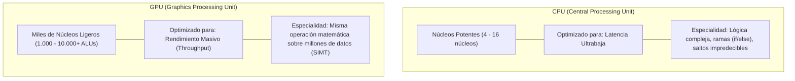
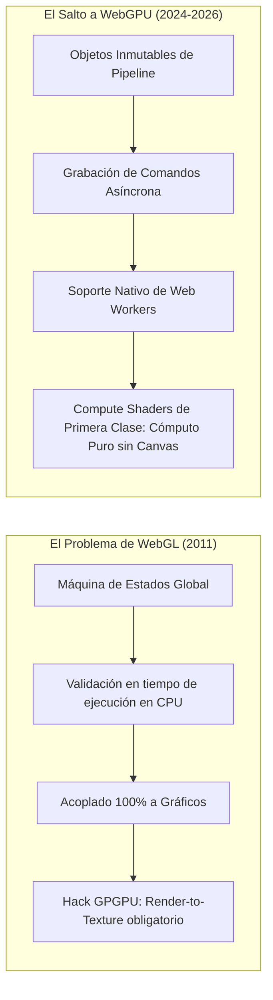
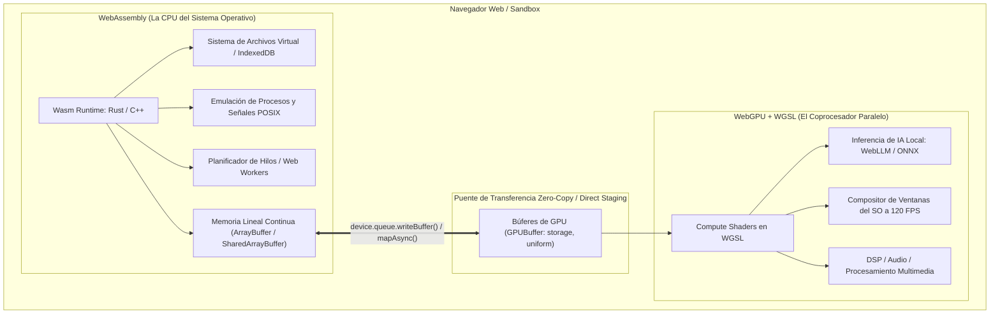
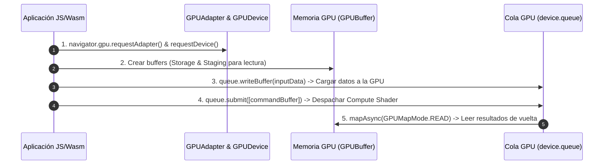

# Capítulo 1: El Modelo Mental de la GPU en la Web
## Del cambio de WebGL a WebGPU y su encaje arquitectónico con WebAssembly

**Serie:** *Arquitectura de Sistemas en el Navegador: De WebAssembly a WebGPU y WGSL*  
**Autor:** Antigravity Engineering Lab & O'Reilly Technical Review  
**Bibliografía y Referencias O'Reilly:**
* [WebAssembly: The Definitive Guide](https://learning.oreilly.com/library/view/-/9781492089834/?orm_source=mcp) por Brian Sletten (*O'Reilly Media*)
* [Server-Side WebAssembly](https://learning.oreilly.com/library/view/-/9781633436206/?orm_source=mcp) por Danilo Chiarlone (*Manning Publications*)
* [Web Performance Engineering in the Age of AI](https://learning.oreilly.com/library/view/-/9798341660182/?orm_source=mcp) por Addy Osmani (*O'Reilly Media*)
* [Computer Organization and Design MIPS Edition](https://learning.oreilly.com/library/view/-/9780128226742/?orm_source=mcp) por David A. Patterson y John L. Hennessy (*Morgan Kaufmann*)
* [GPU-Accelerated Computing with Python 3 and CUDA](https://learning.oreilly.com/library/view/-/9781803245423/?orm_source=mcp) por Niels Cautaerts y Hossein Ghorbanfekr (*Packt Publishing*)

---

## 1. Introducción: Empezando desde Cero

Para comprender por qué tecnologías como **WebGPU** y **WGSL** están revolucionando la web y haciendo posible el concepto de un **BrowserOS** (un sistema operativo o entorno de cómputo completo que vive dentro del navegador), primero debemos despojarnos de las asunciones habituales de la programación web y descender al silicio.

Tradicionalmente, cuando escribimos código para el navegador (JavaScript o TypeScript), asumimos un modelo de computación **secuencial**: el motor ejecuta una instrucción tras otra en un único hilo de ejecución (el *Event Loop* o hilo principal). Si una tarea requiere procesar diez millones de números, la CPU procesará el primero, luego el segundo, luego el tercero, y así sucesivamente.

Sin embargo, el mundo físico y las aplicaciones modernas (visión artificial, modelos de inteligencia artificial, renderizado de interfaces con docenas de ventanas fluidas, física de partículas y simulación de audio) no operan de forma secuencial: son intrínsecamente **masivamente paralelas**.

Aquí es donde entra la distinción fundamental entre dos procesadores completamente diferentes: la **CPU** y la **GPU**.



### La Analogía del Transporte: El Tren de Carga vs. El Coche Deportivo
Como explican Patterson y Hennessy en su clásica obra sobre arquitectura de computadores (*Computer Organization and Design*):
* **La CPU es como un coche deportivo:** Puede transportar solo a una o dos personas, pero llega a su destino a 300 km/h. Si necesitas responder inmediatamente a la pulsación de una tecla o calcular una condición lógica compleja, la CPU es inigualable.
* **La GPU es como un tren de carga de 200 vagones:** Se desplaza mucho más lento (menor velocidad de reloj por núcleo), pero en un único viaje transporta 50.000 toneladas de mercancía. Si tienes que aplicar una ecuación a 4 millones de píxeles o multiplicar dos matrices gigantes de una red neuronal, la GPU completará la tarea en microsegundos, mientras que la CPU tardaría segundos o minutos.

---

## 2. La Evolución Histórica en el Navegador: De WebGL a WebGPU

Para entender WebGPU, debemos responder con honestidad a una pregunta: **¿Por qué WebGL ya no era suficiente si ya permitía usar la tarjeta gráfica?**

### 2.1. Las Limitaciones Estructurales de WebGL
WebGL nació en 2011 como una adaptación directa de **OpenGL ES 2.0** (un estándar de 2007 diseñado originalmente para teléfonos móviles como el primer iPhone). Aunque permitió llevar gráficos 3D a la web por primera vez sin plugins, arrastra tres problemas arquitectónicos insalvables para las necesidades actuales:



1. **El Modelo de "Máquina de Estados Global" (*State Machine*):**
   En WebGL existe un único contexto global (`gl`). Para dibujar algo, el programador debe alterar variables globales una por una:
   ```javascript
   // Pseudo-código WebGL clásico
   gl.useProgram(shaderProgram);
   gl.bindBuffer(gl.ARRAY_BUFFER, vertexBuffer);
   gl.enableVertexAttribArray(positionLocation);
   gl.drawArrays(gl.TRIANGLES, 0, 3);
   ```
   Si una función intermedia en tu código modifica inadvertidamente el buffer activo o el estado de mezcla (*blending*), el renderizado falla silenciosamente sin arrojar una excepción clara.
2. **Cuello de Botella Masivo en la CPU del Navegador:**  
   Debido a que el estado es mutable en cualquier microsegundo, el controlador del navegador está obligado a validar cada parámetro justo en el momento en que se invoca `gl.drawArrays()`. Si una escena tiene 5.000 objetos, la CPU tiene que realizar 5.000 validaciones redundantes por cada fotograma (60 o 120 veces por segundo).
3. **El Ineficiente "Hack" de la Computación (GPGPU en WebGL):**  
   WebGL fue concebido **única y exclusivamente para pintar triángulos en una pantalla**. No existía el concepto de "cómputo general".  
   Si querías usar la GPU para calcular física, simulaciones o machine learning en WebGL, estabas obligado a engañar al hardware:
   - Tenías que codificar tus números de entrada como si fueran colores (`R, G, B, A`) en una imagen digital (textura).
   - Tenías que lanzar un *Fragment Shader* dibujando un rectángulo plano que cubriera toda la pantalla.
   - Tenías que leer los resultados de vuelta con `gl.readPixels()`, una llamada sincrónica que **congelaba el hilo de JavaScript** hasta que la GPU terminaba y devolvía los datos a la memoria RAM.

### 2.2. La Llegada de WebGPU: El Rediseño Moderno
En la última década, las APIs nativas de gráficos abandonaron OpenGL para dialogar directamente con la arquitectura real de las GPUs modernas: **Vulkan** (Khronos/Linux/Android), **Metal** (Apple) y **DirectX 12** (Microsoft).

**WebGPU es la capa estándar del W3C que expone estas capacidades modernas al navegador:**
* **Pipelines Inmutables (*Pipeline State Objects - PSOs*):** Toda la configuración (shaders, formatos de buffer, topología) se compila y valida **una sola vez** al inicio. Cuando se despacha la orden de ejecución, la CPU no valida nada: simplemente envía la orden al silicio.
* **Grabación Asíncrona de Comandos (*Command Encoders*):** En lugar de hacer llamadas inmediatas a la GPU, la CPU graba una lista de instrucciones en un búfer de comandos (`GPUCommandBuffer`) y la envía de golpe a la cola de la GPU (`device.queue.submit(...)`).
* **Independencia del Canvas y Compute Shaders de Primer Nivel:** WebGPU no necesita un elemento `<canvas>` en el DOM para funcionar. Puede ser instanciado como una **unidad de cálculo matemático puro** dentro de un Web Worker en segundo plano, ejecutando código sobre búferes directos de memoria sin tocar la interfaz gráfica.

---

## 3. El Encaje Arquitectónico con WebAssembly: El Núcleo de un "BrowserOS"

En el diseño de un sistema operativo en el navegador (*BrowserOS*), el objetivo es ejecutar aplicaciones complejas (como entornos de desarrollo, editores multimedia, terminales y modelos de IA locales) dentro de una pestaña web con el mismo rendimiento y aislamiento que un sistema operativo de escritorio.

Aquí es donde la combinación de **WebAssembly (Wasm)** y **WebGPU** forma una simbiosis perfecta:



### Roles Complementarios:
1. **WebAssembly es el Cerebro Lógico (Kernel):**  
   Compilado desde lenguajes de bajo nivel como C++, Rust o Zig, Wasm gestiona las estructuras de datos complejas, los árboles de ficheros, la gestión de memoria y el control de flujo secuencial. Tal como detalla Brian Sletten en *WebAssembly: The Definitive Guide*, Wasm proporciona un entorno binario seguro, predecible y tipado.
2. **WebGPU es el Músculo de Cómputo (Acelerador):**  
   Cuando el kernel de Wasm necesita ejecutar una operación pesada (como multiplicar matrices de pesos de un modelo de lenguaje o renderizar el escritorio del SO con transparencias y sombras), **no consume ciclos de la CPU**. En su lugar, despacha un *Compute Shader* escrito en **WGSL** a la GPU.
3. **El Canal de Memoria Eficiente:**  
   La memoria de Wasm es un simple bloque contiguo de bytes (`WebAssembly.Memory.buffer`). Mediante las APIs de WebGPU, este buffer se puede volcar directamente a la memoria de la tarjeta gráfica (`GPUBuffer`) con una sobrecarga mínima, permitiendo que la GPU y Wasm colaboren en tiempo real.

---

## 4. Matriz Comparativa: Qué se puede hacer ahora que antes era imposible

| Capacidad Técnica | En WebGL (El Pasado) | En WebGPU (El Presente) | Impacto Real en un BrowserOS |
|---|---|---|---|
| **Cómputo General (GPGPU)** | Imposible de forma nativa. Requiere simular datos como píxeles en texturas (*Render-to-Texture*). | **Nativo y directo** mediante `Compute Pipelines` y `storage buffers`. | Permite ejecutar IA local (LLMs, Whisper, embeddings) a velocidad nativa en el cliente. |
| **Acceso a Memoria Compartida en Chip** | No existe. Cada píxel se procesa aislado sin poder comunicarse con sus vecinos. | **Soporte de `var<workgroup>`**: memoria SRAM ultrarrápida compartida entre hilos del mismo grupo. | Algoritmos de multiplicación matricial por bloques (*tiled GEMM*) hasta 10x más veloces. |
| **Escritura Arbitraria en Memoria (*Scatter*)** | Prohibida. Un shader solo podía escribir en el píxel exacto que estaba rasterizando. | **Escritura arbitraria** en cualquier índice de un buffer con operaciones atómicas (`atomicAdd`, etc.). | Implementación de simulaciones de física, árboles espaciales y estructuras de datos dinámicas. |
| **Multihilo Real (Web Workers)** | Muy limitado. El contexto de WebGL estaba atado al hilo principal de la UI en la mayoría de implementaciones. | **Desacoplado del hilo principal**. Múltiples Workers pueden grabar comandos en paralelo. | El sistema operativo nunca se congela; la UI responde a 120 Hz mientras la GPU trabaja al 100%. |
| **Lenguaje de Programación** | GLSL ES (derivado de C antiguo con macros y tipos débiles). | **WGSL (WebGPU Shading Language)**: fuertemente tipado, validado formalmente, estilo Rust. | Detección de errores de seguridad y desbordamiento en compilación antes de tocar el silicio. |

---

## 5. Taller Práctico: Laboratorio Interactivo "WebGPU vs. CPU"

Para consolidar este modelo mental, hemos construido un taller práctico ejecutable que demuestra en vivo la diferencia entre procesar un millón de datos en la CPU frente a despacharlos a un **Compute Pipeline real en WebGPU**.

### 5.1. El Algoritmo del Taller
Imagina que nuestro BrowserOS necesita aplicar una transformación matemática sobre un vector de **1.000.000 de números flotantes**:
$$\text{resultado}[i] = \sqrt{\text{dato}[i]} \times 2.5 + \sin(\text{dato}[i])$$

* **En la CPU (JavaScript):** Un bucle `for` convencional procesa los elementos uno tras otro:
  ```javascript
  for (let i = 0; i < n; i++) {
    output[i] = Math.sqrt(input[i]) * 2.5 + Math.sin(input[i]);
  }
  ```
* **En WebGPU (Compute Shader WGSL):** La GPU crea miles de hilos paralelos. Cada hilo recibe su propio identificador único (`global_id.x`) y calcula un único elemento exactamente al mismo tiempo que todos los demás:
  ```wgsl
  @group(0) @binding(0) var<storage, read> inputData: array<f32>;
  @group(0) @binding(1) var<storage, read_write> outputData: array<f32>;

  @compute @workgroup_size(64)
  fn main(@builtin(global_invocation_id) global_id: vec3<u32>) {
      let i = global_id.x;
      if (i >= arrayLength(&inputData)) {
          return;
      }
      outputData[i] = sqrt(inputData[i]) * 2.5 + sin(inputData[i]);
  }
  ```

### 5.2. Los Pasos del Pipeline de WebGPU en Código Real
El código del taller ilustra los 5 pasos universales que todo desarrollador debe dominar para usar WebGPU:



1. **Obtención del Dispositivo:** Solicitar el adaptador físico y crear la interfaz lógica (`navigator.gpu.requestAdapter()`).
2. **Asignación de Memoria:** Crear el buffer de entrada (`STORAGE | COPY_DST`), el buffer de salida en GPU (`STORAGE | COPY_SRC`) y el buffer de lectura (*staging buffer*) con permiso de mapeo (`MAP_READ | COPY_DST`).
3. **Carga de Datos:** Enviar los datos desde la memoria de la CPU a la GPU con `device.queue.writeBuffer()`.
4. **Grabación y Despacho:** Crear un `GPUCommandEncoder`, abrir un `computePass`, enlazar el pipeline y el bind group, e invocar `pass.dispatchWorkgroups(Math.ceil(N / 64))`.
5. **Lectura Asíncrona:** Copiar el resultado al buffer de staging y mapearlo a JavaScript con `stagingBuffer.mapAsync(GPUMapMode.READ)`.

---

## 6. Archivos del Taller en el Repositorio

Para ejecutar y experimentar este taller de forma interactiva en tu máquina:

1. **Página Interactiva del Taller:**
   Abre el archivo [workshop_01_webgpu_vs_cpu.html](file:///Volumes/MisAppsV/SearchMCP/tutorial_webgpu_wgsl/workshop_01_webgpu_vs_cpu.html) directamente en cualquier navegador moderno con soporte WebGPU (Chrome, Edge, Safari 18+ o Firefox Nightly).
2. **Características del Taller:**
   - Detecta automáticamente si tu tarjeta gráfica y navegador soportan WebGPU.
   - Permite ajustar la cantidad de datos (desde 100.000 hasta 5.000.000 de elementos).
   - Compara en milisegundos reales el tiempo de CPU frente al tiempo de GPU.
   - Muestra la verificación de integridad matemática (comprobando que la GPU calculó exactamente los mismos valores que la CPU).
   - Incluye visor interactivo con resaltado de sintaxis del Compute Shader en WGSL.

---

## 7. Bibliografía y Lecturas Recomendadas para Profundizar

Para consolidar los conceptos abordados en este capítulo y profundizar en la arquitectura de hardware, WebAssembly y la computación acelerada por GPU, se recomienda consultar las siguientes obras de referencia disponibles en la plataforma **O'Reilly Learning**:

1. **[Computer Organization and Design: The Hardware/Software Interface (MIPS Edition)](https://learning.oreilly.com/library/view/-/9780128226742/?orm_source=mcp)**  
   *David A. Patterson y John L. Hennessy (Morgan Kaufmann)*  
   * **Por qué leerlo:** La obra fundamental por antonomasia de la arquitectura de computadores (Premio Turing). Esencial para comprender la física del silicio, la divergencia entre la optimización de latencia (CPU) y la de throughput (GPU), y el modelo de ejecución paralela masiva SIMD/SIMT.

2. **[WebAssembly: The Definitive Guide](https://learning.oreilly.com/library/view/-/9781492089834/?orm_source=mcp)**  
   *Brian Sletten (O'Reilly Media, Inc.)*  
   * **Por qué leerlo:** Explica en detalle el modelo de ejecución lineal de Wasm, la gestión de memoria contigua en el navegador y cómo WebAssembly sienta las bases para portar motores de sistemas completos al entorno web.

3. **[Server-Side WebAssembly](https://learning.oreilly.com/library/view/-/9781633436206/?orm_source=mcp)**  
   *Danilo Chiarlone (Manning Publications)*  
   * **Por qué leerlo:** Aunque enfocado en el backend, es una de las obras más lúcidas sobre la interfaz WASI y el puente entre WebAssembly y las capacidades de aceleración de hardware (incluyendo WebGPU), clave para entender la visión de un BrowserOS.

4. **[Web Performance Engineering in the Age of AI](https://learning.oreilly.com/library/view/-/9798341660182/?orm_source=mcp)**  
   *Addy Osmani (O'Reilly Media, Inc.)*  
   * **Por qué leerlo:** Ofrece una visión pragmática sobre el impacto de descargar cargas computacionales intensivas e inferencia de modelos en la GPU del cliente web para evitar la saturación del hilo principal de JavaScript.

5. **[GPU-Accelerated Computing with Python 3 and CUDA](https://learning.oreilly.com/library/view/-/9781803245423/?orm_source=mcp)**  
   *Niels Cautaerts y Hossein Ghorbanfekr (Packt Publishing)*  
   * **Por qué leerlo:** Extraordinaria guía sobre los patrones mentales de la computación GPGPU: división de hilos en bloques/workgroups, memoria compartida y minimización de transferencias entre host y dispositivo.

---

## 8. Próximo Paso: Hacia el Capítulo 2

En el **Capítulo 2**, nos sumergiremos de lleno en el lenguaje **WGSL (WebGPU Shading Language)**:
* La estructura formal de un programa WGSL: declaraciones, módulos y puntos de entrada (`@vertex`, `@fragment`, `@compute`).
* El sistema de tipos estricto: escalares, vectores, matrices y empaquetamiento de memoria según las reglas de alineamiento del estándar.
* Decoradores esenciales: `@group`, `@binding`, `@builtin` y constantes de especialización `@id` / `override`.
