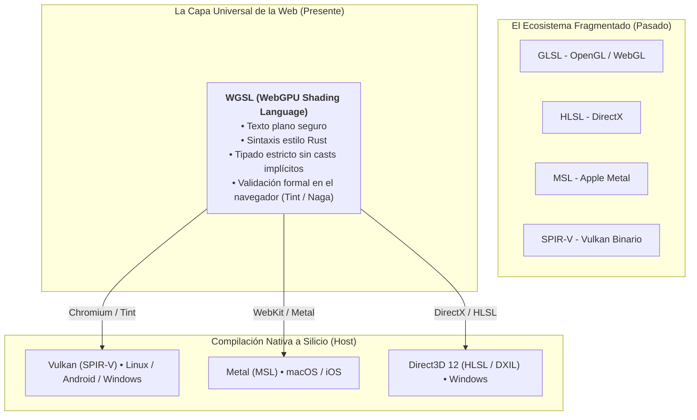
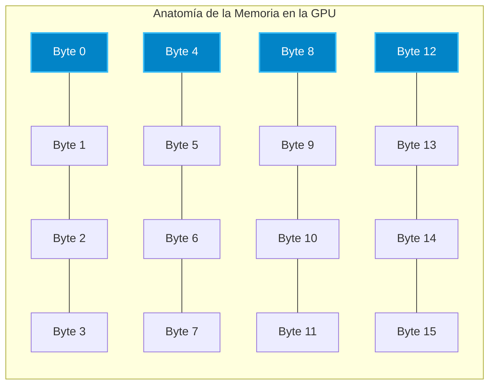
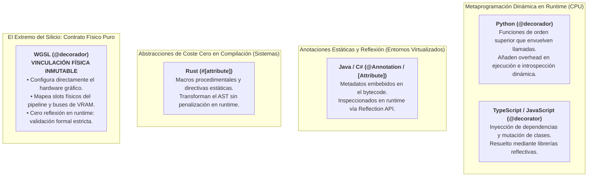
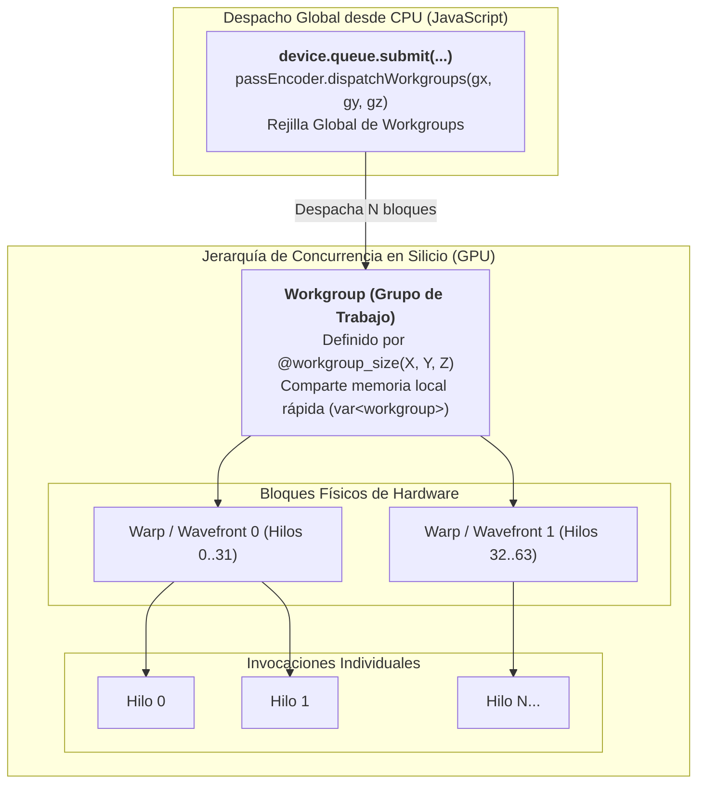
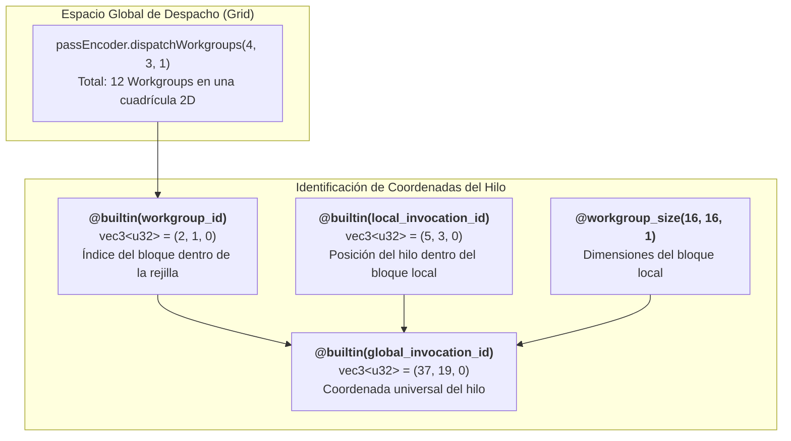

# Capítulo 2: Fundamentos del Lenguaje WGSL
## Sintaxis moderna, tipado estricto, estructuras de datos y el contrato del hardware

**Serie:** *BrowserOS: Computación Nativa en la Web con Wasm, WebGPU y WGSL*  
**Autor:** Antigravity Engineering Lab & O'Reilly Technical Review  
**Bibliografía y Referencias O'Reilly:**
* [Programming Rust, 3rd Edition](https://learning.oreilly.com/library/view/-/9781098176228/?orm_source=mcp) por Jim Blandy, Jason Orendorff y Leonora F. S. Tindall (*O'Reilly Media*)
* [Programming with Types](https://learning.oreilly.com/library/view/-/9781617296413/?orm_source=mcp) por Vlad Riscutia (*Manning Publications*)
* [Programming Massively Parallel Processors, 4th Edition](https://learning.oreilly.com/library/view/-/9780323984638/?orm_source=mcp) por Wen-mei W. Hwu, David B. Kirk e Izzat El Hajj (*Morgan Kaufmann*)
* [GPU-Accelerated Computing with Python 3 and CUDA](https://learning.oreilly.com/library/view/-/9781803245423/?orm_source=mcp) por Niels Cautaerts y Hossein Ghorbanfekr (*Packt Publishing*)
* [The Evolune Metaverse: Meta-Avatars, Spatial Computing, and the Evolution of Humans with AI](https://learning.oreilly.com/library/view/-/9798868815881/?orm_source=mcp) por Frank Lisitano y John Hickie (*Apress*)
* [Computer Organization and Design: The Hardware/Software Interface](https://learning.oreilly.com/library/view/-/9780128226742/?orm_source=mcp) por David A. Patterson y John L. Hennessy (*Morgan Kaufmann*)

---

## 1. Introducción y Filosofía de Diseño: ¿Por qué un Nuevo Lenguaje?

En el Capítulo 1 establecimos el modelo mental de la GPU y comprendimos por qué WebGPU trasciende las limitaciones de WebGL para convertir el navegador en un entorno de cómputo universal (*BrowserOS*). Sin embargo, un motor gráfico y de cómputo moderno es tan eficaz como el lenguaje que los desarrolladores utilizan para comunicarse con sus procesadores.

Durante décadas, la industria gráfica estuvo fragmentada en dialectos divergentes:
* **GLSL (*OpenGL Shading Language*):** Diseñado con sintaxis de C de los años noventa, plagado de macros de preprocesador y dependiente de compiladores propietarios en los controladores de NVIDIA, AMD e Intel que interpretaban el mismo código con comportamientos impredecibles.
* **HLSL (*High-Level Shader Language*):** El estándar de Microsoft para DirectX, potente pero históricamente acoplado al ecosistema Windows.
* **MSL (*Metal Shading Language*):** Basado en C++14, exclusivo de los dispositivos de Apple.
* **SPIR-V:** La representación intermedia binaria de Vulkan, eficiente para máquinas pero ilegible para humanos y de verificación compleja en entornos web no confiables.

Cuando el consorcio **W3C (GPU for the Web Working Group)** se propuso estandarizar el lenguaje de la nueva web, se enfrentó a un dilema fundamental: *¿debía el navegador recibir binarios SPIR-V o un lenguaje en texto plano?*

La respuesta fue contundente: **la web necesita un estándar en texto legible por humanos, verificable formalmente en tiempo de compilación y seguro por diseño**. Así nació **WGSL (WebGPU Shading Language)**.



Como señalan Jim Blandy y Jason Orendorff en *Programming Rust*, los lenguajes de sistemas modernos persiguen el principio de **"corrección por construcción" (*correctness by construction*)**: los errores de memoria y las discrepancias de tipos deben ser imposibles de compilar, en lugar de manifestarse como fallos silenciosos en producción. WGSL traslada este mismo principio rector al mundo de los shaders.

---

## 2. Sintaxis Moderna (Estilo Rust): Declaraciones, Mutabilidad y Alcance

La primera impresión al leer código WGSL es su evidente parentesco sintáctico con **Rust** y **Swift**. WGSL prescinde deliberadamente de la sintaxis arcaica de C y adopta una gramática limpia, orientada a expresiones y con control estricto de mutabilidad.

### 2.1. Declaración de Variables: `let`, `var`, `const` y `override`

En WGSL existen cuatro palabras clave para declarar valores. Confundirlas es la causa más común de errores en desarrolladores noveles:

| Palabra Clave | Mutabilidad | Momento de Evaluación | Ubicación en Memoria | Propósito Principal |
|---|---|---|---|---|
| **`const`** | Inmutable | **Compilación del Shader** | No consume memoria en runtime | Constantes matemáticas fijas (`const PI = 3.14159;`). |
| **`override`** | Inmutable | **Creación del Pipeline** | Constante de especialización | Valores inyectados desde JavaScript al compilar (`device.createComputePipeline`). |
| **`let`** | **Inmutable** | **Tiempo de Ejecución** | Registros de la invocación (hilo) | Valores intermedios calculados dentro de una función que no cambiarán. |
| **`var`** | **Mutable** | **Tiempo de Ejecución** | Espacio de memoria explícito (`function`, `workgroup`, `storage`, `uniform`) | Variables cuyo valor se modifica con reasignaciones (`x = x + 1.0;`). |

```wgsl
// 1. Constante evaluada en tiempo de compilación
const FACTOR_ESCALA: f32 = 1.4142135;

// 2. Constante de especialización (configurable desde JS al crear el pipeline)
@id(0) override TAMANO_BLOQUE: u32 = 64u;

fn procesar_dato(entrada: f32) -> f32 {
    // 3. 'let' crea un valor inmutable local
    let base = entrada * FACTOR_ESCALA;
    // base = base + 1.0; // ❌ ERROR DE COMPILACIÓN: 'base' es inmutable.

    // 4. 'var' crea una variable mutable local (espacio 'function' por defecto)
    var acumulador: f32 = 0.0;
    acumulador = acumulador + base; // ✅ VÁLIDO: 'acumulador' fue declarado con 'var'.
    
    return acumulador;
}
```

> **Axioma de Diseño:** En WGSL, **la inmutabilidad es la norma y la mutabilidad es la excepción**. El uso preferente de `let` permite al compilador de la GPU optimizar el uso de registros físicos del chip y eliminar variables redundantes sin temor a efectos secundarios.

### 2.2. Funciones Puras y Ausencia de Recursividad
Las funciones en WGSL se declaran con la palabra clave `fn`, reciben parámetros tipados y definen su retorno mediante el operador `->`:

```wgsl
fn calcular_distancia(dx: f32, dy: f32) -> f32 {
    return sqrt(dx * dx + dy * dy);
}
```

**Restricción Crucial de Hardware:** En WGSL **la recursividad está estrictamente prohibida** (una función no puede llamarse a sí misma, ni directa ni indirectamente). La razón es arquitectónica: a diferencia de una CPU con gigabytes de memoria RAM y una pila dinámica (*stack*), cada hilo de una GPU tiene un número limitado y fijo de registros físicos. Si se permitiera la recursividad, un desbordamiento de pila (*stack overflow*) colapsaría el procesador gráfico completo.

### 2.3. Control de Flujo Estructurado
WGSL soporta las estructuras de control habituales (`if / else`, `switch`, `for`, `while`), pero introduce el constructo primitivo **`loop`** con bloque **`continuing`**, que refleja fielmente cómo las arquitecturas de GPU gestionan los saltos de instrucción en hardware:

```wgsl
var i: u32 = 0u;
loop {
    if (i >= 100u) {
        break; // Salida del bucle
    }
    
    // Cuerpo del bucle
    procesar_indice(i);

    continuing {
        // El bloque 'continuing' se ejecuta SIEMPRE al final de cada iteración,
        // incluso si el cuerpo ejecutó una sentencia 'continue'.
        i = i + 1u;
    }
}
```

---

## 3. Sistema de Tipos Estricto: Escalares, Vectores, Matrices y Colecciones

En *Programming with Types*, Vlad Riscutia argumenta que la principal virtud de un sistema de tipos estricto no es limitar al programador, sino documentar inequívocamente la memoria y eliminar clases enteras de errores en tiempo de diseño. WGSL lleva este principio a su máxima expresión.

### 3.1. Tipos Escalares Fundamentales
* `bool`: Booleano (`true`, `false`).
* `i32`: Entero de 32 bits con signo en complemento a dos (literales: `12i` o `-5i`).
* `u32`: Entero de 32 bits sin signo (literales: `0u`, `64u`). **Indispensable para índices y tamaños de workgroups.**
* `f32`: Número de coma flotante de 32 bits conforme a IEEE 754 (literales: `1.0`, `0.5f`).
* `f16`: Coma flotante de precisión reducida (16 bits), disponible mediante la extensión de hardware `enable f16;`.

### 3.2. Prohibición Absoluta de Conversiones Implícitas (*No Implicit Casts*)
En lenguajes como C, C++ o JavaScript, es habitual escribir:
```javascript
let total = 5.5 + 2; // JavaScript convierte el 2 en 2.0 silenciosamente
```
**En WGSL, esto es un error fatal de compilación:**
```wgsl
let resultado: f32 = 5.5 + 2u; // ❌ ERROR: No se puede sumar f32 con u32.
let correcto: f32  = 5.5 + f32(2u); // ✅ CORRECTO: Conversión explícita requerida.
```
**¿Por qué esta rigidez?** En la GPU, una conversión de entero a flotante o de 64 a 32 bits no es gratuita: requiere que las ALUs ejecuten instrucciones de transcodificación de formato. Al exigir conversiones explícitas, WGSL garantiza que el desarrollador nunca introduzca instrucciones ocultas de conversión en bucles que se ejecutan miles de millones de veces por segundo.

### 3.3. Vectores y la Magia del *Swizzling*
La GPU es intrínsecamente un procesador vectorial. WGSL proporciona tipos vectoriales de 2, 3 y 4 dimensiones para cualquier tipo escalar: `vec2<f32>`, `vec3<u32>`, `vec4<i32>`, etc.

WGSL permite acceder a los componentes vectoriales mediante dos nomenclaturas equivalentes:
* Coordenadas espaciales: `.x`, `.y`, `.z`, `.w`
* Canales cromáticos: `.r`, `.g`, `.b`, `.a`

Además, soporta **Swizzling** (reordenación y duplicación instantánea de componentes sin coste adicional de reloj):

```wgsl
let posicion = vec4<f32>(1.0, 2.0, 3.0, 4.0);

let coords_2d: vec2<f32> = posicion.xy;       // vec2(1.0, 2.0)
let invertido: vec3<f32> = posicion.zyx;      // vec3(3.0, 2.0, 1.0)
let mascara:   vec4<f32> = posicion.xxxx;     // vec4(1.0, 1.0, 1.0, 1.0)
```

### 3.4. Matrices y Álgebra Lineal
Las matrices en WGSL están optimizadas para transformaciones tridimensionales y proyección:
* `mat2x2<f32>`, `mat3x3<f32>`, `mat4x4<f32>` (y combinaciones rectangulares como `mat3x2<f32>`).
* **Orden por Columnas (*Column-Major Order*):** Una matriz de $4 \times 4$ se compone internamente de 4 vectores columna (`vec4<f32>`). Al acceder a `matriz[c][f]`, el primer índice selecciona la **columna** y el segundo la **fila**.

### 3.5. Arrays: Fijos vs. Runtime-Sized
1. **Arrays de tamaño fijo:** Se declaran especificando el tipo y la longitud constante:
   ```wgsl
   var coeficientes: array<f32, 4> = array<f32, 4>(0.1, 0.2, 0.3, 0.4);
   ```
2. **Arrays de tamaño dinámico (*Runtime-Sized Arrays*):** Se declaran omitiendo el tamaño (`array<f32>`). **Solo pueden ubicarse como el último campo de una estructura dentro de un búfer de almacenamiento (`storage buffer`)**, permitiendo que el shader procese búferes de cualquier tamaño asignados desde JavaScript:
   ```wgsl
   struct TensorDinamico {
       filas: u32,
       columnas: u32,
       datos: array<f32>, // ✅ Tamaño determinado por el buffer asignado en WebGPU
   };
   ```

---

## 4. Estructuras de Datos (`struct`) y la Física del Alineamiento de Memoria

Llegamos al apartado donde radica la mayor discrepancia entre el desarrollo de software convencional y la programación de GPU: **el empaquetamiento binario y el alineamiento de memoria (*Memory Layout & Alignment*)**.

En los lenguajes de alto nivel como JavaScript o Python, los datos son abstracciones dinámicas que flotan en el montículo (*heap*): un objeto `{ x: 1.0, y: 2.0, masa: 5.0 }` está gestionado por un recolector de basura (*garbage collector*), sus propiedades se resuelven mediante tablas hash internas o clases ocultas de V8, y al programador jamás le preocupa en qué dirección física de la memoria RAM reside cada número.

En la GPU, ese mundo protegido no existe. En el silicio gráfico **no hay recolector de basura, no hay punteros dinámicos opacos y no hay nombres de propiedades**. Un `struct` en WGSL no es un objeto abstracto: es un **contrato binario físico inmutable** que describe exactamente cómo se distribuye una secuencia contigua de bytes sobre los transistores de la memoria de vídeo (VRAM).

Como subraya Vlad Riscutia en *Programming with Types*:
> *"Un tipo compuesto es mucho más que una agrupación conceptual de valores: es un contrato explícito de distribución espacial en memoria. Cuando dos entornos de ejecución distintos —como la CPU anfitriona y un coprocesador acelerador— intercambian datos a través de una frontera física, no intercambian nombres ni semántica: intercambian direcciones de memoria puras y desplazamientos de bytes. Si sus mapas de memoria difieren en tan solo un byte, la integridad de todo el sistema se desmorona de forma silenciosa e impredecible."*

Cuando despachamos datos desde JavaScript hacia la GPU mediante `device.queue.writeBuffer()`, el navegador no envía un objeto JSON ni variables nombradas: transfiere un bloque ciego de bytes crudos (`ArrayBuffer`). Si el diseño de ese bloque en la CPU no coincide con una precisión milimétrica con la estructura declarada en WGSL, la GPU interpretará números enteros como flotantes o leerá ceros en lugar de coordenadas.

---

### 4.1. Glosario Fundamental: Entendiendo la Memoria desde Cero

Para dominar este contrato sin dejar lagunas conceptuales, es imprescindible definir con rigor los términos que rigen la arquitectura de memoria:



1. **Byte y Dirección de Memoria (*Memory Address*):**  
   La memoria física de la GPU es una secuencia unidimensional continua de casillas de 8 bits (un byte). Cada casilla tiene un número identificador único e irrepetible: su **dirección de memoria** ($0, 1, 2, 3, 4 \dots$).
2. **Tamaño (*Size*):**  
   Es la cantidad neta de bytes que un tipo de datos necesita físicamente para almacenar su valor útil.  
   * Un número entero de 32 bits (`u32` o `i32`) necesita 4 bytes (32 bits / 8 = 4 bytes).
   * Un número de coma flotante de precisión simple (`f32`) necesita 4 bytes.
   * Un vector tridimensional de coma flotante (`vec3<f32>`) contiene tres flotantes de 4 bytes: su tamaño neto es de $3 \times 4 = 12 \text{ bytes}$.
3. **Alineamiento (*Alignment* o *AlignOf*):**  
   Es una **restricción matemática de posición** impuesta por los circuitos electrónicos del hardware. Establece que la dirección de memoria donde comience un dato debe ser un **múltiplo exacto de un número $N$**.  
   * Si un tipo exige un alineamiento de **4 bytes**, su dirección inicial solo puede ser $0, 4, 8, 12, 16, 20 \dots$ (la dirección dividida entre 4 debe dar residuo cero). Jamás puede comenzar en la dirección 1, 2 o 3.
   * Si exige un alineamiento de **16 bytes**, solo puede comenzar en $0, 16, 32, 48, 64 \dots$.
4. **Desplazamiento (*Offset*):**  
   Es la distancia relativa, medida en bytes, desde el primer byte de la estructura (el byte 0) hasta el primer byte donde se ubica un campo específico.
5. **Relleno o Acolchado (*Padding*):**  
   Son **bytes vacíos ("huecos muertos")** que el compilador de WGSL se ve obligado a insertar automáticamente entre dos campos adyacentes, o al final de la estructura, para que el campo siguiente (o la estructura siguiente) empiece en una dirección legalmente alineada. Aunque estos bytes no contienen ningún dato para el programador, **consumen espacio físico real en la VRAM y deben ser tenidos en cuenta obligatoriamente al construir el búfer en JavaScript**.
6. **Paso o Intervalo (*Stride*):**  
   Es la distancia total en bytes entre el inicio de un elemento y el inicio del elemento siguiente dentro de un array. Si una estructura ocupa 28 bytes de datos pero sus reglas de alineamiento obligan a cerrar en 32 bytes, su *stride* es de **32 bytes**.

---

### 4.2. La Física del Silicio: ¿Por qué el Hardware Exige Palabras de 16 Bytes?

Una pregunta natural que todo ingeniero se formula al ver estas restricciones es: *¿por qué el silicio no permite simplemente guardar los datos uno detrás de otro de forma compacta, sin desperdiciar memoria con padding?*

La respuesta reside en la arquitectura física de los chips de memoria (GDDR6, HBM) y en cómo los microprocesadores se comunican con ellos.

En *Computer Organization and Design: The Hardware/Software Interface*, David A. Patterson y John L. Hennessy explican que la memoria de un computador no está cableada byte a byte:
> *"Los buses de memoria de alta velocidad y los bancos de DRAM están organizados para transferir palabras alineadas completas en cada ciclo de reloj. Si el procesador solicita una palabra cuya dirección cruza la frontera física de dos bancos o dos líneas de transferencia, el hardware se ve forzado a descomponer la operación en dos accesos de memoria independientes, desplazar las partes en registros auxiliares y ensamblarlas lógicamente. Una lectura desalineada duplica el tráfico sobre el bus y degrada severamente el rendimiento."*

En las tarjetas gráficas, esta penalización es exponencialmente más grave debido a su naturaleza masivamente paralela:

```mermaid
graph TD
    subgraph "Acceso Coalescente y Alineado (Óptimo)"
        W1["32 Hilos (Warp / Wavefront)"] -->|Solicitud Alin. 16B| BUS1["Bus de Memoria de 128 bits"]
        BUS1 -->|1 Única Transacción Física| VRAM1["Bancos de VRAM GDDR6"]
    end

    subgraph "Acceso Desalineado (Catastrófico)"
        W2["32 Hilos (Warp / Wavefront)"] -->|Solicitud Cruzada (Misaligned)| BUS2["Bus de Memoria Fragmentado"]
        BUS2 -->|Transacción 1: Mitad Izquierda| VRAM2["Banco VRAM A"]
        BUS2 -->|Transacción 2: Mitad Derecha| VRAM3["Banco VRAM B"]
        BUS2 -->|Lógica de Ensamblado en ALU| STALL["<b>Memory Stall</b> (Retardo y Pérdida del 50% de Ancho de Banda)"]
    end
```

Como documentan David B. Kirk, Wen-mei W. Hwu e Izzat El Hajj en *Programming Massively Parallel Processors (4th Edition)*, las GPUs ejecutan instrucciones en bloques de 32 hilos en NVIDIA (*warps*) o 64 hilos en AMD (*wavefronts*). Cuando estos hilos acceden a la memoria simultáneamente, el controlador de memoria intenta realizar lo que se denomina **acceso coalescente (*coalesced access*)**: agrupar todas las lecturas de los 32 hilos en **una única transacción de bus de 128 bits (16 bytes)**.

#### La Analogía del Montacargas y los Palés Industriales
Imagina un almacén automatizado donde un montacargas robótico solo puede transportar palés que miden exactamente **16 compartimentos de ancho**, y que solo puede detenerse en las marcas pintadas en el suelo en las posiciones $0, 16, 32, 48 \dots$:
* **Caso Alineado:** Si colocas una caja de 16 compartimentos que empieza exactamente en la marca 0, el montacargas baja su horquilla, la levanta y la despacha en **1 solo movimiento** (1 ciclo de reloj).
* **Caso Desalineado:** Si colocas esa misma caja desplazada 4 compartimentos (ocupando de la marca 4 a la 19), la caja invade el terreno de dos palés contiguos. Para recogerla, el robot debe:
  1. Detenerse en la marca 0, levantar el primer palé completo y tirar a la basura los primeros 4 compartimentos.
  2. Avanzar a la marca 16, levantar el segundo palé completo y descartar los últimos 12 compartimentos.
  3. Ejecutar una máquina auxiliar para unir físicamente los dos fragmentos.

Para impedir que este desastre de rendimiento ocurra en el hardware gráfico, **el estándar WGSL del W3C hace que el alineamiento sea obligatorio por diseño en tiempo de compilación**.

---

### 4.3. La Especificación WGSL: Tabla Canónica de Tamaños y Alineamientos

El consorcio W3C define en la especificación formal de WGSL las reglas exactas de tamaño (*Size*) y alineamiento (*AlignOf*) para cada tipo primitivo y compuesto:

| Tipo en WGSL | Tamaño en Bytes (*Size*) | Alineamiento Requerido (*AlignOf*) | Comportamiento en Memoria / Reglas de Hardware |
|---|---|---|---|
| `bool`, `i32`, `u32`, `f32` | **4 bytes** | **4 bytes** | Debe empezar en direcciones divisibles por 4 ($0, 4, 8, 12, 16 \dots$). |
| `f16` | **2 bytes** | **2 bytes** | Precisión media; debe empezar en múltiplos de 2. |
| `vec2<f32>` / `vec2<u32>` | **8 bytes** | **8 bytes** | Dos escalares contiguos; debe empezar en múltiplos de 8 ($0, 8, 16, 24 \dots$). |
| **`vec3<f32>` / `vec3<u32>`** | **12 bytes** | **16 bytes** | ⚠️ **¡LA GRAN TRAMPA!** Ocupa 12 bytes pero exige empezar en múltiplos de 16. **Siempre deja un hueco libre de 4 bytes a su derecha**. |
| `vec4<f32>` / `vec4<u32>` | **16 bytes** | **16 bytes** | Encaje perfecto con la palabra nativa de 128 bits del hardware ($0, 16, 32 \dots$). |
| `mat2x2<f32>` | **16 bytes** | **8 bytes** | Compuesto por 2 columnas `vec2<f32>` consecutivas ($2 \times 8 \text{B}$). |
| `mat3x3<f32>` | **48 bytes** | **16 bytes** | Compuesto por 3 columnas `vec3<f32>`. Como cada `vec3` se alinea a 16 bytes, cada columna ocupa 16 bytes: $3 \times 16 = 48 \text{ bytes}$ (¡no 36!). |
| `mat4x4<f32>` | **64 bytes** | **16 bytes** | Compuesto por 4 columnas `vec4<f32>` ($4 \times 16 \text{ bytes}$). |
| `array<T, N>` | $N \times \text{Stride}(T)$ | $\text{AlignOf}(T)$ | El paso (*stride*) de cada elemento es su tamaño redondeado hacia arriba a su propio alineamiento. |
| **`struct`** | $\sum(\text{campos}) + \text{padding}$ | **$\max(\text{AlignOf}(\text{miembros}))$** | **El alineamiento de la estructura es el mayor de los alineamientos de sus campos**. Su tamaño total se redondea obligatoriamente al múltiplo de su alineamiento. |

#### Las Dos Fórmulas Matemáticas Inquebrantables de un `struct`
1. **Alineamiento del Struct:**
   $$\text{AlignOf}(struct) = \max \big( \text{AlignOf}(\text{campo}_1), \text{AlignOf}(\text{campo}_2), \dots, \text{AlignOf}(\text{campo}_n) \big)$$
2. **Tamaño Total del Struct (Cierre de Frontera):**
   El tamaño final de una estructura debe ser **siempre un múltiplo entero de su propio alineamiento**:
   $$\text{SizeOf}(struct) = \left\lceil \frac{\text{OffsetFinal} + \text{TamañoUltimoCampo}}{\text{AlignOf}(struct)} \right\rceil \times \text{AlignOf}(struct)$$
   Si la suma de campos y paddings internos da 28 bytes pero el alineamiento del struct es 16, el tamaño se redondea hacia arriba al siguiente múltiplo de 16, que es **32 bytes**. Esos 4 bytes extras se añaden al final como **padding de cierre**.

---

### 4.4. Análisis Forense: La Gran Trampa de `vec3<f32>` Paso a Paso

Para comprender por qué esta es la trampa donde caen la inmensa mayoría de programadores al comenzar con WebGPU, analicemos dos estructuras que contienen **exactamente los mismos datos**, pero declarados en orden inverso.

#### Caso A: Orden Afortunado (`vec3` primero, luego escalar)
```wgsl
struct ParticulaOptima {
    posicion:  vec3<f32>, // Offset 0..11  (Tamaño: 12B | Alineamiento: 16B)
    velocidad: f32,       // Offset 12..15 (Tamaño: 4B  | Alineamiento: 4B)
};
```
* `posicion` empieza en el byte **0** (múltiplo de 16) y ocupa 12 bytes (bytes 0, 1, 2, 3, 4, 5, 6, 7, 8, 9, 10, 11).
* El siguiente byte libre es el **12**.
* El campo `velocidad` requiere alineamiento de 4 bytes. Como 12 es múltiplo de 4 ($12 / 4 = 3$), ¡el campo entra inmediatamente sin necesidad de padding! Ocupa los bytes 12, 13, 14 y 15.
* Tamaño acumulado: **16 bytes**.
* Alineamiento de la estructura: $\max(16, 4) = 16 \text{ bytes}$.
* Como 16 ya es múltiplo de 16, no hace falta padding final.
* **Resultado:** La estructura ocupa **16 bytes perfectos** (4 flotantes de 32 bits en JavaScript: `[x, y, z, vel]`).

---

#### Caso B: El Desastre del Padding Oculto (Escalar primero, luego `vec3`)
Invertimos únicamente el orden de las líneas:
```wgsl
struct ParticulaPeligrosa {
    velocidad: f32,       // Offset 0..3   (Tamaño: 4B  | Alineamiento: 4B)
                          // ⚠️ HUECO INVISIBLE DE PADDING: Bytes 4..15 (12 bytes vacíos)
    posicion:  vec3<f32>, // Offset 16..27 (Tamaño: 12B | Alineamiento: 16B)
                          // ⚠️ PADDING FINAL DE CIERRE: Bytes 28..31 (4 bytes vacíos)
};
```

Veamos qué ocurre byte a byte:
1. `velocidad` empieza en el byte **0** y ocupa 4 bytes (bytes 0 a 3).
2. El siguiente campo es `posicion` (`vec3<f32>`), que **exige por ley de hardware empezar en un múltiplo de 16**.
3. El byte 4 **no** es divisible por 16. Ni el 5, ni el 6... El primer múltiplo de 16 disponible tras el byte 3 es el **byte 16**.
4. **Consecuencia:** El compilador inserta de forma silenciosa e invisible **12 bytes de relleno (*padding*)** entre los bytes 4 y 15.
5. `posicion` se ubica en los bytes 16 al 27 (12 bytes útiles).
6. El struct acumula 28 bytes. Pero el alineamiento máximo del struct es 16. Como 28 no es múltiplo de 16, se deben agregar **4 bytes más de padding al final** (bytes 28 a 31) para completar los 32 bytes.
7. **¡Resultado Fatal:** La estructura ocupa **32 bytes** en lugar de 16. ¡El 50% de la memoria transferida es espacio vacío!

```
Mapa de Memoria Comparativo (32 Bytes / Cuadrícula de 16 Bytes por Fila):

Palabra 0 (Bytes 00 al 15):
[ vel.x ][ vel.y ][ vel.z ][ vel.w ] -> ParticulaOptima:      [ pos.x ][ pos.y ][ pos.z ][ vel ] (16B)
[ Byte0 ][ Byte4 ][ Byte8 ][ Byte12] -> ParticulaPeligrosa:   [ vel   ][  PAD  ][  PAD  ][  PAD  ] (4B datos + 12B muertos)

Palabra 1 (Bytes 16 al 31):
[ Byte16][ Byte20][ Byte24][ Byte28] -> ParticulaPeligrosa:   [ pos.x ][ pos.y ][ pos.z ][  PAD  ] (12B datos + 4B muertos)
```

#### El Choque Host-Device: La Corrupción de Datos en JavaScript
¿Qué ocurre si un desarrollador escribe en JavaScript un array compacto pensando que la estructura mide 16 bytes?

```javascript
// ❌ ERROR TÍPICO: JavaScript asume 4 floats continuos (16 bytes)
const datosCPU = new Float32Array([
  10.0,             // velocidad (esperado en byte 0)
  1.0, 2.0, 3.0,    // posición X, Y, Z (esperado en byte 4)
  // Partícula 2 inmediatamente pegada:
  20.0,             // velocidad P2
  4.0, 5.0, 6.0     // posición P2
]);
```

Cuando la GPU ejecute el shader:
* Para la Partícula 1, leerá `velocidad` en el byte 0 ($10.0$). ¡Parece funcionar!
* Pero cuando vaya a leer `posicion` en el byte 16, **¡leerá los datos de la segunda partícula ($20.0, 4.0, 5.0$) creyendo que son las coordenadas de la primera!**
* La simulación se corromperá, los objetos saltarán a posiciones caóticas y el programador pasará horas depurando una fórmula matemática que era perfectamente correcta, cuando el error era exclusivamente un desfase de alineamiento de memoria.

---

### 4.5. Tres Reglas de Oro para un Diseño Robusto de Estructuras

Para no sufrir jamás problemas de padding ni desalineamiento entre la CPU y la GPU, sigue estas tres directrices de ingeniería:

#### Regla 1: La Estrategia del Empaquetamiento Descendente (*Greedy Alignment Ordering*)
Ordena siempre los campos dentro de tu struct de **mayor a menor requerimiento de alineamiento**:
1. Primero, matrices de transformación (`mat4x4<f32>`: 64B, alineamiento 16).
2. Segundo, vectores de 4 componentes (`vec4<f32>`: 16B, alineamiento 16).
3. Tercero, vectores de 2 componentes (`vec2<f32>`: 8B, alineamiento 8).
4. Cuarto, escalares individuales (`f32`, `u32`, `i32`: 4B, alineamiento 4), procurando agruparlos en bloques de 4 para sumar múltiplos limpios de 16 bytes.

#### Regla 2: El Destierro de `vec3` en Buffers de Interfaz
En cualquier estructura que viaje entre JavaScript y WGSL (búferes `uniform` o `storage`), **no utilices nunca `vec3<f32>`**.
* Utiliza siempre `vec4<f32>`.
* Si tus coordenadas son tridimensionales ($X, Y, Z$), aprovecha el cuarto componente ($W$) para almacenar un dato escalar que guarde relación con la entidad (como su masa, su radio de colisión, su tiempo de vida o un identificador de tipo).
* Si no tienes ningún dato que almacenar, nómbralo explícitamente como `_padding: f32`. De ese modo, la estructura se vuelve **autodocumentada**: tanto en WGSL como en JavaScript quedará meridianamente claro que ese byte existe y debe rellenarse.

```wgsl
// ✅ DISEÑO PROFESIONAL: Sin ambigüedad ni huecos ocultos
struct ParticulaLimpia {
    posicion_y_radio: vec4<f32>, // .xyz = posición (x, y, z) | .w = radio de la partícula
    velocidad_y_masa: vec4<f32>, // .xyz = velocidad (vx, vy, vz) | .w = masa inercial
    color:            vec4<f32>, // Canales RGBA normalizados (0.0 .. 1.0)
    id_tipo:          u32,       // Offset 48..51 (4 bytes)
    tiempo_vida:      f32,       // Offset 52..55 (4 bytes)
    _pad1:            u32,       // Offset 56..59 (4 bytes explícitos)
    _pad2:            u32,       // Offset 60..63 (4 bytes explícitos para cerrar en 64B)
};
// Tamaño exacto garantizado: 64 bytes (16 flotantes de 32 bits)
```

#### Regla 3: Control Explícito con Atributos `@align` y `@size`
Si necesitas forzar una disposición milimétrica para compatibilidad con código C/Rust preexistente, WGSL proporciona dos atributos de compilador:
* `@align(N)`: Obliga a que el campo comience en una dirección múltiplo de $N$ (donde $N$ debe ser una potencia de dos igual o mayor al alineamiento natural del tipo).
* `@size(M)`: Obliga a que el campo reserve un espacio mínimo de $M$ bytes en memoria (útil para reservar huecos de expansión futura sin cambiar los offsets).

```wgsl
struct BloqueEspecializado {
    @align(16) factor_escala: f32, // Fuerza inicio en frontera de 16B
    @size(32)  vector_base:   vec4<f32>, // Reserva 32B aunque el vector solo ocupe 16B
};
```

---

### 4.6. El Puente en JavaScript: Construcción Infalible de Búferes

En el lado de la CPU (el *Host* en JavaScript), debemos construir el búfer de memoria de forma que coincida exactamente con las fronteras de 16 bytes calculadas.

Existen dos estrategias para lograrlo en JavaScript moderno:

#### Estrategia A: Búfer Homogéneo mediante `Float32Array` con Stride Fijo
Si todos los datos son números en coma flotante (o enteros reinterpretables), definimos constantes de desplazamiento (*stride*):

```javascript
// Cada partícula mide exactamente 48 bytes (48 / 4 bytes por float = 12 floats)
const BYTES_POR_PARTICULA = 48;
const FLOATS_POR_PARTICULA = BYTES_POR_PARTICULA / Float32Array.BYTES_PER_ELEMENT; // 12
const NUM_PARTICULAS = 10000;

const bufferParticulas = new Float32Array(NUM_PARTICULAS * FLOATS_POR_PARTICULA);

for (let i = 0; i < NUM_PARTICULAS; i++) {
  const base = i * FLOATS_POR_PARTICULA;
  
  // vec4 posicion (Offsets 0, 1, 2, 3 en floats -> Bytes 0..15)
  bufferParticulas[base + 0] = Math.random() * 100; // x
  bufferParticulas[base + 1] = Math.random() * 100; // y
  bufferParticulas[base + 2] = 0.0;                 // z
  bufferParticulas[base + 3] = 1.0;                 // w (homogéneo)
  
  // vec4 velocidad (Offsets 4, 5, 6, 7 en floats -> Bytes 16..31)
  bufferParticulas[base + 4] = (Math.random() - 0.5) * 10; // vx
  bufferParticulas[base + 5] = (Math.random() - 0.5) * 10; // vy
  bufferParticulas[base + 6] = 0.0;                        // vz
  bufferParticulas[base + 7] = 0.0;                        // vw
  
  // Escalares (Offsets 8, 9, 10 en floats -> Bytes 32..43)
  bufferParticulas[base + 8] = 1.5; // masa
  bufferParticulas[base + 9] = 5.0; // vida restante
  // Reinterpretación de entero como float o usando DataView:
  bufferParticulas[base + 10] = 1.0; // id_tipo
  
  // Offset 11 (Bytes 44..47): PADDING IMPLÍCITO DE CIERRE
  bufferParticulas[base + 11] = 0.0; // Relleno explícito de seguridad
}

// Envío a la GPU de un solo golpe
device.queue.writeBuffer(
  gpuBufferParticulas,
  0,
  bufferParticulas.buffer,
  bufferParticulas.byteOffset,
  bufferParticulas.byteLength
);
```

#### Estrategia B: Búfer Heterogéneo mediante `DataView`
Cuando una estructura combina enteros (`u32`, `i32`) y flotantes (`f32`) en posiciones adyacentes, la herramienta más precisa y segura en JavaScript es `DataView`, que permite escribir tipos primitivos en offsets exactos en bytes con orden *little-endian* (el estándar en GPUs modernas):

```javascript
const rawBuffer = new ArrayBuffer(BYTES_POR_PARTICULA * NUM_PARTICULAS);
const view = new DataView(rawBuffer);

let byteOffset = 0;
for (let i = 0; i < NUM_PARTICULAS; i++) {
  // Posición vec4<f32> (16 bytes)
  view.setFloat32(byteOffset + 0,  10.5, true);
  view.setFloat32(byteOffset + 4,  20.3, true);
  view.setFloat32(byteOffset + 8,  0.0,  true);
  view.setFloat32(byteOffset + 12, 1.0,  true);
  
  // Velocidad vec4<f32> (16 bytes)
  view.setFloat32(byteOffset + 16, 1.0,  true);
  view.setFloat32(byteOffset + 20, 0.5,  true);
  view.setFloat32(byteOffset + 24, 0.0,  true);
  view.setFloat32(byteOffset + 28, 0.0,  true);
  
  // Escalares heterogéneos
  view.setFloat32(byteOffset + 32, 2.5, true); // masa (f32)
  view.setFloat32(byteOffset + 36, 10.0, true); // vida (f32)
  view.setUint32(byteOffset + 40,  42,   true); // id_tipo (u32, entero!)
  
  // Bytes 44..47: Relleno explícito
  view.setUint32(byteOffset + 44, 0, true);
  
  byteOffset += BYTES_POR_PARTICULA; // Avanzamos 48 bytes exactos
}
```

Al dominar esta correspondencia exacta entre la memoria de JavaScript y la de WGSL, eliminamos para siempre los errores de datos corruptos y aseguramos que el hardware gráfico opere a su velocidad pico teórica.

---

## 5. Decoradores y Metadatos: El Contrato entre el Shader y el Hardware

En WGSL, cualquier identificador que comience con el símbolo `@` recibe formalmente el nombre de **decorador** o **atributo** (*attribute*). Lejos de ser meros adornos cosméticos o comentarios documentales, los decoradores constituyen el **contrato formal de interfaz binaria (ABI)** que permite a la CPU anfitriona (*Host*) comunicarse con el silicio de la GPU (*Device*) a través del abismo del bus del sistema.

Para comprender su trascendencia, es necesario situarlos en la perspectiva histórica de cómo los lenguajes de programación modernos han resuelto el problema de la vinculación entre código ejecutable y metadatos de configuración.

---

### 5.1. El Rol de los Decoradores en la Programación Moderna: De la Metaprogramación al Contrato de Hardware

En el desarrollo de software contemporáneo, los decoradores y anotaciones representan una de las herramientas de abstracción más influyentes. Sin embargo, su significado varía radicalmente según el entorno de ejecución:



#### Comparativa Trans-lenguaje: ¿Por qué la GPU es Diferente?
1. **En lenguajes interpretados o dinámicos (Python, TypeScript):** Un decorador como `@cache` o `@Injectable()` es una construcción dinámica: código que se ejecuta en tiempo de inicio para inspeccionar o envolver objetos en memoria. Existe un entorno de ejecución (*runtime*) continuo que analiza nombres de variables y resuelve dependencias dinámicamente.
2. **En entornos de plataforma gestionada (Java, C#):** Anotaciones como `@Entity` o `[Serializable]` graban metadatos dentro del binario. Si el programa desea utilizarlos, debe recurrir a la **Reflexión** (*Reflection API*), un proceso que busca cadenas de texto en tablas de símbolos durante la ejecución.
3. **En lenguajes de sistemas modernos (Rust):** Atributos como `#[derive(Clone)]` o `#[inline]` se evalúan estrictamente durante la compilación, expandiendo código y optimizando llamadas a nivel de código máquina sin ningún coste en tiempo de ejecución (*Zero-Cost Abstractions*).

#### La Realidad del Silicio: En la GPU no hay Reflexión
En la GPU **no existe recolector de basura, no hay sistema operativo dentro del chip gráfico y está terminantemente prohibida la reflexión dinámica**. Los núcleos de la GPU solo entienden de registros físicos, transistores de ALU y canales de acceso a la memoria VRAM.

Como destaca Martin Reddy en *API Design for C++*:
> *"Un contrato de interfaz robusto no solo declara qué funciones existen, sino que establece las garantías formales de comunicación entre subsistemas disjuntos. En la frontera donde dos arquitecturas de hardware distintas colaboran, la ambigüedad debe ser erradicada en tiempo de diseño: cada puerto de entrada, cada búfer de memoria y cada registro del procesador deben quedar unívocamente fijados antes de que se emita la primera instrucción."*

En WGSL, los decoradores `@` son **directivas estáticas de hardware**. Cuando el compilador del navegador (como *Tint* en Chromium o *Naga* en Firefox/Safari) procesa un archivo `.wgsl`, los decoradores le indican con precisión quirúrgica:
* Qué función física debe activarse al invocar la etapa de cómputo (`@compute`).
* Cómo deben agruparse los transistores para ejecutar los hilos concurrentes (`@workgroup_size`).
* En qué registro de entrada o salida debe inyectarse cada valor (`@location`).
* Qué canal físico de memoria de la GPU debe conectarse a un búfer asignado en JavaScript (`@group`, `@binding`).
* Qué registros de reloj e identificadores de hardware debe inyectar el procesador gráfico a cada invocación (`@builtin`).

Si un solo decorador no coincide con la configuración que JavaScript ha construido en la CPU, el navegador abortará la compilación del pipeline **antes de enviar un solo comando a la tarjeta gráfica**, protegiendo al sistema de bloqueos de pantalla o corrupciones de memoria.

---

### 5.2. Puntos de Entrada y Geometría de Concurrencia: `@compute` y `@workgroup_size(X, Y, Z)`

En un programa convencional de C, Rust o Java, existe un único punto de entrada global e inalterable: la función `main()`. En un archivo de shader, esta restricción no existe: un único archivo `.wgsl` puede contener decenas de funciones auxiliares y múltiples puntos de entrada especializados para distintas tareas.

Para declarar que una función es un punto de entrada ejecutable directamente por el hardware de la GPU, se utiliza un decorador de etapa:
* `@compute`: Especifica que la función es un **Compute Shader** para cálculo masivo de propósito general (GPGPU).
* `@vertex`: Especifica el punto de entrada para procesar vértices geométricos en la tubería gráfica.
* `@fragment`: Especifica el punto de entrada para calcular el color final de cada fragmento (píxel potencial).

```wgsl
@compute @workgroup_size(64, 1, 1)
fn simular_particulas(@builtin(global_invocation_id) global_id: vec3<u32>) {
    // Código ejecutado por cada hilo de la GPU
}
```



#### Anatomía y Filosofía de `@workgroup_size(X, Y, Z)`
El decorador `@workgroup_size` es **estrictamente obligatorio** en cualquier función decorada con `@compute`. Define la **topología tridimensional de hilos** que se agruparán para formar un único **Workgroup** (Grupo de Trabajo).

¿Por qué la GPU no ejecuta los hilos de uno en uno o en una masa uniforme indiferenciada? Porque las GPUs están construidas como una agregación jerárquica de unidades de multiprocesamiento:
* **NVIDIA:** *Streaming Multiprocessors* (SM).
* **AMD:** *Compute Units* (CU) o *Workgroup Processors* (WGP).
* **Apple Silicon:** *GPU Cores*.

Cada uno de estos multiprocesadores físicos ejecuta los hilos en submódulos cableados llamados **Warps** (32 hilos en NVIDIA) o **Wavefronts** (32 o 64 hilos en AMD/Intel). Los hilos dentro de un mismo Workgroup tienen una ventaja extraordinaria: residen en el mismo multiprocesador físico, pueden sincronizarse en un solo ciclo mediante barreras de ejecución (`workgroupBarrier()`) y comparten una memoria estática ultrarrápida en el chip (`var<workgroup>`).

#### Las Tres Topologías Dimensionales de Trabajo
El decorador `@workgroup_size(X, Y, Z)` acepta hasta tres dimensiones discretas (enteros sin signo `u32`). Si se omiten $Y$ o $Z$, su valor por defecto es $1$:

| Topología | Declaración WGSL | Total Hilos | Dominio de Aplicación Típico |
|---|---|---|---|
| **1D (Lineal)** | `@workgroup_size(64)` | 64 | Vectores, tensores planos, simulaciones de $N$ partículas físicas, ordenación paralela. |
| **2D (Superficie)** | `@workgroup_size(16, 16)` | 256 ($16 \times 16$) | Procesamiento de imágenes, matrices 2D, convoluciones, filtros de desenfoque, trazado de rayos. |
| **3D (Volumétrico)** | `@workgroup_size(8, 8, 4)` | 256 ($8 \times 8 \times 4$) | Simulaciones de dinámica de fluidos (grid Euleriano), renderizado volumétrico de TAC médico, vóxeles. |

#### La Regla del Múltiplo de 32 (o 64)
Como documentan Wen-mei W. Hwu, David B. Kirk e Izzat El Hajj en *Programming Massively Parallel Processors*:
> *"El hardware de la GPU no programa hilos individuales de forma aislada, sino unidades mínimas SIMD (Warps de 32 hilos). Si el programador define un tamaño de bloque que no sea múltiplo entero del tamaño del warp nativo, las ALUs del hardware reservadas para los hilos inexistentes quedan forzosamente inactivas, disipando energía sin producir cálculo útil."*

* Si declaras `@workgroup_size(35)`: La GPU debe reservar dos warps completos de 32 hilos (64 hilos en total). Los primeros 35 hilos trabajarán, pero los **29 hilos restantes permanecerán desactivados**. El 45% de la potencia de cómputo del bloque se habrá desperdiciado.
* **Recomendación Profesional:** Escoge siempre tamaños totales de workgroup que sean múltiplos de **32** o **64** (ejemplos habituales: $64$, $128$, $256$).

#### Límites Normativos del Estándar WebGPU
La especificación W3C garantiza unos límites universales que cualquier dispositivo compatible con WebGPU (desde un teléfono móvil modesto hasta una estación de trabajo) debe cumplir:
* `maxComputeInvocationsPerWorkgroup`: Mínimo garantizado de **256** hilos en total ($X \times Y \times Z \le 256$). Dispositivos de escritorio permiten habitualmente hasta 1024, pero ceñirse a 256 asegura portabilidad universal sin fallos.
* Límites dimensionales: $X \le 256$, $Y \le 256$, $Z \le 64$.

#### Constantes de Especialización con `override`
¿Qué ocurre si deseas cambiar el tamaño del workgroup según el hardware del cliente sin reescribir ni duplicar el código del shader? WGSL permite parametrizar `@workgroup_size` utilizando constantes de especialización declaradas con `override`:

```wgsl
@id(100) override TAMANO_BLOQUE: u32 = 64u;

@compute @workgroup_size(TAMANO_BLOQUE, 1, 1)
fn procesar_lote() {
    // El tamaño del workgroup se fija dinámicamente desde JavaScript al compilar el pipeline
}
```
En JavaScript, al llamar a `device.createComputePipeline({ constants: { 100: 128 } })`, el navegador compilará un kernel nativo optimizado específicamente con 128 hilos sin sobrecarga en runtime.

---

### 5.3. Los Puertos de Comunicación Host-Device: `@group(G)` y `@binding(B)`

En la arquitectura de computadores, la CPU y la GPU viven en dominios de hardware separados por el bus PCI-Express. Para que un Compute Shader pueda leer una matriz o escribir un array de resultados en la memoria de vídeo, debe existir una correspondencia inequívoca entre los búferes creados en JavaScript y las variables declaradas en WGSL.

Esta correspondencia se formaliza mediante dos decoradores complementarios: **`@group(G)`** y **`@binding(B)`**.

```wgsl
// Espacio Group 0: Recursos globales compartidos
@group(0) @binding(0) var<uniform> configuracion: ParametrosGlobales;
@group(0) @binding(1) var<storage, read> particulas_origen: array<Particula>;

// Espacio Group 1: Recursos de salida o dependientes de fase
@group(1) @binding(0) var<storage, read_write> particulas_destino: array<Particula>;
```

```mermaid
graph LR
    subgraph "CPU Host (JavaScript WebGPU API)"
        B0["GPUBuffer (Parámetros)"]
        B1["GPUBuffer (Entrada)"]
        B2["GPUBuffer (Salida)"]
        
        BG0["<b>GPUBindGroup 0</b><br/>entries: [binding 0, binding 1]"]
        BG1["<b>GPUBindGroup 1</b><br/>entries: [binding 0]"]
        
        B0 --> BG0
        B1 --> BG0
        B2 --> BG1
    end

    subgraph "Canal Hardware (Pipeline Layout)"
        SLOT_G0B0["Slot (0, 0)"]
        SLOT_G0B1["Slot (0, 1)"]
        SLOT_G1B0["Slot (1, 0)"]
    end

    subgraph "GPU Device (WGSL Shader)"
        WGSL_U["@group(0) @binding(0)<br/>var&lt;uniform&gt;"]
        WGSL_IN["@group(0) @binding(1)<br/>var&lt;storage, read&gt;"]
        WGSL_OUT["@group(1) @binding(0)<br/>var&lt;storage, read_write&gt;"]
    end

    BG0 -.->|passEncoder.setBindGroup(0, bg0)| SLOT_G0B0
    BG0 -.->|passEncoder.setBindGroup(0, bg0)| SLOT_G0B1
    BG1 -.->|passEncoder.setBindGroup(1, bg1)| SLOT_G1B0

    SLOT_G0B0 ==> WGSL_U
    SLOT_G0B1 ==> WGSL_IN
    SLOT_G1B0 ==> WGSL_OUT
```

#### ¿Por qué una Jerarquía de Dos Niveles (`@group` y `@binding`)?
Los desarrolladores noveles a menudo se preguntan: *¿por qué no utilizar simplemente `@binding(0)`, `@binding(1)`, `@binding(2)` sin la complicación añadida del grupo?*

La respuesta proviene directamente de la arquitectura de las APIs gráficas de bajo nivel modernas (**Vulkan *Descriptor Sets*** y **DirectX 12 *Descriptor Tables***). 

En el hardware de la GPU, cambiar un puntero de memoria o un recurso individual durante la emisión de comandos es una operación extraordinariamente costosa que invalida las cachés del controlador de pantalla. Para maximizar el rendimiento, los ingenieros de hardware introdujeron el concepto de **tablas de descriptores agrupadas**: la CPU no envía los recursos uno a uno; empaqueta una tabla completa de recursos y la asigna a la GPU en una sola transacción de microcódigo.

#### El Principio Rector de la Frecuencia de Actualización (*Frequency of Change*)
La especificación WebGPU permite hasta cuatro grupos independientes (`@group(0)` hasta `@group(3)`). La regla de oro en el diseño de motores de renderizado y sistemas de cálculo numérico es organizar los grupos según su **frecuencia de cambio temporal**:

| Grupo | Frecuencia de Modificación | Contenido Típico en el Pipeline | Justificación de Arquitectura |
|---|---|---|---|
| **`@group(0)`** | **Por Frame / Global** | Matrices de cámara, proyección, tiempo global ($t$), configuraciones de pantalla. | Se vincula **una única vez al inicio del fotograma** (`passEncoder.setBindGroup(0, bgGlobal)`). Todos los shaders lo reutilizan sin coste adicional. |
| **`@group(1)`** | **Por Pase / Fase de Render** | Mapas de sombras, luces globales, acumuladores temporales, búferes de desenfoque. | Cambia únicamente al pasar de una etapa a la siguiente (por ejemplo, del pase geométrico al pase de iluminación). |
| **`@group(2)`** | **Por Material / Algoritmo** | Texturas difusas y normales, coeficientes de rugosidad, coeficientes de difusión de fluidos. | Se conmuta al cambiar de material o al cambiar de ecuación diferencial en una simulación. |
| **`@group(3)`** | **Por Objeto / Instancia** | Matriz de modelo del objeto individual, índice de color, datos cinemáticos particulares. | Cambia con cada orden de dibujado o despacho. Dado que los grupos $0, 1$ y $2$ permanecen estables, cambiar el grupo $3$ no altera las tablas de descriptores superiores en la caché de la GPU. |

#### Espacios de Direcciones Asociados a `@binding`
Al declarar una variable enlazada mediante `@group` y `@binding`, es imperativo especificar su **espacio de direcciones** (*address space*), que instruye a la GPU sobre qué canal de memoria física utilizar:
* `var<uniform>`: Memoria de solo lectura altamente optimizada con caché local rápida para datos pequeños que son idénticos para todos los hilos (máximo 64 KB).
* `var<storage, read>`: Memoria global de gran capacidad de solo lectura.
* `var<storage, read_write>`: Memoria global de lectura y escritura. Permite a los compute shaders modificar datos que posteriormente volverán a la CPU o se pasarán a un pase gráfico.
* Texturas y Muestreadores: `texture_2d<f32>`, `texture_storage_2d<rgba8unorm, write>`, `sampler`.

---

### 5.4. Variables Físicas del Hardware: La Inyección `@builtin(...)`

El paradigma de ejecución de una GPU es **SIMT (*Single Instruction, Multiple Threads*)**: miles o millones de hilos ejecutan exactamente el mismo bloque de instrucciones ensamblador en sus respectivos núcleos.

Esto plantea un dilema fundamental: *si todos los hilos ejecutan el mismo código, ¿cómo sabe cada hilo qué elemento específico del array de un millón de datos le corresponde procesar?*

En la CPU, esto se resolvería con un bucle `for`:
```javascript
for (let i = 0; i < total; i++) { procesar(i); }
```
En la GPU **no hay ningún bucle maestro exterior**. En su lugar, el procesador gráfico despacha de golpe todos los hilos en paralelo. Para que cada hilo conozca su propia identidad y coordenadas físicas en la máquina, el compilador proporciona el decorador **`@builtin(...)`**.



#### Las Cuatro Variables Integradas Clave de Cómputo
Las variables `@builtin` se inyectan comúnmente como parámetros de la función de punto de entrada decorada con `@compute`:

```wgsl
@compute @workgroup_size(16, 16, 1)
fn main(
    @builtin(global_invocation_id)   global_id:   vec3<u32>, // Coordenada 3D universal
    @builtin(workgroup_id)           group_id:    vec3<u32>, // Coordenada 3D del bloque
    @builtin(local_invocation_id)    local_id:    vec3<u32>, // Coordenada 3D dentro del bloque
    @builtin(local_invocation_index) local_index: u32,       // Índice escalar 1D dentro del bloque (0..255)
    @builtin(num_workgroups)         grid_dims:   vec3<u32>  // Dimensiones totales de la rejilla
) {
    // Cada hilo posee valores numéricos distintos en estas variables
}
```

1. **`@builtin(workgroup_id)` (`vec3<u32>`):**  
   Indica en qué bloque de la cuadrícula general está situado el hilo actual. Si JavaScript despachó una rejilla de $(4, 4, 1)$ workgroups, `group_id.x` variará entre $0$ y $3$.
2. **`@builtin(local_invocation_id)` (`vec3<u32>`):**  
   Indica la coordenada del hilo dentro de su propio bloque. Si el `@workgroup_size` es $(16, 16, 1)$, `local_id.x` oscilará de $0$ a $15$, y `local_id.y` de $0$ a $15$.
3. **`@builtin(global_invocation_id)` (`vec3<u32>`):**  
   Es la coordenada espacial absoluta del hilo en todo el universo de cálculo despachado. **Es la variable más empleada en cómputo masivo**, calculada directamente por el hardware mediante la ley matemática fundamental:
   $$\vec{\text{global\_invocation\_id}} = (\vec{\text{workgroup\_id}} \times \vec{\text{workgroup\_size}}) + \vec{\text{local\_invocation\_id}}$$
4. **`@builtin(local_invocation_index)` (`u32`):**  
   Es la versión linealizada o aplanada (unidimensional) de `local_invocation_id`. Si el bloque mide $(16, 16, 1)$, este índice va de $0$ a $255$. Es la variable indispensable para inicializar arrays en la memoria compartida del bloque (`var<workgroup>`). La fórmula de aplanamiento aplicada internamente por el silicio es:
   $$\text{local\_invocation\_index} = \text{local\_id.z} \cdot (S_x \cdot S_y) + \text{local\_id.y} \cdot S_x + \text{local\_id.x}$$
5. **`@builtin(num_workgroups)` (`vec3<u32>`):**  
   Refleja los valores exactos pasados a `dispatchWorkgroups(gx, gy, gz)` desde JavaScript, permitiendo al shader calcular dinámicamente el tamaño total del dominio de cómputo.

#### De Coordenadas Espaciales a Índices de Memoria: El Desafío de la Linealización
En la memoria VRAM, los búferes son siempre arrays unidimensionales contiguos (una cinta continua de memoria de $0$ a $N-1$). Cuando trabajamos con simulaciones 2D (como un filtro de imagen de $1920 \times 1080$ píxeles), debemos transformar la coordenada bidimensional `global_id.xy` en un índice lineal de array:

$$\text{indice\_lineal} = (\text{global\_id.y} \times \text{ANCHO\_IMAGEN}) + \text{global\_id.x}$$

```wgsl
@group(0) @binding(0) var<storage, read_write> pixeles: array<vec4<f32>>;

const ANCHO: u32 = 1920u;
const ALTO:  u32 = 1080u;

@compute @workgroup_size(16, 16)
fn procesar_imagen(@builtin(global_invocation_id) id: vec3<u32>) {
    // ⚠️ SALVAGUARDA DE LÍMITES OBLIGATORIA (Out-of-Bounds Check)
    if (id.x >= ANCHO || id.y >= ALTO) {
        return; // El hilo está fuera de la imagen; aborta para no corromper memoria
    }

    let indice = id.y * ANCHO + id.x;
    pixeles[indice] = pixeles[indice] * 1.5; // Aplica exposición lumínica
}
```

#### La Salvaguarda Obligatoria contra Desbordamientos (*Out-of-Bounds Guard*)
Observa detenidamente la comprobación `if (id.x >= ANCHO || id.y >= ALTO) return;`. Esta instrucción es **el mandamiento más crítico en cualquier Compute Shader**.

Dado que los workgroups se despachan en múltiplos cerrados (por ejemplo, baldosas de $16 \times 16 = 256$ hilos), si el ancho de la imagen no es un múltiplo exacto de 16 (por ejemplo, 1925 píxeles), la CPU debe despachar suficientes grupos para cubrir todo el ancho:
$$\text{grupos\_x} = \lceil 1925 / 16 \rceil = 121 \text{ grupos} \to 121 \times 16 = 1936 \text{ hilos}$$
Habrá 11 hilos adicionales al borde derecho ejecutándose en el silicio. Si esos hilos intentaran escribir en el array `pixeles[indice]`, intentarían acceder a direcciones de memoria no reservadas. Aunque WebGPU cuenta con protección de memoria en hardware (*robust buffer access* que previene fugas de seguridad del navegador inyectando ceros), el intento de escritura fuera de límites corromperá el algoritmo o degradará el rendimiento. La comprobación `if (id.x >= ANCHO) return;` desconecta limpiamente esos hilos marginales.

---

### 5.5. Tabla Canónica de Decoradores en WGSL

A modo de referencia técnica consolidada, la siguiente tabla reúne la totalidad de los decoradores estandarizados en WGSL, clasificados por su dominio de actuación en el hardware:

| Categoría | Decorador WGSL | Argumentos / Tipos | Propósito y Efecto en Hardware |
|---|---|---|---|
| **Etapa de Pipeline** | `@compute` | Ninguno | Declara la función como punto de entrada de cómputo general (GPGPU). |
| | `@vertex` | Ninguno | Declara la función como punto de entrada de transformación geométrica. |
| | `@fragment` | Ninguno | Declara la función como punto de entrada de rasterización y color. |
| **Geometría de Hilos** | `@workgroup_size(X, [Y], [Z])` | Literales `u32` o constantes `override` | Define el número y disposición tridimensional de hilos por bloque en silicio. |
| **Enlace de Memoria (Host-Device)** | `@group(G)` | Entero literal ($0 \le G \le 3$) | Asigna el recurso a un conjunto de descriptores (`GPUBindGroup`) según frecuencia de cambio. |
| | `@binding(B)` | Entero literal ($B \ge 0$) | Asigna la ranura (*slot*) física dentro del grupo correspondiente. |
| **Variables de Sistema** | `@builtin(nombre)` | `global_invocation_id`, `workgroup_id`, `local_invocation_id`, `local_invocation_index`, `num_workgroups`, `position`, `vertex_index`, `instance_index` | Inyecta en el shader registros cableados físicos de la GPU y coordenadas de hardware. |
| **Canales de Interpolación** | `@location(N)` | Entero literal ($N \ge 0$) | Conecta salidas de una etapa con entradas de la siguiente (ej. de Vertex Shader a Fragment Shader). |
| **Control de Memoria de Datos** | `@align(N)` | Potencia de 2 en bytes ($N \in \{4, 8, 16 \dots\}$) | Fuerza el alineamiento de un campo dentro de un `struct` a un múltiplo de $N$. |
| | `@size(M)` | Entero en bytes ($M \ge \text{tamaño natural}$) | Obliga al compilador a reservar un tamaño mínimo de $M$ bytes para ese campo. |
| **Especialización** | `@id(N)` | Entero literal ($N \ge 0$) | Asigna un identificador numérico a una constante `override` para configurarla desde JavaScript. |

Al entender los decoradores no como meras palabras clave, sino como **el contrato de cableado que vincula el software del host con los circuitos electrónicos de la GPU**, disponemos de las bases conceptuales para orquestar simulaciones masivas y algoritmos de inteligencia artificial con total rigor y máximo rendimiento.

---

### 5.6. Laboratorio Interactivo: El Contrato del Shader en Vivo

Para consolidar estos conceptos sobre código real y observar el comportamiento de los hilos en el hardware de forma visual, hemos desarrollado el visualizador interactivo:

👉 **[workshop_05_shader_decorators_contract.html](file:///Volumes/MisAppsV/SearchMCP/tutorial_webgpu_wgsl/workshop_05_shader_decorators_contract.html)**

En este laboratorio podrás:
1. **Inspeccionar el Código Dual Sincronizado:** Alternar entre `kernel.wgsl` y `host_pipeline.js` con resaltado de sintaxis profesional (estilo VS Code Dark+) y foco pedagógico (*spotlight*).
2. **Experimentar con `@workgroup_size(X, Y)`:** Modificar interactivamente la topología de hilos ($8 \times 8$, $16 \times 8$, $16 \times 16$, $32 \times 1$) y ver cómo la GPU asigna Warps y calcula la eficiencia útil del silicio.
3. **Explorar las Variables `@builtin` en Directo:** Pasar el cursor sobre cualquier casilla de la rejilla de hilos para ver cómo el hardware descompone en tiempo real su vector espacial en `global_invocation_id`, `workgroup_id` y `local_invocation_id`.
4. **Visualizar la Salvaguarda de Límites:** Comprobar visualmente por qué un problema con dimensiones que no son múltiplos exactos del tamaño de bloque genera hilos fuera de límites (marcados en rojo) y cómo la condición `if return` los apaga limpiamente en el silicio.
5. **Ver el Cableado Host-Device:** Analizar el diagrama de puentes que conecta los búferes creados en JavaScript (`GPUBindGroup`) con las ranuras declaradas en WGSL (`@group` y `@binding`) ordenadas por su frecuencia de actualización.

---

## 6. Taller Práctico: Laboratorio de Estructuras y Alineamiento de Memoria

Para experimentar directamente cómo el alineamiento de memoria afecta a la ejecución real de WebGPU y aprender a sincronizar estructuras complejas entre JavaScript y WGSL sin errores de padding, hemos creado el laboratorio interactivo **Taller 2**.

### 6.1. La Estructura del Taller
Definimos una estructura compleja que combina escalares, vectores y arrays:

```wgsl
struct ParticulaFisica {
    posicion:   vec4<f32>, // 16 bytes (Offset 0..15)
    velocidad:  vec4<f32>, // 16 bytes (Offset 16..31)
    masa:       f32,       // 4 bytes  (Offset 32..35)
    vida:       f32,       // 4 bytes  (Offset 36..39)
    id_tipo:    u32,       // 4 bytes  (Offset 40..43)
    // ⚠️ PADDING: 4 bytes automáticos para cerrar el múltiplo de 16 (Offset 44..47)
};
// Tamaño total del Struct: 48 bytes (12 flotantes de 32 bits)
```

### 6.2. El Archivo Interactivo del Laboratorio
Abre el archivo [workshop_02_memory_alignment_structs.html](file:///Volumes/MisAppsV/SearchMCP/tutorial_webgpu_wgsl/workshop_02_memory_alignment_structs.html) en tu navegador para:
1. **Inspeccionar el Mapa de Bytes Visual:** Ver gráficamente la cuadrícula de 16 bytes por fila con los desplazamientos de memoria (*offsets*) calculados en vivo.
2. **Ejecutar la Simulación:** Enviar un array de estructuras desde JavaScript a un Compute Shader WGSL que actualiza la cinemática de las partículas en la GPU ($P_{t+1} = P_t + V \cdot \Delta t$).
3. **Simulador de Padding Erróneo:** Activar la opción *"Generar buffer sin padding"* para ver en directo cómo la GPU lee memoria corrupta cuando la CPU no respeta las reglas de alineamiento del estándar.

---

## 7. Bibliografía y Lecturas Recomendadas para Profundizar

Para asentar los fundamentos del diseño de lenguajes, sistemas de tipos y la arquitectura de memoria en procesadores masivamente paralelos, se aconseja el estudio de las siguientes obras de la biblioteca **O'Reilly Learning**:

1. **[Programming Rust: Fast, Safe Systems Development (3rd Edition)](https://learning.oreilly.com/library/view/-/9781098176228/?orm_source=mcp)**  
   *Jim Blandy, Jason Orendorff y Leonora F. S. Tindall (O'Reilly Media, Inc.)*  
   * **Por qué leerlo:** La referencia definitiva para entender la semántica de inmutabilidad por defecto (`let` vs `var`), la ausencia de efectos secundarios en expresiones puras y la filosofía de diseño que inspiró directamente la sintaxis de WGSL.

2. **[Programming with Types: Examples in TypeScript](https://learning.oreilly.com/library/view/-/9781617296413/?orm_source=mcp)**  
   *Vlad Riscutia (Manning Publications)*  
   * **Por qué leerlo:** Obra maestra sobre la teoría práctica de tipos. Detalla con claridad meridiana cómo los tipos compuestos (`structs`, tuplas, arrays) condicionan la distribución de bytes en memoria física y cómo el tipado estricto previene vulnerabilidades de desbordamiento.

3. **[GPU-Accelerated Computing with Python 3 and CUDA](https://learning.oreilly.com/library/view/-/9781803245423/?orm_source=mcp)**  
   *Niels Cautaerts y Hossein Ghorbanfekr (Packt Publishing)*  
   * **Por qué leerlo:** Esencial para comprender la relación directa entre el tamaño del bloque (*workgroup size*), el acceso coalescente a memoria (*coalesced memory access*) y las penalizaciones de latencia que sufre la GPU cuando los datos no están alineados a 16 bytes.

4. **[The Evolune Metaverse: Meta-Avatars, Spatial Computing, and the Evolution of Humans with AI](https://learning.oreilly.com/library/view/-/9798868815881/?orm_source=mcp)**  
   *Frank Lisitano y John Hickie (Apress)*  
   * **Por qué leerlo:** Uno de los primeros textos que aplica WGSL en escenarios reales de computación espacial en el navegador, mostrando la integración de decoradores `@group` y `@binding` en pipelines de simulación complejos.

5. **[Programming Massively Parallel Processors: A Hands-on Approach (4th Edition)](https://learning.oreilly.com/library/view/-/9780323984638/?orm_source=mcp)**  
   *Wen-mei W. Hwu, David B. Kirk e Izzat El Hajj (Morgan Kaufmann)*  
   * **Por qué leerlo:** El texto de referencia académica indiscutible sobre arquitectura de procesadores paralelos. Sus capítulos sobre coalescencia de memoria (*memory coalescing*), desalineamiento de accesos y división de transacciones en los buses de DRAM son la explicación física definitiva de por qué WGSL impone fronteras de 16 bytes.

6. **[Computer Organization and Design: The Hardware/Software Interface](https://learning.oreilly.com/library/view/-/9780128226742/?orm_source=mcp)**  
   *David A. Patterson y John L. Hennessy (Morgan Kaufmann)*  
   * **Por qué leerlo:** Lectura obligada para cualquier ingeniero de sistemas. El capítulo dedicado al paralelismo gráfico y memoria multinivel desmitifica por qué las GPUs exigen alineamiento estricto a nivel de silicio.

7. **[API Design for C++, 2nd Edition](https://learning.oreilly.com/library/view/-/9780443222207/?orm_source=mcp)**  
   *Martin Reddy (Morgan Kaufmann)*  
   * **Por qué leerlo:** Fundamental para asimilar el concepto de diseño de contratos formales de interfaz (ABI), desacoplamiento estático y diseño de interfaces inviolables en sistemas de alto rendimiento y arquitectura de drivers.

8. **[Vulkan™ Programming Guide: The Official Guide to Learning Vulkan](https://learning.oreilly.com/library/view/-/9780134464701/?orm_source=mcp)**  
   *Graham Sellers (Addison-Wesley Professional)*  
   * **Por qué leerlo:** La obra canónica para entender los *Descriptor Sets* y *Pipeline Layouts* que inspiraron directamente el diseño de `@group` y `@binding` en WebGPU y WGSL, explicando por qué organizar los descriptores por frecuencia de cambio es crítico para el rendimiento del silicio.

---

## 8. Próximo Paso: Hacia el Capítulo 3

Con la sintaxis, el tipado y la estructura de memoria dominados, estamos preparados para entrar en el corazón del rendimiento de la GPU:

En el **Capítulo 3: Compute Shaders y Jerarquía de Memoria**, analizaremos:
* La memoria local compartida de ultra-alta velocidad en el chip (`var<workgroup>`).
* Barreras de sincronización (`workgroupBarrier()` y `storageBarrier()`) para evitar carreras de datos (*race conditions*).
* Algoritmos de computación paralela de élite: reducciones paralelas en árbol, prefijos acumulados (*scan*) y multiplicación matricial por bloques (*tiled GEMM*) para acelerar redes neuronales en el BrowserOS.
