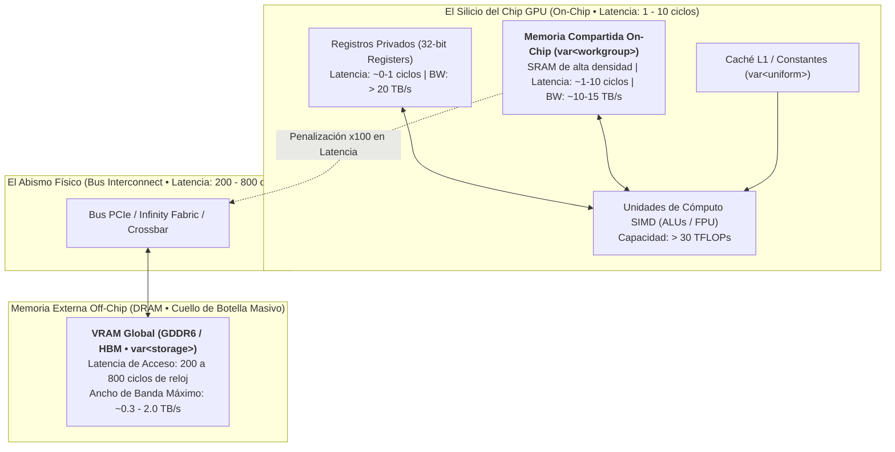

# Capítulo 3: Compute Shaders y Jerarquía de Memoria
## Memoria compartida (`var<workgroup>`), barreras de sincronización y algoritmos paralelos masivos (Reducciones y Tiled GEMM)

**Serie:** *BrowserOS: Computación Nativa en la Web con Wasm, WebGPU y WGSL*  
**Autor:** Antigravity Engineering Lab & O'Reilly Technical Review  
**Bibliografía y Referencias O'Reilly:**
* [Programming Massively Parallel Processors, 4th Edition](https://learning.oreilly.com/library/view/-/9780323984638/?orm_source=mcp) por Wen-mei W. Hwu, David B. Kirk e Izzat El Hajj (*Morgan Kaufmann*)
* [Computer Organization and Design: The Hardware/Software Interface](https://learning.oreilly.com/library/view/-/9780128226742/?orm_source=mcp) por David A. Patterson y John L. Hennessy (*Morgan Kaufmann*)
* [GPU-Accelerated Computing with Python 3 and CUDA](https://learning.oreilly.com/library/view/-/9781803245423/?orm_source=mcp) por Niels Cautaerts y Hossein Ghorbanfekr (*Packt Publishing*)
* [Advances in GPU Research and Practice](https://learning.oreilly.com/library/view/-/9780128037881/?orm_source=mcp) por Hamid Sarbazi-Azad (*Morgan Kaufmann*)
* [High Performance Parallel Runtimes](https://learning.oreilly.com/library/view/-/9783110632897/?orm_source=mcp) por Michael Klemm y Jim Cownie (*De Gruyter Oldenbourg*)
* [The Evolune Metaverse: Meta-Avatars, Spatial Computing, and the Evolution of Humans with AI](https://learning.oreilly.com/library/view/-/9798868815881/?orm_source=mcp) por Frank Lisitano y John Hickie (*Apress*)
* [Vulkan™ Programming Guide: The Official Guide to Learning Vulkan](https://learning.oreilly.com/library/view/-/9780134464701/?orm_source=mcp) por Graham Sellers (*Addison-Wesley Professional*)

---

## 1. La Pared de Memoria (*The Memory Wall*) y el Teorema del Techo (*Roofline Model*)

En los capítulos precedentes establecimos el modelo de concurrencia masiva de WebGPU y la sintaxis rigurosa de WGSL. Sin embargo, en la ingeniería de sistemas paralelos existe una cruda realidad que separa a los desarrolladores aficionados de los arquitectos de alto rendimiento: **los procesadores gráficos no están limitados por su capacidad de cálculo matemático, sino por la velocidad a la que pueden alimentarse de datos**.

Una GPU moderna de gama alta alberga decenas de miles de unidades aritmético-lógicas (ALUs) capaces de ejecutar decenas de billones de operaciones de coma flotante por segundo (TFLOPs). No obstante, esas unidades de cálculo son inútiles si deben permanecer inactivas cientos de ciclos de reloj esperando que un operando llegue desde los módulos de memoria externa (VRAM / DRAM). Este abismo físico entre la capacidad computacional de los transistores y el ancho de banda del bus de memoria se conoce en la literatura académica como **la Pared de Memoria (*The Memory Wall*)**.



### 1.1. Latencia vs. Rendimiento Masivo: La Filosofía GPU
Como explican David A. Patterson y John L. Hennessy en *Computer Organization and Design*:
> *"Mientras que la arquitectura de la CPU dedica la mayor parte de su superficie de silicio a enormes cachés jerárquicas multinivel y a sofisticados circuitos de predicción de saltos y ejecución fuera de orden (Out-of-Order Execution) para minimizar la latencia de un único hilo de instrucciones, la GPU adopta una filosofía diametralmente opuesta: maximizar el rendimiento agregado (throughput) tolerando y ocultando la latencia mediante multithreading masivo impulsado por hardware."*

Cuando un grupo de hilos (*warp* en NVIDIA de 32 hilos, o *wavefront* en AMD de 32/64 hilos) emite una lectura a la memoria global DRAM (`var<storage>`), el controlador de hardware suspende inmediatamente la ejecución de ese warp y conmuta en cero ciclos hacia otro warp cuyos operandos ya estén disponibles en registros locales. Sin embargo, esta estrategia de ocultación de latencia tiene un límite insalvable: si todos los warps están a la espera de la memoria DRAM y el bus externo se satura (*memory saturation*), la GPU entra en hambruna de datos (*data starvation*) y el rendimiento del silicio se desploma por debajo del 5% de su potencial teórico.

### 1.2. Intensidad Aritmética y el Modelo Roofline
Para cuantificar con rigor este fenómeno, Wen-mei W. Hwu, David B. Kirk e Izzat El Hajj introducen en *Programming Massively Parallel Processors (4th Edition)* la métrica de **Intensidad Aritmética** ($I_A$), definida como el número de operaciones en coma flotante (FLOPs) ejecutadas por cada byte de datos transferido desde la memoria global:

$$I_A = \frac{\text{Operaciones de Cómputo (FLOPs)}}{\text{Tráfico de Memoria Global (Bytes)}}$$

El célebre **Modelo del Techo (*Roofline Model*)** postula que el rendimiento alcanzable de un kernel ($P$, en FLOPs por segundo) está acotado por dos techos físicos infranqueables:

$$P = \min\left(P_{\text{pico}},\, I_A \times B_{\text{memoria}}\right)$$

Donde:
* $P_{\text{pico}}$ es la potencia máxima teórica de cálculo de la GPU (GFLOPs/s).
* $B_{\text{memoria}}$ es el ancho de banda máximo del bus de memoria DRAM (GB/s).

```
Rendimiento (FLOP/s) ▲
                     │                      Techo de Cómputo (P_pico)
        P_pico ──────┼───────────────────┌───────────────────────────────
                     │                  /
                     │                 /  Régimen Limitado por Cómputo
                     │                /   (Compute-Bound)
                     │               /
                     │              /
                     │             /   Régimen Limitado por Memoria
                     │            /    (Memory-Bound)
                     │           /
                     │          /  Pendiente = Ancho de Banda (B_memoria)
                     │         /
                     └────────┴─────────────────────────────────────────►
                             I_critica         Intensidad Aritmética (FLOP/Byte)
```

1. **Régimen Limitado por Memoria (*Memory-Bound*):** Si tu algoritmo presenta una intensidad aritmética baja (pocos cálculos por cada dato cargado), el rendimiento queda atrapado en la rampa oblicua. Aumentar el número de núcleos o frecuencias de reloj de la GPU produce una ganancia de rendimiento nula; la memoria es el estrangulamiento.
2. **Régimen Limitado por Cómputo (*Compute-Bound*):** Cuando la intensidad aritmética supera el umbral crítico ($I_{\text{crítica}} = \frac{P_{\text{pico}}}{B_{\text{memoria}}}$), el kernel alcanza la meseta horizontal. En este estado, los buses de memoria no son el cuello de botella y la GPU opera a su máxima eficiencia física.

¿Cómo transformamos un algoritmo inherentemente limitado por memoria (como la multiplicación de matrices o las convoluciones profundas en redes neuronales) en un algoritmo limitado por cómputo? **Reutilizando datos en el silicio**. Y el vehículo para lograrlo en WebGPU es la **Memoria Compartida de Grupo de Trabajo (`var<workgroup>`)**.

---

## 2. La Jerarquía Física de Memoria en WebGPU y WGSL

Para aprovechar el hardware sin intermediarios abstractos, WGSL modela de forma explícita la jerarquía multinivel de los multiprocesadores de la GPU. Cada nivel posee características físicas, ámbitos de visibilidad y costes de latencia radicalmente dispares:

| Espacio de Memoria WGSL | Ubicación Física | Ámbito de Visibilidad (*Scope*) | Latencia Típica | Ancho de Banda | Capacidad Típica |
|---|---|---|---|---|---|
| **Registros Privados** (`let`, `var<private>`, variables locales) | Banco de registros en silicio (*Register File*) | Exclusivo del hilo individual (*Invocation*) | **~0 - 1 ciclos** | > 20 TB/s | Decenas de KB por bloque |
| **Memoria Compartida** (`var<workgroup>`) | Memoria SRAM On-Chip (LDS en AMD / Shared Memory en NVIDIA) | Todos los hilos del **mismo Workgroup** | **~1 - 10 ciclos** | **~10 - 15 TB/s** | **16 KB a 64 KB por SM** |
| **Caché de Constantes** (`var<uniform>`) | Memoria DRAM respaldada por Caché L1/L2 dedicada | Global (Solo Lectura, Broadcast óptimo) | ~5 - 15 ciclos (en acierto de caché) | ~5 TB/s | 64 KB garantizados |
| **Memoria Global de Almacenamiento** (`var<storage>`) | Módulos externos de DRAM (GDDR6 / HBM) | **Universal**: Todos los hilos, todos los workgroups y CPU | **~200 - 800 ciclos** | ~0.3 - 2 TB/s | Gigabytes (VRAM total del dispositivo) |

### 2.1. Memoria Compartida (`var<workgroup>`): Anatomía en el Silicio
La memoria compartida no reside en la lejana placa de circuito impreso junto a los módulos GDDR6, sino **en el mismísimo corazón del procesador de flujo (Streaming Multiprocessor o Compute Unit)**, compartiendo oblea de silicio con las propias unidades aritméticas. Por esta razón, su latencia de acceso es dos órdenes de magnitud más rápida que la de la memoria global (de 4 a 10 ciclos frente a 600 ciclos).

En la especificación WebGPU, la cantidad de memoria compartida asignable a un grupo de trabajo está regulada por el límite del adaptador:
* **`maxComputeWorkgroupStorageSize`:** El estándar W3C garantiza un mínimo inviolable de **16.384 bytes (16 KB)** por workgroup en cualquier dispositivo conforme (móviles, portátiles o estaciones de trabajo), extensible habitualmente a 32 KB o 64 KB en hardware de escritorio.

Esto implica que un workgroup de 256 hilos puede reservar holgadamente:
* $16.384 \text{ bytes} / 4 \text{ bytes (f32)} = 4.096 \text{ floats de precisión simple}$.
* O bien $1.024 \text{ vectores } \text{vec4<f32>}$.

---

## 3. Bancos de Memoria y Conflictos de Acceso (*Bank Conflicts*)

Para suministrar datos a 32 hilos simultáneamente en un único ciclo de reloj sin provocar caídas de tensión, la SRAM de la memoria compartida está dividida internamente en **32 módulos independientes llamados bancos de memoria (*memory banks*)**, indexados en palabras sucesivas de 4 bytes (32 bits):

$$\text{Banco ID} = (\text{Dirección de Byte} / 4) \pmod{32}$$

```
Banco 0    Banco 1    Banco 2   ...   Banco 31
┌────────┐ ┌────────┐ ┌────────┐     ┌────────┐
│ Word 0 │ │ Word 1 │ │ Word 2 │ ... │ Word 31│  ◄── Fila 0 (Bytes 0 .. 127)
├────────┤ ├────────┤ ├────────┤     ├────────┤
│ Word 32│ │ Word 33│ │ Word 34│ ... │ Word 63│  ◄── Fila 1 (Bytes 128 .. 255)
└────────┘ └────────┘ └────────┘     └────────┘
```

Como advierten Niels Cautaerts y Hossein Ghorbanfekr en *GPU-Accelerated Computing with Python 3 and CUDA*:
* **Acceso Paralelo Ideal (Sin Conflicto):** Si los 32 hilos de un warp acceden a 32 direcciones que caen en bancos distintos, los 32 accesos se despachan en **un único ciclo de reloj**.
* **Acceso Broadcast (Difusión Gratuita):** Si todos los hilos del warp leen exactamente la misma dirección en el mismo banco, el hardware realiza un *broadcast* en un único ciclo.
* **Conflicto de Bancos (*Bank Conflict*):** Si dos o más hilos intentan acceder a direcciones distintas que pertenecen al **mismo banco**, las solicitudes deben serializarse. Un conflicto de 2 vías duplica el tiempo de acceso; un conflicto de 32 vías degrada el rendimiento de la SRAM compartida al nivel de una cola secuencial.

En el diseño de matrices bidimensionales en memoria compartida (`tile[16][16]`), veremos cómo el tamaño de baldosa evita naturalmente estos conflictos o cómo la técnica del *padding* artificial (`tile[16][17]`) rompe la coincidencia de pasos.

---

## 4. Primitivas de Sincronización en WGSL: `workgroupBarrier()` y `storageBarrier()`

El uso de `var<workgroup>` en WGSL está sujeto a reglas estructurales estrictas diseñadas para garantizar la seguridad del código y la coherencia del compilador nativo (Tint / Naga).

### 3.1. Declaración y Restricciones Estructurales
1. **Ámbito de Módulo Obligatorio:** Las variables `var<workgroup>` **deben declararse en el ámbito global del módulo**, fuera de cualquier función o punto de entrada `@compute`.
2. **Prohibición de Inicializadores:** Está estrictamente prohibido asignar un valor inicial en la declaración:
   ```wgsl
   // ❌ ERROR FATAL DE COMPILACIÓN EN WGSL:
   var<workgroup> buffer: array<f32, 256> = array<f32, 256>(); 

   // ✅ CORRECTO: Declaración limpia sin inicializador:
   var<workgroup> buffer: array<f32, 256>;
   ```
   *Justificación Física:* La memoria compartida se asigna en la SRAM cuando el bloque es programado en el silicio. Inicializarla automáticamente requeriría que el compilador inyectara bucles ocultos de escritura antes de lanzar tus hilos, consumiendo valiosos ciclos de reloj. WGSL delega la responsabilidad de la carga colaborativa al programador.
3. **Persistencia:** La memoria compartida se crea al iniciar el workgroup y se destruye cuando todos sus hilos finalizan. No retiene datos entre diferentes despachos (`dispatchWorkgroups`) ni entre workgroups distintos.

### 3.2. Sincronización y Carreras de Datos (*Data Races*)
Cuando 256 hilos leen y escriben concurrentemente en la misma memoria compartida, se manifiestan los tres peligros clásicos del paralelismo:
* **RAW (*Read-After-Write*):** Un hilo lee un valor antes de que el hilo productor haya terminado de escribirlo.
* **WAR (*Write-After-Read*):** Un hilo sobrescribe un dato que otro hilo rezagado todavía necesitaba leer.
* **WAW (*Write-After-Write*):** Dos hilos escriben concurrentemente en la misma celda, produciendo un resultado final impredecible.

Para eliminar estas anomalías, WGSL proporciona dos primitivas atómicas de sincronización:

#### `workgroupBarrier()`
Es la herramienta reina de los algoritmos paralelos en WebGPU. Realiza una operación dual:
1. **Barrera de Ejecución:** Detiene a todos los hilos del workgroup en ese punto exacto del código. Ningún hilo tiene permitido avanzar hasta que **todos y cada uno de los hilos del bloque** hayan alcanzado la barrera.
2. **Barrera de Memoria (*Memory Fence* para Workgroup):** Garantiza que todas las escrituras en variables `var<workgroup>` realizadas por cualquier hilo antes de la barrera se completen físicamente y sean visibles de forma inmediata y coherente para el resto de hilos tras cruzar la barrera.

#### `storageBarrier()`
Garantiza la consistencia de memoria sobre búferes globales (`var<storage, read_write>`). Sincroniza las escrituras en la VRAM externa para los hilos pertenecientes al mismo workgroup, asegurando que las modificaciones previas sean visibles para lecturas posteriores dentro del grupo.

### 3.3. La Regla de Oro: Prohibición de Divergencia de Barreras (*Barrier Divergence*)
Una de las causas más graves de cuelgues del controlador gráfico (*GPU Hang / TDR*) en novatos es colocar una barrera dentro de una rama condicional que no toman todos los hilos del grupo:

```wgsl
// ❌ PELIGRO MORTAL: CONDICIÓN DE BLOQUEO PERMANENTE (DEADLOCK)
if (local_id.x < 16u) {
    workgroupBarrier(); // ¡Los hilos 16..255 jamás llegarán aquí!
}
```

Si los hilos del $0$ al $15$ entran en la barrera y se detienen a esperar a sus compañeros, pero los hilos del $16$ al $255$ toman la rama alternativa y continúan su camino sin alcanzar la barrera, el hardware entra en un **bloqueo mutuo perpetuo (*Deadlock*)**. La GPU detecta que los hilos nunca avanzan, el sistema operativo aborta el controlador de pantalla y el contexto WebGPU se destruye instantáneamente (*device lost*).

> **Ley Inviolable del Silicio:** En WGSL, toda llamada a `workgroupBarrier()` o `storageBarrier()` debe ubicarse en **flujo de control uniforme (*uniform control flow*)**. Debe garantizarse matemáticamente que o bien **todos los hilos del workgroup ejecutan la barrera**, o bien **ninguno la ejecuta**.

---

## 5. Algoritmo 1: Reducción Paralela en Árbol ($O(\log N)$)

### 5.0. Los Dos Pilares Algorítmicos del Silicio: Reducción y Baldosas
Antes de adentrarnos en el taller práctico interactivo, es fundamental dominar los dos algoritmos paralelos canónicos que articulan la computación gráfica moderna, el cálculo científico y la inteligencia artificial en el silicio:
1. **Algoritmo 1: Reducción Paralela en Árbol ($O(\log N)$):** El arquetipo de agregación colectiva masiva. Permite sumar, promediar o calcular normas sobre vectores de millones de elementos en tiempo logarítmico comprimiendo datos en la SRAM compartida.
2. **Algoritmo 2: Multiplicación Matricial por Bloques (*Tiled GEMM*):** El motor matricial que alimenta las redes neuronales profundas y los modelos *Transformers*. Descompone tensores en baldosas bidimensionales cargadas cooperativamente en memoria compartida para maximizar la intensidad aritmética y reducir el tráfico a la DRAM externa en más de un 93%.

En este apartado nos sumergimos de lleno en la arquitectura y matemáticas del primero de ellos: **la Reducción Paralela en Árbol**.

### 5.1. El Paradigma de Reducción Logarítmica frente al Bucle Secuencial CPU
Sumar un vector masivo de $N$ elementos es el arquetipo de operación colectiva en física computacional y aprendizaje profundo (cálculo de funciones de pérdida, normas vectoriales, capas *Softmax*).

En una CPU tradicional, la reducción se ejecuta secuencialmente mediante un bucle acumulador con complejidad lineal $O(N)$:
```c
float suma = 0.0f;
for (int i = 0; i < N; i++) suma += data[i]; // N pasos lentos
```

Para sumar miles o millones de elementos sin incurrir en la lentitud lineal $O(N)$ de una CPU, en la GPU organizamos los hilos en un **árbol binario logarítmico con complejidad $O(\log_2 N)$**:
* **Carga inicial colaborativa:** Cada hilo copia un elemento desde DRAM al array en memoria compartida `s_data` y espera en `workgroupBarrier()`.
* **Plegado sin Divergencia SIMD:** En lugar de usar el operador módulo (`tid % 2 == 0`), se utiliza un paso descendente (`stride >>= 1`) con condición de índice compacto (`if (tid < stride)`). De este modo, los hilos activos ocupan siempre posiciones contiguas ($0$ a `stride - 1`), manteniendo a warps completos trabajando al 100% de ocupación y warps inactivos totalmente apagados sin divergencia interna.

Un bloque de 256 elementos se reduce a una sola suma en tan solo $\log_2(256) = 8$ pasos paralelos:

```mermaid
graph TD
    subgraph "Fase 0: Carga a Shared Memory (256 elementos)"
        H0["T0: [0]"]
        H1["T1: [1]"]
        H2["..."]
        H128["T128: [128]"]
        H255["T255: [255]"]
    end

    subgraph "Paso 1: Stride = 128 (128 sumas simultáneas)"
        H0 -->|+ [128]| S1_0["T0: [0]+[128]"]
        H1 -->|+ [129]| S1_1["T1: [1]+[129]"]
        H2 --> S1_2["..."]
    end

    subgraph "Paso 2: Stride = 64 (64 sumas simultáneas)"
        S1_0 -->|+ [64]| S2_0["T0: acumulado"]
        S1_1 -->|+ [65]| S2_1["T1: acumulado"]
    end

    subgraph "Pasos Sucesivos: Stride = 32, 16, 8, 4, 2, 1"
        S2_0 --> S_FINAL["<b>Hilo 0 escribe la Suma Total</b><br/>en Memoria Global DRAM"]
    end
```

### 5.2. Anatomía de la Divergencia de Warps: El Gran Error del Principiante
La implementación del bucle en árbol es el clásico campo de minas donde se demuestra la maestría en arquitectura de hardware. Consideremos el enfoque ingenuo que suele encontrarse en foros no especializados:

```wgsl
// ⚠️ IMPLEMENTACIÓN INGENUA E INEFICIENTE (Divergencia Destructiva):
for (var s: u32 = 1u; s < 256u; s *= 2u) {
    if (tid % (2u * s) == 0u) { // ❌ OPERADOR MÓDULO: DIVERGENCIA TOTAL
        s_data[tid] += s_data[tid + s];
    }
    workgroupBarrier();
}
```
*¿Por qué este código es destructivo en el silicio?*  
La condición `tid % (2 * s) == 0` provoca que en el primer paso solo trabajen los hilos pares ($0, 2, 4, \dots$). Dentro de un mismo warp de 32 hilos, la mitad de los carriles SIMD deben apagarse mientras la otra mitad trabaja. En el paso 2, solo trabaja 1 de cada 4 hilos (75% de ineficiencia). El hardware está pagando el coste de ejecución completo para desaprovechar la inmensa mayoría de sus transistores.

### 5.3. La Solución Óptima: Reducción con Índices Compactos
Para erradicar la divergencia de warps, invertimos la dirección del paso (*stride* descendente) y concentramos a los hilos activos en un bloque contiguo al inicio:

```wgsl
// ✅ IMPLEMENTACIÓN ÓPTIMA: CERO DIVERGENCIA DE WARPS
for (var stride: u32 = WG_SIZE / 2u; stride > 0u; stride >>= 1u) {
    if (tid < stride) { // Hilos activos contiguos (0 .. stride-1)
        s_data[tid] += s_data[tid + stride];
    }
    workgroupBarrier();
}
```
*La Belleza del Silicio:*  
Cuando `stride = 128`, los hilos del $0$ al $127$ (warps 0, 1, 2 y 3 íntegros) trabajan a pleno rendimiento (100% de ocupación SIMD). Los warps 4, 5, 6 y 7 quedan inactivos en su totalidad, permitiendo que el planificador de la GPU asigne los recursos de ejecución a otros procesos. No hay carriles enmascarados dentro de ningún warp activo.

### 5.4. Código Completo del Shader WGSL de Reducción
```wgsl
const WG_SIZE: u32 = 256u;

@group(0) @binding(0) var<storage, read> datos_entrada: array<f32>;
@group(0) @binding(1) var<storage, read_write> sumas_parciales: array<f32>;

// Memoria compartida ultrarrápida (SRAM on-chip)
var<workgroup> s_data: array<f32, 256>;

@compute @workgroup_size(256)
fn main(
    @builtin(global_invocation_id) gid: vec3<u32>,
    @builtin(local_invocation_id) lid: vec3<u32>,
    @builtin(workgroup_id) wgid: vec3<u32>
) {
    let tid = lid.x;

    // 1. Carga cooperativa: cada hilo transfiere un float de DRAM a SRAM
    s_data[tid] = datos_entrada[gid.x];

    // Sincronizar: Asegurar que los 256 floats residen en SRAM antes de sumar
    workgroupBarrier();

    // 2. Plegado logarítmico en árbol (8 pasos: 128 -> 64 -> 32 -> 16 -> 8 -> 4 -> 2 -> 1)
    for (var stride: u32 = WG_SIZE / 2u; stride > 0u; stride >>= 1u) {
        if (tid < stride) {
            s_data[tid] += s_data[tid + stride];
        }
        // Barrera esencial: sincronizar la memoria compartida entre niveles del árbol
        workgroupBarrier();
    }

    // 3. Consolidación: Únicamente el hilo 0 escribe el total del bloque en DRAM
    if (tid == 0u) {
        sumas_parciales[wgid.x] = s_data[0];
    }
}
```

---

## 6. Algoritmo 2: Multiplicación Matricial por Bloques (*Tiled GEMM*)

La multiplicación de matrices dense ($C = A \times B$) es el núcleo algorítmico de los modelos de inteligencia artificial modernos (redes neuronales convolucionales, mecanismos de auto-atención en *Transformers* y LLMs). En el entorno del navegador (*BrowserOS*), ejecutar inferencia nativa de modelos como Whisper o LLaMA a 60 FPS exige optimizar esta operación hasta el límite físico del silicio.

Sean las matrices cuadradas $A \in \mathbb{R}^{N \times N}$ y $B \in \mathbb{R}^{N \times N}$. Cada elemento resultante $C[i, j]$ se define formalmente como:

$$C[i, j] = \sum_{k=0}^{N-1} A[i, k] \cdot B[k, j]$$

### 6.1. El Desastre del Enfoque Ingenuo (*Naive Matrix Multiply*)
En una implementación ingenua, asignamos un hilo de cómputo por cada elemento $(i, j)$ de la matriz $C$. Para calcular su valor, dicho hilo recorre la fila $i$ de $A$ y la columna $j$ de $B$ leyendo secuencialmente de la memoria global DRAM:

```wgsl
// ⚠️ IMPLEMENTACIÓN INGENUA: ESTRANGULAMIENTO DE MEMORIA
@compute @workgroup_size(16, 16)
fn main(@builtin(global_invocation_id) gid: vec3<u32>) {
    let row = gid.y;
    let col = gid.x;
    var sum: f32 = 0.0;
    for (var k: u32 = 0u; k < N; k++) {
        // ❌ 2 lecturas de DRAM lenta (~600 ciclos) por CADA multiplicación
        sum += matA[row * N + k] * matB[k * N + col];
    }
    matC[row * N + col] = sum;
}
```

Analicemos el coste de tráfico de memoria para una matriz de dimensiones moderadas ($N = 4.096$):
* Matriz $C$: $4.096 \times 4.096 = 16.777.216 \text{ elementos}$ (hilos).
* Cada hilo realiza $4.096$ iteraciones, leyendo $2 \text{ floats}$ en cada una: $8.192 \text{ lecturas de DRAM}$.
* Tráfico total a DRAM: $16.777.216 \times 8.192 \times 4 \text{ bytes} \approx \mathbf{549{,}75 \text{ Gigabytes}}$.
* Intensidad Aritmética: $I_A = \frac{2 \text{ FLOPs}}{8 \text{ Bytes}} = \mathbf{0{,}25 \text{ FLOP/Byte}}$.

Con un ancho de banda de memoria de $500 \text{ GB/s}$, ¡la GPU tardaría más de 1 segundo entero solo en transferir los datos por el bus! El kernel está violentamente atrapado en el régimen *Memory-Bound*.

### 6.2. El Paradigma de Baldosas (*Tiling* con `var<workgroup>`)
El desperdicio en el enfoque ingenuo radica en que los hilos de una misma fila leen repetidamente los mismos elementos de $A$, y los hilos de una misma columna leen repetidamente los mismos elementos de $B$.

El algoritmo **Tiled GEMM** explota este principio mediante el principio de localidad espacial y temporal:
1. Dividimos las matrices $A$, $B$ y $C$ en baldosas cuadradas (*tiles*) de tamaño $\text{TILE\_SIZE} \times \text{TILE\_SIZE}$ (habitualmente $16 \times 16$).
2. Un workgroup de $16 \times 16 = 256$ hilos se hace responsable de computar una baldosa completa de la matriz $C$.
3. La dimensión común $K$ se recorre por bloques: en cada fase, los 256 hilos cargan **colaborativamente** una baldosa de $A$ y una baldosa de $B$ desde la lenta memoria global hacia dos arrays en memoria compartida on-chip (`tile_a` y `tile_b`).
4. Se ejecuta `workgroupBarrier()` para confirmar que la baldosa está completa en SRAM.
5. Cada hilo calcula el producto punto parcial de su elemento consumiendo los 16 floats directamente de la memoria compartida (latencia de 4 ciclos). Cada dato cargado de DRAM es reutilizado **16 veces consecutivas** por los hilos hermanos.
6. Se ejecuta una segunda `workgroupBarrier()` para evitar que los hilos rápidos sobrescriban la memoria compartida antes de que los rezagados terminen de leerla (*anti-race protection*).

```
Matriz Global A (DRAM)              Matriz Global B (DRAM)
┌───┬───┬───┬───┐                   ┌───┬───┬───┬───┐
│   │   │   │   │                   │   │   │ B │   │ ◄── Baldosa k de B
├───┼───┼───┼───┤                   ├───┼───┼───┼───┤
│   │ A │   │   │ ◄── Baldosa k     │   │   │   │   │
├───┼───┼───┼───┤     de A          ├───┼───┼───┼───┤
│   │   │   │   │                   │   │   │   │   │
└───┴───┴───┴───┘                   └───┴───┴───┴───┘
          │                                   │
          └───────────────┬───────────────────┘
                          ▼
            Carga Cooperativa a SRAM On-Chip
        ┌───────────────────────────────────────┐
        │ tile_a (16x16)  │  tile_b (16x16)     │ ◄── var<workgroup> (~4 ciclos)
        └───────────────────────────────────────┘
                          │
                   workgroupBarrier()
                          │
                          ▼
        256 hilos calculan acumulados en paralelo
        sin tocar la DRAM durante 16 ciclos
                          │
                   workgroupBarrier()
                          │
                          ▼
             Avanzar a la siguiente baldosa k
```

### 6.3. El Incremento Cuantitativo de Intensidad Aritmética
Al utilizar baldosas de $16 \times 16$:
* En cada fase, el bloque transfiere $2 \times (16 \times 16) \times 4 \text{ bytes} = 2.048 \text{ bytes}$ desde DRAM.
* En esa misma fase, el bloque ejecuta $(16 \times 16) \times 16 \times 2 \text{ FLOPs} = 65.536 \text{ FLOPs}$.
* La nueva Intensidad Aritmética es:
  $$I_A = \frac{65.536 \text{ FLOPs}}{2.048 \text{ Bytes}} = \mathbf{32{,}0 \text{ FLOP/Byte}}$$

¡Hemos multiplicado la intensidad aritmética y reducido el tráfico hacia la DRAM externa exactamente por un factor de $16\times$ (un ahorro del **93,75% de ancho de banda**)! Para baldosas de $32 \times 32$, la reducción es de $32\times$ (96,87% de ahorro). El algoritmo abandona la rampa de memoria y se sitúa en la meseta de máxima potencia de cómputo del procesador.

---

### 6.4. Código WGSL Completo y Comentado: Tiled GEMM
```wgsl
// Parámetros de baldosa fijados en tiempo de compilación
const TILE_SIZE: u32 = 16u;
const MATRIX_DIM: u32 = 64u; // Dimensiones M = K = N = 64 para este ejemplo

@group(0) @binding(0) var<storage, read> matA: array<f32>;
@group(0) @binding(1) var<storage, read> matB: array<f32>;
@group(0) @binding(2) var<storage, read_write> matC: array<f32>;

// Memoria compartida on-chip ultrarrápida (SRAM local al Workgroup)
// 2 arrays de 16x16 floats = 2 KB de SRAM (muy por debajo del límite de 16 KB)
var<workgroup> tile_a: array<array<f32, 16>, 16>;
var<workgroup> tile_b: array<array<f32, 16>, 16>;

@compute @workgroup_size(16, 16)
fn main(
    @builtin(global_invocation_id) global_id: vec3<u32>,
    @builtin(local_invocation_id) local_id: vec3<u32>
) {
    let row = global_id.y;
    let col = global_id.x;
    let lx = local_id.x;
    let ly = local_id.y;

    // Registro privado ultrarrápido para acumular la suma parcial del hilo
    var accum: f32 = 0.0;

    // Número de baldosas a lo largo de la dimensión compartida K
    let num_tiles = MATRIX_DIM / TILE_SIZE;

    // Bucle exterior: itera baldosa a baldosa a lo largo de K
    for (var t: u32 = 0u; t < num_tiles; t++) {
        
        // 1. CARGA COOPERATIVA: Cada hilo carga 1 elemento de A y 1 de B a SRAM
        let idx_a_k = t * TILE_SIZE + lx;
        let idx_b_k = t * TILE_SIZE + ly;

        tile_a[ly][lx] = matA[row * MATRIX_DIM + idx_a_k];
        tile_b[ly][lx] = matB[idx_b_k * MATRIX_DIM + col];

        // 2. BARRERA DE ENTRADA: Esperar a que los 256 hilos llenen las baldosas
        workgroupBarrier();

        // 3. CÓMPUTO EN BALDOSA: Producto punto parcial leyendo 100% de SRAM
        for (var k: u32 = 0u; k < TILE_SIZE; k++) {
            accum += tile_a[ly][k] * tile_b[k][lx];
        }

        // 4. BARRERA DE PROTECCIÓN: Prohibir sobrescribir las baldosas en la 
        // siguiente iteración hasta que todos los hilos hayan terminado de leer
        workgroupBarrier();
    }

    // 5. ESCRITURA FINAL: Almacenar el resultado consolidado en la matriz C en DRAM
    matC[row * MATRIX_DIM + col] = accum;
}
```

---

## 7. Orquestación en Host (JavaScript WebGPU)

Para despachar estos algoritmos desde el navegador con total seguridad, configuramos las restricciones explícitas del hardware en el pipeline de cómputo:

```javascript
// host_pipeline.js
async function runTiledGemm() {
  // 1. Obtener adaptador solicitando capacidades de alto rendimiento
  const adapter = await navigator.gpu.requestAdapter({
    powerPreference: "high-performance"
  });

  // 2. Solicitar dispositivo asegurando el soporte de memoria compartida
  const device = await adapter.requestDevice({
    requiredLimits: {
      maxComputeWorkgroupStorageSize: 16384 // 16 KB garantizados por estándar
    }
  });

  // 3. Compilar módulo WGSL
  const shaderModule = device.createShaderModule({
    code: wgslShaderSource
  });

  // 4. Crear Pipeline de Cómputo con diseño automático de layouts
  const computePipeline = device.createComputePipeline({
    layout: "auto",
    compute: {
      module: shaderModule,
      entryPoint: "main"
    }
  });

  // 5. Creación de Búferes GPU (Matrices 64x64 de f32 = 16.384 bytes cada una)
  const bufferSize = 64 * 64 * Float32Array.BYTES_PER_ELEMENT;

  const bufA = device.createBuffer({
    size: bufferSize,
    usage: GPUBufferUsage.STORAGE | GPUBufferUsage.COPY_DST
  });

  const bufB = device.createBuffer({
    size: bufferSize,
    usage: GPUBufferUsage.STORAGE | GPUBufferUsage.COPY_DST
  });

  const bufC = device.createBuffer({
    size: bufferSize,
    usage: GPUBufferUsage.STORAGE | GPUBufferUsage.COPY_SRC
  });

  // 6. Enlace de recursos mediante GPUBindGroup
  const bindGroup = device.createBindGroup({
    layout: computePipeline.getBindGroupLayout(0),
    entries: [
      { binding: 0, resource: { buffer: bufA } },
      { binding: 1, resource: { buffer: bufB } },
      { binding: 2, resource: { buffer: bufC } }
    ]
  });

  // 7. Grabación del Pase de Cómputo
  const commandEncoder = device.createCommandEncoder();
  const pass = commandEncoder.beginComputePass();
  
  pass.setPipeline(computePipeline);
  pass.setBindGroup(0, bindGroup);

  // Despacho de baldosas: 64x64 dividido en baldosas de 16x16 = 4x4 workgroups
  pass.dispatchWorkgroups(4, 4, 1);
  pass.end();

  // 8. Enviar cola de comandos al silicio
  device.queue.submit([commandEncoder.finish()]);
}
```

---

## 8. Laboratorio Interactivo: El Taller de Silicio y Memoria en Vivo

Para experimentar de forma táctil e interactiva la sincronización de hilos, el flujo de baldosas y la reducción paralela, hemos desarrollado el visualizador interactivo:

👉 **[workshop_06_tiled_gemm_and_reduction.html](file:///Volumes/MisAppsV/SearchMCP/tutorial_webgpu_wgsl/workshop_06_tiled_gemm_and_reduction.html)**

### Capacidades del Simulador:
1. **Conmutador de Algoritmos en Vivo:** Alterna instantáneamente entre la multiplicación matricial por bloques (*Tiled GEMM*) y la reducción en árbol logarítmica (*Parallel Tree Reduction*).
2. **Editor Profesional VS Code Dark+ Sincronizado:** Inspecciona el código de los shaders y del host con foco pedagógico dinámico (*spotlight*).
3. **Paso a Paso de Silicio de Tiled GEMM:** Avanza baldosa a baldosa a lo largo de la dimensión compartida $K$ y observa cómo las celdas de la memoria DRAM global se copian a los bancos de la memoria compartida SRAM on-chip.
4. **Visualizador de Divergencia en Reducción:** Observa gráficamente el plegado de 16 hilos paso a paso y comprueba cómo los hilos activos se mantienen compactados en índices contiguos para erradicar la divergencia de warps.
5. **Telemetría de Hardware en Tiempo Real:** Monitoriza el tráfico ahorrado a la memoria global (reducción de $16\times$), el incremento de intensidad aritmética y la barra comparativa física de latencias (DRAM ~600 ciclos vs. SRAM ~4 ciclos).

---

## 9. Bibliografía y Lecturas Recomendadas para Profundizar

Para dominar la optimización a nivel de silicio, la consistencia de memoria y el diseño de algoritmos paralelos masivos, se recomienda el estudio exhaustivo de las siguientes obras de la biblioteca **O'Reilly Learning**:

1. **[Programming Massively Parallel Processors: A Hands-on Approach (4th Edition)](https://learning.oreilly.com/library/view/-/9780323984638/?orm_source=mcp)**  
   *Wen-mei W. Hwu, David B. Kirk e Izzat El Hajj (Morgan Kaufmann)*  
   * **Por qué leerlo:** El texto sagrado de la computación masivamente paralela. Los capítulos dedicados a memoria compartida (*Shared Memory*), multiplicación matricial por baldosas (*Tiled Matrix Multiplication*), conflictos de bancos y el modelo de reducción paralela en árbol constituyen la base teórica y matemática directa de este capítulo.

2. **[Computer Organization and Design: The Hardware/Software Interface](https://learning.oreilly.com/library/view/-/9780128226742/?orm_source=mcp)**  
   *David A. Patterson y John L. Hennessy (Morgan Kaufmann)*  
   * **Por qué leerlo:** La referencia canónica de arquitectura de computadores. El análisis de Patterson y Hennessy sobre la Pared de Memoria (*Memory Wall*), el modelo Roofline y la jerarquía de memoria multinivel desmitifica la física del silicio que condiciona el rendimiento de las GPUs.

3. **[GPU-Accelerated Computing with Python 3 and CUDA](https://learning.oreilly.com/library/view/-/9781803245423/?orm_source=mcp)**  
   *Niels Cautaerts y Hossein Ghorbanfekr (Packt Publishing)*  
   * **Por qué leerlo:** Obra contemporánea de ingeniería aplicada. Detalla con precisión quirúrgica el funcionamiento de los bancos de memoria compartida, el acceso coalescente a memoria y la optimización de primitivas atómicas de sincronización.

4. **[Advances in GPU Research and Practice](https://learning.oreilly.com/library/view/-/9780128037881/?orm_source=mcp)**  
   *Hamid Sarbazi-Azad (Morgan Kaufmann)*  
   * **Por qué leerlo:** Compendio técnico de investigación avanzada sobre arquitecturas multinúcleo, interconexiones en chip y modelos de consistencia débil de memoria en hardware gráfico masivo.

5. **[High Performance Parallel Runtimes](https://learning.oreilly.com/library/view/-/9783110632897/?orm_source=mcp)**  
   *Michael Klemm y Jim Cownie (De Gruyter Oldenbourg)*  
   * **Por qué leerlo:** Fundamental para entender la mecánica de barreras de sincronización a bajo nivel, la prevención de condiciones de carrera (*race conditions*) y el diseño de runtimes para arquitecturas heterogéneas.

6. **[The Evolune Metaverse: Meta-Avatars, Spatial Computing, and the Evolution of Humans with AI](https://learning.oreilly.com/library/view/-/9798868815881/?orm_source=mcp)**  
   *Frank Lisitano y John Hickie (Apress)*  
   * **Por qué leerlo:** Ilustra la aplicación práctica de compute shaders WGSL en el navegador para transformaciones matriciales masivas y simulaciones físicas en tiempo real para entornos web espaciales.

7. **[Vulkan™ Programming Guide: The Official Guide to Learning Vulkan](https://learning.oreilly.com/library/view/-/9780134464701/?orm_source=mcp)**  
   *Graham Sellers (Addison-Wesley Professional)*  
   * **Por qué leerlo:** La guía oficial del estándar en el que se cimenta la capa de cómputo de WebGPU. Esencial para profundizar en las barreras de memoria (*memory barriers*) y las etapas de canalización (*pipeline stages*) a nivel de controlador nativo.

---

## 10. Próximo Paso: Hacia el Capítulo 4

Con la jerarquía de memoria física, la memoria compartida `var<workgroup>`, las barreras de sincronización y los algoritmos paralelos avanzados dominados, estamos listos para conquistar el siguiente gran territorio de la GPU:

En el **Capítulo 4: Texturas, Samplers y Computación Gráfica Avanzada en WGSL**, abordaremos:
* La diferencia física fundamental entre búferes lineales (`array<T>`) y texturas multidimensionales con almacenamiento espacial entrelazado (*Morton / Z-order curve*).
* El hardware dedicado de muestreo (*Texture Filtering Units*) para interpolación bilineal y trilineal gratuita en silicio.
* Filtros de convolución bidimensional para procesamiento de imágenes de alta fidelidad, visión artificial y procesamiento de señales en tiempo real mediante compute shaders.
