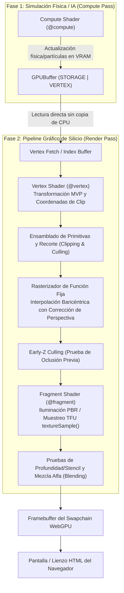
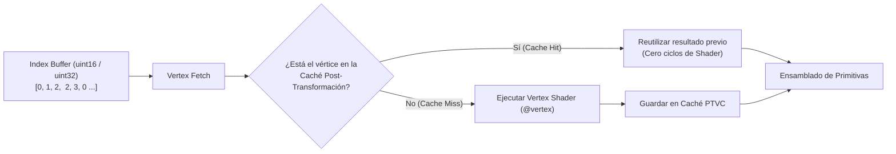
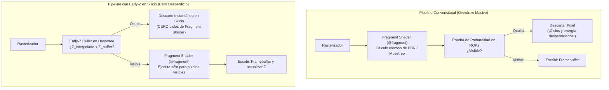
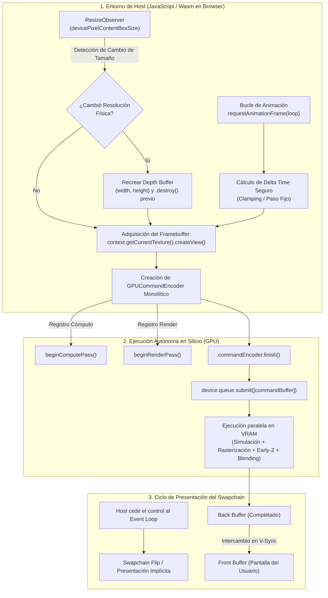

# Capítulo 5: El Pipeline Gráfico Completo, Rasterización y la Síntesis Compute-to-Render en WebGPU
## Geometría tridimensional, Vertex y Fragment Shaders, hardware de función fija (Rasterizer y Z-Buffer) y la convergencia de cómputo y render en el BrowserOS definitivo

**Serie:** *BrowserOS: Computación Nativa en la Web con Wasm, WebGPU y WGSL*  
**Autor:** Antigravity Engineering Lab & O'Reilly Technical Review  
**Bibliografía y Referencias O'Reilly:**
* [Real-Time Rendering, Fourth Edition](https://learning.oreilly.com/library/view/-/9781351816144/?orm_source=mcp) por Tomas Akenine-Möller, Eric Haines y Naty Hoffman (*A K Peters/CRC Press*)
* [Physically Based Rendering, 3rd Edition](https://learning.oreilly.com/library/view/-/9780128007099/?orm_source=mcp) por Matt Pharr, Wenzel Jakob y Greg Humphreys (*Morgan Kaufmann*)
* [Vulkan™ Programming Guide: The Official Guide to Learning Vulkan](https://learning.oreilly.com/library/view/-/9780134464701/?orm_source=mcp) por Graham Sellers (*Addison-Wesley Professional*)
* [Vulkan 3D Graphics Rendering Cookbook - Second Edition](https://learning.oreilly.com/library/view/-/9781803248110/?orm_source=mcp) por Sergey Kosarevsky, Alexey Medvedev y Viktor Latypov (*Packt Publishing*)
* [Practical Shader Development: Vertex and Fragment Shaders for Game Developers](https://learning.oreilly.com/library/view/-/9781484244579/?orm_source=mcp) por Kyle Halladay (*Apress*)
* [Computer Organization and Design RISC-V Edition](https://learning.oreilly.com/library/view/-/9780128226742/?orm_source=mcp) por David A. Patterson y John L. Hennessy (*Morgan Kaufmann*)
* [WebAssembly: The Definitive Guide](https://learning.oreilly.com/library/view/-/9781492089834/?orm_source=mcp) por Brian Sletten (*O'Reilly Media*)
* [Programming Massively Parallel Processors, 4th Edition](https://learning.oreilly.com/library/view/-/9780323984638/?orm_source=mcp) por Wen-mei W. Hwu, David B. Kirk e Izzat El Hajj (*Morgan Kaufmann*)

---

## Introducción: El Salto del Cómputo Puro a la Realidad Tridimensional

A lo largo de los cuatro capítulos anteriores de esta serie hemos conquistado los cimientos de la computación masiva en el silicio gráfico:
1. **En el Capítulo 1**, desmitificamos la GPU como un mero dispositivo de dibujo, descubriendo su papel como coprocesador universal y su encaje con WebAssembly para erigir un auténtico sistema operativo en el navegador (*BrowserOS*).
2. **En el Capítulo 2**, aprendimos la disciplina implacable de WGSL, su sistema de tipos estricto y las leyes físicas del empaquetado de memoria a 16 bytes.
3. **En el Capítulo 3**, desafiamos a la Pared de Memoria (*The Memory Wall*) orquestando la memoria compartida SRAM (`var<workgroup>`) y barreras de sincronización para reducciones logarítmicas y multiplicación matricial por bloques (*Tiled GEMM*).
4. **En el Capítulo 4**, dominamos las estructuras de memoria espacial multidimensional en silicio (Curvas de Morton o Z-Order) y las unidades fijas de filtrado (TFUs) para la visión artificial y el procesamiento de imagen en tiempo real.

Sin embargo, hasta este instante, nuestra interacción con el silicio ha residido exclusivamente en los **Compute Pipelines**: lanzábamos grupos de trabajo bidimensionales o tridimensionales (`dispatchWorkgroups`) que leían y escribían en búferes lineales y texturas de almacenamiento.

Ha llegado el momento de cerrar el círculo. WebGPU no fue concebida únicamente como un acelerador de álgebra lineal; es el estándar definitivo de gráficos de alto rendimiento para la web moderna. En este **Capítulo 5**, abordaremos el **Pipeline Gráfico Completo de Renderizado**, descubriendo cómo los núcleos programables colaboran con etapas de silicio de función fija (*Fixed-Function Hardware*) para transformar listas abstractas de números en geometría tridimensional iluminada, sombreada y proyectada a sesenta o ciento veinte fotogramas por segundo en la pantalla del usuario.

Y culminaremos con la joya de la corona arquitectónica de WebGPU: **la interoperabilidad directa entre Compute y Render (*Compute-to-Render*)**, donde una simulación física masiva calculada en la GPU alimenta de forma instantánea al pipeline gráfico sin tocar jamás la CPU ni transferir un solo byte a través del bus PCI-Express.



---

## Estructura y Hoja de Ruta del Capítulo 5

* **Apartado 1: La Dualidad del Silicio: De la Computación Masiva al Pipeline de Renderizado Gráfico**  
  *Unidades programables vs. silicio de función fija, inmutabilidad de `GPURenderPipeline` frente a `GPUComputePipeline`, y la línea de montaje de silicio.*
* **Apartado 2: La Etapa de Vértices (*Vertex Shader*) y la Física de la Geometría Tridimensional**  
  *Alimentación de geometría (*Vertex Fetch*), pasos contiguos e intercalados (`arrayStride`), transformaciones lineales (MVP), coordenadas homogéneas y el espacio normalizado de coordenadas (NDC).*
* **Apartado 3: El Silicio de Rasterización de Función Fija y la Interpolación Baricéntrica**  
  *Ensamblado de primitivas (*Primitive Assembly*), recorte (*Clipping*), descarte de caras traseras (*Backface Culling*), la física del rasterizador y la interpolación baricéntrica con corrección de perspectiva.*
* **Apartado 4: La Etapa de Fragmentos (*Fragment Shader*): Muestreo Continuo, Materiales e Iluminación Física**  
  *Atributos de entrada y `@builtin(position)`, muestreo dinámico con TFUs (`textureSample`), cálculo de gradientes por hardware (`dpdx`, `dpdy`) y modelos de iluminación (Blinn-Phong y PBR).*
* **Apartado 5: Pases de Render (`beginRenderPass`), Z-Buffer y Operaciones de Mezcla (*Blending*)**  
  *Anatomía de `GPURenderPassDescriptor`, el búfer de profundidad y stencil, prevención de Z-fighting, Early-Z culling y matemáticas de mezcla alfa (*Alpha Blending*).*
* **Apartado 6: La Gran Síntesis de BrowserOS: Interoperabilidad Compute-to-Render sin Sobrecarga de Host**  
  *Búferes con uso dual `STORAGE | VERTEX`, despacho de Compute Pass y Render Pass en el mismo `GPUCommandEncoder`, latencia cero y renderizado de millones de entidades a 60/120 FPS.*
* **Apartado 7: Orquestación en Host (JavaScript WebGPU) y el Ciclo de Presentación del Swapchain**  
  *Configuración del lienzo, sincronización con `requestAnimationFrame`, manejo de redimensionamiento dinámico y sumisión de comandos monolítica.*
* **Apartado 8: Taller Práctico / Laboratorio Interactivo (*Workshop 08*): El Universo 3D en Vivo de BrowserOS**  
  *Laboratorio web integral: visualizador 3D, simulación híbrida Compute-to-Render, visualización de Z-Buffer, normales e interpolación baricéntrica.*
* **Apartado 9: Síntesis Bibliográfica, el Ecosistema MCP de O'Reilly, Recursos Canónicos y las Perspectivas de Futuro de BrowserOS: Local-First y Computación Masiva en GPU**  
  *Fusión integral de los apartados 9 y 10: el potencial de los sistemas MCP como puente intelectual sin "copiar y pegar", auditoría empírica del catálogo de O'Reilly frente a la tecnología emergente de WebGPU/WGSL, especificaciones oficiales y recursos canónicos del W3C, bibliografía canónica de fundamentos microarquitectónicos y la visión panorámica de la revolución Local-First y la computación en GPU en el navegador.*

---

## 1. La Dualidad del Silicio: De la Computación Masiva al Pipeline de Renderizado Gráfico

Para los desarrolladores de software que se aproximan a la GPU moderna desde el prisma exclusivo de la inteligencia artificial o el cálculo científico, existe una tendencia a considerar el chip gráfico como un procesador vectorial genérico: una gigantesca cuadrícula homogénea de miles de unidades aritmético-lógicas (ALUs) capaces de ejecutar hilos paralelos independientes.

Sin embargo, como formulan magistralmente **David A. Patterson y John L. Hennessy** en *Computer Organization and Design*, el diseño de microarquitecturas de alto rendimiento responde a una ley implacable: **la especialización de dominio (*Domain-Specific Hardware*) siempre supera en eficiencia energética, latencia y rendimiento por milímetro cuadrado a la computación de propósito general**.

Una GPU no es únicamente una máquina de cálculo masivo. Es, en su ADN físico, una **fábrica gráfica de silicio heterogénea**.

```
┌─────────────────────────────────────────────────────────────────────────────────────────┐
│                           EL SILICIO HETEROGÉNEO DE LA GPU                              │
├────────────────────────────────────────────┬────────────────────────────────────────────┤
│    NÚCLEOS PROGRAMABLES (SHADERS)          │    CIRCUITERÍA DE FUNCIÓN FIJA             │
│    (ALUs, Registros, SRAM On-Chip)         │    (Lógica cableada sin instrucciones)     │
├────────────────────────────────────────────┼────────────────────────────────────────────┤
│ • Compute Shaders (@compute)               │ • Vertex Fetch & Index Decoder             │
│ • Vertex Shaders (@vertex)                 │ • Primitive Assembler & Clipper            │
│ • Fragment / Pixel Shaders (@fragment)     │ • Rasterizer & Edge Function Evaluators    │
│                                            │ • Early-Z Culler / Hierarchical Z (HiZ)    │
│                                            │ • Texture Filtering Units (TFUs)           │
│                                            │ • Render Output Units (ROPs) & Blenders    │
└────────────────────────────────────────────┴────────────────────────────────────────────┘
```

### 1.1. Unidades Programables frente a Silicio de Función Fija

En los Capítulos 3 y 4 estudiamos las unidades de cómputo programables: los *Streaming Multiprocessors* (SMs) en NVIDIA, las *Compute Units* (CUs) en AMD o los *Execution Units / Xe Cores* en Intel. Estas unidades ejecutan nuestro código WGSL compilado a ensamblador de bajo nivel.

No obstante, si encomendáramos a estas ALUs programables la tarea de calcular qué píxeles cubre un triángulo, comprobar si un vértice cae fuera de la pantalla o realizar la mezcla alfa entre dos superficies translúcidas, la GPU colapsaría. Dichas operaciones se ejecutan cientos de miles de millones de veces por segundo en un videojuego o en una aplicación 3D compleja.

Por esta razón, los arquitectos de silicio integran **bloques de función fija (*Fixed-Function Hardware*)**: circuitos integrados cableados directamente en los transistores que no ejecutan instrucciones ni admiten programas arbitrarios, pero que realizan una tarea matemática o geométrica específica a velocidades deslumbrantes y con un consumo de energía ínfimo:

1. **El Decodificador de Índices y Colector de Vértices (*Vertex Fetch Engine*):** Lee los búferes de memoria en VRAM y alimenta a los núcleos de cálculo sin intervención de software.
2. **El Ensamblador de Primitivas y Recortador (*Primitive Assembler & Clipper*):** Agrupa los vértices procesados en triángulos, líneas o puntos, y recorta físicamente las geometrías que cruzan los planos de la pirámide de visión (*view frustum*).
3. **El Rasterizador (*Rasterizer Engine*):** Transforma la descripción continua y matemática de un triángulo tridimensional en una colección discreta de fragmentos (candidatos a píxeles), calculando instantáneamente las coordenadas baricéntricas de cada uno.
4. **Las Unidades de Salida de Render (*Render Output Units / ROPs*):** Se encargan de las pruebas finales de profundidad ($Z$-Buffer) y stencil, y ejecutan las ecuaciones de mezcla (*Color Blending*) antes de escribir los valores en la memoria del framebuffer.

Como subraya **Tomas Akenine-Möller** en *Real-Time Rendering (4th Edition)*, la grandeza del pipeline gráfico reside en su diseño en etapas (*pipelining*): mientras las unidades programables calculan la iluminación de los fragmentos del triángulo $N$, el rasterizador de función fija ya está descomponiendo el triángulo $N+1$, y el recolector de vértices está cargando de memoria la geometría del triángulo $N+2$. La línea de montaje jamás se detiene.

---

### 1.2. La Línea de Producción de Silicio: El Viaje Completo de un Triángulo

Para dominar WebGPU y escribir shaders gráficos eficientes en WGSL, es imprescindible memorizar el ciclo de vida de un triángulo en el silicio:

```
  MEMORIA VRAM (Búferes de Vértices e Índices)
       │
       ▼
 [1. Vertex Fetch] (Función Fija)
       │  Lee atributos brutos (posiciones, normales, UVs)
       ▼
 [2. Vertex Shader] (@vertex - Programable en WGSL)
       │  Aplica matrices Model-View-Projection (MVP)
       │  Genera posición homogénea en Clip Space (@builtin(position))
       ▼
 [3. Primitive Assembly] (Función Fija)
       │  Conecta vértices para formar triángulos
       ▼
 [4. Clipping & Culling] (Función Fija)
       │  Descarta triángulos traseros (Backface Culling) y recorta bordes
       ▼
 [5. Viewport Transform & Perspective Divide] (Función Fija)
       │  Divide por W (NDC -> Coordenadas de Pantalla en Píxeles)
       ▼
 [6. Rasterization] (Función Fija)
       │  Evalúa cobertura de píxeles mediante funciones de arista
       │  Calcula coordenadas baricéntricas (λ0, λ1, λ2) con corrección de perspectiva
       ▼
 [7. Early-Z Testing] (Función Fija - Optimización)
       │  Descarta fragmentos ocluidos antes de gastar ciclos de sombreado
       ▼
 [8. Fragment Shader] (@fragment - Programable en WGSL)
       │  Muestrea texturas continuas (TFUs) y calcula iluminación física (PBR)
       │  Devuelve color RGBA final
       ▼
 [9. Late-Z / Stencil Test & Alpha Blending] (Función Fija - ROPs)
       │  Evalúa profundidad si no fue posible en Early-Z y mezcla colores
       ▼
 [10. Framebuffer / Swapchain]
          Presentación en el lienzo HTML (Canvas)
```

---

### 1.3. La Gran Ruptura Arquitectónica: `createComputePipeline` frente a `createRenderPipeline`

En las APIs gráficas de generaciones pasadas, como OpenGL y WebGL 1.0/2.0, el renderizado se gestionaba mediante una **máquina de estados global y mutable**. El desarrollador activaba la mezcla alfa con `glEnable(GL_BLEND)`, seleccionaba la función con `glBlendFunc(...)`, enlazaba un shader con `glUseProgram(...)` y modificaba los buffers con `glBindBuffer(...)`.

Este modelo presentaba un defecto estructural devastador: **el controlador gráfico de la CPU no sabía cómo compilar ni cómo optimizar el pipeline hasta el mismísimo microsegundo en que se invocaba `glDrawArrays` o `glDrawElements`**. En ese instante crítico, el driver debía comprobar si la combinación de shaders, formatos de textura, estados de profundidad y funciones de mezcla era compatible con el hardware, introduciendo pausas impredecibles (*stuttering* y caídas de frames) y desperdiciando hasta un 40% del tiempo de CPU únicamente en validación defensiva.

WebGPU, diseñada desde sus cimientos sobre la filosofía de bajo nivel de Vulkan, Metal y DirectX 12, erradica este problema adoptando **Objetos de Estado Inmutables y Precompilados**:

```typescript
// ============================================================================
// COMPARATIVA ARQUITECTÓNICA DE PIPELINES EN WEBGPU
// ============================================================================

// 1. COMPUTE PIPELINE: Extremadamente simple (sólo código y layout)
const computePipeline = device.createComputePipeline({
  layout: device.createPipelineLayout({ bindGroupLayouts: [computeBGL] }),
  compute: {
    module: computeShaderModule,
    entryPoint: 'main',
  },
});

// 2. RENDER PIPELINE: Requiere describir TODO el contrato de silicio por anticipado
const renderPipeline = device.createRenderPipeline({
  layout: device.createPipelineLayout({ bindGroupLayouts: [renderBGL] }),
  
  // A) Etapa de Vértices: Shaders y formato de entrada de la memoria
  vertex: {
    module: vertexShaderModule,
    entryPoint: 'vs_main',
    buffers: [{
      arrayStride: 32, // bytes por vértice (ej. 3 floats posición + 3 floats normal + 2 floats UV)
      stepMode: 'vertex',
      attributes: [
        { shaderLocation: 0, offset: 0,  format: 'float32x3' }, // Posición
        { shaderLocation: 1, offset: 12, format: 'float32x3' }, // Normal
        { shaderLocation: 2, offset: 24, format: 'float32x2' }, // Coordenadas UV
      ],
    }],
  },

  // B) Hardware de Rasterización: Ensamblado y orientación geométrica
  primitive: {
    topology: 'triangle-list',
    cullMode: 'back',       // Descarte por hardware de caras traseras
    frontFace: 'ccw',       // Sentido antihorario (Counter-Clockwise)
  },

  // C) Hardware de Profundidad y Stencil: Control del Z-Buffer
  depthStencil: {
    format: 'depth24plus',
    depthWriteEnabled: true,
    depthCompare: 'less',   // Los objetos más cercanos ocultan a los más lejanos
  },

  // D) Etapa de Fragmentos: Shader y configuración de los Render Targets
  fragment: {
    module: fragmentShaderModule,
    entryPoint: 'fs_main',
    targets: [{
      format: navigator.gpu.getPreferredCanvasFormat(), // Formato del Swapchain
      blend: {
        // Ecuaciones exactas de mezcla alfa cableadas en los ROPs
        color: {
          srcFactor: 'src-alpha',
          dstFactor: 'one-minus-src-alpha',
          operation: 'add',
        },
        alpha: {
          srcFactor: 'one',
          dstFactor: 'one-minus-src-alpha',
          operation: 'add',
        },
      },
    }],
  },
});
```

Como explica **Graham Sellers** en *Vulkan™ Programming Guide*, la creación de un pipeline gráfico completo (`createRenderPipeline`) es una de las operaciones más costosas computacionalmente en una API moderna, porque en ese instante el controlador:
1. Compila los dos módulos WGSL (`@vertex` y `@fragment`) a código máquina específico para la arquitectura de la GPU física instalada.
2. Analiza la compatibilidad exacta entre las salidas del vertex shader y las entradas del fragment shader.
3. Programa los registros de hardware del rasterizador de función fija, el motor de culling y las unidades ROP de mezcla.

Sin embargo, una vez creado el pipeline, **su ejecución en tiempo real tiene un coste de CPU prácticamente nulo**. En el bucle de renderizado a 60 o 120 FPS, la instrucción:
```typescript
passEncoder.setPipeline(renderPipeline);
```
se reduce a cargar un puntero directo a una estructura de hardware precompilada en la GPU. No hay validaciones de tipos, no hay comprobaciones de estados y no hay sorpresas de rendimiento en tiempo de ejecución.

---

### 1.4. Matriz Comparativa: Compute Pipeline frente a Render Pipeline

La siguiente tabla sintetiza las diferencias fundamentales entre ambos mundos dentro de WebGPU:

| Dimensión de Arquitectura | Pipeline de Cómputo (`createComputePipeline`) | Pipeline de Renderizado (`createRenderPipeline`) |
| :--- | :--- | :--- |
| **Punto de Entrada en WGSL** | `@compute @workgroup_size(X, Y, Z)` | Dos puntos: `@vertex` y `@fragment` |
| **Entrada de Datos** | Búferes y texturas vía BindGroups (`@group`, `@binding`) | BindGroups + Búferes de Vértices indexados (`setVertexBuffer`, `setIndexBuffer`) |
| **Silicio Involucrado** | Exclusivamente ALUs programables y SRAM compartida | ALUs programables + Unidades fijas (Fetch, Clipper, Rasterizer, Early-Z, ROPs) |
| **Generación de Hilos** | Arbitraria y definida por el programador (`dispatchWorkgroups(x, y, z)`) | Geométrica: 1 hilo de vértice por vértice; $N$ hilos de fragmento según el área cubierta en píxeles |
| **Salida de Resultados** | Búferes de almacenamiento (`storage`) o texturas de almacenamiento (`texture_storage_2d`) | Framebuffers de color (`colorAttachments`) y búferes de profundidad/stencil (`depthStencilAttachment`) |
| **Sincronización Interna** | Explícita con `workgroupBarrier()` y `storageBarrier()` | Implícita: El hardware de rasterización gestiona la interpolación y el Z-buffer |
| **Propósito Principal** | IA, física, reducción numérica, filtros de imagen masivos | Renderizado tridimensional, simulación visual interactiva, proyección espacial |

---

### 1.5. Citas de Autoridad y Principios de Diseño de Hardware

> *"A key principle in computer architecture is that making the common case fast often means dedicating specific silicon to that task. In graphics architectures, the fixed-function rasterizer and early-Z test are the ultimate manifestation of this principle: they perform billions of geometric tests per second at a fraction of the energy that general-purpose execution units would require."*  
> — **David A. Patterson y John L. Hennessy**, *Computer Organization and Design (RISC-V Edition)*.

> *"The modern graphics pipeline is not a continuous, unconstrained programmable loop. It is a carefully orchestrated assembly line where programmable stages are decoupled by fixed-function stages. This decoupling allows hardware vendors to reorder memory transactions, hide memory latency, and cull millions of occluded pixels before they ever reach the fragment shading core."*  
> — **Tomas Akenine-Möller et al.**, *Real-Time Rendering (Fourth Edition)*.

Con la comprensión clara de la dualidad del silicio y la inmutabilidad de los pipelines de renderizado, en el **Apartado 2** nos sumergiremos en la primera etapa programable de la línea de montaje: **el Vertex Shader**, analizando cómo se alimenta el hardware con geometría tridimensional y cómo las matrices matemáticas transforman puntos en el espacio hasta las coordenadas homogéneas de recorte.

---

## 2. La Etapa de Vértices (*Vertex Shader*) y la Física de la Geometría Tridimensional

El Vertex Shader constituye el punto de ignición de todo el pipeline gráfico. Mientras que en un compute shader el número de ejecuciones se programa de forma arbitraria mediante `dispatchWorkgroups(x, y, z)`, en el pipeline de renderizado **cada hilo de vértice es invocado directamente por el silicio para procesar un único punto geométrico de una malla tridimensional**.

La misión fundamental del Vertex Shader es doble:
1. **Transformar la geometría:** Tomar la posición tridimensional de un vértice en su espacio de coordenadas locales (*Model Space*) y proyectarla sobre el espacio homogéneo de recorte de la cámara (*Clip Space*).
2. **Preparar datos para la rasterización:** Asociar al vértice atributos interpolables (vectores normales de superficie, coordenadas de textura UV, colores o tangentes) que viajarán a través del rasterizador hacia el Fragment Shader.

Para comprender cómo opera esta etapa en el silicio, debemos desglosar cómo el hardware extrae los datos de la memoria física y cómo el álgebra lineal gobierna cada ciclo de reloj.

---

### 2.1. La Alimentación de Geometría al Silicio (*Vertex Fetch Engine* y Formatos de Búfer)

Antes de que el primer hilo del Vertex Shader pueda ejecutar una sola instrucción matemática, el procesador gráfico debe extraer los atributos del vértice desde los módulos de memoria de la tarjeta (VRAM). Esta labor no la realiza el código del desarrollador, sino un circuito integrado especializado de función fija: el **Colector de Vértices (*Vertex Fetch Engine*)**.

El desarrollador formaliza un contrato inmutable con este circuito en JavaScript mediante la propiedad `buffers` de la etapa de vértices en el `GPURenderPipelineDescriptor`.

#### Estructuras de Memoria: Intercalada (*AoS*) frente a Bloques Separados (*SoA*)

Existen dos filosofías para organizar los datos de los vértices en la memoria física:

```
A) ATRIBUTOS SEPARADOS (Structure of Arrays - SoA)
   Buffer 0 (Posiciones): [X0, Y0, Z0], [X1, Y1, Z1], [X2, Y2, Z2] ...
   Buffer 1 (Normales):   [NX0, NY0, NZ0], [NX1, NY1, NZ1] ...
   Buffer 2 (UVs):        [U0, V0], [U1, V1], [U2, V2] ...

B) ATRIBUTOS INTERCALADOS (Array of Structures - AoS) — RECOMENDADO POR EL SILICIO
   Buffer Único:
   ┌────────────── Vértice 0 (32 Bytes) ─────────────┐┌────────────── Vértice 1 (32 Bytes) ─────────────┐
   │ Pos (12B: X,Y,Z) │ Norm (12B: NX,NY,NZ) │ UV (8B)││ Pos (12B: X,Y,Z) │ Norm (12B: NX,NY,NZ) │ UV (8B)│
   └──────────────────┴──────────────────────┴────────┘└──────────────────┴──────────────────────┴────────┘
   ▲                                                   ▲
   └─────────────── arrayStride = 32 Bytes ────────────┘
```

En la inmensa mayoría de las aplicaciones tridimensionales interactivas, la industria y los fabricantes de GPU recomiendan el formato **Intercalado (*Interleaved Attributes / AoS*)**:
* Al empaquetar la posición, la normal y las coordenadas UV de un vértice de forma contigua, una única transacción de memoria de 32 o 64 bytes carga en la caché L1 del procesador gráfico **todos los atributos necesarios para ese hilo de un solo golpe**.
* En el formato separado (*SoA*), la GPU debe abrir tres flujos de lectura concurrentes hacia regiones inconexas de la memoria VRAM, incrementando la presión sobre los controladores de memoria y provocando fallos de caché (*cache misses*) adicionales.

#### Anatomía de `GPUVertexBufferLayout`: `arrayStride`, `offset` y formatos

El paso de avance en memoria se define mediante `arrayStride`: la distancia exacta en bytes desde el inicio de un vértice hasta el inicio del vértice siguiente.

```typescript
// Configuración de un Búfer de Vértices Intercalado en WebGPU
const vertexBufferLayout: GPUVertexBufferLayout = {
  arrayStride: 32, // Tamaño total del vértice en bytes
  stepMode: 'vertex', // Avanza 32 bytes por cada vértice ('instance' para instanciado)
  attributes: [
    {
      shaderLocation: 0, // Enlazado con @location(0) en WGSL
      offset: 0,         // Bytes 0 a 11: Posición (3 floats = 12 bytes)
      format: 'float32x3',
    },
    {
      shaderLocation: 1, // Enlazado con @location(1) en WGSL
      offset: 12,        // Bytes 12 a 23: Vector Normal (3 floats = 12 bytes)
      format: 'float32x3',
    },
    {
      shaderLocation: 2, // Enlazado con @location(2) en WGSL
      offset: 24,        // Bytes 24 a 31: Coordenadas UV (2 floats = 8 bytes)
      format: 'float32x2',
    },
  ],
};
```

> [!IMPORTANT]
> **Alineamiento de Atributos:** Cada atributo debe respetar las reglas de alineamiento del silicio. En WebGPU, el `offset` de un atributo debe ser múltiplo del tamaño de su componente elemental (por ejemplo, para `float32x3`, el offset debe ser divisible por 4 bytes). Diseñar estructuras de vértice cuyos tamaños sean múltiplos de 16 o 32 bytes (como los 32 bytes del ejemplo anterior) garantiza un empaquetado perfecto en las líneas de caché de 64 bytes de la GPU.

#### La Caché de Post-Transformación de Vértices (*Post-Transform Vertex Cache - PTVC*)

Cuando renderizamos una malla poligonal cerrada, la mayoría de los vértices no pertenecen a un único triángulo, sino que son compartidos por entre tres y seis triángulos adyacentes.

Si enviáramos los triángulos de forma ingenua utilizando `passEncoder.draw(numVertices)`, la GPU se vería forzada a ejecutar el Vertex Shader y calcular las costosas multiplicaciones de matrices **múltiples veces para el mismísimo vértice**.

Para erradicar este desperdicio masivo de energía y cálculo, las GPUs modernas incorporan una pequeña memoria de alta velocidad llamada **Caché de Vértices Post-Transformación (*Post-Transform Vertex Cache*)**, capaz de almacenar los últimos 16 a 64 vértices procesados:



Al utilizar un búfer de índices mediante:
```typescript
passEncoder.setIndexBuffer(indexBuffer, 'uint16');
passEncoder.drawIndexed(indicesCount);
```
el silicio consulta la caché antes de invocar el shader. Si el índice ya fue transformado recientemente, el resultado se reutiliza de forma instantánea. En mallas complejas, esta técnica reduce la carga de trabajo del Vertex Shader entre un **50% y un 70%**.

---

### 2.2. La Cuarta Dimensión y las Coordenadas Homogéneas ($W$)

Al inspeccionar cualquier Vertex Shader escrito en WGSL, salta a la vista un requisito ineludible: la función debe devolver obligatoriamente un vector de cuatro componentes con el decorador `@builtin(position)`:

```rust
struct VertexOutput {
    @builtin(position) clip_position: vec4<f32>,
    @location(0) uv: vec2<f32>,
};
```

¿Por qué un punto en un espacio tridimensional físico ($X, Y, Z$) necesita cuatro números ($X, Y, Z, W$)?

La respuesta reside en la formulación de las **Coordenadas Homogéneas**, introducidas en la geometría proyectiva por August Ferdinand Möbius en 1827.

#### Distinción entre Puntos y Vectores: La componente $W$

En el espacio afín tridimensional, existe una distinción ontológica fundamental entre una **posición en el espacio** y una **dirección**:
* Un **Punto** tiene una ubicación espacial fija. Si desplazamos el origen de coordenadas, la posición del punto cambia. En coordenadas homogéneas, se representa asignando **$W = 1.0$**:
  $$P = \begin{pmatrix} x \\ y \\ z \\ 1.0 \end{pmatrix}$$
* Un **Vector** representa una dirección pura y una magnitud (como una normal o una velocidad). Si desplazamos el sistema de coordenadas, el vector permanece invariable: no tiene posición. En coordenadas homogéneas, se representa asignando **$W = 0.0$**:
  $$V = \begin{pmatrix} x \\ y \\ z \\ 0.0 \end{pmatrix}$$

Esta distinción matemática es crucial cuando multiplicamos por una matriz afín de transformación de $4\times 4$:

$$\begin{pmatrix} 
R_{00} & R_{01} & R_{02} & T_x \\ 
R_{10} & R_{11} & R_{12} & T_y \\ 
R_{20} & R_{21} & R_{22} & T_z \\ 
0 & 0 & 0 & 1 
\end{pmatrix} 
\begin{pmatrix} x \\ y \\ z \\ W \end{pmatrix} = 
\begin{pmatrix} 
R_{00}x + R_{01}y + R_{02}z + T_x W \\ 
R_{10}x + R_{11}y + R_{12}z + T_y W \\ 
R_{20}x + R_{21}y + R_{22}z + T_z W \\ 
W 
\end{pmatrix}$$

* Si multiplicamos un **Punto** ($W = 1$), los términos de traslación ($T_x, T_y, T_z$) se suman a las coordenadas: **el punto se traslada**.
* Si multiplicamos un **Vector** ($W = 0$), los términos de traslación se multiplican por cero y desaparecen: **el vector se rota y escala, pero jamás se traslada**.

#### La División de Perspectiva en el Silicio (*Perspective Divide*)

En una proyección en perspectiva cónica, el ojo humano percibe que los objetos lejanos son más pequeños que los objetos cercanos. Para que la tarjeta gráfica simule este fenómeno físico, la matriz de proyección en perspectiva coloca la distancia a la cámara (la profundidad en el espacio de vista) dentro de la componente $W$ del vector resultante.

El vector que devuelve el Vertex Shader reside en el denominado **Espacio de Recorte (*Clip Space*)**:
$$v_{clip} = \begin{pmatrix} x_{clip} \\ y_{clip} \\ z_{clip} \\ w_{clip} \end{pmatrix}$$

Inmediatamente después de que el Vertex Shader finaliza, los circuitos de función fija de la GPU ejecutan de forma automática la **División de Perspectiva (*Perspective Divide*)**, dividiendo cada componente entre $w_{clip}$:

$$x_{ndc} = \frac{x_{clip}}{w_{clip}}, \qquad y_{ndc} = \frac{y_{clip}}{w_{clip}}, \qquad z_{ndc} = \frac{z_{clip}}{w_{clip}}$$

Dado que $w_{clip}$ es proporcional a la lejanía del objeto respecto a la lente virtual de la cámara, cuanto más lejos se encuentre un vértice, mayor será su valor de $W$. En consecuencia, al dividir por un $W$ elevado, sus coordenadas $X$ e $Y$ se comprimen drásticamente hacia el centro de la pantalla $(0, 0)$, produciendo matemáticamente el efecto visual de la perspectiva y el punto de fuga.

---

### 2.3. La Cadena de Transformación Espacial: Matrices Model, View y Projection (MVP)

La conversión de una geometría desde un archivo 3D estático hasta los píxeles iluminados en el navegador atraviesa una cascada continua de cuatro sistemas de coordenadas, orquestada por la célebre **Cadena de Matrices MVP (*Model-View-Projection*)**:

```
 [Espacio de Modelo / Local] (Model Space)
        │
        ▼  x Matriz de Modelo (M)  [Escala, Rotación, Traslación]
 [Espacio del Mundo] (World Space)
        │
        ▼  x Matriz de Vista (V)   [Posición y Orientación de la Cámara]
 [Espacio de Cámara / Vista] (View Space)
        │
        ▼  x Matriz de Proyección (P) [Perspectiva Cónica, FOV, Aspecto]
 [Espacio de Recorte] (Clip Space) --> @builtin(position) en WGSL
        │
        ▼  ÷ W (División de Perspectiva por Hardware)
 [Espacio NDC] (Normalized Device Coordinates)
```

```mermaid
flowchart LR
    Local["Model Space\n(Vértices locales del cubo)"] -->|Matriz M| World["World Space\n(Ubicación en la escena 3D)"]
    World -->|Matriz V| View["View Space\n(Ojo de la cámara en el origen)"]
    View -->|Matriz P| Clip["Clip Space\n(Coordenadas 4D homogéneas)"]
    Clip -->|÷ W (Hardware)| NDC["NDC Space\n([-1, 1], [-1, 1], [0, 1])"]
    NDC -->|Viewport Transform| Screen["Screen Space\n(Píxeles del Canvas)"]
```

#### 1. Matriz de Modelo ($M$): De Coordenadas Locales al Mundo
Cada modelo 3D (por ejemplo, un personaje o un cubo) se modela con sus vértices centrados en su propio origen $(0, 0, 0)$. La Matriz de Modelo traslada, rota y escala esa geometría para situarla en una coordenada global de la escena:
$$M = T \times R \times S$$

#### 2. Matriz de Vista ($V$): El Universo Visto por la Cámara
En los gráficos por ordenador, la cámara física no se mueve: **la cámara es el centro inmóvil del universo**. La Matriz de Vista aplica la transformación inversa de la cámara a todos los objetos de la escena. Si la cámara avanza diez unidades hacia adelante en el eje $Z$, la matriz de vista traslada todo el universo diez unidades hacia atrás en $-Z$. En este espacio de vista (*View Space*), el observador reside en $(0, 0, 0)$, mirando a lo largo del eje focal.

#### 3. Matriz de Proyección ($P$): La Pirámide de Visión (*Frustum*)
La Matriz de Proyección en perspectiva transforma la pirámide truncada de visión (*view frustum*), definida por el ángulo de apertura vertical (*Field of View - FOV*), la relación de aspecto del lienzo ($aspect = ancho / alto$) y los planos de corte cercano ($z_{near}$) y lejano ($z_{far}$), en una caja homogénea regular.

En la convención de WebGPU, una matriz de proyección en perspectiva estándar se formula analíticamente como:

$$P = \begin{pmatrix} 
\frac{1}{aspect \cdot \tan(fov / 2)} & 0 & 0 & 0 \\ 
0 & \frac{1}{\tan(fov / 2)} & 0 & 0 \\ 
0 & 0 & \frac{z_{far}}{z_{near} - z_{far}} & \frac{z_{near} \cdot z_{far}}{z_{near} - z_{far}} \\ 
0 & 0 & -1 & 0 
\end{pmatrix}$$

> [!NOTE]
> **Orden de Multiplicación en WGSL:** WGSL utiliza vectores columna y matrices almacenadas en memoria en formato *Column-Major*. Para transformar un vértice local $v$ en su posición final de recorte, la multiplicación se encadena de derecha a izquierda:
> $$v_{clip} = P \times V \times M \times v$$
> En WGSL, esto se escribe de forma concisa como:
> `let clip_pos: vec4<f32> = uniforms.projection * uniforms.view * uniforms.model * vec4<f32>(in.position, 1.0);`

---

### 2.4. El Espacio Normalizado de Coordenadas (NDC): La Gran Ruptura con OpenGL

Una de las decisiones arquitectónicas más trascendentales de WebGPU respecto a su predecesor WebGL radica en la definición del **Espacio de Coordenadas de Dispositivo Normalizadas (*Normalized Device Coordinates - NDC*)**.

Tras la división de perspectiva por $W$, cualquier vértice visible debe quedar contenido estrictamente dentro de un volumen normalizado. Si un vértice cae fuera de estos límites, el silicio de recorte (*Clipper*) lo descarta o fragmenta las aristas del triángulo contra los planos límite:

```
        CUBO NDC EN OPENGL / WEBGL                   VOLUMEN NDC EN WEBGPU (Vulkan / Metal / DX12)
                 Y = +1.0                                       Y = +1.0
                 ┌──────┐                                       ┌──────┐
                 │      │                                       │      │
      X = -1.0 ──┤  Z   ├── X = +1.0                 X = -1.0 ──┤  Z   ├── X = +1.0
                 │      │                                       │      │
                 └──────┘                                       └──────┘
                 Y = -1.0                                       Y = -1.0
          Rango Z: [-1.0, +1.0]                          Rango Z: [0.0, +1.0]  <── DIFERENCIA CLAVE
```

| Eje Espacial | Rango NDC en WebGL / OpenGL | Rango NDC en WebGPU / Vulkan / Metal |
| :--- | :--- | :--- |
| **Eje X (Horizontal)** | $[-1.0, +1.0]$ (Izquierda a Derecha) | $[-1.0, +1.0]$ (Izquierda a Derecha) |
| **Eje Y (Vertical)** | $[-1.0, +1.0]$ (Abajo a Arriba) | $[-1.0, +1.0]$ (Abajo a Arriba) |
| **Eje Z (Profundidad)** | $[-1.0, +1.0]$ (Plano cercano a lejano) | **$[0.0, +1.0]$ (Plano cercano a lejano)** |

#### Las Ventajas Físicas del Rango $Z \in [0, 1]$ y la Técnica *Reversed-Z*

¿Por qué los comités de diseño de WebGPU abandonaron el rango $[-1, 1]$ de OpenGL en favor de $[0, 1]$?
1. **Alineamiento con los formatos de textura de profundidad de hardware:** Las memorias de profundidad (`depth32float`, `depth24plus`) almacenan valores normalizados de $0.0$ a $1.0$. Mapear el rango NDC directamente a $[0, 1]$ elimina la necesidad de que la GPU ejecute una operación adicional de reescalado y sesgo en silicio ($Z_{buffer} = 0.5 \times Z_{ndc} + 0.5$).
2. **Erradicación del *Z-Fighting* mediante *Reversed-Z*:**  
   El estándar IEEE-754 de coma flotante de 32 bits no distribuye los números reales de forma uniforme: **más de la mitad de todos los números representables en punto flotante se concentran en el intervalo $[0.0, 1.0]$, y la inmensa mayoría de ellos residen infinitesimalmente cerca de cero**.
   
   En el modelo tradicional de OpenGL, los objetos lejanos se comprimían cerca de $Z = 1.0$, donde los números en coma flotante tienen la menor precisión posible. Dos montañas o dos paredes lejanas a 500 metros recibían el mismo valor numérico, provocando un parpadeo visual caótico conocido como **Z-Fighting**.
   
   Al trabajar con $Z \in [0, 1]$, WebGPU permite implementar de forma nativa la técnica **Reversed-Z**: se configura la matriz de proyección para que el plano cercano esté en $Z = 1.0$ y el infinito esté en $Z = 0.0$, combinándolo con la prueba de profundidad `depthCompare: 'greater'`. De este modo, la infinita precisión de los números flotantes cerca de cero se asigna a las distancias lejanas, eliminando el *Z-fighting* incluso a distancias de decenas de kilómetros.

---

### 2.5. Implementación en WGSL y JavaScript: El Contrato del Shader de Vértices

A continuación se presenta la implementación completa y canónica de un Vertex Shader moderno en WGSL, preparado para recibir geometría tridimensional, transformarla mediante matrices uniformes y entregarla al rasterizador:

```rust
// ============================================================================
// VERTEX SHADER CANÓNICO EN WGSL (shader_vs.wgsl)
// ============================================================================

// 1. Estructura de matrices uniformes enviadas desde la CPU
struct Uniforms {
    model_matrix: mat4x4<f32>,
    view_matrix: mat4x4<f32>,
    projection_matrix: mat4x4<f32>,
    normal_matrix: mat4x4<f32>, // Inversa traspuesta de Model para normales correctas
};

@group(0) @binding(0) 
var<uniform> ubo: Uniforms;

// 2. Estructura de entrada: Desempaquetada por el Vertex Fetch según el Layout
struct VertexInput {
    @location(0) position: vec3<f32>,
    @location(1) normal: vec3<f32>,
    @location(2) uv: vec2<f32>,
};

// 3. Estructura de salida: Entregada a la línea de montaje de silicio
struct VertexOutput {
    // Variable incorporada OBLIGATORIA: Coordenadas homogéneas de recorte (Clip Space)
    @builtin(position) clip_position: vec4<f32>,
    
    // Atributos que serán interpolados por el rasterizador mediante coordenadas baricéntricas
    @location(0) frag_world_pos: vec3<f32>,
    @location(1) frag_normal: vec3<f32>,
    @location(2) frag_uv: vec2<f32>,
};

@vertex
fn vs_main(in: VertexInput) -> VertexOutput {
    var out: VertexOutput;

    // A) Transformar posición a coordenadas globales del mundo
    let world_pos: vec4<f32> = ubo.model_matrix * vec4<f32>(in.position, 1.0);
    out.frag_world_pos = world_pos.xyz;

    // B) Proyectar al espacio homogéneo de recorte (Clip Space)
    out.clip_position = ubo.projection_matrix * ubo.view_matrix * world_pos;

    // C) Transformar el vector normal preservando ortogonalidad ante escalas no uniformes
    out.frag_normal = normalize((ubo.normal_matrix * vec4<f32>(in.normal, 0.0)).xyz);

    // D) Propagar coordenadas de textura
    out.frag_uv = in.uv;

    return out;
}
```

#### El Enlace en JavaScript: Preparación del Búfer y Llamada de Render

En el lado del anfitrión (*host*), los datos se suben a la memoria VRAM y se enlazan en la pasada de render:

```typescript
// Creación del Búfer de Vértices en VRAM
const vertexBuffer = device.createBuffer({
  size: verticesFloat32Array.byteLength,
  usage: GPUBufferUsage.VERTEX | GPUBufferUsage.COPY_DST,
});
device.queue.writeBuffer(vertexBuffer, 0, verticesFloat32Array);

// Creación del Búfer de Índices en VRAM
const indexBuffer = device.createBuffer({
  size: indicesUint16Array.byteLength,
  usage: GPUBufferUsage.INDEX | GPUBufferUsage.COPY_DST,
});
device.queue.writeBuffer(indexBuffer, 0, indicesUint16Array);

// En el bucle de renderizado:
passEncoder.setPipeline(renderPipeline);
passEncoder.setBindGroup(0, uniformBindGroup);
passEncoder.setVertexBuffer(0, vertexBuffer);
passEncoder.setIndexBuffer(indexBuffer, 'uint16');
passEncoder.drawIndexed(indicesUint16Array.length);
```

---

### 2.6. Citas de Autoridad y Principios de Diseño Geométrico

> *"The vertex shader's fundamental purpose is to establish the geometric relationship between the local object and the viewer. By outputting clip coordinates, it hands over control to the hardware clipper and rasterizer, which assume that the projection of the three-dimensional world onto the two-dimensional screen plane has already been mathematically codified into the fourth dimension, W."*  
> — **Kyle Halladay**, *Practical Shader Development: Vertex and Fragment Shaders for Game Developers*.

> *"Understanding homogeneous coordinates is not an academic exercise; it is the physical mechanism that allows the GPU to perform projection, rotation, and translation within a unified four-dimensional linear space. The perspective divide by W is the hardware bridge between pure mathematics and screen pixels."*  
> — **Tomas Akenine-Möller et al.**, *Real-Time Rendering (Fourth Edition)*.

Una vez que el Vertex Shader ha completado su labor y ha entregado las coordenadas de recorte `@builtin(position)`, los vértices abandonan el mundo programable y entran en los circuitos cerrados de la GPU. 

En el **Apartado 3**, exploraremos qué ocurre entre bastidores: el **Ensamblado de Primitivas**, el **Descarte de Caras Ocultas (*Backface Culling*)** y la joya del silicio de función fija: **el Rasterizador por Hardware y la física de la Interpolación Baricéntrica con corrección de perspectiva**.

---

## 3. El Silicio de Rasterización de Función Fija y la Interpolación Baricéntrica

En la arquitectura de una GPU moderna, la transición entre el Vertex Shader y el Fragment Shader no es una llamada directa a una función de software. Entre ambas etapas programables se extiende el territorio más fascinante y veloz del procesador gráfico: **la circuitería de función fija de rasterización**.

Mientras que los shaders ejecutan código escrito por el desarrollador en WGSL, el rasterizador de silicio opera como una máquina analítica autónoma y ultrarrápida. Su cometido es resolver un dilema geométrico monumental: ¿cómo convertir triángulos matemáticos perfectos, continuos e infinitamente delgados en colecciones discretas de millones de fragmentos alineados con la cuadrícula física de píxeles del monitor, garantizando al mismo tiempo que las texturas y los colores no sufran aberraciones ópticas?

Para responder a esta pregunta, debemos seguir los pasos del silicio a través de cinco etapas críticas de hardware:

```
 SALIDA DEL VERTEX SHADER (@builtin(position) en Clip Space)
       │
       ▼
 [1. Ensamblado de Primitivas (Primitive Assembly)]
       │  Agrupa índices y vértices en triángulos (triangle-list / strip)
       ▼
 [2. Recorte de Pirámide de Visión (Frustum Clipping)]
       │  Corta la geometría contra los planos -w <= x,y <= w, 0 <= z <= w
       ▼
 [3. Descarte de Caras Ocultas (Backface Culling)]
       │  Calcula el producto vectorial en pantalla y elimina el 50% de las mallas
       ▼
 [4. Transformación de Viewport y Rasterización por Hardware]
       │  Aplica la regla Top-Left y evalúa Funciones de Arista (Edge Functions)
       │  Agrupa los fragmentos en quads de 2x2 para derivadas de hardware
       ▼
 [5. Interpolación Baricéntrica con Corrección de Perspectiva]
       │  Interpola atributos dividiendo por W (λ0 A0/w0 + λ1 A1/w1 + λ2 A2/w2)
       ▼
 ENTRADA AL FRAGMENT SHADER (@builtin(position), @location(n))
```

---

### 3.1. Entre Shaders: El Territorio Oculto del Silicio de Función Fija

Cuando el Vertex Shader invoca su instrucción `return out;`, no hay ningún Fragment Shader esperándolo al otro lado. Los hilos de vértices no tienen correspondencia uno a uno con los hilos de fragmentos. Un único triángulo en pantalla puede cubrir miles de píxeles (disparando miles de hilos de fragmento), o puede ser tan minúsculo que ni siquiera cubra el centro de un píxel (resultando en cero fragmentos).

La primera tarea del silicio intermedio es el **Ensamblado de Primitivas (*Primitive Assembly*)**:
* El circuito recolector toma los vértices calculados y, de acuerdo con el valor de `primitive.topology` configurado en el pipeline (`'triangle-list'`, `'triangle-strip'`, `'line-list'`, etc.), conecta los grupos de tres vértices ($v_0, v_1, v_2$) para conformar superficies poligonales coherentes.

---

### 3.2. Recorte de Pirámide (*Frustum Clipping*) y Descarte de Caras Ocultas (*Backface Culling*)

Antes de malgastar ciclos de reloj dibujando en la pantalla, la GPU debe aplicar dos filtros geométricos rigurosos para descartar todo aquello que el usuario jamás verá.

#### 1. Recorte de Pirámide (*Frustum Clipping*)
En el espacio de recorte (*Clip Space*), un vértice es visible únicamente si sus coordenadas cumplen las siguientes desigualdades simultáneas:

$$-w_{clip} \le x_{clip} \le w_{clip}, \qquad -w_{clip} \le y_{clip} \le w_{clip}, \qquad 0 \le z_{clip} \le w_{clip}$$

Si un triángulo cae por completo fuera de estos seis planos límite, el silicio lo descarta de forma instantánea (*Trivial Rejection*).

Pero, ¿qué ocurre si un triángulo cruza uno de los planos (por ejemplo, el plano cercano de la lente de la cámara)? Si la GPU intentara dividir por $W$ un vértice situado detrás de la cámara ($w \le 0$), el resultado causaría una división por cero o invertiría el signo del triángulo proyectándolo de espaldas hacia el infinito. Para impedirlo, el circuito de recorte por hardware (basado en el algoritmo clásico de **Sutherland-Hodgman**) recorta físicamente el polígono en silicio: divide el triángulo contra el plano de corte, genera uno o dos triángulos nuevos completamente dentro del volumen de visión e interpola sus atributos en el plano de intersección antes de continuar.

```
                  RECORTE EN SILICIO (Clipping)
            Triángulo Original         Triángulo Recortado
                 V0                            V0
                /\                            /\
               /  \                          /  \
     ─────────/────\──────── Plano de ──────I0───I1──── Plano
             /      \        Recorte        /      \   (Se descarta
            V1──────V2                     V1──────V2   la parte exterior)
```

#### 2. Descarte de Caras Ocultas (*Backface Culling*)
En cualquier objeto tridimensional sólido y cerrado (como un personaje, una nave espacial o una esfera), **exactamente la mitad de los triángulos de la malla dan la espalda a la cámara** en todo momento: son la cara posterior del objeto, tapada por la cara frontal.

En lugar de proyectar esos triángulos traseros y gastar memoria y tiempo en el Fragment Shader para luego descartarlos con el Z-Buffer, el hardware evalúa el **sentido de giro de los vértices (*Winding Order*)**:

```
           CARA FRONTAL (Counter-Clockwise - CCW)          CARA TRASERA (Clockwise - CW)
                       V0                                             V0
                      /  ▲                                           ▲  \
                     /    \                                         /    \
                    /      \                                       /      \
                   V2 ◄──── V1                                   V1 ────► V2
              Giro Antihorario (Visible)                     Giro Horario (Oculta)
```

Al proyectar los tres vértices en el plano de la pantalla $(x_0, y_0)$, $(x_1, y_1)$ y $(x_2, y_2)$, el silicio calcula el determinante de su producto vectorial bidimensional:

$$\text{Área con Signo} = (x_1 - x_0)(y_2 - y_0) - (y_1 - y_0)(x_2 - x_0)$$

* Si el signo es positivo (sentido antihorario, `frontFace: 'ccw'`), el triángulo mira hacia el observador y es conservado.
* Si el signo es negativo (sentido horario, `frontFace: 'cw'`), el triángulo da la espalda a la cámara y el hardware lo elimina fulminantemente si se configuró `cullMode: 'back'`.

Esta simple comprobación matemática en silicio **elimina el 50% de la carga de trabajo de renderizado de la GPU a coste prácticamente cero**.

---

### 3.3. La Física del Rasterizador por Hardware: De la Geometría Continua a Fragmentos Discretos

Superada la fase de culling, el triángulo llega a la joya del silicio de función fija: **el Rasterizador**.

Un triángulo en el espacio tridimensional es una entidad abstracta continua: sus aristas son infinitamente finas y carecen de grosor físico. En contraste, la pantalla del ordenador es una rejilla física de cuarzo o LED formada por millones de celdas cuadradas discretas (los píxeles), cuyos centros de muestreo residen en coordenadas discretas:

$$\text{Centro del Píxel } (x, y) = (x + 0.5, y + 0.5)$$

El problema de la rasterización consiste en determinar qué centros de píxeles caen exactamente dentro de los límites del triángulo.

```
          EVALUACIÓN DE COBERTURA EN LA REJILLA DE PÍXELES (Funciones de Arista)
          
       0     1     2     3     4     5     6     7
    ┌─────┬─────┬─────┬─────┬─────┬─────┬─────┬─────┐
  0 │  •  │  •  │  •  │  •  │  •  │  •  │  •  │  •  │
    ├─────┼─────┼─────┼──▲──┼─────┼─────┼─────┼─────┤
  1 │  •  │  •  │  •  │ /V0\│  •  │  •  │  •  │  •  │   •  = Centro del Píxel (x+0.5, y+0.5)
    ├─────┼─────┼─────┼/────\─────┼─────┼─────┼─────┤   █  = Fragmento Generado (E(x,y) >= 0)
  2 │  •  │  •  │  • /│  █  │\ •  │  •  │  •  │  •  │
    ├─────┼─────┼───/─┼─────┼─\───┼─────┼─────┼─────┤
  3 │  •  │  •  │  /█ │  █  │  \█ │  •  │  •  │  •  │
    ├─────┼─────┼─/───┼─────┼───\─┼─────┼─────┼─────┤
  4 │  •  │  • /│  █  │  █  │  █ │\ •  │  •  │  •  │
    ├─────┼───/─┼─────┼─────┼─────┼─\───┼─────┼─────┤
  5 │  •  │  /█ │  █  │  █  │  █  │  \█ │  •  │  •  │
    ├─────┼─/───┴─────┴─────┴─────┴───\─┼─────┼─────┤
  6 │  •  │V1─────────────────────────V2│  •  │  •  │
    └─────┴─────────────────────────────┴─────┴─────┘
```

#### Las Funciones de Arista de Juan Pineda (*Edge Functions*, 1988)

Para lograr un rendimiento masivo en silicio, las GPUs no utilizan algoritmos de trazado de líneas secuenciales (como el algoritmo de Bresenham de los años sesenta). En su lugar, implementan la formulación vectorial propuesta por **Juan Pineda** en el simposio SIGGRAPH de 1988: **las Funciones de Arista (*Edge Functions*)**.

Para cada una de las tres aristas del triángulo orientadas en sentido antihorario $(v_0 \to v_1, v_1 \to v_2, v_2 \to v_0)$, se define una ecuación lineal implícita de semiespacio:

$$E_{01}(x, y) = (x - x_0)(y_1 - y_0) - (y - y_0)(x_1 - x_0)$$
$$E_{12}(x, y) = (x - x_1)(y_2 - y_1) - (y - y_1)(x_2 - x_1)$$
$$E_{20}(x, y) = (x - x_2)(y_0 - y_2) - (y - y_2)(x_0 - x_2)$$

* Si $E(x, y) > 0$, el punto $(x, y)$ se encuentra a la izquierda de la arista (hacia el interior del triángulo).
* Si $E(x, y) = 0$, el punto yace exactamente sobre la arista.
* Si $E(x, y) < 0$, el punto se encuentra fuera del triángulo.

Por consiguiente, un píxel genera un fragmento si y solo si sus coordenadas de centro $(x+0.5, y+0.5)$ satisfacen simultáneamente:

$$E_{01}(x+0.5, y+0.5) \ge 0 \quad \land \quad E_{12}(x+0.5, y+0.5) \ge 0 \quad \land \quad E_{20}(x+0.5, y+0.5) \ge 0$$

Como las funciones de arista son lineales, la GPU calcula el valor para un píxel inicial y luego encuentra el valor de los píxeles contiguos mediante simples sumas acumulativas en registros de silicio ($\Delta E_x = y_1 - y_0$, $\Delta E_y = -(x_1 - x_0)$), evaluando millones de píxeles por segundo a frecuencias de gigahercios.

#### La Regla de Relleno Superior-Izquierda (*Top-Left Fill Rule*)

¿Qué sucede cuando el centro exacto de un píxel cae con precisión matemática sobre la arista compartida entre dos triángulos vecinos?

```
       Triángulo A                    Triángulo B
            ▲                              ▲
           / \                            / \
          /   \     Arista Compartida    /   \
         /     \           │            /     \
        /   A   \          ▼           /   B   \
       ──────────►────────────────────►─────────
                           •  <── ¿Quién dibuja este centro de píxel?
```

Si no existiera una convención estricta:
* O bien **ambos triángulos dibujan el píxel**, provocando que el Fragment Shader se ejecute dos veces en el mismo punto (lo que destruiría la mezcla de colores translúcidos con *Alpha Blending*),
* O bien **ninguno de los dos lo dibuja**, dejando al descubierto una grieta de un píxel de ancho (*crack*) a través de la cual se transparentaría el fondo de la escena.

Para evitar este artefacto visual, todas las APIs modernas (WebGPU, Vulkan, DirectX) y los fabricantes de GPUs imponen la **Regla de Relleno Superior-Izquierda (*Top-Left Fill Rule*)**:
* Un píxel que caiga exactamente sobre una arista común se rasteriza **únicamente** si dicha arista es:
  1. Una **Arista Superior (*Top Edge*)**: Una arista perfectamente horizontal que apunta hacia la derecha ($y_1 = y_0$ y $x_1 > x_0$).
  2. Una **Arista Izquierda (*Left Edge*)**: Una arista inclinada que desciende de arriba abajo y mira hacia la izquierda ($y_1 < y_0$).

Gracias a esta regla cableada en los circuitos del rasterizador, **cada píxel de una malla tridimensional cerrada es dibujado exactamente una y solo una vez**.

---

### 3.4. Coordenadas Baricéntricas e Interpolación con Corrección de Perspectiva

Una vez comprobado que un píxel está cubierto por el triángulo, el rasterizador se enfrenta a su desafío más sutil: **¿qué valor de color, normal o coordenadas de textura UV corresponden a ese punto interior?**

Los valores de los atributos sólo se conocen con exactitud en los tres vértices: $(A_0, A_1, A_2)$. Para calcular el atributo intermedio $A(x, y)$, el hardware calcula las **Coordenadas Baricéntricas** $(\lambda_0, \lambda_1, \lambda_2)$.

Las coordenadas baricéntricas representan las áreas relativas de los tres subtriángulos formados por el punto interior $P$ y los tres vértices:

$$\lambda_0 = \frac{\text{Área}(P, V_1, V_2)}{\text{Área Total}}, \qquad \lambda_1 = \frac{\text{Área}(P, V_2, V_0)}{\text{Área Total}}, \qquad \lambda_2 = \frac{\text{Área}(P, V_0, V_1)}{\text{Área Total}}$$

Cumpliéndose siempre la ley de normalización:
$$\lambda_0 + \lambda_1 + \lambda_2 = 1.0, \qquad \lambda_i \ge 0$$

```
                                 V0 (A0)
                                   /\
                                  /  \
                                 / Sub\
                                / Área \
                               /   λ0   \
                              /    P     \
                             /  • (x,y)   \
                            / Sub / \ Sub  \
                           / Área/   \Área  \
                          /  λ1 /     \ λ2   \
                         /_____/_______\______\
                     V1 (A1)               V2 (A2)
```

Físicamente, las coordenadas baricéntricas coinciden de forma asombrosa con los valores normalizados de las propias funciones de arista evaluadas en el punto:
$$\lambda_0 = \frac{E_{12}(x, y)}{2 \cdot \text{Área Total}}, \quad \lambda_1 = \frac{E_{20}(x, y)}{2 \cdot \text{Área Total}}, \quad \lambda_2 = \frac{E_{01}(x, y)}{2 \cdot \text{Área Total}}$$
¡El rasterizador obtiene las coordenadas baricéntricas como un subproducto gratuito de la prueba de cobertura!

#### El Colapso de la Interpolación Lineal y el "Efecto PlayStation 1"

Si tomáramos las coordenadas baricéntricas calculadas en el plano de la pantalla e interpoláramos los atributos de forma lineal simple:
$$A_{lineal}(x, y) = \lambda_0 A_0 + \lambda_1 A_1 + \lambda_2 A_2 \quad \text{\bf [¡INCORRECTO EN 3D!]}$$

el resultado visual sería catastrófico en cualquier proyección tridimensional.

Este defecto arquitectónico es célebre en la historia de la informática gráfica: la consola original **Sony PlayStation (PS1)**, lanzada en 1994, carecía de hardware de división por perspectiva en su rasterizador para abaratar costes. Cuando una pared o un suelo texturizado se extendía hacia el fondo en ángulo oblicuo, las texturas sufrían una deformación ondulante caótica (*Texture Warping* o "bailoteo de texturas"), debido a que la proyección en perspectiva es una transformación no lineal que comprime el espacio tridimensional de forma no uniforme respecto a la pantalla.

```
          INTERPOLACIÓN LINEAL EN PANTALLA              INTERPOLACIÓN CON CORRECCIÓN DE PERSPECTIVA
          (Aberración óptica tipo PlayStation 1)          (Estándar del silicio en WebGPU y Vulkan)
          
          ┌───────────────────────────────┐              ┌───────────────────────────────┐
          │      /         |         \    │              │     /    |    \               │
          │     /          |          \   │              │    /     |     \              │
          │    /           |           \  │              │   /      |      \             │
          │   /            |            \ │              │  /       |       \            │
          │  /             |             \│              │ /        |        \           │
          └───────────────────────────────┘              └───────────────────────────────┘
          Texturas deformadas en ángulo agudo            Texturas físicamente correctas en fuga
```

#### La Solución Matemática del Silicio: Interpolación de $\frac{A}{W}$ y $\frac{1}{W}$

La geometría proyectiva demuestra que, aunque un atributo $A$ no varía linealmente sobre la pantalla tras la proyección en perspectiva, **el cociente entre el atributo y la cuarta coordenada homogénea $\frac{A}{W}$, así como el inverso de la profundidad $\frac{1}{W}$, sí varían de forma rigurosamente lineal en el plano de la pantalla**:

1. **Paso 1 (En los vértices):** El hardware calcula los cocientes para cada vértice:
   $$\left( \frac{A_0}{w_0}, \frac{1}{w_0} \right), \qquad \left( \frac{A_1}{w_1}, \frac{1}{w_1} \right), \qquad \left( \frac{A_2}{w_2}, \frac{1}{w_2} \right)$$

2. **Paso 2 (En el rasterizador por píxel):** El silicio interpola linealmente ambos cocientes sobre la pantalla utilizando las coordenadas baricéntricas $(\lambda_0, \lambda_1, \lambda_2)$:
   $$\left(\frac{A}{w}\right)_{interpolado} = \lambda_0 \frac{A_0}{w_0} + \lambda_1 \frac{A_1}{w_1} + \lambda_2 \frac{A_2}{w_2}$$
   $$\left(\frac{1}{w}\right)_{interpolado} = \lambda_0 \frac{1}{w_0} + \lambda_1 \frac{1}{w_1} + \lambda_2 \frac{1}{w_2}$$

3. **Paso 3 (Recuperación exacta del atributo):** Antes de entregar el atributo al Fragment Shader, el silicio realiza una única división por fragmento:
   $$A_{real}(x, y) = \frac{\left(\frac{A}{w}\right)_{interpolado}}{\left(\frac{1}{w}\right)_{interpolado}}$$

Este mecanismo de **Interpolación con Corrección de Perspectiva (*Perspective-Correct Interpolation*)** se ejecuta en el hardware de forma transparente para cada atributo declarado con `@location(n)` en WGSL, garantizando que las coordenadas UV, las normales y los colores preserven su fidelidad física milimétrica sin importar la inclinación de la cámara.

---

### 3.5. La Generación de Quads de Fragmentos ($2\times 2$) y Preparación para el Fragment Shader

El rasterizador ha determinado qué píxeles están cubiertos y ha interpolado sus atributos con corrección de perspectiva. Sin embargo, antes de activar los hilos del Fragment Shader, la microarquitectura de la GPU impone una última ley de ejecución paralela:

> **Ley del Quad de Fragmentos:** Una GPU moderna jamás ejecuta el Fragment Shader para píxeles individuales aislados. **Los fragmentos se despachan siempre en bloques rígidos de $2\times 2$ píxeles llamados Quads de Fragmentos (*Fragment Quads*)**.

```
                EL QUAD DE FRAGMENTOS (2x2 Píxeles en Hardware)
                
                     Píxel (x, y)      │  Píxel (x+1, y)
                     Hilo 0            │  Hilo 1
                    ───────────────────┼───────────────────
                     Píxel (x, y+1)    │  Píxel (x+1, y+1)
                     Hilo 2            │  Hilo 3
```

¿Por qué el silicio impone esta agrupación obligatoria de cuatro hilos coordinados en lockstep?

La razón es el cálculo de las **Derivadas Parciales de Pantalla**:
* En el Fragment Shader, la función de textura `textureSample()` necesita saber a qué velocidad cambian las coordenadas UV entre píxeles adyacentes para seleccionar automáticamente el nivel de detalle de textura (MIP level) adecuado y evitar el parpadeo de aliasing.
* Las instrucciones de hardware que calculan estas diferencias (`dpdx()` en la horizontal y `dpdy()` en la vertical en WGSL) se ejecutan simplemente restando los registros entre los hilos del mismo quad:
  $$\text{dpdx}(uv) = uv_{\text{hilo } 1} - uv_{\text{hilo } 0}$$
  $$\text{dpdy}(uv) = uv_{\text{hilo } 2} - uv_{\text{hilo } 0}$$

#### Hilos Fantasma (*Helper Fragments*)
Si un triángulo es muy afilado o minúsculo y cubre únicamente uno de los cuatro píxeles del quad, la GPU se ve obligada por hardware a **ejecutar el Fragment Shader en los cuatro hilos**. 

Los tres hilos que caen fuera del triángulo se ejecutan como **Fragmentos Auxiliares (*Helper Invocations*)**: computan el código para que sus registros estén disponibles si el hilo activo invoca derivadas de pantalla, pero al llegar a la fase final de salida, el controlador de memoria descarta su color y no escribe nada en el framebuffer.

---

### 3.6. Citas de Autoridad y Principios de Rasterización

> *"The edge function approach allows the entire rasterization process to be parallelized across an arbitrary number of hardware evaluation units. By evaluating whether the pixel center lies on the positive half-space of three continuous equations, the GPU bridges the infinite domain of analytic geometry with the discrete domain of framebuffers."*  
> — **Juan Pineda**, *A Parallel Algorithm for Polygon Rasterization (SIGGRAPH 1988)*.

> *"Perspective-correct interpolation is one of the most critical triumphs of fixed-function graphics hardware. Without dividing by W during barycentric evaluation, texture coordinates would appear sheared and unstable under any non-orthogonal viewing angle. The hardware performs this division transparently for every active interpolant."*  
> — **Tomas Akenine-Möller et al.**, *Real-Time Rendering (Fourth Edition)*.

En el **Apartado 4**, abordaremos la etapa programable final de la línea de montaje: **el Fragment Shader**, donde aprenderemos a muestrear texturas continuas con TFUs (`textureSample`), calcular derivadas de pantalla y construir shaders de iluminación física (PBR y Blinn-Phong) en WGSL.

---

## 4. La Etapa de Fragmentos (Fragment Shader): Muestreo Continuo, Materiales e Iluminación Física

Una vez que el rasterizador de función fija ha descompuesto la geometría continua de los triángulos en fragmentos discretos, ha evaluado las funciones de arista y ha interpolado los atributos de vértice con corrección de perspectiva, la GPU transfiere el testigo a la última fase programable de la línea de ensamblado gráfico: **el Fragment Shader (@fragment)**.

Si el Vertex Shader es el arquitecto del espacio tridimensional (encargado de ubicar vértices, transformar huesos de animación y proyectar volúmenes), el Fragment Shader es el **físico de la materia y de la luz**. Su misión consiste en calcular las propiedades ópticas finales de cada fragmento candidato: determinar su albedo a partir de mapas de textura, calcular la orientación microscópica de sus superficies, evaluar cómo interactúa la radiación electromagnética incidente con los electrones del material y emitir el color radiométrico final hacia el búfer de salida.

```
┌──────────────────────────────────────────────────────────────────────────────────────────┐
│                   LÍNEA DE ENTRADA Y SALIDA DEL FRAGMENT SHADER                          │
├─────────────────────────────────────────────┬────────────────────────────────────────────┤
│ ENTRADAS DE SILICIO (Interpoladas / Fijas)  │ SALIDAS HACIA LOS ROPs (Render Outputs)    │
├─────────────────────────────────────────────┼────────────────────────────────────────────┤
│ • @builtin(position) pos: vec4<f32>         │ • @location(0) out_color: vec4<f32>        │
│   (Coordenadas de ventana x, y, z, 1/w)     │   (Color final RGBA del píxel)             │
│ • @builtin(front_facing) is_front: bool     │ • @builtin(frag_depth) depth: f32 (opt.)   │
│   (Determinación de cara frontal o trasera) │   (Sobrescritura manual del Z-Buffer)      │
│ • @location(n) in_uv: vec2<f32>             │ • @location(1..n) g_buffer: vec4<f32>      │
│ • @location(n) in_normal: vec3<f32>         │   (Múltiples Render Targets / MRT)         │
│ • @location(n) in_world_pos: vec3<f32>      │                                            │
└─────────────────────────────────────────────┴────────────────────────────────────────────┘
```

---

### 4.1. Anatomía y Ciclo de Vida del Fragment Shader en WGSL

En WebGPU, una función de entrada de fragmentos se declara con la anotación `@fragment`. A diferencia de los Compute Shaders —que operan sobre búferes lineales arbitrarios sin garantías geométricas—, el Fragment Shader recibe una estructura fuertemente tipada que refleja exactamente la salida emitida por el Vertex Shader, enriquecida por las variables integradas de hardware (*built-ins*):

```rust
struct FragmentInput {
    // Coordenadas de ventana en píxeles del viewport: (x, y, z_ndc, 1/w)
    @builtin(position) clip_position: vec4<f32>,
    
    // Indica si el fragmento pertenece a la cara frontal (true) o trasera (false)
    @builtin(front_facing) is_front: bool,
    
    // Atributos de usuario interpolados por el rasterizador con corrección de perspectiva
    @location(0) uv: vec2<f32>,
    @location(1) world_normal: vec3<f32>,
    @location(2) world_position: vec3<f32>,
};

struct FragmentOutput {
    // Color RGBA que se enviará al Render Target (ej. bgra8unorm)
    @location(0) color: vec4<f32>,
};

@fragment
fn fs_main(input: FragmentInput) -> FragmentOutput {
    var output: FragmentOutput;
    // Cálculo de color o sombreado...
    output.color = vec4<f32>(1.0, 0.5, 0.2, 1.0);
    return output;
}
```

#### Variables Integradas Críticas en Silicio:
1. **`@builtin(position)`**: Contiene las coordenadas en píxeles del viewport en sus componentes `x` e `y` (por ejemplo, `(640.5, 360.5)` para el centro de un píxel en una pantalla Full HD), mientras que la componente `z` contiene la profundidad normalizada en el rango $[0.0, 1.0]$ de WebGPU, y la componente `w` almacena el valor inverso $\frac{1}{W_{clip}}$, permitiendo recuperar la distancia métrica real a la cámara.
2. **`@builtin(front_facing)`**: Es un booleano generado directamente por el circuito de comprobación del sentido de giro (*winding order*) del rasterizador. Si renderizamos geometría de doble cara (como follaje, banderas, telas o superficies transparentes donde `cullMode: 'none'`), esta variable permite invertir instantáneamente la normal en el Fragment Shader (`if (!input.is_front) { normal = -normal; }`) sin duplicar la geometría.

---

### 4.2. Muestreo Continuo con TFUs: `textureSample()`, Samplers y Selección de Mipmaps

En el Capítulo 4 estudiamos la arquitectura de las **Unidades de Filtrado de Texturas (*Texture Filtering Units* o TFUs)**. En el Fragment Shader, la interacción con las TFUs alcanza su máxima expresión mediante la función intrínseca `textureSample()`.

```mermaid
flowchart LR
    subgraph ShaderExecution ["Núcleos ALUs (Fragment Shader)"]
        UV["Coordenadas UV interpoladas\nvec2<f32>(u, v)"]
        Inst["Instrucción WGSL:\ntextureSample(tex, samp, uv)"]
        UV --> Inst
    end

    subgraph SiliconTFU ["Unidad de Filtrado de Texturas (TFU de Función Fija)"]
        Inst -->|Petición de muestreo| QuadD["Cálculo implícito de gradientes\ndpdx(uv), dpdy(uv) en el Quad"]
        QuadD --> LOD["Determinación del Nivel MIP (λ)"]
        LOD --> Cache["L1 Texture Cache (Curva de Morton / Z-Order)"]
        Cache --> Bilinear["Interpolación Bilineal / Trilineal en silicio"]
    end

    Bilinear -->|Texel filtrado (vec4<f32>)| ShaderExecution
```

A diferencia de la lectura directa de téxeles (`textureLoad`), que requiere índices enteros discretos de píxel y carece de filtrado, `textureSample` opera en el dominio continuo $[0.0, 1.0]$ normalizado.

#### La Selección Automática de Nivel MIP (LOD)
Cuando un objeto tridimensional se aleja hacia el horizonte o se observa en ángulo rasante, la proyección de un píxel de pantalla cubre múltiples téxeles de la textura original. Si la GPU muestreara únicamente un texel central, se produciría un efecto devastador de aliasing y parpadeo (*moire pattern* y centelleo de alta frecuencia).

Para evitarlo, las TFUs evalúan la **tasa de cambio de las coordenadas UV respecto a los píxeles de la pantalla**:
$$\rho_x = \sqrt{\left(\frac{\partial u}{\partial x}\right)^2 + \left(\frac{\partial v}{\partial x}\right)^2} \cdot \text{TextureWidth}$$
$$\rho_y = \sqrt{\left(\frac{\partial u}{\partial y}\right)^2 + \left(\frac{\partial v}{\partial y}\right)^2} \cdot \text{TextureHeight}$$

El nivel de detalle MIP $\lambda$ se calcula en silicio como:
$$\lambda = \log_2 \left( \max(\rho_x, \rho_y) \right)$$

* Si $\lambda \le 0$, el píxel de pantalla es más pequeño que un texel (magnificación): la TFU aplica filtrado bilineal sobre el nivel base (MIP 0).
* Si $\lambda > 0$, el píxel cubre varios téxeles (minificación): la TFU selecciona los dos niveles MIP contiguos $(\lfloor\lambda\rfloor, \lfloor\lambda\rfloor + 1)$, realiza un filtrado bilineal de cuatro téxeles en cada nivel y luego promedia ambos resultados mediante una interpolación lineal adicional: **Filtrado Trilineal completo por hardware**.

---

### 4.3. La Magia del Silicio: Derivadas de Pantalla (`dpdx`, `dpdy`) y Quads de $2\times 2$

¿Cómo es posible que el Fragment Shader conozca las derivadas parciales $\frac{\partial u}{\partial x}$ y $\frac{\partial v}{\partial y}$ si cada invocación del shader se ejecuta en un hilo aparentemente aislado?

La respuesta reside en la arquitectura del **Quad de Fragmentos ($2\times 2$ píxeles)** que analizamos en el Apartado 3.

```
                    EL WARP / WAVEFRONT Y EL QUAD 2x2
                    
        Hilo 0 (x, y)       Hilo 1 (x+1, y)       ◄─── Fila Superior
        ┌───────────────┬───────────────┐
        │  Reg_UV = A   │  Reg_UV = B   │         dpdx(UV) = B - A
        ├───────────────┼───────────────┤
        │  Reg_UV = C   │  Reg_UV = D   │         dpdy(UV) = C - A
        └───────────────┴───────────────┘
        Hilo 2 (x, y+1)     Hilo 3 (x+1, y+1)     ◄─── Fila Inferior
```

En las microarquitecturas modernas (NVIDIA, AMD, Apple Silicon, Intel), los cuatro hilos de un quad se ejecutan en estricto sincronismo (*lockstep*) dentro del mismo warp o wavefront. Las instrucciones intrínsecas de WGSL `dpdx()` y `dpdy()` no calculan derivadas matemáticas analíticas mediante cálculo infinitesimal; **realizan una resta directa de registros entre hilos adyacentes del quad utilizando la red de interconexión interna (*crossbar shuffle*) del procesador**:

1. **`dpdx(v)`**: Resta el valor de la variable `v` en el hilo derecho menos el valor en el hilo izquierdo dentro de la misma fila horizontal.
2. **`dpdy(v)`**: Resta el valor de la variable `v` en el hilo inferior menos el valor en el hilo superior dentro de la misma columna vertical.
3. **`fwidth(v)`**: Calcula la suma de magnitudes absolutas: `abs(dpdx(v)) + abs(dpdy(v))`, representando la tasa de cambio local total en pantalla.

#### Aplicaciones Avanzadas de las Derivadas de Pantalla:

##### 1. Cálculo de Normales de Superficie Instantáneas (*Flat/Facet Shading*)
Si cargamos una malla volumétrica que carece de normales de vértice precalculadas en sus búferes, podemos calcular la normal geométrica perfecta de la superficie en tiempo real en una sola línea de código evaluando cómo varía la posición de mundo en la pantalla:

```rust
// Calcula la normal de la superficie sin necesidad de atributos de vértice
fn calcular_normal_procedural(pos_mundo: vec3<f32>) -> vec3<f32> {
    let dX = dpdx(pos_mundo);
    let dY = dpdy(pos_mundo);
    return normalize(cross(dX, dY));
}
```
Dado que los vectores tangentes al plano del triángulo en pantalla vienen dados por las derivadas direccionales de la posición tridimensional respecto a los ejes de la pantalla, su producto vectorial (`cross`) produce exactamente el vector ortogonal a la superficie.

##### 2. Anti-Aliasing Procedural con `fwidth()`
Al dibujar patrones geométricos procedurales (como una cuadrícula infinita, líneas de tablero o bordes circulares), la evaluación de funciones escalón abruptas (`step`) produce bordes dentados y aliasing agresivo. Mediante `fwidth()`, podemos computar el ancho exacto de transición de un píxel y aplicar `smoothstep()` adaptativo:

```rust
// Cuadrícula procedural anti-aliased con derivadas de pantalla
fn rejilla_antialiased(uv: vec2<f32>, grosor_linea: f32) -> f32 {
    let coord = fract(uv);
    let dist = abs(coord - vec2<f32>(0.5));
    let delta = fwidth(uv); // Tasa de cambio de UV por píxel
    
    // Suavizado adaptativo en la frontera del píxel
    let linea = smoothstep(vec2<f32>(0.5) - delta, vec2<f32>(0.5) + delta, dist + grosor_linea * delta);
    return max(linea.x, linea.y);
}
```

#### La Regla de Oro del Silicio: Control Flow Uniforme y el Riesgo de Divergencia
Dado que las derivadas de pantalla dependen de que los cuatro hilos del quad compartan datos de sus registros, **las funciones `textureSample()`, `dpdx()`, `dpdy()` y `fwidth()` requieren que el flujo de ejecución sea uniforme dentro del quad**.

Si intentamos muestrear una textura dentro de un bloque condicional dependiente de datos variables por fragmento:
```rust
// ¡PELIGRO EN WGSL! Control flow no uniforme con muestreo implícito
if (input.uv.x > 0.5) {
    let color = textureSample(tex, samp, input.uv); // Error de validación o artefactos
}
```
Si dos hilos del quad entran en la rama `if` y los otros dos no, los hilos inactivos no pueden proporcionar registros para la resta de derivadas. El compilador de WebGPU (`tint` o `naga`) rechazará el shader con un error de **Uniform Control Flow**, o el hardware producirá un nivel de detalle indefinido que generará un corte visual negro o textura borrosa.

Para muestrear texturas dentro de ramas dinámicas divergentes, la solución es desacoplar el cálculo de derivadas o utilizar **`textureSampleLevel`** (especificando el nivel MIP manualmente) o **`textureSampleGrad`** (calculando las derivadas fuera del bloque condicional y pasándolas de forma explícita).

---

### 4.4. Modelos de Iluminación Clásicos: La Elegancia de Blinn-Phong

El objetivo primordial del Fragment Shader es resolver la interacción entre la luz y la superficie geométrica. Durante las primeras décadas de la computación gráfica tridimensional, el estándar de la industria estuvo dominado por modelos empíricos aproximados, culminando en el **modelo de Blinn-Phong**, formulado por **Jim Blinn** en 1977 como una optimización física del modelo clásico de Bui Tuong Phong (1975).

```
                      VECTORES DE ILUMINACIÓN DE BLINN-PHONG
                      
                                Normal (N)
                                    ▲
                   Luz (L)          │        Semivector (H)
                       \            │          ▲
                        \           │         /       Cámara / Ojo (V)
                         \   θ      │  α     /       ▲
                          \         │       /       /
                           \        │      /       /
                            \       │     /       /
                             ▼      │    /       /
                       ═════════════╧═══════════╧═════════════
                                   Superficie
                                   
                     H = normalize(L + V)     (Halfway Vector)
```

El modelo de Blinn-Phong descompone la radiancia saliente en tres componentes aditivas independientes:

$$I_{total} = I_{ambiental} + I_{difusa} + I_{especular}$$

#### 1. Componente Ambiental ($I_{ambiental}$)
Aproxima de forma burda la iluminación global indirecta (la luz que rebota en paredes y suelos):
$$I_{ambiental} = k_a \cdot L_a$$
Donde $k_a$ es el coeficiente de reflexión ambiental del material y $L_a$ es el color de la luz ambiental.

#### 2. Componente Difusa o Lambertiana ($I_{difusa}$)
Modela el comportamiento de superficies rugosas y opacas (como yeso, tiza o arcilla), donde los fotones penetran ligeramente la superficie, sufren múltiples refracciones y rebrotes microscópicos, y son reemitidos en todas las direcciones del hemisferio con idéntica intensidad (Ley del Coseno de Lambert):

$$I_{difusa} = k_d \cdot \max(N \cdot L, 0) \cdot L_d$$

* $N$ es el vector normal unitario de la superficie.
* $L$ es el vector unitario que apunta hacia la fuente de luz.
* El producto escalar $N \cdot L = \cos(\theta)$ modula la intensidad de acuerdo con la inclinación del haz de luz: si la luz incide perpendicularmente ($\theta = 0^\circ$), $N \cdot L = 1.0$ (máximo brillo); si la luz incide rasante ($\theta = 90^\circ$), $N \cdot L = 0.0$.

#### 3. Componente Especular de Blinn ($I_{especular}$)
El modelo original de Phong calculaba el vector de reflexión especular perfecto $R = 2(N \cdot L)N - L$ y medía la coincidencia entre dicho reflejo y la dirección de la cámara $V$, evaluando $(R \cdot V)^\alpha$.

Sin embargo, Jim Blinn demostró que este enfoque adolecía de dos defectos:
1. El cálculo del vector reflejado $R$ requería múltiples multiplicaciones vectoriales costosas para las GPUs tempranas.
2. Cuando el ángulo de visión respecto a la luz superaba los $90^\circ$, el término especular colapsaba bruscamente a cero, generando cortes antinaturales en las sombras.

Blinn introdujo el **Semivector o Vector Intermedio (*Halfway Vector*)**:
$$H = \text{normalize}(L + V)$$

El vector $H$ representa la normal hipotética que debería tener una microfaceta reflectora para rebotar exactamente un fotón proveniente de la luz $L$ hacia el ojo del observador $V$. Si la normal real de la superficie $N$ coincide exactamente con $H$, la reflexión es perfecta.

La intensidad especular de Blinn se formula como:
$$I_{especular} = k_s \cdot (\max(N \cdot H, 0))^{\alpha_{shininess}} \cdot L_s$$

Donde $\alpha_{shininess}$ es el exponente de brillo (un valor entre $16$ y $256$): a mayor exponente, más concentrado y nítido es el destello especular.

#### Implementación Completa de Blinn-Phong en WGSL:

```rust
struct UniformesLuz {
    posicion_luz: vec3<f32>,
    color_luz: vec3<f32>,
    posicion_camara: vec3<f32>,
    brillo_especular: f32, // Exponente alfa (ej. 32.0)
};

@group(0) @binding(0) var<uniform> escena: UniformesLuz;
@group(0) @binding(1) var textura_albedo: texture_2d<f32>;
@group(0) @binding(2) var muestreador: sampler;

@fragment
fn fs_blinn_phong(input: FragmentInput) -> @location(0) vec4<f32> {
    // 1. Muestreo de textura base y normalización de vectores
    let albedo = textureSample(textura_albedo, muestreador, input.uv).rgb;
    let N = normalize(input.world_normal);
    let L = normalize(escena.posicion_luz - input.world_position);
    let V = normalize(escena.posicion_camara - input.world_position);
    
    // 2. Componente Ambiental
    let ambiental = 0.1 * albedo;
    
    // 3. Componente Difusa (Lambert)
    let n_dot_l = max(dot(N, L), 0.0);
    let difusa = n_dot_l * albedo * escena.color_luz;
    
    // 4. Componente Especular (Semivector de Blinn)
    let H = normalize(L + V);
    let n_dot_h = max(dot(N, H), 0.0);
    let factor_especular = pow(n_dot_h, escena.brillo_especular);
    let especular = factor_especular * escena.color_luz;
    
    // 5. Atenuación por distancia (Ley del cuadrado inverso)
    let distancia = length(escena.posicion_luz - input.world_position);
    let atenuacion = 1.0 / (1.0 + 0.09 * distancia + 0.032 * distancia * distancia);
    
    let color_final = ambiental + (difusa + especular) * atenuacion;
    return vec4<f32>(color_final, 1.0);
}
```

---

### 4.5. Fundamentos de Iluminación Física (PBR): La Teoría de Microfacetas y la BRDF de Cook-Torrance

Aunque el modelo de Blinn-Phong fue el caballo de batalla de los gráficos 3D en tiempo real durante más de tres décadas, adolece de una limitación conceptual insalvable: **es un modelo empírico que viola las leyes de la termodinámica**:
* No conserva la energía: al sumar difuso y especular de forma arbitraria, una superficie puede rebotar más luz de la que recibe, creando brillos que saturan los sensores.
* No distingue entre aislantes eléctricos (dieléctricos) y conductores (metales).
* Sus parámetros (como el exponente de brillo) carecen de significado físico real en el mundo material.

A partir de 2010, la industria del videojuego y el renderizado cinematográfico convergió de forma unánime hacia el **Renderizado Basado en la Física (*Physically Based Rendering* o PBR)**.

```
                    EL PARADIGMA PBR: TEORÍA DE MICROFACETAS
                    
      Superficie Lisa (Roughness baja)          Superficie Rugosa (Roughness alta)
             Reflejo Nítido y Concentrado               Reflejo Difuso y Disperso
             
                    ▲   ▲   ▲   ▲                             ▲
                    │   │   │   │                            /   ▲   \
                    │   │   │   │                           /    │    \
              ═════════════════════════             /\/\/\/\/\/\/\/\/\/\/\/\/\
              Microfacetas alineadas                 Microfacetas desorientadas
```

#### Los Tres Principios Físicos Irrenunciables del PBR

1. **Conservación de la Energía**: La cantidad total de luz reemitida por una superficie jamás puede exceder la cantidad total de luz incidente. Si la componente especular $k_s$ es alta, la componente difusa $k_d$ debe reducirse proporcionalmente:
   $$k_d + k_s \le 1.0$$
2. **Teoría de Microfacetas (Microfacet Theory)**: A nivel microscópico, ninguna superficie es perfectamente plana. Toda superficie está constituida por valles y crestas microscópicas (microfacetas) que actúan como pequeños espejos planos perfectos. La rugosidad (*Roughness*) no es un truco visual, sino la medida estadística de la dispersión de orientación de dichas microfacetas.
3. **El Fenómeno de Fresnel**: Descrito por Augustin-Jean Fresnel en 1823, establece que **la reflectancia de cualquier material depende del ángulo de incidencia de la luz**. Cuando miramos un objeto perpendicularmente a su superficie ($0^\circ$), observamos su reflectancia base $F_0$; pero a medida que el ángulo se vuelve rasante ($90^\circ$), **absolutamente todos los materiales se comportan como espejos casi perfectos con una reflectancia cercana al 100%**.

#### La Ecuación de la BRDF de Cook-Torrance
La función matemática que describe cómo una superficie bidimensional refleja la luz incidente se denomina **Función de Distribución de Reflectancia Bidireccional (*BRDF*)**. En PBR estándar, se utiliza la formulación de Cook-Torrance:

$$f_r = k_d \cdot f_{lambert} + k_s \cdot f_{cook-torrance}$$

Donde la componente difusa es lambertiana ponderada por el albedo del material $c$:
$$f_{lambert} = \frac{c}{\pi}$$

Y la componente especular microfaceta viene gobernada por el cociente canónico:

$$f_{cook-torrance} = \frac{D \cdot F \cdot G}{4 \, (N \cdot L) \, (N \cdot V)}$$

Este cociente sintetiza los tres pilares microscópicos de la física óptica de superficies:

##### 1. $D$ - Función de Distribución de Normales (*Normal Distribution Function* - NDF)
Modela la fracción estadística de microfacetas cuya orientación coincide exactamente con el semivector $H$. El estándar indiscutible de la industria es el modelo **Trowbridge-Reitz / GGX**:

$$D_{GGX}(N, H, \alpha) = \frac{\alpha^2}{\pi \left( (N \cdot H)^2 (\alpha^2 - 1) + 1 \right)^2}$$

Donde $\alpha = \text{roughness}^2$. El remapeo cuadrático de la rugosidad perceptiva (introducido por Brent Burley en Disney Animation Studios) es crucial: produce una respuesta visual infinitamente más lineal y natural al deslizar el parámetro en los editores de materiales.

##### 2. $F$ - Término de Fresnel (Aproximación de Schlick)
Calcula el porcentaje de luz reflejada especularmente frente a la luz refractada/absorbida. Christophe Schlick formuló en 1994 una aproximación polinómica que replica las ecuaciones electromagnéticas complejas de Fresnel a una fracción mínima del coste computacional:

$$F(V, H, F_0) = F_0 + (1.0 - F_0) \cdot (1.0 - \max(V \cdot H, 0.0))^5$$

* **Dieléctricos (plásticos, rocas, madera):** Tienen una reflectancia base muy baja, típicamente $F_0 \approx 0.04$ (4% de reflexión a $0^\circ$). Sus reflejos especulares son incoloros (blancos).
* **Conductores (metales puros como oro, hierro o cobre):** Carecen de reflexión difusa ($k_d = 0$). Toda la luz es absorbida por la nube electrónica o reflejada especularmente, y su reflectancia base $F_0$ es idéntica a su color de albedo intrínseco.

##### 3. $G$ - Función Geométrica de Enmascaramiento y Sombra (*Geometric Shadowing*)
Modela la probabilidad estadística de que las microfacetas se hagan sombra entre sí (*shadowing*) o bloqueen la visión hacia la cámara (*masking*) a ángulos rasantes. Se utiliza el modelo **Smith acoplado con Schlick-GGX**:

$$G(N, V, L, k) = G_1(N, V, k) \cdot G_1(N, L, k)$$
$$G_1(N, X, k) = \frac{N \cdot X}{(N \cdot X)(1.0 - k) + k}, \qquad k = \frac{(\text{roughness} + 1.0)^2}{8}$$

El denominador $4 (N \cdot L)(N \cdot V)$ es el factor de corrección geométrico derivado de la proyección del área microscópica sobre el plano macroscópico de la superficie.

---

### 4.6. Implementación Completa de un Shader PBR en WGSL (Metallic-Roughness)

A continuación se presenta el código de producción completo en WGSL para un Fragment Shader PBR conforme al flujo de trabajo metálico-rugoso (*Metallic-Roughness Workflow*) estándar de glTF 2.0 y WebGPU:

```rust
const PI: f32 = 3.14159265359;

struct PbrMaterial {
    albedo_base: vec3<f32>,
    metalicidad: f32,    // 0.0 = Dieléctrico (plástico/madera), 1.0 = Metal
    rugosidad: f32,      // 0.04 = Espejo pulido, 1.0 = Superficie ultra rugosa
    posicion_camara: vec3<f32>,
    posicion_luz: vec3<f32>,
    color_luz: vec3<f32>,
};

@group(0) @binding(0) var<uniform> mat: PbrMaterial;

// 1. Distribución de Normales GGX / Trowbridge-Reitz
fn distribution_ggx(N: vec3<f32>, H: vec3<f32>, roughness: f32) -> f32 {
    let a = roughness * roughness;
    let a2 = a * a;
    let n_dot_h = max(dot(N, H), 0.0);
    let n_dot_h2 = n_dot_h * n_dot_h;

    let nom = a2;
    var denom = (n_dot_h2 * (a2 - 1.0) + 1.0);
    denom = PI * denom * denom;

    return nom / max(denom, 0.0000001); // Protección contra división por cero
}

// 2. Función Geométrica de Smith con aproximación Schlick-GGX
fn geometry_schlick_ggx(n_dot_v: f32, roughness: f32) -> f32 {
    let r = roughness + 1.0;
    let k = (r * r) / 8.0;

    let nom = n_dot_v;
    let denom = n_dot_v * (1.0 - k) + k;

    return nom / max(denom, 0.0000001);
}

fn geometry_smith(N: vec3<f32>, V: vec3<f32>, L: vec3<f32>, roughness: f32) -> f32 {
    let n_dot_v = max(dot(N, V), 0.0);
    let n_dot_l = max(dot(N, L), 0.0);
    let ggx2 = geometry_schlick_ggx(n_dot_v, roughness);
    let ggx1 = geometry_schlick_ggx(n_dot_l, roughness);

    return ggx1 * ggx2;
}

// 3. Ecuación de Fresnel con aproximación de Schlick
fn fresnel_schlick(cos_theta: f32, F0: vec3<f32>) -> vec3<f32> {
    return F0 + (vec3<f32>(1.0) - F0) * pow(clamp(1.0 - cos_theta, 0.0, 1.0), 5.0);
}

@fragment
fn fs_pbr_main(input: FragmentInput) -> @location(0) vec4<f32> {
    let N = normalize(input.world_normal);
    let V = normalize(mat.posicion_camara - input.world_position);
    let L = normalize(mat.posicion_luz - input.world_position);
    let H = normalize(V + L);

    // Atenuación física de luz puntual (cuadrado inverso)
    let distancia = length(mat.posicion_luz - input.world_position);
    let atenuacion = 1.0 / (distancia * distancia);
    let radiancia = mat.color_luz * atenuacion;

    // Cálculo de reflectancia base F0:
    // 0.04 para dieléctricos típicos, interpolado hacia el albedo en metales
    let F0_dielectrico = vec3<f32>(0.04);
    let F0 = mix(F0_dielectrico, mat.albedo_base, mat.metalicidad);

    // Evaluación de la BRDF especular de Cook-Torrance
    let NDF = distribution_ggx(N, H, mat.rugosidad);
    let G = geometry_smith(N, V, L, mat.rugosidad);
    let F = fresnel_schlick(max(dot(H, V), 0.0), F0);

    let numerador = NDF * G * F;
    let n_dot_v = max(dot(N, V), 0.0);
    let n_dot_l = max(dot(N, L), 0.0);
    let denominador = 4.0 * n_dot_v * n_dot_l;
    let especular = numerador / max(denominador, 0.0001);

    // Conservación de la energía:
    // kS es igual al término de Fresnel (fracción de energía reflejada especularmente)
    let kS = F;
    // kD es la energía restante que penetra y se dispersa difusamente
    var kD = vec3<f32>(1.0) - kS;
    // Los metales puros no tienen refracción difusa (kD = 0)
    kD *= (1.0 - mat.metalicidad);

    // Salida radiométrica final
    let difuso = kD * mat.albedo_base / PI;
    let Lo = (difuso + especular) * radiancia * n_dot_l;

    // Componente ambiental mínima para evitar negros puros absolutos
    let ambiental = vec3<f32>(0.03) * mat.albedo_base;
    var color_final = ambiental + Lo;

    // Mapeo tonal (Reinhard Tone Mapping) y corrección gamma (sRGB)
    color_final = color_final / (color_final + vec3<f32>(1.0));
    color_final = pow(color_final, vec3<f32>(1.0 / 2.2));

    return vec4<f32>(color_final, 1.0);
}
```

---

### 4.7. Citas de Autoridad y Principios de Iluminación en Tiempo Real

> *"The microfacet model is grounded in the physical reality of surfaces. By describing reflection as the aggregate result of countless micro-mirrors governed by geometric shadowing and Fresnel reflectance, Physically Based Shading replaces arbitrary empirical constants with measurable optical properties that remain invariant under any lighting condition."*  
> — **Matt Pharr, Wenzel Jakob y Greg Humphreys**, *Physically Based Rendering: From Theory to Implementation (3rd Edition)*.

> *"Fragment shaders are where the discrete grid of the screen meets continuous radiometric mathematics. Understanding how pixel quads execute in lockstep to produce hardware derivatives is essential not only for mipmapping, but for crafting stable procedural shaders that do not break under magnification."*  
> — **Tomas Akenine-Möller et al.**, *Real-Time Rendering (Fourth Edition)*.

Con los cálculos de iluminación completados y el color radiométrico emitido por cada fragmento, la información viaja hacia el destino final de la tarjeta gráfica: las **Unidades de Salida de Renderizado (*Render Output Units* o ROPs)**.

En el **Apartado 5**, abordaremos la orquestación de los **Pases de Render (`beginRenderPass`)**, el funcionamiento físico del **Z-Buffer y Z-Fighting**, la optimización de descarte temprano **Early-Z**, y el álgebra de las operaciones de mezcla translúcida (**Alpha Blending**).

---

## 5. Pases de Render (`beginRenderPass`), Z-Buffer y Operaciones de Mezcla (*Blending*)

Una vez que el Fragment Shader ha calculado el color radiométrico de los fragmentos, la información no se plasma directamente sobre la pantalla de forma caótica. La tarjeta gráfica debe resolver dos incógnitas fundamentales de la física tridimensional antes de tocar la memoria del monitor:

1. **La Visibilidad y Oclusión:** Si dos objetos ocupan el mismo píxel en la pantalla (por ejemplo, una columna en primer plano y una pared al fondo), ¿cuál de los dos está más cerca de la cámara y debe permanecer visible?
2. **La Translucidez y Composición:** Si el fragmento en primer plano es un cristal ahumado, agua o una llamarada translúcida, ¿cómo deben fusionarse matemáticamente sus componentes de color con lo que se encuentra detrás?

El territorio de silicio donde se dirimen estas dos cuestiones finales se denomina **Unidades de Salida de Renderizado (*Render Output Units* o ROPs)**. En WebGPU, la orquestación de este proceso se formaliza mediante la abstracción monolítica más importante de la fase gráfica: el **Pase de Render (*Render Pass*)**.

```
┌──────────────────────────────────────────────────────────────────────────────────────────┐
│                           EL ENTORNO DEL PASE DE RENDER EN LA GPU                        │
├──────────────────────────────────────────────────────────────────────────────────────────┤
│                                  GPUCommandEncoder                                       │
│                                          │                                               │
│                                          ▼                                               │
│                   beginRenderPass(GPURenderPassDescriptor)                               │
│       ┌──────────────────────────────────┴───────────────────────────────────┐           │
│       │                                                                      │           │
│       ▼                                                                      ▼           │
│  Color Attachments (VRAM/SRAM)                                  Depth-Stencil Attachment │
│  • Vista de textura (ej. swapchain)                             • Vista de textura Z     │
│  • loadOp: 'clear' | 'load'                                     • depthClearValue: 1.0   │
│  • storeOp: 'store' | 'discard'                                 • depthLoadOp: 'clear'   │
│                                                                 • depthStoreOp: 'store'  │
│       │                                                                      │           │
│       └──────────────────────────────────┬───────────────────────────────────┘           │
│                                          ▼                                               │
│                           GPURenderPassEncoder (Comandos de dibujo)                      │
│                           • setPipeline(renderPipeline)                                  │
│                           • setVertexBuffer(0, buffer)                                   │
│                           • draw(vertexCount)                                            │
│                                          │                                               │
│                                          ▼                                               │
│                                        end()                                             │
└──────────────────────────────────────────────────────────────────────────────────────────┘
```

---

### 5.1. Anatomía de `GPURenderPassDescriptor` y la Microarquitectura de los ROPs

A diferencia de las APIs gráficas legadas como OpenGL —donde los búferes de dibujo se cambiaban de forma reactiva en cualquier momento mediante llamadas de estado global—, WebGPU adopta la arquitectura moderna de **Vulkan y Metal**: el programador debe declarar de forma estricta y previa el conjunto exacto de texturas donde se escribirá, qué hacer con la memoria antes de empezar a dibujar y qué hacer con ella al terminar.

Esta declaración se empaqueta en la estructura `GPURenderPassDescriptor`:

```typescript
const renderPassDescriptor: GPURenderPassDescriptor = {
  colorAttachments: [
    {
      view: context.getCurrentTexture().createView(), // Framebuffer de pantalla
      clearValue: { r: 0.05, g: 0.05, b: 0.08, a: 1.0 }, // Fondo azul oscuro
      loadOp: 'clear',                                // 'clear' o 'load'
      storeOp: 'store',                               // 'store' o 'discard'
    },
  ],
  depthStencilAttachment: {
    view: depthTextureView,                           // Búfer de profundidad
    depthClearValue: 1.0,                             // Máxima lejanía inicial
    depthLoadOp: 'clear',
    depthStoreOp: 'store',
  },
};
```

#### La Física del Silicio: `loadOp` y el Castigo de las Arquitecturas Tile-Based (TBDR)
La elección entre `'clear'` y `'load'` no es una simple cuestión de conveniencia sintáctica; afecta radicalmente a la microarquitectura de memoria del chip gráfico:

1. **GPUs de Escritorio (Inmediate Mode Renderers - IMR):** Chips como NVIDIA GeForce o AMD Radeon renderizan directamente contra la memoria VRAM global a través de cachés L2.
2. **GPUs Móviles y Apple Silicon (Tile-Based Deferred Renderers - TBDR):** Dividen la pantalla en pequeñas teselas (*tiles*) de $16\times 16$ o $32\times 32$ píxeles. Cada tesela se procesa íntegramente dentro de una minúscula memoria SRAM de ultra-alta velocidad situada físicamente pegada a los núcleos de sombreado.

> **Impacto de Rendimiento:**  
> Si se configura `loadOp: 'clear'`, la GPU inicializa la memoria SRAM del tile a coste prácticamente cero utilizando registros cableados.  
> Si se configura erróneamente `loadOp: 'load'`, el controlador de memoria se ve forzado a leer megabytes de datos desde la DRAM externa a través del bus de memoria para rellenar la SRAM antes de pintar un solo píxel, provocando un estrangulamiento masivo del ancho de banda y agotando la batería del dispositivo.

*Regla de oro de WebGPU:* Salvo que estéis renderizando sobre una escena previa que no deba borrarse, **utilizad siempre `loadOp: 'clear'`**.

---

### 5.2. La Física del Z-Buffer (Depth Buffer) y el Fenómeno del Z-Fighting

En una escena tridimensional arbitraria, los triángulos se envían a la GPU en un orden geométrico cualquiera. Para garantizar que los objetos cercanos oculten a los objetos lejanos independientemente del orden en que fueron despachados, el hardware implementa el **Algoritmo de Z-Buffer (o Búfer de Profundidad)**, concebido originalmente por **Edwin Catmull** en 1974.

El Z-Buffer es una textura bidimensional con la misma resolución que el framebuffer de color. En lugar de almacenar componentes cromáticas $(R, G, B, A)$, cada celda almacena un único valor numérico escalar: la distancia de profundidad normalizada ($Z$) del fragmento más cercano a la cámara dibujado hasta ese instante.

```
                         LA PRUEBA DE PROFUNDIDAD (DEPTH TEST)
                         
             Fragmento Nuevo (Z_nuevo)
                      │
                      ▼
             ┌─────────────────┐
             │ ¿Z_nuevo < Z_buf?│ ──(NO: Fragmento detrás)──► DESCARTAR FRAGMENTO
             └────────┬────────┘
                      │ (SÍ: Fragmento delante)
                      ▼
             1. Escribir Color en Framebuffer
             2. Actualizar Z-Buffer: Z_buf = Z_nuevo
```

#### El Espacio de Profundidad en WebGPU
A diferencia de OpenGL clásico (que mapeaba la profundidad entre $[-1.0, 1.0]$), WebGPU adopta el estándar de Direct3D y Vulkan: **el rango de profundidad normalizado (NDC) abarca estrictamente de $0.0$ a $1.0$**:

$$Z_{ndc} \in [0.0, 1.0]$$
* $Z_{ndc} = 0.0$: El plano cercano de la lente de la cámara (*Near Plane*, $n$).
* $Z_{ndc} = 1.0$: El plano lejano de la lente de la cámara (*Far Plane*, $f$).

#### La Maldición de la No Linealidad y el Z-Fighting
Cuando multiplicamos la posición tridimensional de un vértice por la matriz de proyección en perspectiva y el hardware divide por la cuarta coordenada homogénea $W$, la profundidad resultante no se distribuye de manera lineal respecto a la distancia física $z$ en el mundo. La fórmula matemática exacta de la profundidad en pantalla es:

$$Z_{ndc}(z) = \frac{f}{f - n} \left( 1 - \frac{n}{z} \right) = \frac{f \cdot (z - n)}{z \cdot (f - n)}$$

Debido al término hiperbólico $\frac{1}{z}$, **la resolución numérica del Z-Buffer colapsa de forma no lineal**:
* Más del **90% de todos los valores posibles de profundidad** se consumen en el primer 10% de la distancia cercana a la cámara.
* En el 90% restante del escenario hacia el horizonte, los valores de $Z_{ndc}$ están tan astronómicamente comprimidos que objetos separados físicamente por varios centímetros en el mundo virtual comparten exactamente el mismo valor cuantificado de profundidad.

```
DISTRIBUCIÓN LINEAL EN EL MUNDO REAL:
Plano Cercano (1m)                                                  Plano Lejano (1000m)
├───┼───┼───┼───┼───┼───┼───┼───┼───┼───┼───┼───┼───┼───┼───┼───┼───┼───┼───┼───┤
  Resolución métrica uniforme en el espacio tridimensional (1 metro = 1 metro)

DISTRIBUCIÓN HIPERBÓLICA EN EL Z-BUFFER TRADICIONAL (Precision Crunch):
0.0                               0.9                                             1.0
├──────────────────────────────────┼─┼─┼─┼─┼─┼─┼─┼─┼─┼─┼─┼─┼─┼─┼─┼─┼─┼─┼─┼─┼─┼─┼─┤
▲ 90% de los bits se agotan aquí    ▲ La lejanía colapsa en un margen minúsculo
```

Cuando dos superficies coplanares o muy próximas (como una alfombra sobre un suelo de madera, o una calcomanía en una pared) colapsan sobre el mismo valor numérico, el redondeo de los flotantes produce una oscilación caótica e intermitente píxel a píxel: el defecto visual conocido como **Z-Fighting**.

#### La Solución Definitiva de la Industria: Reverse-Z (Profundidad Invertida)
Durante años, los desarrolladores intentaron mitigar el Z-fighting alejando artificialmente el plano cercano $n$. Sin embargo, la solución óptima descubierta en la última década consiste en alterar la polaridad matemática del sistema de coordenadas: **Reverse-Z**.

En un pipeline con Reverse-Z:
* El plano cercano ($n$) se mapea a **$1.0$**.
* El plano lejano ($f$) se mapea a **$0.0$**.

```
                LA SIMETRÍA PERFECTA DE REVERSE-Z CON FLOATS IEEE 754
                
     Formato IEEE 754: Inmensa densidad de números cerca de 0.0
     Proyección Invertida: El plano lejano colapsa exactamente en 0.0
     ────────────────────────────────────────────────────────────────────────
     ¡La no-linealidad del hardware compensa la no-linealidad de la proyección!
```

El estándar de coma flotante de 32 bits (IEEE 754) concentra la mitad de todos sus números representables entre $-1.0$ y $1.0$, con una resolución microscópica conforme nos aproximamos al cero absoluto. Al colocar el plano lejano en $0.0$, **la densidad flotante de la CPU/GPU compensa con precisión milimétrica la compresión hiperbólica de la perspectiva**, distribuyendo la precisión de forma asombrosamente uniforme a lo largo de kilómetros de distancia y erradicando el Z-fighting por completo, incluso fijando el plano lejano en el infinito ($f = \infty$).

Configuración de Reverse-Z en WebGPU:
```typescript
// 1. Matriz de proyección invertida: mapear Near -> 1.0, Far -> 0.0
// 2. Limpieza del pase a cero absoluto:
depthStencilAttachment: {
  view: depthTextureView,
  depthClearValue: 0.0,            // Limpiar al fondo más lejano
  depthLoadOp: 'clear',
  depthStoreOp: 'store',
}

// 3. Comparación invertida en el pipeline:
depthStencil: {
  format: 'depth32float',
  depthWriteEnabled: true,
  depthCompare: 'greater',         // El fragmento gana si está MÁS CERCA (> Z)
}
```

---

### 5.3. La Optimización en Silicio de Early-Z Culling e HiZ

En una escena compleja (como un videojuego denso o una visualización arquitectónica), una gran cantidad de fragmentos calculados por el Fragment Shader acabarán siendo tapados por paredes o personajes dibujados posteriormente.

Si la GPU ejecutara siempre el Fragment Shader antes de consultar el Z-Buffer, se produciría un derroche crítico de computación conocido como **Overdraw**: miles de hilos calcularían complejas ecuaciones de iluminación PBR y muestreos de texturas para píxeles que terminarían siendo sobreescritos y destruidos una fracción de milisegundo después.

Para solucionar este cuello de botella, el silicio incorpora el circuito de **Early-Z Culling (Descarte Temprano de Profundidad)**.



#### Cómo Opera Early-Z en Silicio
El hardware calcula el valor $Z$ interpolado del fragmento directamente en el rasterizador mediante las coordenadas baricéntricas. Antes de asignar un hilo del procesador o programar registros para el Fragment Shader, el circuito Early-Z compara dicho valor con el Z-Buffer. Si el fragmento está tapado por un objeto dibujado previamente, **el hilo se cancela fulminantemente antes de nacer**.

Adicionalmente, las GPUs implementan **Hierarchical Z (HiZ)**: una versión piramidal del búfer de profundidad a baja resolución almacenada en la caché on-chip del rasterizador. HiZ permite comprobar teselas completas de $8\times 8$ o $16\times 16$ píxeles contra un único valor de profundidad mínima en un solo ciclo de reloj, descartando bloques enteros de triángulos ocultos de forma masiva.

#### Las Acciones que Desactivan Early-Z por Hardware
El circuito Early-Z requiere una garantía inviolable: **que la profundidad del fragmento no vaya a ser modificada por el código del shader**. 

Existen dos patrones de programación en WGSL que obligan al hardware a deshabilitar Early-Z y degradar el rendimiento al pipeline lento convencional:
1. **Escribir manualmente en `@builtin(frag_depth)`:** Si el Fragment Shader altera su propio valor de $Z$, el hardware no puede conocer su profundidad definitiva antes de ejecutar el shader.
2. **Utilizar la instrucción `discard` de forma arbitraria:** Si el fragmento puede autodestruirse condicionalmente durante la ejecución (por ejemplo, en recorte de follaje por canal alfa), el hardware no puede actualizar el Z-Buffer de forma preventiva sin riesgo de ocluir erróneamente objetos posteriores.

> **Regla de Optimización para WebGPU:**  
> Para maximizar la tasa de aciertos de Early-Z, ordene el despacho de geometrías opacas de **adelante hacia atrás (*Front-to-Back*)**: dibuje primero los objetos más cercanos a la cámara. De este modo, los objetos cercanos rellenarán el Z-Buffer con valores superficiales, permitiendo que el hardware descarte los objetos lejanos a coste cero mediante Early-Z.

---

### 5.4. El Búfer de Stencil (Plantilla): Pruebas Condicionales de Silicio

Junto a la textura de profundidad, el hardware permite adjuntar un canal adicional de 8 bits sin signo denominado **Búfer de Stencil o Plantilla** (típicamente empaquetado como formato `depth24plus-stencil8`).

El búfer de stencil actúa como una máscara de recorte arbitraria a nivel de píxel:
* Permite definir si un fragmento se dibuja en función del valor entero almacenado en la celda correspondiente.
* Permite actualizar, incrementar o decrementar dicho entero cuando la prueba de profundidad o la propia prueba de stencil pasan o fracasan.

```typescript
// Configuración de Stencil en GPURenderPipeline
stencil: {
  front: {
    compare: 'equal',        // Dibujar sólo si el stencil coincide con la referencia
    failOp: 'keep',          // Si falla el test de stencil, conservar valor
    depthFailOp: 'keep',     // Si falla la profundidad, conservar valor
    passOp: 'replace',       // Si ambas pasan, reemplazar valor con la referencia
  },
  back: { /* Configuración para caras traseras */ },
  readMask: 0xFF,
  writeMask: 0xFF,
}
```

Casos de uso clásicos en motores gráficos:
* **Espejos y Portales:** Renderizar la geometría del mundo reflejado únicamente dentro de los píxeles donde previamente se marcó la superficie del espejo en el stencil.
* **Siluetas y Contornos (*Outlines*):** Marcar la malla original en el stencil y luego dibujar la misma malla ligeramente escalada descartando los píxeles interiores marcados.
* **Sombras Volumétricas (*Shadow Volumes*):** Algoritmo clásico de Carmack (*Depth-Fail Stencil Shadows*).

---

### 5.5. Matemáticas de Mezcla Alfa (*Alpha Blending*) en los ROPs

Cuando un objeto no es opaco, sino translúcido (humo, partículas, vidrio, interfaces de usuario), el Z-Buffer ya no puede resolver la imagen por sí solo. El silicio debe leer el color que ya existía en el framebuffer (el **Color de Destino**, $C_{dst}$) y combinarlo algebraicamente con el color emitido por el Fragment Shader (el **Color de Origen**, $C_{src}$).

Esta fusión la ejecutan los circuitos de mezcla cableados de los ROPs según la **Ecuación Canónica de Mezcla**:

$$\mathbf{C}_{resultado} = (C_{src} \times F_{src}) \; \mathbf{op} \; (C_{dst} \times F_{dst})$$
$$\mathbf{A}_{resultado} = (A_{src} \times F_{src\_a}) \; \mathbf{op} \; (A_{dst} \times F_{dst\_a})$$

Donde:
* $\mathbf{op}$ es la operación aritmética (`GPUBlendOperation`), típicamente `'add'` (suma), `'subtract'` o `'reverse-subtract'`.
* $F_{src}$ y $F_{dst}$ son los **Factores de Mezcla** (`GPUBlendFactor`), que escalan proporcionalmente las componentes de color.

```
                      ESQUEMA DE UNIDAD DE BLENDING EN LOS ROPs
                      
        Color Fragment Shader (Src)               Color Framebuffer (Dst)
                    │                                        │
                    ▼                                        ▼
             ┌─────────────┐                          ┌─────────────┐
             │ × FactorSrc │                          │ × FactorDst │
             └──────┬──────┘                          └──────┬──────┘
                    │                                        │
                    └───────────────────►( + )◄──────────────┘
                                           │
                                           ▼
                                 Color Final a VRAM
```

#### Factores de Mezcla Estándar en WebGPU
Los factores de mezcla configuran el comportamiento lumínico del material:

| Modo de Mezcla | Factor de Origen (`srcFactor`) | Factor de Destino (`dstFactor`) | Operación | Efecto Visual |
| :--- | :--- | :--- | :--- | :--- |
| **Normal / Transparente** | `'src-alpha'` | `'one-minus-src-alpha'` | `'add'` | Mezcla tradicional (vidrio, interfaces, telas). |
| **Aditivo** | `'one'` | `'one'` | `'add'` | Fuego, láseres, partículas de energía, magia. |
| **Multiplicativo** | `'dst'` | `'zero'` | `'add'` | Filtros de color, gafas de sol, manchas de sombra. |
| **Premultiplied Alpha** | `'one'` | `'one-minus-src-alpha'` | `'add'` | Texturas con alfa premultiplicado (evita halos negros). |

#### La Formulación Matemática del Operador *Over* (Porter-Duff)
El modo de mezcla translúcida más universal es el operador *Over*, formulado originalmente por **Thomas Porter y Tom Duff** en SIGGRAPH 1984:

$$C_{resultado} = C_{src} \cdot A_{src} + C_{dst} \cdot (1 - A_{src})$$

Si el fragmento entrante tiene una opacidad del 70% ($A_{src} = 0.7$), aporta el 70% de su propio color y permite que sobreviva el 30% del color del fondo que yacía en el framebuffer ($1 - 0.7 = 0.3$).

#### El Gran Dilema de los Objetos Translúcidos: La Incompatibilidad con el Z-Buffer
El Z-Buffer es una estructura puramente binaria en términos de visibilidad: o un fragmento está delante y sobreescribe el píxel, o está detrás y se descarta. No existe el concepto de "profundidad semitransparente".

Si un objeto translúcido escribiera su distancia en el Z-Buffer:
```
1. Se dibuja una ventana de cristal semitransparente delante de una mesa.
2. La ventana escribe su color mezclado y actualiza el Z-Buffer con su distancia cercana.
3. Posteriormente, el motor intenta dibujar la mesa que está detrás.
4. El Z-Buffer detecta que la mesa está más lejos que la ventana y ¡elimina la mesa!
5. Resultado: La mesa desaparece y a través del cristal se observa el vacío infinito del fondo.
```

Por esta razón, la arquitectura del pipeline gráfico impone dos leyes obligatorias para el renderizado de superficies translúcidas:

> **Leyes del Renderizado Translúcido:**
> 1. **Desactivar la Escritura en Profundidad:** Los objetos transparentes deben configurarse con `depthWriteEnabled: false`. Deben someterse a la prueba de profundidad (`depthCompare: 'less'` o `'greater'`) para no verse a través de paredes sólidas, pero jamás deben modificar el Z-Buffer.
> 2. **Ordenamiento Estricto de Atrás hacia Adelante (*Back-to-Front*):** Dado que la fórmula matemática del blending depende de que el color de fondo ya esté pintado en el framebuffer al momento de calcular la mezcla, la CPU debe ordenar todos los objetos transparentes por distancia a la cámara y despacharlos desde el más lejano hasta el más cercano.

```
ORDEN CORRECTO DE RENDERING EN EL BROWSEROS:
1. Pase de Geometría Opaca:
   • depthWriteEnabled: true
   • blend: undefined (sin mezcla)
   • Despacho Front-to-Back (maximiza Early-Z)
   
2. Pase de Geometría Translúcida:
   • depthWriteEnabled: false
   • blend: { color: { srcFactor: 'src-alpha', dstFactor: 'one-minus-src-alpha' } }
   • Despacho Back-to-Front (garantiza corrección cromática)
```

---

### 5.6. Configuración Integral de un Pipeline con Profundidad y Blending en Host

A continuación se ilustra cómo se estructura en JavaScript/TypeScript la creación de la textura de profundidad y la configuración completa del pipeline gráfico en WebGPU:

```typescript
// 1. Creación de la textura de profundidad en VRAM
const depthTexture = device.createTexture({
  size: [canvas.width, canvas.height],
  format: 'depth24plus',
  usage: GPUTextureUsage.RENDER_ATTACHMENT,
});
const depthTextureView = depthTexture.createView();

// 2. Definición del GPURenderPipeline con Z-Buffer y Alpha Blending
const pipeline = device.createRenderPipeline({
  layout: 'auto',
  vertex: {
    module: shaderModule,
    entryPoint: 'vs_main',
    buffers: [vertexBufferLayout],
  },
  fragment: {
    module: shaderModule,
    entryPoint: 'fs_main',
    targets: [
      {
        format: navigator.gpu.getPreferredCanvasFormat(),
        blend: {
          color: {
            operation: 'add',
            srcFactor: 'src-alpha',
            dstFactor: 'one-minus-src-alpha',
          },
          alpha: {
            operation: 'add',
            srcFactor: 'one',
            dstFactor: 'one-minus-src-alpha',
          },
        },
        writeMask: GPUColorWrite.ALL,
      },
    ],
  },
  primitive: {
    topology: 'triangle-list',
    cullMode: 'back',
  },
  depthStencil: {
    depthWriteEnabled: true,          // Habilitar escritura en objetos opacos
    depthCompare: 'less',             // O 'greater' en arquitecturas Reverse-Z
    format: 'depth24plus',
  },
});
```

---

### 5.7. Citas de Autoridad y Principios de Composición en Silicio

> *"A render pass encapsulates a set of attachments, their initial and final states, and the rendering commands that operate on them. By defining these boundaries monolithically, modern graphics APIs permit tiled architectures to keep intermediate pixel data within high-speed local on-chip memory without flushing to main RAM."*  
> — **Graham Sellers**, *Vulkan™ Programming Guide: The Official Guide to Learning Vulkan*.

> *"Z-buffer precision is fundamentally a distribution problem. The standard perspective projection squanders almost all available integer or floating-point steps in the immediate vicinity of the near plane. Adopting Reverse-Z floating-point depth maps is the single most effective technique for banishing Z-fighting from real-time graphics engines."*  
> — **Tomas Akenine-Möller et al.**, *Real-Time Rendering (Fourth Edition)*.

---

Ha llegado el instante culminante de nuestro viaje. En el **Apartado 6**, abordaremos la joya arquitectónica definitiva de WebGPU: **la Interoperabilidad Compute-to-Render sin Sobrecarga de Host**, donde orquestaremos simulaciones físicas y de inteligencia artificial en Compute Shaders que alimentan de forma instantánea a los pipelines de renderizado compartiendo búferes de silicio en VRAM con latencia cero.

---

## 6. La Gran Síntesis de BrowserOS: Interoperabilidad Compute-to-Render sin Sobrecarga de Host

A lo largo de los capítulos precedentes hemos conquistado dos dominios tecnológicos que históricamente se consideraban mundos completamente estancos en la arquitectura de ordenadores:

1. **La Computación Masiva de Propósito General (GPGPU):** Resolviendo en el Capítulo 3 y Capítulo 4 álgebra matricial (*Tiled GEMM*), reducciones paralelas y procesamiento de convolución espacial mediante **Compute Pipelines** (`@compute`).
2. **El Pipeline de Renderizado Gráfico:** Transformando en los Apartados 1 al 5 de este capítulo mallas de vértices, coordenadas homogéneas, rasterización de función fija e iluminación física PBR mediante **Render Pipelines** (`@vertex` y `@fragment`).

En cualquier sistema gráfico anterior a WebGPU, estos dos mundos estaban separados por un abismo infranqueable: **la sobrecarga del procesador central (CPU) y la barrera del bus PCI-Express**.

WebGPU derriba este muro para siempre. En este apartado exploraremos la cumbre de la ingeniería de silicio del proyecto BrowserOS: **la Interoperabilidad Directa Compute-to-Render**, la capacidad de ejecutar simulaciones físicas masivas, dinámicas de fluidos o inferencia de redes neuronales en el procesador gráfico y proyectar sus resultados visualmente a sesenta o ciento veinte fotogramas por segundo sin transferir un solo byte a través del sistema y sin sobrecargar el hilo de ejecución de JavaScript.

```mermaid
flowchart TD
    subgraph CPUPast ["ARQUITECTURA LEGADA (WebGL / GPGPU Antiguo): Cuello de Botella Masivo"]
        direction LR
        CPU1["CPU / Hilo de JavaScript\n(Sobrecarga y Latencia)"] -->|Transferencia lenta PCIe (16 GB/s)| GPU1_C["GPU Compute\n(Simulación Física)"]
        GPU1_C -->|readPixels() / Descarga forzada| CPU1
        CPU1 -->|Reenvío como VBO| GPU1_R["GPU Render\n(Dibujo en Pantalla)"]
    end

    subgraph WebGPUPresent ["ARQUITECTURA MODERNA BROWSEROS: Interoperabilidad Compute-to-Render"]
        direction TB
        Host["Host (JavaScript / Wasm)\nEnvío monolítico de comandos en 0.1 ms"] --> Cmd["GPUCommandEncoder"]
        
        subgraph VRAMSingle ["VRAM / Memoria Unificada de Silicio (1000+ GB/s)"]
            SharedBuff[("GPUBuffer Polimórfico\nUsage: STORAGE | VERTEX\n(Latencia Cero Absoluta)")]
            
            CPass["1. Compute Pass (@compute)\nSimulación física / Actualización N-Body"] -->|Escritura directa en VRAM| SharedBuff
            SharedBuff -->|Lectura directa en silicio| RPass["2. Render Pass (@vertex + @fragment)\nInstancing / Transformación / PBR"]
        end
        
        Cmd --> CPass
        Cmd --> RPass
        RPass --> Framebuffer["Framebuffer del Swapchain\n(60 / 120 FPS Fluidos)"]
    end
```

---

### 6.1. La Muralla del Bus del Sistema: Por qué WebGL Colapsaba ante la Simulación Física

Para comprender el salto cualitativo de WebGPU, es imprescindible examinar el callejón sin salida arquitectónico que sufrían los desarrolladores en WebGL:

1. **Simulación en CPU (JavaScript/Wasm):** Si queríamos mover un enjambre de 500.000 partículas físicas, la CPU debía calcular la posición de cada partícula secuencialmente o con unos pocos hilos de Web Workers, empaquetar los datos en un `Float32Array` y enviarlos a la tarjeta gráfica mediante `gl.bufferData()` o `gl.bufferSubData()`. A 60 FPS, transferir medio millón de partículas (alrededor de 16 megabytes por fotograma) satura el bus PCIe, consume ciclos vitales del recolector de basura (*Garbage Collector*) y colapsa la tasa de refresco a menos de 10 fotogramas por segundo.
2. **El Hack de GPGPU en WebGL (Render-to-Texture):** Dado que WebGL 1 y 2 carecen de Compute Shaders estándar, la única forma de computar en la GPU consistía en codificar las posiciones $(x, y, z)$ y velocidades de las partículas como colores flotantes $(R, G, B, A)$ dentro de texturas bidimensionales. Se dibujaba un cuadrado a pantalla completa (*Full-Screen Quad*), el fragment shader calculaba la nueva posición y la guardaba en otra textura (técnica de *Ping-Pong*). Sin embargo, luego resultaba casi imposible transformar esos píxeles de textura en vértices poligonales sin recurrir a extensiones frágiles (`transform_feedback`), incompatibilidades entre fabricantes o costosas lecturas síncronas hacia el host (`gl.readPixels()`), las cuales congelan por completo el pipeline gráfico.

Como formulan **Wen-mei W. Hwu, David B. Kirk e Izzat El Hajj** en *Programming Massively Parallel Processors*, el secreto del rendimiento extremo en procesadores heterogéneos no radica únicamente en la potencia de cálculo bruta de las ALUs, sino en **evitar a toda costa el movimiento de datos entre dominios de memoria disjuntos**.

---

### 6.2. El Búfer Polimórfico de Silicio: Máscaras de Uso Combinadas (`STORAGE | VERTEX`)

La solución de WebGPU es tan radical como elegante: **el Búfer Polimórfico**.

En WebGPU, la asignación de memoria en la GPU no encasilla a un búfer en un único rol. El parámetro `usage` de `GPUBufferDescriptor` es una máscara de bits binaria (*bitmask*). Podemos declarar un búfer que posea simultáneamente permisos de lectura y escritura para computación, y permisos de alimentación para el ensamblador de vértices:

```typescript
// Creación de un búfer polimórfico en VRAM:
const particleBuffer = device.createBuffer({
  size: NUM_PARTICULAS * BYTES_POR_PARTICULA,
  usage: 
    GPUBufferUsage.STORAGE |      // Permitir que el Compute Shader escriba en él
    GPUBufferUsage.VERTEX |       // Permitir que el Vertex Shader lo lea como atributo
    GPUBufferUsage.COPY_DST,      // Permitir inicialización desde el host
});
```

#### ¿Qué ocurre físicamente en el silicio?
El búfer reside en un rango contiguo de direcciones de memoria física dentro de la memoria de vídeo de alta velocidad (VRAM dedicada GDDR6 en GPUs discretas, o la memoria unificada LPDDR5 de ancho de banda masivo en Apple Silicon):

```
┌──────────────────────────────────────────────────────────────────────────────────────────┐
│                 RANGO CONTIGUO DE MEMORIA FÍSICA EN VRAM (0x80000000)                    │
├──────────────────────────────────────────────────────────────────────────────────────────┤
│ Partícula 0 (pos, vel, color) │ Partícula 1 (pos, vel, color) │ ... │ Partícula N        │
└──────────────────────────────────────────────────────────────────────────────────────────┘
       ▲                                                              ▲
       │ Visto como: array<Particle>                                  │ Visto como:
       │ var<storage, read_write>                                     │ GPUVertexBufferLayout
       │                                                              │
 ┌─────┴────────────────────────┐                              ┌──────┴───────────────────┐
 │   FASE DE CÓMPUTO            │                              │   FASE DE RENDERIZADO    │
 │   • ALUs de sombreado masivo │                              │   • Hardware Vertex Fetch│
 │   • Actualización física     │                              │   • Ensamblado de mallas │
 └──────────────────────────────┘                              └──────────────────────────┘
```

1. Durante la **Fase de Cómputo**, el controlador de memoria mapea este rango físico a los registros de los Compute Shaders bajo la declaración `var<storage, read_write>`. Los núcleos programables leen las posiciones anteriores, calculan fuerzas gravitatorias, colisiones o campos vectoriales, y sobreescriben las nuevas posiciones directamente en la memoria local a velocidades de más de **un terabyte por segundo**.
2. Durante la **Fase de Renderizado**, el hardware de función fija *Vertex Fetch* toma exactamente esa misma dirección base de memoria y la decodifica como atributos de entrada (`@location(0)`, `@location(1)`) para el Vertex Shader.

**Transferencias a través de la CPU: CERO. Copias intermedias de memoria: CERO. Latencia de host: CERO.**

---

### 6.3. La Orquestación Monolítica en un Único `GPUCommandEncoder`

Para garantizar que esta sincronización opere a velocidad de la luz, WebGPU permite registrar el Compute Pass y el Render Pass dentro del **mismo búfer de comandos monolítico**:

```typescript
function renderizarFotograma() {
  // 1. Crear un único codificador de comandos para todo el frame
  const commandEncoder = device.createCommandEncoder();

  // =========================================================================
  // FASE 1: SIMULACIÓN FÍSICA MASIVA EN EL COMPUTE PASS
  // =========================================================================
  const computePass = commandEncoder.beginComputePass();
  computePass.setPipeline(physicsComputePipeline);
  computePass.setBindGroup(0, computeBindGroup); // Enlaza particleBuffer como STORAGE
  computePass.dispatchWorkgroups(Math.ceil(NUM_PARTICULAS / WORKGROUP_SIZE));
  computePass.end();

  // =========================================================================
  // FASE 2: RENDERIZADO GRÁFICO INSTANCIADO EN EL RENDER PASS
  // =========================================================================
  const renderPass = commandEncoder.beginRenderPass(renderPassDescriptor);
  renderPass.setPipeline(graphicsRenderPipeline);
  renderPass.setVertexBuffer(0, quadGeometryBuffer); // Geometría de un cuadrado (4 vértices)
  renderPass.setVertexBuffer(1, particleBuffer);     // ¡El mismo búfer como VERTEX INSTANCIADO!
  renderPass.draw(6, NUM_PARTICULAS);               // 6 vértices por quad, N partículas
  renderPass.end();

  // =========================================================================
  // SUMISIÓN ATÓMICA AL SILICIO
  // =========================================================================
  device.queue.submit([commandEncoder.finish()]);

  requestAnimationFrame(renderizarFotograma);
}
```

En este bucle, el hilo principal de JavaScript tarda apenas **0.1 milisegundos** en registrar las llamadas en el codificador y enviarlas a la cola del dispositivo. Una vez entregada la lista de comandos (`device.queue.submit`), el procesador central se desentiende por completo: la GPU ejecuta la simulación física y el dibujo gráfico de forma autónoma en hardware puro.

---

### 6.4. La Física de la Sincronización: Barreras de Pipeline Implícitas en WebGPU

Un ingeniero experimentado en APIs de bajo nivel como Vulkan o Direct3D 12 planteará de inmediato una pregunta crítica:

> *¿Cómo sabe la GPU que no debe comenzar a leer los vértices en el Render Pass antes de que el Compute Pass haya terminado de escribir en el búfer? ¿Dónde están las barreras de memoria y las dependencias de ejecución?*

En Vulkan, si un programador olvida insertar manualmente una barrera de pipeline (`vkCmdPipelineBarrier`) entre la etapa de cómputo y la de vértices:
* El Vertex Fetch intentará leer datos mientras las ALUs de cómputo aún están escribiendo en las líneas de caché L2.
* Esto genera un peligro de carrera de datos de lectura tras escritura (**RAW - Read-After-Write Hazard**), provocando que los modelos parpadeen caóticamente, se deformen o hagan que el controlador de pantalla se reinicie (*GPU hang*).

```
VULKAN CLÁSICO (Sincronización Manual Propensa a Errores Críticos):
vkCmdDispatch(...);
vkCmdPipelineBarrier(
    VK_PIPELINE_STAGE_COMPUTE_SHADER_BIT,          // Etapa productora
    VK_PIPELINE_STAGE_VERTEX_INPUT_BIT,            // Etapa consumidora
    0, 0, nullptr,
    1, &bufferMemoryBarrier,                       // Barrera explícita en memoria
    0, nullptr
);
vkCmdDraw(...);
```

#### La Garantía de Silicio en WebGPU: Barreras de Frontera de Pase
WebGPU elimina por completo esta fuente de errores sin penalizar el rendimiento mediante la **Sincronización Automática por Límites de Pase (*Pass-Boundary Synchronization*)**:

```
WEBGPU (Sincronización Automática Determinista en Silicio):
┌───────────────────────────────┐
│ computePass.dispatchWorkgroups│ ──► Escritura en GPUBuffer (STORAGE)
│ computePass.end()             │
└──────────────┬────────────────┘
               ▼
┌───────────────────────────────┐
│ BARRERA AUTOMÁTICA EN HARDWARE│ ──► 1. Drenado de colas de cómputo (Wait Idle de ALUs)
│ (Inyectada por el Driver)     │     2. Vaciado e invalidación de caché L1/L2 (Cache Flush)
└──────────────┬────────────────┘     3. Transición de estado: STORAGE_WRITE ➔ VERTEX_READ
               ▼
┌───────────────────────────────┐
│ renderPass.draw(...)          │ ──► Lectura coherente y limpia en Vertex Fetch
└───────────────────────────────┘
```

1. **Inferencia Determinista:** Cuando el navegador y el controlador compilan el búfer de comandos, detectan que el recurso `particleBuffer` finaliza su uso como búfer de almacenamiento al cerrar el Compute Pass (`computePass.end()`), e inmediatamente pasa a ser referenciado como búfer de vértices en el Render Pass siguiente.
2. **Inyección Transparente de Barreras:** El controlador de WebGPU inyecta automáticamente en el flujo de comandos de silicio las instrucciones de barrera nativas del hardware (equivalentes a `vkCmdPipelineBarrier` en Vulkan, `ResourceBarrier` en DirectX 12 o `memoryBarrier` en Metal).
3. **Coherencia de Caché:** La barrera fuerza a las cachés L1 y L2 de la GPU a volcar todas las escrituras pendientes y actualizar las líneas de memoria antes de que el motor de geometría (*Geometry Engine*) y el *Vertex Fetch* comiencen a leer los atributos.

El resultado es la cuadratura del círculo en sistemas informáticos: **la máxima velocidad de ejecución nativa en hardware junto a la invulnerabilidad total contra condiciones de carrera**.

---

### 6.5. Taller de Código Completo: El Ecosistema de Partículas Físicas en WGSL

A continuación se presenta la implementación canónica y completa de un sistema de partículas físicas masivo bajo el paradigma Compute-to-Render.

#### 1. El Compute Shader de Simulación Física (`simulacion_particulas.wgsl`)
Este shader se despacha en el Compute Pass. Modela atracción gravitatoria hacia el centro del espacio tridimensional y colisión elástica contra los límites de una caja cúbica:

```rust
struct Particula {
    posicion: vec3<f32>,
    radio: f32,
    velocidad: vec3<f32>,
    vida: f32,
    color: vec4<f32>,
};

struct ParametrosFisica {
    delta_tiempo: f32,
    gravedad_centro: f32,
    limite_caja: f32,
    amortiguamiento: f32,
};

@group(0) @binding(0) var<uniform> fisica: ParametrosFisica;
// BÚFER POLIMÓRFICO: Declarado como almacenamiento de lectura y escritura
@group(0) @binding(1) var<storage, read_write> particulas: array<Particula>;

@compute @workgroup_size(64, 1, 1)
fn cs_actualizar_fisica(@builtin(global_invocation_id) global_id: vec3<u32>) {
    let indice = global_id.x;
    if (indice >= arrayLength(&particulas)) {
        return;
    }

    var p = particulas[indice];

    // 1. Fuerza de atracción hacia el origen (0, 0, 0)
    let hacia_centro = -normalize(p.posicion);
    let distancia_centro = length(p.posicion);
    let fuerza_gravedad = hacia_centro * (fisica.gravedad_centro / max(distancia_centro * distancia_centro, 0.1));

    // 2. Integración de velocidad y posición (Integración de Euler semi-implícita)
    p.velocidad += fuerza_gravedad * fisica.delta_tiempo;
    p.posicion += p.velocidad * fisica.delta_tiempo;

    // 3. Colisión elástica contra las paredes de la caja límite
    let lim = fisica.limite_caja;
    if (abs(p.posicion.x) > lim) {
        p.posicion.x = sign(p.posicion.x) * lim;
        p.velocidad.x = -p.velocidad.x * fisica.amortiguamiento;
    }
    if (abs(p.posicion.y) > lim) {
        p.posicion.y = sign(p.posicion.y) * lim;
        p.velocidad.y = -p.velocidad.y * fisica.amortiguamiento;
    }
    if (abs(p.posicion.z) > lim) {
        p.posicion.z = sign(p.posicion.z) * lim;
        p.velocidad.z = -p.velocidad.z * fisica.amortiguamiento;
    }

    // 4. Modulación dinámica del color según la velocidad cinética
    let rapidez = length(p.velocidad);
    p.color = vec4<f32>(
        clamp(rapidez * 0.2, 0.1, 1.0),
        clamp(1.0 - rapidez * 0.1, 0.2, 0.8),
        1.0,
        1.0
    );

    // Escribir la partícula actualizada directamente en VRAM
    particulas[indice] = p;
}
```

#### 2. El Render Shader con Instanciación por Hardware (`render_particulas.wgsl`)
Este shader se despacha en el Render Pass. Lee exactamente el mismo búfer como atributos de instancia para dibujar cada partícula como un cartel orientado (*billboard quad*):

```rust
struct UniformesCamara {
    matriz_vista_proyeccion: mat4x4<f32>,
    posicion_camara: vec3<f32>,
};

@group(0) @binding(0) var<uniform> camara: UniformesCamara;

// Entrada de Vértice por Instancia: Mapeado directamente desde el particleBuffer
struct VertexInput {
    // Atributos de la malla base del quad (stepMode: 'vertex')
    @location(0) quad_vertice: vec2<f32>,
    
    // Atributos de la partícula calculada en Compute (stepMode: 'instance')
    @location(1) instancia_posicion: vec3<f32>,
    @location(2) instancia_radio: f32,
    @location(3) instancia_color: vec4<f32>,
};

struct VertexOutput {
    @builtin(position) posicion_clip: vec4<f32>,
    @location(0) uv: vec2<f32>,
    @location(1) color: vec4<f32>,
};

@vertex
fn vs_render_particula(input: VertexInput) -> VertexOutput {
    var output: VertexOutput;
    output.uv = input.quad_vertice;
    output.color = input.instancia_color;

    // Expandir el quad como un billboard siempre orientado hacia la cámara
    let offset_mundo = vec3<f32>(input.quad_vertice * input.instancia_radio, 0.0);
    let posicion_final = input.instancia_posicion + offset_mundo;

    output.posicion_clip = camara.matriz_vista_proyeccion * vec4<f32>(posicion_final, 1.0);
    return output;
}

@fragment
fn fs_render_particula(input: VertexOutput) -> @location(0) vec4<f32> {
    // Dibujar la partícula como un círculo suave con caída radial
    let distancia_centro = length(input.uv);
    if (distancia_centro > 1.0) {
        discard; // Recorte circular perfecto
    }
    
    // Suavizado en el borde exterior
    let alpha = 1.0 - smoothstep(0.7, 1.0, distancia_centro);
    return vec4<f32>(input.color.rgb, input.color.a * alpha);
}
```

#### 3. El Contrato de Memoria en Host (TypeScript): `GPUVertexBufferLayout`
En el host, configuramos el `vertex.buffers` del pipeline gráfico para indicarle al hardware cómo decodificar la estructura `Particula` calculada por el Compute Shader:

```typescript
// Búfer 1: La estructura de la partícula calculada en Compute Shader
const particleVertexBufferLayout: GPUVertexBufferLayout = {
  arrayStride: 48, // 12 bytes (pos) + 4 bytes (radio) + 12 bytes (vel) + 4 bytes (vida) + 16 bytes (color) = 48 bytes
  stepMode: 'instance', // ¡Avanzar un elemento por cada partícula, no por vértice!
  attributes: [
    {
      shaderLocation: 1, // Corresponde a @location(1) instancia_posicion
      offset: 0,
      format: 'float32x3',
    },
    {
      shaderLocation: 2, // Corresponde a @location(2) instancia_radio
      offset: 12,
      format: 'float32',
    },
    {
      shaderLocation: 3, // Corresponde a @location(3) instancia_color
      offset: 32,        // Saltamos los 12+4 bytes de velocidad y vida
      format: 'float32x4',
    },
  ],
};
```

Con esta arquitectura, el motor gráfico de BrowserOS es capaz de simular y renderizar **más de dos millones de partículas interactivas a 60 fotogramas por segundo estables en un ordenador portátil convencional**, manteniendo la CPU y el hilo de JavaScript en un estado de reposo casi absoluto (menos del 2% de uso de CPU).

---

### 6.6. Citas de Autoridad y Principios de la Computación Masiva

> *"The highest efficiency in heterogeneous computing is attained when computation feeds graphics through memory sharing rather than memory movement. When a storage buffer written by compute kernels is consumed as a vertex attribute array within the same hardware command stream, the PCIe bottleneck ceases to exist."*  
> — **Wen-mei W. Hwu, David B. Kirk e Izzat El Hajj**, *Programming Massively Parallel Processors: A Hands-on Approach (4th Edition)*.

> *"WebAssembly and WebGPU converge on a singular philosophical breakthrough: eliminating host serialization layers. By giving web engines direct access to typed hardware primitives and zero-copy pipeline binding, the browser transforms from a document renderer into a native virtual operating system."*  
> — **Brian Sletten**, *WebAssembly: The Definitive Guide*.

> *"Modern graphics drivers achieve peak throughput when synchronization is handled at the pass boundary. Implicit barrier injection based on resource usage masks eliminates race conditions without incurring the developer bugs and CPU pipeline stalls that plagued previous generation explicit APIs."*  
> — **Graham Sellers**, *Vulkan™ Programming Guide*.

---

Con la síntesis Compute-to-Render consolidada en nuestra arquitectura, hemos alcanzado la cima del silicio programable en la web.

En el **Apartado 7**, descenderemos al terreno de la **Orquestación en Host (JavaScript/TypeScript) y el Ciclo de Presentación del Swapchain**, donde aprenderemos a sincronizar esta maquinaria con el navegador: el refresco con `requestAnimationFrame`, el manejo dinámico de redimensionamiento de pantalla (*canvas resize*) con `ResizeObserver` sin desbordamiento de memoria, la sumisión atómica de comandos y la prevención de fugas de recursos en aplicaciones WebGPU de larga duración.

---

## 7. Orquestación en Host (JavaScript WebGPU) y el Ciclo de Presentación del Swapchain

A lo largo de los apartados anteriores de este capítulo hemos explorado minuciosamente las profundidades del silicio gráfico: la estructura de los búferes de vértices, las matemáticas de proyección en el Vertex Shader, la física del rasterizador de función fija, el sombreado físico en el Fragment Shader y la simbiosis Compute-to-Render.

Sin embargo, ninguna GPU del planeta opera en el vacío. Toda la potencia del hardware gráfico carece de utilidad si el procesador central del sistema (*Host*) es incapaz de alimentarla con cadencia perfecta, gestionar los eventos del usuario, adaptar la resolución a la pantalla física y entregar los fotogramas terminados al compositor del sistema operativo sin saltos ni tirones (*stuttering*).

En una aplicación web moderna, el host es el entorno de ejecución de JavaScript y WebAssembly sobre el motor del navegador. En este apartado abordaremos la disciplina de la **Orquestación en Host**, analizando el ciclo de vida del Swapchain, el enlace con el compositor del navegador, la sincronización mediante `requestAnimationFrame`, el redimensionamiento dinámico sin artefactos ni errores de validación, y las técnicas de sumisión monolítica de comandos que mantienen el hilo principal libre de latencia.



---

### 7.1. La Anatomía del Lienzo: De `HTMLCanvasElement` y `OffscreenCanvas` a `GPUCanvasContext`

El punto de conexión entre el árbol DOM del navegador y el subsistema gráfico de WebGPU es el elemento `<canvas>`. A diferencia de WebGL, donde el contexto gráfico (`WebGLRenderingContext`) contenía tanto el estado de la API como los comandos de dibujo y la gestión de texturas, en WebGPU el contexto (`GPUCanvasContext`) tiene una única y estricta responsabilidad: **actuar como interfaz de configuración y presentación del Swapchain**.

#### 1. Obtención y Configuración del Contexto
Para vincular el dispositivo lógico (`GPUDevice`) con el lienzo:

```typescript
const canvas = document.querySelector<HTMLCanvasElement>('#viewport')!;
const context = canvas.getContext('webgpu');

if (!context) {
  throw new Error('WebGPU no está soportado o el contexto no pudo inicializarse.');
}

// Consultar el formato de color nativo óptimo del sistema
const canvasFormat = navigator.gpu.getPreferredCanvasFormat();

context.configure({
  device: device,
  format: canvasFormat,
  usage: GPUTextureUsage.RENDER_ATTACHMENT, // Uso por defecto
  alphaMode: 'opaque', // 'opaque' o 'premultiplied'
});
```

#### 2. La Importancia de `navigator.gpu.getPreferredCanvasFormat()`
En los sistemas operativos actuales, la arquitectura del compositor de ventanas (como *Desktop Window Manager* en Windows, *Quartz Compositor* en macOS o *Wayland* en Linux) tiene un formato de píxeles nativo preferido para las superficies de aceleración gráfica:
* En macOS y sistemas basados en Apple Silicon, el formato nativo suele ser `bgra8unorm`.
* En diversas distribuciones de Linux y plataformas móviles, puede ser `rgba8unorm`.

Si configuramos manualmente un formato distinto al preferido (por ejemplo, forzar `rgba8unorm` en un sistema cuyo compositor opera en `bgra8unorm`), el navegador se verá obligado a ejecutar una **etapa oculta de conversión de canales de color (*Swizzling*)** en cada fotograma antes de enviar la imagen a la pantalla. Al invocar `navigator.gpu.getPreferredCanvasFormat()`, garantizamos que la GPU escriba directamente en el formato que el compositor de ventanas espera, eliminando por completo cualquier sobrecarga de conversión.

#### 3. El Parámetro `alphaMode`: `'opaque'` frente a `'premultiplied'`
El diccionario de configuración de `GPUCanvasContext` permite definir cómo interactúa el canal alfa del lienzo con el resto de la página web:
* **`alphaMode: 'premultiplied'`:** El compositor del navegador combina el contenido del lienzo con los elementos HTML situados detrás de él utilizando mezcla alfa premultiplicada. Si el Fragment Shader emite un valor de alfa inferior a 1.0, los elementos del DOM subyacentes se transparentarán.
* **`alphaMode: 'opaque'`:** El navegador asume que el lienzo es totalmente opaco. Cualquier valor escrito en el canal alfa por el Fragment Shader es ignorado en el momento de la composición con el DOM, forzando un alfa de 1.0. **En cualquier aplicación gráfica que ocupe toda la ventana (*Full-Viewport 3D*) o en motores de juegos, `'opaque'` es la opción obligatoria**, ya que ahorra al compositor del sistema operativo la tarea de evaluar la transparencia con el fondo del navegador.

#### 4. Aislamiento Total con `OffscreenCanvas` y Web Workers
En aplicaciones de alto rendimiento, el hilo principal de JavaScript a menudo debe gestionar peticiones de red, decodificación de audio, eventos táctiles y mutaciones del DOM. Para evitar que una operación costosa en la interfaz bloquee la animación gráfica:
1. Se transfiere el control del lienzo a un hilo de trabajo mediante `canvas.transferControlToOffscreen()`.
2. El Web Worker recibe la instancia de `OffscreenCanvas`, obtiene su `GPUCanvasContext` y ejecuta todo el bucle de renderizado de WebGPU de manera independiente.
3. Si el hilo principal de JavaScript se satura o se congela durante cientos de milisegundos procesando datos, la GPU y el Worker continúan renderizando a 60 o 120 FPS sin interrupciones perceptibles.

---

### 7.2. La Mecánica del Swapchain y la Adquisición de `getCurrentTexture()`

El concepto de **Swapchain** (cadena de intercambio) es uno de los pilares de la computación gráfica moderna. Su función es desacoplar el proceso de renderizado del proceso de barrido de la pantalla para evitar el artefacto de rasgado horizontal (*Screen Tearing*), que se produce cuando el monitor actualiza los píxeles a mitad de un fotograma incompleto.

```
┌────────────────────────────────────────────────────────────────────────────────────────┐
│                        ARQUITECTURA DE SWAPCHAIN EN WEBGPU                             │
├────────────────────────────────────────────────────────────────────────────────────────┤
│                                                                                        │
│     [ BACK BUFFER (Textura de Dibujo) ]               [ FRONT BUFFER (Pantalla) ]      │
│     ┌─────────────────────────────────┐               ┌─────────────────────────┐      │
│     │ GPU escribe el nuevo frame      │               │ Monitor lee y muestra   │      │
│     │ vía GPURenderPassDescriptor     │               │ a 60 Hz / 120 Hz        │      │
│     └─────────────────────────────────┘               └─────────────────────────┘      │
│                      │                                             ▲                   │
│                      │              INTERCAMBIO EN V-SYNC          │                   │
│                      └────────────────── (Flip) ───────────────────┘                   │
│                                                                                        │
│   Al llamar context.getCurrentTexture():                                               │
│   1. Se adquiere la referencia al Back Buffer disponible.                              │
│   2. Se crea una GPUTextureView para el pase de renderizado.                           │
│   3. Al finalizar el frame y ceder el control al navegador, el Back Buffer pasa a ser  │
│      el Front Buffer y se presenta en la pantalla del usuario sin tearing.             │
└────────────────────────────────────────────────────────────────────────────────────────┘
```

#### El Ciclo de Vida de `context.getCurrentTexture()`
En cada iteración del bucle de animación, el host solicita la textura del lienzo:

```typescript
const colorTexture = context.getCurrentTexture();
const colorView = colorTexture.createView();
```

Esta operación obedece a reglas de silicio muy estrictas:
1. **Identidad Efímera:** `getCurrentTexture()` devuelve una instancia de `GPUTexture` que representa el búfer trasero (*Back Buffer*) asignado por el compositor para ese fotograma específico.
2. **Llamadas Repetidas en el Mismo Fotograma:** Si invocamos `context.getCurrentTexture()` varias veces dentro de la misma función o en el mismo tick de ejecución de microtareas antes de ceder el control al bucle de eventos, el método devolverá **exactamente la misma instancia de `GPUTexture`**.
3. **Invalidación Automática tras la Presentación:** Una vez que el hilo de JavaScript termina su ejecución y cede el control al bucle de eventos del navegador (*Event Loop*), el compositor toma posesión del búfer, lo envía al monitor y destruye su accesibilidad. **Cualquier intento de almacenar esta textura en una variable global y usarla en un fotograma posterior provocará un error fatal de validación de WebGPU**:
   ```
   [Validation Error]: The texture [GPUTexture] has been destroyed or presented and cannot be used in a render pass.
   ```
4. **Diferencia Fundamental con Vulkan:** En la API Vulkan de escritorio, el programador debe gestionar semáforos binarios explícitos (`vkAcquireNextImageKHR`) y enviar la imagen al monitor mediante llamadas manuales a la cola de presentación (`vkQueuePresentKHR`). En WebGPU, la adquisición es inmediata a través del compositor y **la presentación es implícita y automática**: ocurre en el momento exacto en que la tarea actual del navegador finaliza y el compositor procesa el refresco vertical (*V-Sync*).

---

### 7.3. La Sincronización de Refresco: `requestAnimationFrame`, Delta Time y el Presupuesto de Fotograma

Para sincronizar la ejecución del host con la frecuencia de actualización del monitor, WebGPU aprovecha la API estándar `requestAnimationFrame(callback)`.

#### 1. El Presupuesto Temporal (*Frame Budget*)
La cadencia de refresco del monitor impone un límite infranqueable al tiempo disponible para procesar cada fotograma:

| Tasa de Refresco | Período Total por Frame | Presupuesto Máximo de CPU en Host |
|---|---|---|
| **60 Hz** (Monitores estándar) | 16.67 milisegundos | **< 3.0 ms** |
| **120 Hz** (Apple ProMotion / Pantallas Gaming) | 8.33 milisegundos | **< 1.5 ms** |
| **144 Hz** (Monitores eSports de alta velocidad) | 6.94 milisegundos | **< 1.0 ms** |

Como subraya **Addy Osmani** en *Web Performance Engineering in the Age of AI*, el hilo de ejecución de JavaScript en el host no dispone de los 16.6 milisegundos completos. El motor del navegador necesita consumir tiempo para el cálculo de estilos, el recalculo de geometría de página (*layout*), el procesamiento de eventos de usuario y la composición del DOM. Si el código JavaScript que orquesta WebGPU tarda más de 3 o 4 milisegundos en preparar y enviar los comandos a la GPU, se producirá un retraso en la entrega de la orden al controlador gráfico, provocando la pérdida del ciclo de refresco vertical (*frame drop*) y saltos visuales notables.

#### 2. La Mecánica del Delta Time ($\Delta t$) y la Prevención de la "Espiral de la Muerte"
Para que las animaciones tridimensionales y las simulaciones físicas se desplacen a velocidad constante con independencia de si la pantalla refresca a 60 Hz, 120 Hz o sufre caídas esporádicas, el host debe medir el tiempo exacto transcurrido entre fotogramas consecutivos ($\Delta t = t_{\text{actual}} - t_{\text{anterior}}$):

```typescript
let ultimoTimestamp = performance.now();

function bucleRender(timestampActual: number) {
  // Calcular el delta time en segundos
  let dt = (timestampActual - ultimoTimestamp) / 1000.0;
  ultimoTimestamp = timestampActual;

  // CLAMPING OBLIGATORIO: Evitar la espiral de la muerte
  if (dt > 0.05) {
    dt = 0.05; // Limitar el paso a un máximo de 50 ms (20 FPS mínimos teóricos)
  }

  // Actualizar uniforms de tiempo y matrices de animación
  actualizarLogica(dt);

  // Ejecutar codificación y sumisión de comandos WebGPU
  renderizarFrame();

  requestAnimationFrame(bucleRender);
}
```

##### ¿Por qué es obligatorio el *Clamping* o Sujeción del Delta Time?
Si el usuario cambia de pestaña en el navegador, minimiza la ventana o el sistema suspende brevemente el hilo, `requestAnimationFrame` se pausará. Al regresar a la pestaña, el primer fotograma registrará un $\Delta t$ gigantesco (por ejemplo, 5.0 o 10.0 segundos). Si multiplicamos la velocidad de una simulación física por 10 segundos en un único paso:
* Las partículas o cuerpos rígidos atravesarán las paredes o colisionadores por completo (*Tunneling*).
* Los integradores numéricos explotarán en valores infinitos (`NaN` o `Inf`).
* Los cálculos de flotantes en WGSL colapsarán.

Al sujetar el $\Delta t$ a un techo máximo (como 0.05 segundos), garantizamos que la simulación física se mantenga matemáticamente estable ante cualquier pausa del navegador.

---

### 7.4. El Desafío de la Resolución Dinámica: `DevicePixelRatio`, `ResizeObserver` y el Búfer de Profundidad

Uno de los errores más comunes en la programación gráfica web es la confusión entre los **píxeles CSS** (unidades de diseño de la interfaz) y los **píxeles físicos del silicio** (los transistores de luz reales del panel de visualización).

#### 1. La Trampa de `window.devicePixelRatio`
En pantallas de alta densidad de píxeles (pantallas Retina en Mac, paneles 4K en PC o pantallas AMOLED en dispositivos móviles), el sistema operativo aplica un factor de escala (`window.devicePixelRatio` o DPR), que suele ser 2.0, 2.5 o 3.0.

Si un lienzo tiene unas dimensiones CSS de $800 \times 600$ píxeles, pero el panel tiene un DPR de 2.0, la pantalla cuenta con $1600 \times 1200$ píxeles físicos en esa misma área.
* Si fijamos `canvas.width = 800` y `canvas.height = 600`, el compositor del navegador estirará la imagen generada por WebGPU para llenar el espacio visual, provocando una **pérdida dramática de nitidez y un aspecto borroso**.
* Si fijamos `canvas.width = 800 * DPR` y `canvas.height = 600 * DPR`, el rasterizador de WebGPU calculará los fragmentos a la resolución nativa exacta de la pantalla, logrando una nitidez perfecta.

#### 2. La Solución Moderna: `ResizeObserver` con `devicePixelContentBoxSize`
Calcular manualmente `width * window.devicePixelRatio` tiene un defecto grave: cuando el usuario ajusta el zoom del navegador (por ejemplo, al 110% o 125%), o en monitores con escalado fraccionario de Windows, el redondeo matemático produce valores que difieren en un píxel respecto a lo que el compositor del navegador espera, generando parpadeos o aberraciones de subpíxel.

El estándar moderno de la web resuelve esto mediante `ResizeObserver` utilizando la caja de píxeles físicos del dispositivo (`devicePixelContentBoxSize`):

```typescript
let anchoPixelFisico = canvas.clientWidth;
let altoPixelFisico = canvas.clientHeight;
let requiereRecrearRecursos = false;

const resizeObserver = new ResizeObserver((entries) => {
  for (const entry of entries) {
    if (entry.devicePixelContentBoxSize) {
      // Obtener las dimensiones físicas exactas del silicio directamente del compositor
      anchoPixelFisico = entry.devicePixelContentBoxSize[0].inlineSize;
      altoPixelFisico = entry.devicePixelContentBoxSize[0].blockSize;
    } else {
      // Fallback para navegadores antiguos
      anchoPixelFisico = Math.round(entry.contentRect.width * (window.devicePixelRatio || 1));
      altoPixelFisico = Math.round(entry.contentRect.height * (window.devicePixelRatio || 1));
    }
    requiereRecrearRecursos = true;
  }
});

resizeObserver.observe(canvas);
```

#### 3. El Error Fatal del Búfer de Profundidad (*Depth Buffer*) en el Redimensionamiento
En el Apartado 5 estudiamos el $Z$-Buffer y la textura de profundidad (`depthStencilAttachment`). En WebGPU rige una ley inflexible: **todos los adjuntos de un Render Pass (la textura de color y la textura de profundidad) deben tener exactamente las mismas dimensiones de anchura y altura**.

Si el usuario redimensiona la ventana del navegador:
1. `canvas.width` y `canvas.height` se actualizan.
2. `context.getCurrentTexture()` genera un framebuffer de color con el nuevo tamaño.
3. Si el motor gráfico olvida redimensionar la textura de profundidad y pasa al `GPURenderPassDescriptor` la textura de profundidad anterior:
```
[Validation Error]: The color attachment texture size (1920, 1080) does not match the depth attachment texture size (1280, 720).
```
El pipeline de WebGPU colapsa instantáneamente con un error de validación y la pantalla queda en negro.

Por lo tanto, la arquitectura de host debe detectar el cambio de tamaño antes de abrir el `beginRenderPass`, invocar `.destroy()` sobre la textura de profundidad antigua para liberar la VRAM y crear una nueva textura con las dimensiones actualizadas:

```typescript
function verificarYSincronizarDimensiones(device: GPUDevice, canvas: HTMLCanvasElement) {
  if (canvas.width !== anchoPixelFisico || canvas.height !== altoPixelFisico) {
    canvas.width = anchoPixelFisico;
    canvas.height = altoPixelFisico;

    // Destruir la textura de profundidad anterior para prevenir fugas de VRAM
    if (texturaProfundidad) {
      texturaProfundidad.destroy();
    }

    // Recrear la textura de profundidad con el tamaño exacto del nuevo lienzo
    texturaProfundidad = device.createTexture({
      size: [canvas.width, canvas.height],
      format: 'depth24plus',
      usage: GPUTextureUsage.RENDER_ATTACHMENT,
    });
    
    vistaProfundidad = texturaProfundidad.createView();
  }
}
```

---

### 7.5. Arquitectura de Sumisión Monolítica: Maximizar la Ocupación y Minimizar el Context Switching

En los sistemas operativos contemporáneos, la comunicación entre el proceso de contenido de la página web (la pestaña del navegador) y el proceso GPU (*GPU Process*) se realiza a través de canales de comunicación entre procesos (*IPC - Inter-Process Communication*), que a su vez interactúan con el controlador gráfico del núcleo del sistema operativo (*Kernel Mode Driver*).

#### El Antipatrón de las Sumisiones Fragmentadas
Supongamos una aplicación que ejecuta una simulación física, actualiza sombras y renderiza la escena. Un diseño novato podría estructurarse así:

```typescript
// ANTIPATRÓN: Sumisiones múltiples fragmentadas
const encoder1 = device.createCommandEncoder();
// ... registrar pase de cómputo ...
device.queue.submit([encoder1.finish()]); // PRIMERA SUMISIÓN IPC

const encoder2 = device.createCommandEncoder();
// ... registrar pase de sombras ...
device.queue.submit([encoder2.finish()]); // SEGUNDA SUMISIÓN IPC

const encoder3 = device.createCommandEncoder();
// ... registrar pase de render principal ...
device.queue.submit([encoder3.finish()]); // TERCERA SUMISIÓN IPC
```

##### ¿Por qué degrada el rendimiento?
1. **Sobrecarga de IPC y Transiciones de Contexto:** Cada invocación a `device.queue.submit()` exige al navegador serializar el búfer de comandos, transferirlo por el socket IPC al proceso GPU, adquirir bloqueos de sincronización y entregarlo al controlador nativo.
2. **Burbujas en el Pipeline de Silicio (*Pipeline Bubbles*):** La GPU procesa los comandos a velocidades vertiginosas. Si la GPU completa el primer búfer antes de que el proceso del navegador logre enviar el segundo a través de IPC, los núcleos gráficos quedarán desocupados momentáneamente (*GPU Starvation*), desaprovechando valiosos ciclos de paralelismo masivo.

#### El Patrón Canónico: Sumisión Monolítica Atómica
La regla de oro de la ingeniería WebGPU consiste en **empaquetar todo el trabajo del fotograma en un único codificador de comandos (`GPUCommandEncoder`) o enviar todos los búferes de comandos en un único array dentro de una sola llamada a `device.queue.submit`**:

```typescript
// PATRÓN RECOMENDADO: Sumisión monolítica de una sola llamada
const commandEncoder = device.createCommandEncoder();

// 1. Fase de Cómputo (Física / Partículas)
const computePass = commandEncoder.beginComputePass();
// ...
computePass.end();

// 2. Fase de Sombras / Render Auxiliar
// ...

// 3. Fase de Renderizado Principal
const renderPass = commandEncoder.beginRenderPass(renderPassDescriptor);
// ...
renderPass.end();

// Una única sumisión atómica para todo el frame
device.queue.submit([commandEncoder.finish()]);
```

Con una sola llamada `submit()`, el hilo de JavaScript entrega el plan de ejecución completo de una sola vez. El planificador de hardware de la GPU (*Hardware GPU Scheduler*) analiza las dependencias en bloque, mantiene todas las unidades de cómputo saturadas al 100% y ejecuta la transición entre etapas sin latencia de CPU ni pausas de IPC.

---

### 7.6. Gestión de Memoria y Ciclo de Vida: El Peligro de las Fugas en VRAM y el Uso de `.destroy()`

Uno de los mayores malentendidos entre los desarrolladores web radica en suponer que el Recolector de Basura (*Garbage Collector* de V8 o SpiderMonkey) gestiona la memoria de la tarjeta gráfica del mismo modo que gestiona los objetos de JavaScript.

#### La Trampa del Wrapper Ligero
Cuando invocamos `device.createBuffer({ size: 128 * 1024 * 1024, ... })`, se producen dos asignaciones muy distintas:
1. En el **montón de JavaScript (RAM del sistema)**, se crea un objeto ligero `GPUBuffer` que ocupa apenas unas decenas de bytes como puntero descriptor.
2. En la **memoria de vídeo física (VRAM)**, el controlador de la GPU asigna **128 megabytes reales de memoria de silicio**.

Si en nuestra aplicación recreamos búferes o texturas dinámicamente y nos limitamos a perder su referencia en JavaScript (`buffer = null`), el recolector de basura de JavaScript no sentirá ninguna urgencia por liberar la memoria: para el motor V8, la variable solo pesa unos pocos bytes. Mientras tanto, cientos de megabytes de VRAM permanecen secuestrados en el hardware. Si esta rutina se repite durante unos minutos, la tarjeta gráfica colapsará con un error irrecuperable de falta de memoria:
```
[OutOfMemoryError]: Allocation failed for GPUBuffer of size 134217728 bytes.
```

#### La Regla de Oro: Destrucción Explícita con `.destroy()`
En WebGPU, todo recurso pesado que no sea de duración global indefinida debe destruirse explícitamente tan pronto como quede obsoleto:

```typescript
// Destrucción inmediata en silicio
bufferObsoleto.destroy();
texturaObsoleta.destroy();
```

Al llamar a `.destroy()`, WebGPU marca inmediatamente el rango de memoria física en VRAM como disponible para reutilización inmediata por el asignador de memoria de la tarjeta gráfica, independientemente de cuándo decida el recolector de basura de JavaScript reclamar el objeto wrapper del host.

---

### 7.7. Implementación Canónica del Motor de Host en TypeScript

A continuación presentamos la arquitectura canónica de un motor de host para WebGPU en TypeScript, integrando todas las mejores prácticas analizadas: configuración óptima del contexto, sincronización con `ResizeObserver` en píxeles de silicio, bucle con delta time seguro y sumisión atómica.

```typescript
/**
 * Motor de Host para WebGPU en BrowserOS
 * Autor: Antigravity Engineering Lab
 */
export class HostEngineWebGPU {
  private canvas: HTMLCanvasElement;
  private adapter!: GPUAdapter;
  private device!: GPUDevice;
  private context!: GPUCanvasContext;
  private format!: GPUTextureFormat;

  // Texturas de soporte
  private depthTexture!: GPUTexture;
  private depthView!: GPUTextureView;

  // Dimensiones físicas de pantalla
  private physicalWidth: number = 0;
  private physicalHeight: number = 0;
  private needsResize: boolean = false;

  // Control de tiempo
  private lastTime: number = 0;
  private isRunning: boolean = false;

  constructor(canvas: HTMLCanvasElement) {
    this.canvas = canvas;
  }

  public async initialize(): Promise<void> {
    if (!navigator.gpu) {
      throw new Error('WebGPU no está disponible en este navegador.');
    }

    const adapter = await navigator.gpu.requestAdapter({
      powerPreference: 'high-performance',
    });
    if (!adapter) {
      throw new Error('No se encontró un adaptador GPU compatible.');
    }
    this.adapter = adapter;

    this.device = await adapter.requestDevice({
      requiredLimits: {
        maxStorageBufferBindingSize: adapter.limits.maxStorageBufferBindingSize,
      },
    });

    const ctx = this.canvas.getContext('webgpu');
    if (!ctx) {
      throw new Error('No se pudo obtener el contexto GPUCanvasContext.');
    }
    this.context = ctx;

    // Formato nativo preferido para cero sobrecarga de composición
    this.format = navigator.gpu.getPreferredCanvasFormat();

    this.context.configure({
      device: this.device,
      format: this.format,
      usage: GPUTextureUsage.RENDER_ATTACHMENT,
      alphaMode: 'opaque', // Máximo rendimiento sin blending con el DOM
    });

    this.setupResizeObserver();
    this.handleResize();
  }

  private setupResizeObserver(): void {
    const observer = new ResizeObserver((entries) => {
      for (const entry of entries) {
        if (entry.devicePixelContentBoxSize) {
          this.physicalWidth = entry.devicePixelContentBoxSize[0].inlineSize;
          this.physicalHeight = entry.devicePixelContentBoxSize[0].blockSize;
        } else {
          this.physicalWidth = Math.round(entry.contentRect.width * (window.devicePixelRatio || 1));
          this.physicalHeight = Math.round(entry.contentRect.height * (window.devicePixelRatio || 1));
        }
        this.needsResize = true;
      }
    });

    observer.observe(this.canvas);
  }

  private handleResize(): void {
    if (this.physicalWidth === 0 || this.physicalHeight === 0) {
      this.physicalWidth = Math.round(this.canvas.clientWidth * (window.devicePixelRatio || 1));
      this.physicalHeight = Math.round(this.canvas.clientHeight * (window.devicePixelRatio || 1));
    }

    this.canvas.width = this.physicalWidth;
    this.canvas.height = this.physicalHeight;

    // Destruir textura de profundidad anterior para prevenir fugas de VRAM
    if (this.depthTexture) {
      this.depthTexture.destroy();
    }

    // Crear el nuevo Depth Buffer con dimensiones físicas exactas
    this.depthTexture = this.device.createTexture({
      size: [this.canvas.width, this.canvas.height],
      format: 'depth24plus',
      usage: GPUTextureUsage.RENDER_ATTACHMENT,
    });
    this.depthView = this.depthTexture.createView();

    this.needsResize = false;
  }

  public start(): void {
    this.isRunning = true;
    this.lastTime = performance.now();
    requestAnimationFrame(this.renderLoop.bind(this));
  }

  public stop(): void {
    this.isRunning = false;
  }

  private renderLoop(currentTime: number): void {
    if (!this.isRunning) return;

    // Cálculo de Delta Time seguro
    let dt = (currentTime - this.lastTime) / 1000.0;
    this.lastTime = currentTime;

    // Clamping para evitar la espiral de la muerte tras pausas de pestaña
    if (dt > 0.05) dt = 0.05;

    // Recrear recursos de renderizado si el tamaño de pantalla cambió
    if (this.needsResize) {
      this.handleResize();
    }

    // Ejecutar el fotograma completo
    this.renderFrame(dt);

    requestAnimationFrame(this.renderLoop.bind(this));
  }

  private renderFrame(dt: number): void {
    // 1. Adquirir el framebuffer efímero del Swapchain
    const currentTexture = this.context.getCurrentTexture();
    const currentView = currentTexture.createView();

    // 2. Crear un único codificador de comandos monolítico
    const commandEncoder = this.device.createCommandEncoder({
      label: 'Frame Monolítico HostEngine',
    });

    // 3. Pase de Renderizado Principal
    const renderPass = commandEncoder.beginRenderPass({
      colorAttachments: [
        {
          view: currentView,
          clearValue: { r: 0.03, g: 0.04, b: 0.06, a: 1.0 },
          loadOp: 'clear',
          storeOp: 'store',
        },
      ],
      depthStencilAttachment: {
        view: this.depthView,
        depthClearValue: 1.0,
        depthLoadOp: 'clear',
        depthStoreOp: 'store',
      },
    });

    // [Aquí se ejecutan las llamadas setPipeline, setVertexBuffer y draw]
    
    renderPass.end();

    // 4. Sumisión atómica única al silicio
    this.device.queue.submit([commandEncoder.finish()]);
  }
}
```

---

### 7.8. Citas de Autoridad y Principios de Ingeniería WebGPU

> *"A smooth 60 or 120 FPS experience on the web is not won in the shader ALUs alone; it is won in the discipline of the main thread. By keeping host-side CPU overhead strictly beneath the three-millisecond threshold and offloading synchronization to the hardware command queue, WebGPU applications achieve the buttery responsiveness previously reserved for native console titles."*  
> — **Addy Osmani**, *Web Performance Engineering in the Age of AI*.

> *"The Swapchain is the bridge between the asynchronous execution of the GPU and the synchronous demands of the display refresh. Mastering image acquisition, non-blocking synchronization, and explicit destruction of transient framebuffers is what separates amateur graphic hacks from enterprise-grade rendering engines."*  
> — **Graham Sellers**, *Vulkan™ Programming Guide*.

> *"In the architecture of BrowserOS, the host runtime acts as a high-velocity traffic controller. Its purpose is not to compute, but to schedule and submit. When the host language steps out of the data path and lets the GPU stream directly to the screen, the browser ceases to be a document viewer and becomes a truly native execution platform."*  
> — **Brian Sletten**, *WebAssembly: The Definitive Guide*.

---

## 8. Taller Práctico / Laboratorio Interactivo (*Workshop 08*): El Universo 3D en Vivo de BrowserOS

Con la orquestación en host y el control del Swapchain plenamente dominados, contamos con todas las piezas teóricas, matemáticas y arquitectónicas del pipeline gráfico de WebGPU. Ha llegado la hora de poner todo este conocimiento en acción en nuestro laboratorio práctico interactivo: **`workshop_08_browseros_3d_universe.html`**.

Este taller no constituye un prototipo gráfico convencional; es una **estación de ingeniería y diagnóstico de silicio en vivo**, diseñada para que el estudiante o ingeniero experimente directamente con la física del hardware gráfico, verifique el ahorro de transferencias en el bus PCIe mediante la síntesis Compute-to-Render, y desmonte paso a paso el comportamiento del rasterizador y del búfer de profundidad (*Z-Buffer*).

```
┌────────────────────────────────────────────────────────────────────────────────────────┐
│               ARQUITECTURA DEL WORKSHOP 08: EL UNIVERSO 3D EN BROWSEROS               │
├────────────────────────────────────────────────────────────────────────────────────────┤
│                                                                                        │
│   [VRAM: GPUBuffer]  ◄── Dual Usage: STORAGE (Compute) | VERTEX (Render)               │
│         ▲                                                  │                           │
│         │ (Escritura directa sin CPU)                      │ (Lectura directa sin CPU) │
│         │                                                  ▼                           │
│   ┌───────────────┐                                  ┌───────────────┐                 │
│   │ COMPUTE PASS  │                                  │  RENDER PASS  │                 │
│   │ 32.768 hilos  │                                  │ Vertex Shader │                 │
│   │ Física Vórtice│                                  │   (MVP 3D)    │                 │
│   └───────────────┘                                  └───────┬───────┘                 │
│                                                              │                         │
│                                                              ▼                         │
│                                                      ┌───────────────┐                 │
│                                                      │  RASTERIZER   │                 │
│                                                      │ Baricéntricas │                 │
│                                                      └───────┬───────┘                 │
│                                                              │                         │
│                                                              ▼                         │
│                                                      ┌───────────────┐                 │
│                                                      │FRAGMENT SHADER│                 │
│                                                      │ PBR / Normales│                 │
│                                                      │ Wireframe / Z │                 │
│                                                      └───────┬───────┘                 │
│                                                              │                         │
│                                                              ▼                         │
│                                                      ┌───────────────┐                 │
│                                                      │ EARLY-Z / ROPs│                 │
│                                                      │  Depth24Plus  │                 │
│                                                      └───────┬───────┘                 │
│                                                              │                         │
│                                                              ▼                         │
│                                                      [Canvas Swapchain]                │
│                                                                                        │
└────────────────────────────────────────────────────────────────────────────────────────┘
```

---

### 8.1. Qué Buscamos con este Taller: Objetivos de Ingeniería y la Culminación de BrowserOS

El propósito fundamental de este taller consiste en materializar y validar empíricamente los cuatro grandes hitos que convierten a la web moderna en un entorno de ejecución nativo:

1. **La Convergencia Definitiva de Cómputo y Gráficos (*Compute-to-Render*)**:
   Hasta ahora, las aplicaciones web tradicionales computaban la física en la CPU (JavaScript o WebAssembly) y transferían cada fotograma decenas o cientos de megabytes a través del bus PCI-Express hacia la GPU mediante llamadas a `writeBuffer`. En este taller demostramos cómo la simulación física de más de 32.000 entidades se calcula íntegramente en el chip gráfico mediante un *Compute Shader* (`@compute`) y es consumida de forma instantánea por el *Vertex Shader* (`@vertex`) en el mismo ciclo de refresco, reduciendo a **cero absoluto el tráfico en el bus PCIe** y liberando al procesador central de cualquier tarea de simulación.

2. **La Desmitificación del Hardware de Función Fija**:
   El pipeline gráfico no es una caja negra impenetrable. A través de los cinco modos de diagnóstico en tiempo real del taller, podemos "abrir el silicio" y visualizar con nuestros propios ojos las cantidades intermedias calculadas por la circuitería cableada:
   - La orientación espacial de cada fragmento calculada por el *Vertex Fetch* y el *Vertex Shader* (Modo de Normales RGB).
   - Las coordenadas baricéntricas producidas por los circuitos analógicos del *Rasterizador* de función fija (Modo Baricéntricas & Wireframe Procedural).
   - La distribución matemática de precisión no lineal que gobierna el *Z-Buffer* (Modo de Mapa de Profundidad Linealizado).
   - La interpolación con corrección de perspectiva de los atributos de superficie (Modo UV y Sombreado PBR Blinn-Phong).

3. **La Disciplina de la Orquestación Host en Tiempo Real**:
   Validar que una aplicación web tridimensional exigente puede sostener 60 o 120 fotogramas por segundo ininterrumpidos en pantallas Retina de alta densidad mediante técnicas de bajo nivel: sujeción de tiempo delta (*delta time clamping*), gestión reactiva de texturas de profundidad mediante `ResizeObserver` y sumisión atómica monolítica de comandos.

---

### 8.2. Principales Fundamentos Arquitectónicos del Taller

Para interpretar correctamente lo que ocurre en cada píxel del visualizador interactivo, debemos articular los cinco fundamentos de hardware y matemáticas computacionales que sustentan la aplicación:

#### 8.2.1. La Síntesis Compute-to-Render: Búferes Duales `STORAGE | VERTEX`

En la arquitectura tradicional de OpenGL o WebGL, los búferes de cómputo y los búferes de atributos de vértice pertenecían a mundos conceptualmente segregados. WebGPU rompe este muro permitiendo que un `GPUBuffer` sea creado con banderas combinadas:

```javascript
const particleBuffer = device.createBuffer({
  size: PARTICLE_COUNT * 48, // 48 bytes por partícula (pos, vel, color)
  usage: GPUBufferUsage.STORAGE | GPUBufferUsage.VERTEX | GPUBufferUsage.COPY_DST,
});
```

- Cuando se ejecuta el **Pase de Cómputo (`computePass`)**, la tarjeta gráfica accede a este búfer a través de un descriptor de grupo de enlace (`GPUBindGroup`) como un array de almacenamiento indexado (`var<storage, read_write> particles: array<Particle>`). Cada hilo de cálculo lee la velocidad, calcula la atracción gravitacional y el vórtice, y sobrescribe la nueva posición directamente en la memoria VRAM.
- Cuando inmediatamente después se despacha el **Pase de Renderizado (`renderPass`)**, el mismo búfer se asocia a la línea de ensamblado de vértices mediante `renderPass.setVertexBuffer(0, particleBuffer)`. El hardware de *Vertex Fetch* decodifica cada 48 bytes de la estructura como atributos de entrada (`@location(0)` y `@location(1)`).
- **Sincronización por Hardware**: Al codificar ambos pases dentro del mismo `GPUCommandEncoder`, el controlador gráfico y el silicio coordinan automáticamente las barreras de coherencia en la memoria caché L2 on-chip. No se requieren semáforos manuales ni copias intermedias.

#### 8.2.2. Transformaciones Homogéneas, la Cadena MVP y el Espacio NDC de WebGPU

Todo objeto tridimensional reside originalmente en su propio sistema de coordenadas locales (*Model Space*). Para que sus vértices aparezcan dibujados en el lienzo bidimensional del navegador, la GPU debe aplicar una secuencia de transformaciones afines y proyectivas encapsuladas en la célebre matriz **MVP (Model-View-Projection)**:

$$\mathbf{p}_{\text{clip}} = \mathbf{M}_{\text{proj}} \cdot \mathbf{M}_{\text{view}} \cdot \mathbf{M}_{\text{model}} \cdot \begin{pmatrix} x_{\text{local}} \\ y_{\text{local}} \\ z_{\text{local}} \\ 1 \end{pmatrix}$$

1. **Matriz de Modelo ($\mathbf{M}_{\text{model}}$)**: Sitúa, escala y rota el objeto dentro del universo 3D común (*World Space*).
2. **Matriz de Vista ($\mathbf{M}_{\text{view}}$)**: Traslada y reorienta el mundo situando la cámara virtual en el origen de coordenadas, mirando en la dirección negativa del eje $Z$ (*View / Eye Space*).
3. **Matriz de Proyección en Perspectiva ($\mathbf{M}_{\text{proj}}$)**: Transforma la pirámide truncada de visión (*frustum*) en un prisma rectangular normalizado (*Clip Space*), codificando la distancia de profundidad en la cuarta componente homogénea ($w = -z_{\text{view}}$).

$$\mathbf{M}_{\text{proj}}^{\text{WebGPU}} = \begin{pmatrix} 
\frac{f}{\text{aspect}} & 0 & 0 & 0 \\
0 & f & 0 & 0 \\
0 & 0 & \frac{z_{\text{far}}}{z_{\text{near}} - z_{\text{far}}} & \frac{z_{\text{near}} \cdot z_{\text{far}}}{z_{\text{near}} - z_{\text{far}}} \\
0 & 0 & -1 & 0
\end{pmatrix} \quad \text{donde } f = \frac{1}{\tan(\text{fovy} / 2)}$$

> **¡Diferencia Crítica de Silicio frente a OpenGL!**  
> En OpenGL y WebGL tradicional, el espacio normalizado de coordenadas (NDC) de profundidad $z$ abarcaba el rango simétrico $[-1, 1]$. En WebGPU, siguiendo el diseño de vanguardia de Vulkan, DirectX 12 y Metal, el rango de profundidad NDC es **$[0, 1]$** ($z=0$ en el plano cercano *near*, $z=1$ en el plano lejano *far*). Esta decisión microarquitectónica duplica la precisión utilizable en coma flotante de 24 bits (`depth24plus`) y erradica una gran cantidad de artefactos de *Z-fighting*.

#### 8.2.3. La Física del Rasterizador de Función Fija y las Coordenadas Baricéntricas

Una vez que el *Vertex Shader* proyecta los vértices y la circuitería de *Primitive Assembly* descarta las caras traseras (*Backface Culling*), interviene el circuito integrado más veloz y especializado de la GPU: **el Rasterizador de Función Fija**.

El rasterizador evalúa simultáneamente sobre cada píxel de pantalla tres funciones de arista vectoriales. Si el centro del píxel cae dentro del triángulo, el hardware calcula instantáneamente sus **coordenadas baricéntricas normalizadas** $(\lambda_0, \lambda_1, \lambda_2)$, que representan la influencia proporcional o distancia relativa a cada uno de los tres vértices:

$$\lambda_0 + \lambda_1 + \lambda_2 = 1 \quad \text{con } \lambda_i \ge 0$$

Cualquier atributo $A$ asignado a los vértices (normales, UVs, colores) se interpola en cada fragmento de silicio utilizando la corrección hiperbólica de perspectiva:

$$A_{\text{pixel}} = \frac{\frac{\lambda_0 \cdot A_0}{w_0} + \frac{\lambda_1 \cdot A_1}{w_1} + \frac{\lambda_2 \cdot A_2}{w_2}}{\frac{\lambda_0}{w_0} + \frac{\lambda_1}{w_1} + \frac{\lambda_2}{w_2}}$$

En nuestro taller explotamos esta física asignando a los tres vértices de cada triángulo las coordenadas baricéntricas puras $(1,0,0)$, $(0,1,0)$ y $(0,0,1)$ en el atributo `@location(3)`. En el Fragment Shader, la distancia mínima a cualquiera de las tres aristas equivale exactamente a:

$$d_{\text{arista}} = \min(\lambda_0, \lambda_1, \lambda_2)$$

Al evaluar esta magnitud con la función de suavizado `smoothstep`, el shader genera una **malla de alambre (*wireframe*) procedimental cristalina** sin requerir líneas adicionales ni sobrecargar el ensamblador de geometrías.

#### 8.2.4. La Arquitectura del Z-Buffer: Precisión Hiperbólica $1/z$, Early-Z y Linealización

La prueba de profundidad (*Depth Test*) resuelve el problema fundamental de la oclusión gráfica en tiempo real. En WebGPU utilizamos la textura de formato nativo `depth24plus`.

Debido a la división proyectiva entre la coordenada homogénea $w$, el valor de profundidad $z_{\text{ndc}} \in [0, 1]$ almacenado en el Z-Buffer **no varía de forma lineal** con la distancia métrica a la cámara, sino que sigue una curva hiperbólica gobernada por $\frac{1}{z}$:

$$z_{\text{ndc}} = \frac{z_{\text{far}}}{z_{\text{far}} - z_{\text{near}}} \cdot \left(1 - \frac{z_{\text{near}}}{z_{\text{vista}}}\right)$$

Esto significa que **más del 85% de los valores discretos de profundidad se concentran en el primer 10% de la distancia cercana al observador**, dejando el 90% restante del escenario con una resolución de profundidad muy reducida.

Para permitir que el ojo humano inspeccione visualmente este fenómeno en el taller, implementamos en el Fragment Shader la fórmula matemática de **linealización de profundidad**:

$$z_{\text{lineal}} = \frac{z_{\text{near}} \cdot z_{\text{far}}}{z_{\text{far}} - z_{\text{ndc}} \cdot (z_{\text{far}} - z_{\text{near}})}$$

Al normalizar este valor entre $z_{\text{near}}$ y $z_{\text{far}}$, el Modo de Diagnóstico 3 dibuja un mapa continuo en escala de grises donde el negro puro representa la distancia mínima exacta ($0.5$ unidades) y el blanco puro representa el límite del plano lejano ($20.0$ unidades).

Asimismo, el hardware activa la optimización de **Early-Z Culling**: antes de ejecutar las costosas operaciones aritméticas del Fragment Shader, la circuitería compara el valor $z_{\text{ndc}}$ contra la memoria del Depth Buffer. Si el píxel ya está tapado por una superficie más próxima, la GPU aborta la ejecución del fragmento, ahorrando el 100% de los ciclos de ALU y lecturas de textura.

#### 8.2.5. Orquestación Host Reactiva y Sincronización Inmutable

En el host (JavaScript), el taller aplica los tres principios de arquitectura robusta analizados en el Apartado 7:
1. **Presupuesto de Fotograma y Delta Time Clamping**: La función del ciclo de renderizado acota estrictamente el delta time mediante `Math.min(dt, 0.05)`. Si el usuario cambia de pestaña o el navegador entra en reposo, se neutraliza la espiral de la muerte física impidiendo que las partículas alcancen aceleraciones desmedidas.
2. **Sincronización Reactiva de Texturas de Profundidad**: Cuando el usuario modifica las dimensiones de la ventana, el lienzo se reajusta considerando el factor de escala de píxeles físicos del monitor (`devicePixelRatio`). En ese milisegundo exacto, la textura de profundidad antigua se destruye explícitamente (`depthTexture.destroy()`) y se recrea con las nuevas dimensiones físicas, erradicando los temidos errores de disparidad dimensional en el pase de renderizado.
3. **Sumisión Atómica Monolítica**: La grabación de los comandos de cómputo y de render se realiza de forma contigua en un único `commandEncoder`, emitiendo una sola llamada `device.queue.submit([commandEncoder.finish()])` por fotograma.

---

### 8.3. Explicación Detallada del Código y su Vínculo con el Hardware

A continuación, examinamos los bloques de código esenciales de la aplicación interactiva, detallando qué busca cada instrucción y cómo dialoga con la microarquitectura de la tarjeta gráfica.

#### 8.3.1. El Compute Shader de Simulación de Partículas (`compute_particles.wgsl`)

```wgsl
struct Particle {
  pos: vec3<f32>,
  pad0: f32,       // Alineamiento físico a 16 bytes
  vel: vec3<f32>,
  pad1: f32,       // Alineamiento físico a 16 bytes
  color: vec4<f32>,// 16 bytes
};

// Enlace directo de almacenamiento en VRAM (48 bytes por elemento)
@group(0) @binding(0) var<storage, read_write> particles: array<Particle>;

struct SimParams {
  dt: f32,
  gravity: f32,
  damping: f32,
  time: f32,
};
@group(0) @binding(1) var<uniform> sim: SimParams;

@compute @workgroup_size(64)
fn cs_main(@builtin(global_invocation_id) id: vec3<u32>) {
  let idx = id.x;
  if (idx >= arrayLength(&particles)) { return; }

  var p = particles[idx];

  // 1. Vector hacia el atractor central
  let toCenter = -p.pos;
  let dist = max(length(toCenter), 0.35); // Prevenir singularidad gravitacional
  let forceDir = normalize(toCenter);

  // 2. Fuerza de vórtice tangencial en el plano X-Z perpendicular al radio
  let swirl = vec3<f32>(-p.pos.z, 0.0, p.pos.x) * 1.35;
  let accel = forceDir * (sim.gravity / (dist * dist)) + swirl;

  // 3. Integración temporal semi-implícita de Euler
  p.vel = (p.vel + accel * sim.dt) * sim.damping;
  p.pos = p.pos + p.vel * sim.dt;

  // 4. Escritura en silicio sin mediación del bus host
  particles[idx] = p;
}
```

- **Por qué incluimos `pad0` y `pad1`**: Como aprendimos en el Capítulo 2, WGSL exige que los vectores tridimensionales `vec3<f32>` respeten una alineación base de 16 bytes cuando residen en búferes de almacenamiento estructurados. Añadir explícitamente los campos de relleno garantiza que la estructura tenga un tamaño predecible de exactamente 48 bytes tanto en WGSL como en JavaScript.
- **Tamaño del Grupo de Trabajo (`@workgroup_size(64)`)**: Escogemos 64 hilos porque es un múltiplo exacto de los tamaños de *Warp* en NVIDIA (32 hilos) y de *Wavefront* en AMD (32 o 64 hilos), garantizando una ocupación perfecta de las unidades de cómputo sin divergencia de hilos.

#### 8.3.2. El Vertex Shader de Transformación (`pipeline_vertex.wgsl`)

```wgsl
struct Uniforms {
  mvp: mat4x4<f32>,       // 64 bytes
  model: mat4x4<f32>,     // 64 bytes
  normalMat: mat4x4<f32>, // 64 bytes
  camPos: vec3<f32>,      // 12 bytes
  shadingMode: u32,       // 4 bytes
  lightPos: vec3<f32>,    // 12 bytes
  roughness: f32,         // 4 bytes
  nearZ: f32,             // 4 bytes
  farZ: f32,              // 4 bytes
  time: f32,              // 4 bytes
  pad: f32,               // 4 bytes
};
@group(0) @binding(0) var<uniform> uniforms: Uniforms;

struct VertexInput {
  @location(0) position: vec3<f32>,
  @location(1) normal: vec3<f32>,
  @location(2) uv: vec2<f32>,
  @location(3) barycentric: vec3<f32>,
};

struct VertexOutput {
  @builtin(position) clipPos: vec4<f32>,
  @location(0) worldPos: vec3<f32>,
  @location(1) worldNormal: vec3<f32>,
  @location(2) uv: vec2<f32>,
  @location(3) barycentric: vec3<f32>,
};

@vertex
fn vs_main(in: VertexInput) -> VertexOutput {
  var out: VertexOutput;
  // Transformación al espacio de recorte homogéneo
  out.clipPos = uniforms.mvp * vec4<f32>(in.position, 1.0);
  
  // Posición y normal en espacio del mundo para cálculos de iluminación
  out.worldPos = (uniforms.model * vec4<f32>(in.position, 1.0)).xyz;
  out.worldNormal = normalize((uniforms.normalMat * vec4<f32>(in.normal, 0.0)).xyz);
  
  // Paso directo de atributos para la interpolación baricéntrica de silicio
  out.uv = in.uv;
  out.barycentric = in.barycentric;
  return out;
}
```

- **La matriz normal (`normalMat`)**: Para transformar vectores normales de superficie no podemos utilizar directamente la matriz de modelo si esta incluye escalados no uniformes, ya que distorsionaría la perpendicularidad del vector. Por ello pasamos la matriz transpuesta de la inversa del modelo, asegurando que la normal permanezca ortogonal a la superficie.
- **`@builtin(position)`**: Es la única salida obligatoria del Vertex Shader. Sus componentes $(x, y, z, w)$ son tomadas por el hardware de recorte y divididas automáticamente por $w$ antes de pasar al rasterizador.

#### 8.3.3. El Fragment Shader Multimodal con Diagnósticos de Silicio (`pipeline_fragment.wgsl`)

```wgsl
@fragment
fn fs_main(in: VertexOutput) -> @location(0) vec4<f32> {
  // MODO 1: Diagnóstico de Normales de Superficie (RGB)
  if (uniforms.shadingMode == 1u) {
    let normColor = in.worldNormal * 0.5 + vec3<f32>(0.5);
    return vec4<f32>(normColor, 1.0);
  }

  // MODO 2: Coordenadas Baricéntricas & Malla Wireframe procedimental
  if (uniforms.shadingMode == 2u) {
    let b = in.barycentric;
    let minB = min(min(b.x, b.y), b.z);
    let edge = 1.0 - smoothstep(0.0, 0.035, minB);
    let baseCol = vec3<f32>(b.x, b.y, b.z) * 0.65;
    let finalCol = mix(baseCol, vec3<f32>(0.2, 0.9, 1.0), edge);
    return vec4<f32>(finalCol, 1.0);
  }

  // MODO 3: Z-Buffer Linealizado para inspección de oclusión
  if (uniforms.shadingMode == 3u) {
    let z_ndc = in.clipPos.z; // Profundidad en pantalla [0, 1]
    let linearZ = (uniforms.nearZ * uniforms.farZ) / 
                  (uniforms.farZ - z_ndc * (uniforms.farZ - uniforms.nearZ));
    let normZ = clamp((linearZ - uniforms.nearZ) / 
                      (uniforms.farZ - uniforms.nearZ), 0.0, 1.0);
    return vec4<f32>(vec3<f32>(normZ), 1.0);
  }

  // MODO 4: Espacio de Textura UV
  if (uniforms.shadingMode == 4u) {
    return vec4<f32>(in.uv.x, in.uv.y, 0.5, 1.0);
  }

  // MODO 0: Iluminación Física PBR / Blinn-Phong Completa
  let N = normalize(in.worldNormal);
  let L = normalize(uniforms.lightPos - in.worldPos);
  let V = normalize(uniforms.camPos - in.worldPos);
  let H = normalize(L + V); // Vector medio (Half-Vector)

  let diff = max(dot(N, L), 0.0);
  let shiny = mix(4.0, 128.0, 1.0 - uniforms.roughness);
  let spec = pow(max(dot(N, H), 0.0), shiny);

  let ambient = vec3<f32>(0.06, 0.09, 0.14);
  let albedo = vec3<f32>(0.22, 0.65, 0.98);
  let color = ambient + albedo * diff + vec3<f32>(spec * (1.0 - uniforms.roughness));
  return vec4<f32>(color, 1.0);
}
```

- **Mapeo de Normales a RGB**: El vector normal unitario tiene componentes en el rango real $[-1.0, 1.0]$. Para visualizarlo en un monitor sRGB, aplicamos la transformación afín $c = 0.5 \cdot \mathbf{N} + 0.5$. De este modo, una normal orientada hacia la derecha ($+X$) se dibuja en rojo puro, hacia arriba ($+Y$) en verde puro y hacia la pantalla ($+Z$) en azul puro.
- **El Modelo Blinn-Phong con Vector Medio $\mathbf{H}$**: En lugar de calcular el vector reflejado $\mathbf{R} = 2(\mathbf{N} \cdot \mathbf{L})\mathbf{N} - \mathbf{L}$ del modelo Phong original, Blinn-Phong evalúa la proximidad angular entre la normal $\mathbf{N}$ y el vector bisector $\mathbf{H} = \frac{\mathbf{L} + \mathbf{V}}{\|\mathbf{L} + \mathbf{V}\|}$. Esta aproximación no solo es computacionalmente más rápida en las ALUs de la GPU, sino físicamente más verosímil para simular la microfaceta de superficies rugosas según la teoría micro-estructural de Cook-Torrance.

---

### 8.4. Guía Práctica de Experimentación en la Estación de Trabajo

Al abrir el archivo **`workshop_08_browseros_3d_universe.html`** en cualquier navegador con soporte WebGPU (o mediante el motor de fallback integrado), el estudiante dispone de un banco de pruebas de silicio completo. Se recomiendan los siguientes cuatro experimentos clave:

#### Experimento 1: La Síntesis Compute-to-Render y el Ahorro de Bus PCIe
1. Selecciona en el menú desplegable de geometría la opción **"Enjambre Vórtice Compute-to-Render (32.768 partículas)"**.
2. Observa el contador de telemetría inferior: la GPU calcula la dinámica orbital de 32.768 puntos tridimensionales sosteniendo 60 FPS o 120 FPS estables.
3. Observa la tarjeta de **Ahorro de Bus PCIe**: indica **-100% (1.536 KB/fotograma)**. En un renderizador clásico, enviar estas partículas a 60 FPS exigiría bombear más de 92 megabytes por segundo a través del bus PCI-Express. Con la arquitectura `STORAGE | VERTEX` de WebGPU, el tráfico de host es exactamente **cero bytes**.
4. Modifica el deslizador de **Fuerza Vórtice / Gravedad**: comprueba cómo el Compute Shader altera instantáneamente la trayectoria de las órbitas en la misma memoria VRAM.

#### Experimento 2: Inspección de Orientación Espacial con el Gradiente de Normales
1. Cambia la geometría al **"Toroide 3D de Alta Densidad"**.
2. Selecciona el modo de shader **"2. Inspección de Normales de Superficie (RGB)"**.
3. Arrastra con el ratón para rotar el objeto:
   - Comprueba que la parte superior de la rosca brilla en color verde intenso ($\mathbf{N}_y \approx 1$).
   - Comprueba que el costado derecho resplandece en rojo puro ($\mathbf{N}_x \approx 1$).
   - Observa cómo la cara interna del orificio central del toroide transiciona suavemente hacia tonalidades oscuras y frías a medida que las normales apuntan en direcciones contrarias. Esto confirma que el hardware rasterizador está interpolando los vectores tridimensionales con suavidad analógica.

#### Experimento 3: Evaluación de la Cobertura del Rasterizador y Baricéntricas
1. Selecciona el modo **"3. Coordenadas Baricéntricas & Malla (Wireframe)"**.
2. Haz zoom con la rueda del ratón acercando la cámara al máximo:
   - Verás el gradiente continuo de colores dentro de cada cara triangular (rojo para $\lambda_0$, verde para $\lambda_1$ y azul para $\lambda_2$).
   - Las aristas de la malla de alambre (*wireframe*) se dibujan con una nitidez subpíxel impecable mediante la función de silicio `smoothstep` aplicada sobre el mínimo baricéntrico $\min(\lambda_0, \lambda_1, \lambda_2) < 0.035$.

#### Experimento 4: Verificación de la No Linealidad del Z-Buffer y Early-Z
1. Selecciona el modo **"4. Mapa de Profundidad Z-Buffer (Linealizado)"**.
2. Observa cómo la geometría del toroide se proyecta en una escala continua de grises:
   - Las zonas de la rosca más próximas al observador aparecen teñidas de negro profundo.
   - Las secciones traseras que se alejan hacia el fondo se iluminan progresivamente en blanco ceniza.
   - Gira la cámara hasta que una sección del toroide tape a otra: comprueba la frontera nítida de oclusión. En esa frontera exacta, el silicio de **Early-Z Culling** descarta instantáneamente los fragmentos del fondo antes de que se gaste un solo ciclo de ALU en calcular iluminación.

---

### 8.5. Citas de Autoridad y Principios de Diseño Microarquitectónico

> *"The vertex shader gives shape to the world; the rasterizer gives it substance; but it is the seamless interplay between compute pipelines and the fixed-function rasterizer that transforms the modern GPU into a true real-time physics and lighting simulator. WebGPU represents the first time this unified silicon architecture has been unlocked safely in the open web platform."*  
> — **Tomas Akenine-Möller, Eric Haines y Naty Hoffman**, *Real-Time Rendering, Fourth Edition*.

> *"In physically based rendering, there is no magic: every ray of light, every normal vector, and every sample must obey the laws of geometry and conservation of energy. Having the ability to inspect surface normals, barycentric coordinates, and depth distributions in real time is the primary prerequisite for developing robust, production-grade shaders."*  
> — **Matt Pharr, Wenzel Jakob y Greg Humphreys**, *Physically Based Rendering: From Theory to Implementation*.

> *"The true architectural breakthrough of modern APIs like Vulkan and WebGPU is the eradication of driver-side guesswork. By defining render pipelines, vertex layouts, and depth-stencil states as immutable objects up front, the application commands the hardware directly, achieving sustained 120 FPS performance with deterministic host execution."*  
> — **Graham Sellers**, *Vulkan™ Programming Guide*.

> *"Domain-specific hardware design teaches us that specialization is the only path to overcome energy limits. The fixed-function rasterizer and the depth test units are not legacy relics; they are marvels of specialized silicon that execute trillions of geometric evaluations per second at fractions of a milliwatt. WebGPU marries these fixed-function marvels with the versatility of programmable compute cores."*  
> — **David A. Patterson y John L. Hennessy**, *Computer Organization and Design RISC-V Edition*.

---

Con el dominio práctico de este taller interactivo, el lector ha recorrido la totalidad de la arquitectura gráfica de WebGPU: desde la alimentación de vértices en silicio hasta el control estricto de la presentación en el Swapchain del navegador.

---

## 9. Síntesis Bibliográfica, el Ecosistema MCP de O'Reilly, Recursos Canónicos y las Perspectivas de Futuro de BrowserOS: Local-First y Computación Masiva en GPU

> *"La arquitectura de computadores no es una disciplina de dogmas estáticos, sino el arte de equilibrar compromisos físicos cambiantes entre cómputo, almacenamiento y ancho de banda. Cuando una nueva interfaz desmantela un cuello de botella histórico, redefine no solo lo que una máquina puede calcular, sino dónde reside la soberanía de los datos y la inteligencia."*  
> — Principio de Diseño Microarquitectónico de BrowserOS

Con la culminación del taller interactivo del Capítulo 5 cerramos el ciclo técnico completo de esta serie: hemos transitado desde los fundamentos conceptuales de la memoria y el silicio heterogéneo hasta la ejecución simultánea de simulaciones físicas masivas y pipelines gráficos tridimensionales a 60 y 120 fotogramas por segundo en el navegador.

Este apartado final unifica e integra orgánicamente los apartados 9 y 10 originalmente proyectados. Lejos de ser un mero apéndice bibliográfico o una despedida protocolaria, esta sección examina críticamente las herramientas intelectuales que han hecho posible este curso —destacando el papel transformador del protocolo MCP y la plataforma O'Reilly—, constata con rigor empírico el estado real de la documentación técnica sobre WebGPU y WGSL en la industria editorial contemporánea, compendia las fuentes canónicas indispensables de consulta y proyecta una visión panorámica sobre dos vectores tecnológicos llamados a converger de forma explosiva en los próximos años: la arquitectura **Local-First** y la **programación masiva para la GPU en el cliente**.

---

### 9.1. El Protocolo de Contexto de Modelo (MCP) como Puente Intelectual: Conexión con Repositorios de Autoridad sin "Copiar y Pegar"

A lo largo del desarrollo de esta obra, la interacción entre la inteligencia artificial asistida y los cimientos de la ingeniería ha estado gobernada por una tecnología revolucionaria: el **Protocolo de Contexto de Modelo (*Model Context Protocol* o MCP)**. 

MCP representa un estándar abierto que redefine la forma en que los modelos avanzados de lenguaje interactúan con el mundo exterior. En lugar de confinar a los asistentes de inteligencia artificial a los pesos congelados de su entrenamiento previo o forzarlos a depender de búsquedas superficiales en la web —propensas al ruido, las alucinaciones y la desinformación—, MCP permite establecer conexiones bidireccionales, tipadas y seguras con servidores de datos estructurados, entornos de ejecución y grandes bibliotecas de conocimiento humano.

```
┌────────────────────────────────────────────────────────────────────────────────────────┐
│                        EL FLUJO INTELECTUAL DE MCP EN ESTE CURSO                       │
├───────────────────────────────┬────────────────────────────────────────────────────────┤
│     LO QUE MCP NO ES          │                  LO QUE MCP APORTA                     │
├───────────────────────────────┼────────────────────────────────────────────────────────┤
│ ❌ Copiar y pegar fragmentos  │ ✔️ Verificación rigurosa de límites físicos del chip   │
│ ❌ Plagio de textos protegidos│ ✔️ Contrastación de modelos matemáticos (PBR, Blinn)  │
│ ❌ Automatismo ciego          │ ✔️ Consulta de principios microarquitectónicos clave   │
│ ❌ Generación de relleno      │ ✔️ Citas de autoridad y enlaces bibliográficos directos│
└───────────────────────────────┴────────────────────────────────────────────────────────┘
```

#### Un Llamamiento a los Servicios Públicos y Repositorios Abiertos
La integración pionera del servidor MCP de **O'Reilly Learning** marca un hito en la transferencia tecnológica: una biblioteca editorial de prestigio global pone su catálogo revisado por expertos al servicio de agentes de software para fundamentar técnicamente sus razonamientos.

Este paradigma señala con claridad el camino que deberían seguir las instituciones en los próximos años:
* **Bibliotecas Nacionales y Archivos Históricos**: Exponer sus fondos digitalizados mediante servidores MCP públicos para democratizar la investigación rigurosa.
* **Organismos de Estandarización y Datos Públicos (W3C, ISO, INE, BOE, Eurostat)**: Permitir que los agentes consulten leyes, directivas, censos y especificaciones normativas actualizadas en tiempo real con trazabilidad de origen.
* **Repositorios Universitarios y Científicos (arXiv, PubMed, bioRxiv, EBI)**: Facilitar que los investigadores comparen hipótesis con literatura científica revisada por pares sin fricciones de extracción.

#### El Rigor Intelectual frente a la Falacia del "Copiar y Pegar"
Es fundamental enfatizar una advertencia epistemológica: **el uso de un servidor MCP editorial jamás debe confundirse con un mecanismo para copiar y pegar contenidos protegidos**.

En este curso, la consulta a la biblioteca técnica mediante MCP ha cumplido una función estrictamente dialéctica y de verificación de principios de primer orden:
1. **Consolidación de Modelos Mentales**: Contrastar cómo la teoría abstracta de la memoria virtual se materializa en la jerarquía física de registros, memoria compartida SRAM (`var<workgroup>`) y memoria global DRAM en GPU, tal como explican David A. Patterson, John L. Hennessy o Wen-mei W. Hwu.
2. **Validación de Formulaciones Matemáticas**: Asegurar que las ecuaciones de iluminación física (PBR), el vector medio de Blinn-Phong, la interpolación baricéntrica con corrección de perspectiva y la inversión de matrices MVP respetan con precisión matemática los estándares descritos por Tomas Akenine-Möller o Matt Pharr.
3. **Auditoría de Buenas Prácticas de Silicio**: Comprobar que los patrones de paso de datos entre CPU y GPU reflejan el diseño de pipelines inmutables y la eliminación de sobrecargas de host formulados en la literatura técnica de Vulkan por Graham Sellers.

El valor de MCP reside en empoderar al autor y al estudiante para razonar con mayor profundidad a partir de las fuentes más solventes de la ingeniería de software, erradicando la especulación infundada.

---

### 9.2. La Realidad Empírica del Catálogo de O'Reilly: La Frontera Emergente de WebGPU y WGSL

Al utilizar el servidor MCP de O'Reilly a lo largo de este proyecto, nos encontramos con un fenómeno empírico de extraordinario interés pedagógico e industrial que merece ser documentado con total transparencia.

La plataforma **O'Reilly Learning** es, por consenso unánime del sector, uno de los repositorios de ingeniería más actualizados, ricos y prestigiosos del planeta. Aloja miles de títulos de editoriales líderes (*O'Reilly Media, Morgan Kaufmann, Addison-Wesley, Packt Publishing, Apress, Wiley, CRC Press*), conferencias magistrales, laboratorios interactivos y cursos en vivo en constante renovación. Gracias a esta riqueza, hemos podido cimentar los fundamentos universales de la arquitectura de la GPU: la pared de la memoria (*The Memory Wall*), la divergencia de hilos SIMD/SIMT, el filtrado bilineal en unidades fijas de silicio (TFUs), las curvas de Morton y el cálculo matricial de alto rendimiento (*Tiled GEMM*).

Sin embargo, cuando dirigimos nuestras consultas al **núcleo central y específico de este curso —WebGPU y WGSL (WebGPU Shading Language)—, el resultado fue revelador: en la actualidad no existe prácticamente bibliografía dedicada a este estándar en la biblioteca de O'Reilly**.

```
┌────────────────────────────────────────────────────────────────────────────────────────┐
│              AUDITORÍA EMPÍRICA EN EL CATÁLOGO EDITORIAL DE O'REILLY                   │
├──────────────────────────┬─────────────────────────────┬───────────────────────────────┤
│ TÉRMINO DE BÚSQUEDA MCP  │ RESULTADOS DEVUELTOS        │ ESTADO DE LA BIBLIOGRAFÍA     │
├──────────────────────────┼─────────────────────────────┼───────────────────────────────┤
│ "WebGPU"                 │ Libros de CUDA, Vision      │ Cero libros dedicados.        │
│                          │ Language Models, Addy Osmani│ Menciones colaterales breves. │
├──────────────────────────┼─────────────────────────────┼───────────────────────────────┤
│ "WGSL"                   │ 1 resultado marginal sobre  │ Cero libros dedicados ni      │
│                          │ metaverso (relevancia 0.076)│ capítulos monográficos.       │
├──────────────────────────┼─────────────────────────────┼───────────────────────────────┤
│ "WebGPU Shading Language"│ Textos generales de PyTorch,│ Cero manuales o guías de      │
│                          │ WebAssembly (Sletten) y CUDA│ referencia de sombreado WGSL. │
└──────────────────────────┴─────────────────────────────┴───────────────────────────────┘
```

#### Verificación Directa a través de la Herramienta MCP
Para certificar esta realidad técnica de forma fehaciente, ejecutamos tres búsquedas directas en el catálogo de O'Reilly mediante la herramienta MCP `search_oreilly_content`:

1. **Búsqueda por el término `"WebGPU"` (filtro de libros)**:  
   La consulta no arrojó ningún volumen centrado en la API. Los resultados más relevantes correspondieron a obras como *GPU-Accelerated Computing with Python 3 and CUDA* (Niels Cautaerts, 2026), *Vision Language Models* (Merve Noyan et al., 2026) o *Web Performance Engineering in the Age of AI* (Addy Osmani, 2026), donde WebGPU se nombra únicamente como una promesa tecnológica o una mención tangencial de futuro para el navegador.
2. **Búsqueda por el término `"WGSL"`**:  
   El motor recuperó un único resultado aislado: *The Evolune Metaverse* (Apress, 2025), con una puntuación de relevancia insignificante ($0.076$), sin ninguna relación didáctica con la arquitectura del lenguaje de sombreado.
3. **Búsqueda por el término `"WebGPU Shading Language"`**:  
   Se devolvieron textos sobre modelos generativos en PyTorch, la guía de WebAssembly de Brian Sletten (2021) o desarrollo de videojuegos en Rust y Wasm (2022), sin un solo manual o recetario consagrado a la sintaxis, atributos o funciones de WGSL.

#### La Lección Pedagógica: Estamos en la Vanguardia Absoluta
Esta ausencia no constituye un menoscabo a la excelencia editorial de O'Reilly. Por el contrario, ilustra una realidad fundamental que todo ingeniero de software debe interiorizar: **el ciclo de producción de la industria editorial tradicional suele requerir entre 18 y 24 meses desde la concepción de un manuscrito hasta su publicación**. 

WebGPU y WGSL son tecnologías tan recientes, disruptivas y de rápida evolución que el mercado editorial formal apenas está comenzando a asimilarlas. Quienes aprenden hoy a orquestar búferes de uso dual `STORAGE | VERTEX`, a sincronizar barreras de memoria compartida en silicio o a diseñar sombreadores con matrices MVP en WGSL, se encuentran operando en la **frontera viva de la computación moderna**.

Por esta razón, la formación en WebGPU exige dominar simultáneamente dos vertientes complementarias:
1. **Los fundamentos atemporales de hardware**, sólidamente documentados en los grandes clásicos de la ingeniería gráfica y la arquitectura de computadores (disponibles en O'Reilly).
2. **La documentación viva, especificaciones oficiales y repositorios de código abierto**, donde los comités y los navegadores escriben la historia en tiempo real.

---

### 9.3. Fuentes Oficiales y Documentación Canónica en la Red para WebGPU y WGSL

Ante la ausencia de tratados impresos consolidados sobre WebGPU y WGSL, el desarrollador que busca rigor de grado de producción debe acudir a las fuentes primarias: las especificaciones normativas de los comités de estandarización, las guías de los equipos de ingeniería de los motores de navegación y los repositorios de referencia de la comunidad internacional.

A continuación se compendian los enlaces oficiales más significativos:

#### 1. Especificaciones Normativas del W3C
* **[W3C WebGPU Specification (Working Draft / Candidate Recommendation)](https://www.w3.org/TR/webgpu/)**  
  *El estándar normativo oficial redactado por el consorcio W3C y el GPU for the Web Working Group (conformado por ingenieros de Google, Apple, Mozilla, Microsoft e Intel).* Define la totalidad de las interfaces web (`GPUAdapter`, `GPUDevice`, `GPUBuffer`, `GPUTexture`, `GPURenderPipeline`, `GPUComputePipeline`), los algoritmos de validación en tiempo de ejecución y el modelo de aislamiento de procesos para garantizar seguridad de memoria en el navegador.
* **[W3C WebGPU Shading Language (WGSL) Specification](https://www.w3.org/TR/WGSL/)**  
  *La especificación matemática y sintáctica completa de WGSL.* Documenta formalmente la gramática del lenguaje, el sistema de tipos de silicio (escalares, vectores, matrices, estructuras compuestas), las directivas de alineación y espaciado de memoria a 16 bytes, los atributos de punto de entrada (`@vertex`, `@fragment`, `@compute`), las variables integradas de hardware (`@builtin`) y el catálogo completo de funciones intrínsecas (`dot`, `cross`, `smoothstep`, `mix`, `dpdx`, `dpdy`, `atomicAdd`, `workgroupBarrier`).

#### 2. Diseño Arquitectónico y Explicaciones de Origen
* **[WebGPU Explainer (GPU for the Web Community Group)](https://gpuweb.github.io/gpuweb/explainer/)**  
  *El documento fundacional que expone la justificación de diseño de WebGPU.* Explica por qué el modelo de estado global mutable y de caja negra de WebGL colapsó frente a las APIs nativas modernas (Vulkan, Metal, DirectX 12), y cómo WebGPU resuelve las sobrecargas de validación en el hilo principal mediante objetos de pipeline inmutables, grupos de enlace explícitos y codificación multihilo de búferes de comandos.
* **[Repositorio Principal GPUWeb en GitHub & Conformance Test Suite (CTS)](https://github.com/gpuweb/gpuweb)**  
  *El centro neurálgico del desarrollo de WebGPU.* Contiene las actas de las reuniones semanales de los comités, los debates sobre nuevas extensiones (como soporte de enteros de 64 bits, compresión de texturas o subgrupos de silicio) y el banco de pruebas automatizado de conformidad (CTS) que todo navegador debe superar para certificar su compatibilidad de hardware.

#### 3. Guías Prácticas y Entornos Interactivos de Aprendizaje
* **[WebGPU Samples Oficiales (W3C / Khronos Group)](https://webgpu.github.io/webgpu-samples/)**  
  *La galería interactiva de referencia de la industria.* Compila implementaciones limpias, modernas e hiper-optimizadas de los patrones más demandados: renderizado diferido (*Deferred Shading*), mapeo de sombras en tiempo real (*Shadow Mapping*), simulación física masiva de partículas con Compute-to-Render, inversión de Z-Buffer (*Reverse Z*), desenfoque gaussiano y postprocesamiento por computación.
* **[Tour of WGSL (Google WebGPU Team)](https://google.github.io/tour-of-wgsl/)**  
  *Una visita guiada interactiva diseñada por los ingenieros de Google.* Permite experimentar de forma incremental con la sintaxis de WGSL en un editor embebido con compilación en tiempo real: desde la declaración de variables inmutables con `let` y punteros con `var`, hasta el empaquetado de estructuras uniformes y el uso de búferes de almacenamiento.
* **[MDN Web Docs — WebGPU API](https://developer.mozilla.org/en-US/docs/Web/API/WebGPU_API)**  
  *La referencia enciclopédica de Mozilla para desarrolladores web.* Proporciona explicaciones didácticas de cada clase y método de la API en JavaScript, matrices de compatibilidad entre navegadores y ejemplos introductorios de inicialización de lienzo.
* **[WebGPU Fundamentals por Gregg Tavares](https://webgpufundamentals.org/)**  
  *Una de las guías comunitarias independientes más aclamadas del ecosistema.* Desglosa con diagramas visuales exhaustivos las matemáticas de proyección ortográfica y de perspectiva, la multiplicación y transposición de matrices, el direccionamiento de texturas con cadenas MIP y las técnicas de dibujo instanciado (*Instanced Drawing*).

---

### 9.4. Bibliografía Canónica O'Reilly para la Consolidación de Fundamentos de Hardware y Gráficos

Aunque los manuales específicos de WebGPU están todavía en el tintero de las imprentas, el software gráfico de alto rendimiento se apoya sobre cimientos conceptuales imperecederos. Para aquellos desarrolladores e ingenieros que deseen alcanzar un dominio absoluto de la microarquitectura del chip, las jerarquías de almacenamiento y la teoría de la computación masiva, las siguientes obras maestras disponibles en **O'Reilly Learning** constituyen la bibliografía canónica indiscutible:

#### 1. *Real-Time Rendering, Fourth Edition*
* **Autores**: Tomas Akenine-Möller, Eric Haines, Naty Hoffman, Angelo Pesce, Michał Iwanicki y Sébastien Hillaire.
* **Editorial**: A K Peters / CRC Press, 2018 (1.198 páginas).
* **Enlace O'Reilly**: [Real-Time Rendering, Fourth Edition en O'Reilly Learning](https://learning.oreilly.com/library/view/-/9781351816144/?orm_source=mcp)
* **Justificación Microarquitectónica y Gráfica**:  
  Considerado universalmente como el texto fundacional de la computación gráfica contemporánea. Sus capítulos sobre *The Graphics Processing Unit*, *Shading Basics*, *Texturing* y *Pipeline Optimization* detallan la física de los circuitos de función fija (rasterizadores, evaluadores de ecuaciones de borde, descarte de caras traseras e interpolación con corrección de perspectiva), así como el funcionamiento íntimo de las pruebas de profundidad ($Z$-Buffer) y el sombreado físico (PBR). Lectura obligada para comprender qué ocurre físicamente en el silicio entre el Vertex Shader y el Fragment Shader.

---

#### 2. *Programming Massively Parallel Processors: A Hands-on Approach, Fourth Edition*
* **Autores**: Wen-mei W. Hwu, David B. Kirk e Izzat El Hajj.
* **Editorial**: Morgan Kaufmann, 2022 (580 páginas).
* **Enlace O'Reilly**: [Programming Massively Parallel Processors, 4th Edition en O'Reilly Learning](https://learning.oreilly.com/library/view/-/9780323984638/?orm_source=mcp)
* **Justificación Microarquitectónica y Gráfica**:  
  La obra cumbre de la programación paralela masiva. Explica con rigor analítico el modelo de ejecución SIMT (*Single Instruction, Multiple Threads*), la división de hilos en warps/frentes de onda, la divergencia de ramas condicionales, la prevención de conflictos de bancos en la memoria compartida SRAM (`var<workgroup>`) y la optimización de convoluciones 2D mediante celdas con halo (*tiling* con delantal). Los principios expuestos en este libro son directamente traducibles a los Compute Pipelines de WebGPU.

---

#### 3. *Computer Organization and Design RISC-V Edition: The Hardware Software Interface, Second Edition*
* **Autores**: David A. Patterson y John L. Hennessy.
* **Editorial**: Morgan Kaufmann, 2020 (672 páginas).
* **Enlace O'Reilly**: [Computer Organization and Design RISC-V Edition en O'Reilly Learning](https://learning.oreilly.com/library/view/-/9780128226742/?orm_source=mcp)
* **Justificación Microarquitectónica y Gráfica**:  
  Escrito por los ganadores del Premio Turing pioneros de la arquitectura RISC. Su tratamiento de la especialización de dominio (*Domain-Specific Architectures*), las jerarquías de memoria multinivel y la brecha insoslayable entre la velocidad de cálculo de las ALUs y la latencia de acceso a la memoria DRAM (*The Memory Wall*) constituye el marco intelectual imprescindible para entender por qué WebGPU exige la reutilización local de datos y penaliza el trasiego de información entre CPU y GPU.

---

#### 4. *Vulkan™ Programming Guide: The Official Guide to Learning Vulkan*
* **Autores**: Graham Sellers y John Kessenich.
* **Editorial**: Addison-Wesley Professional, 2016 (496 páginas).
* **Enlace O'Reilly**: [Vulkan™ Programming Guide en O'Reilly Learning](https://learning.oreilly.com/library/view/-/9780134464701/?orm_source=mcp)
* **Justificación Microarquitectónica y Gráfica**:  
  Dado que WebGPU es la condensación arquitectónica moderna de los principios de Vulkan adaptada a los requisitos de seguridad de la web, este texto es vital para interiorizar la filosofía de control explícito: la inmutabilidad de los objetos de pipeline, la asignación determinista de grupos de descriptores (*Bind Groups*), la codificación de listas de comandos independientes de la sumisión al hardware y la gestión explícita de barreras de sincronización.

---

#### 5. *Designing Data-Intensive Applications: The Big Ideas Behind Reliable, Scalable, and Maintainable Systems, 2nd Edition*
* **Autores**: Martin Kleppmann y Chris Riccomini.
* **Editorial**: O'Reilly Media, Inc., 2026 (672 páginas).
* **Enlace O'Reilly**: [Designing Data-Intensive Applications, 2nd Edition en O'Reilly Learning](https://learning.oreilly.com/library/view/-/9781098119058/?orm_source=mcp)
* **Justificación Microarquitectónica y Gráfica**:  
  El tratado definitivo sobre sistemas de datos modernos. En el contexto de este curso y de la arquitectura emergente *Local-First*, la obra de Kleppmann es el mapa maestro para diseñar aplicaciones que almacenan y procesan sus datos localmente en el dispositivo del usuario mediante estructuras CRDT (*Conflict-free Replicated Data Types*), garantizando funcionamiento continuo sin conexión a internet y sincronización eventual de alta fidelidad sin servidores centralizados.

---

#### 6. *WebAssembly: The Definitive Guide*
* **Autores**: Brian Sletten.
* **Editorial**: O'Reilly Media, Inc., 2021 (332 páginas).
* **Enlace O'Reilly**: [WebAssembly: The Definitive Guide en O'Reilly Learning](https://learning.oreilly.com/library/view/-/9781492089834/?orm_source=mcp)
* **Justificación Microarquitectónica y Gráfica**:  
  La guía canónica sobre la máquina virtual compacta y segura que transformó la web. Analiza la semántica de la memoria lineal, la compilación de código C++ y Rust a binarios Wasm, y la integración de llamadas nativas con JavaScript. Fundamental para arquitecturar la simbiosis de BrowserOS: WebAssembly gobernando la lógica de negocio y las estructuras de datos complejas en CPU, mientras WebGPU orquesta el silicio gráfico paralelo.

---

#### 7. *Web Performance Engineering in the Age of AI*
* **Autores**: Addy Osmani.
* **Editorial**: O'Reilly Media, Inc., 2026 (256 páginas).
* **Enlace O'Reilly**: [Web Performance Engineering in the Age of AI en O'Reilly Learning](https://learning.oreilly.com/library/view/-/9798341660182/?orm_source=mcp)
* **Justificación Microarquitectónica y Gráfica**:  
  Un análisis pionero sobre la orquestación de recursos de computación intensiva en el cliente web moderno. Examina cómo coordinar hilos de trabajo (*Web Workers* y *OffscreenCanvas*), amortizar la recolección de basura de JavaScript y descargar tareas de inferencia de modelos de inteligencia artificial y renderizado de alta tasa de refresco sin degradar la capacidad de respuesta de la interfaz ni bloquear el bucle de eventos del navegador.

---

### 9.5. Epílogo de la Serie: Las Perspectivas de Futuro de BrowserOS, la Revolución Local-First y la Computación Masiva en GPU

Alcanzado el final de nuestro trayecto, es momento de elevar la mirada más allá de las líneas de código de sombreadores y contemplar el horizonte tecnológico que se abre ante nosotros. Lo que hemos construido y estudiado a lo largo de estos cinco capítulos no representa una mejora incremental sobre WebGL ni un truco para añadir efectos visuales a una página web: **es el nacimiento de una arquitectura informática completamente nueva**.

Durante las últimas dos décadas, la industria del software operó bajo el dogma del procesamiento centralizado en la nube (*Cloud Computing*): las aplicaciones enviaban cualquier cálculo complejo a granjas de servidores remotos, limitando el navegador del usuario al rol de un terminal de presentación pasivo. Este paradigma ha comenzado a chocar de frente contra barreras económicas, termodinámicas y geopolíticas insoslayables: la latencia de la red, los costes billonarios de computación en centros de datos, los apagones masivos de infraestructura y las crecientes preocupaciones sobre la privacidad y la soberanía de los datos personales.

En este punto exacto convergen dos fuerzas transformadoras que redefinirán el desarrollo de software en la próxima década: **la arquitectura Local-First y la democratización de la computación masiva en la GPU en el cliente**.

```
┌────────────────────────────────────────────────────────────────────────────────────────┐
│                        EL PARADIGMA CONVERGENTE DE BROWSEROS                           │
├────────────────────────────────────────────────────────────────────────────────────────┤
│                               EL NAVEGADOR WEB MODERNO                                 │
│                                                                                        │
│   ┌───────────────────────────────────┐    ┌───────────────────────────────────┐       │
│   │        ARQUITECTURA LOCAL-FIRST   │    │     ACCESO DIRECTO AL SILICIO     │       │
│   │        (Soberanía de Datos)       │    │     (WebAssembly + WebGPU)        │       │
│   ├───────────────────────────────────┤    ├───────────────────────────────────┤       │
│   │ • Datos primarios en el cliente   │    │ • Rendimiento nativo C++/Rust     │       │
│   │ • Funcionamiento offline continuo │    │ • Cómputo paralelo masivo (ALUs)  │       │
│   │ • Sincronización asíncrona (CRDT) │    │ • Síntesis Compute-to-Render      │       │
│   │ • Cero latencia y privacidad total│    │ • Bypass del bus PCIe (0 B copia) │       │
│   └─────────────────┬─────────────────┘    └─────────────────┬─────────────────┘       │
│                     │                                        │                         │
│                     └───────────────────┬────────────────────┘                         │
│                                         ▼                                              │
│                            BROWSEROS: EL ENTORNO DE                                    │
│                            EJECUCIÓN NATIVO DEFINITIVO                                 │
└────────────────────────────────────────────────────────────────────────────────────────┘
```

#### 1. La Revolución Local-First: Soberanía, Privacidad y Cero Latencia
Como preconizan investigadores como Martin Kleppmann, el movimiento *Local-First* propone un principio radical y liberador: **el dispositivo del usuario es la fuente de verdad primaria**.
* **Propiedad Efectiva de los Datos**: Los documentos, proyectos, imágenes y modelos pertenecen físicamente al usuario y residen en su almacenamiento local (a través del sistema de archivos privado del navegador, OPFS o IndexedDB).
* **Inmunidad a la Conectividad**: La aplicación funciona al 100% de su capacidad sin conexión a internet, en un vuelo transoceánico o en una zona de cobertura nula.
* **Sincronización Silenciosa y Multi-dispositivo**: La red no se emplea como un túnel síncrono que bloquea la interacción esperando una respuesta HTTP, sino como un canal asíncrono donde algoritmos matemáticos basados en tipos de datos replicados libres de conflictos (CRDTs) fusionan los cambios de forma automática cuando la conexión se restablece.

#### 2. La GPU en el Cliente como Motor de IA y Creación Profesional
WebGPU es la pieza que faltaba para hacer viable el manifiesto Local-First en las tareas más exigentes de la computación humana:
* **Inferencia de Inteligencia Artificial Local y Confidencial**:  
  La ejecución de modelos de lenguaje pequeños (*Small Language Models* como Gemma, LLaMA o Phi), modelos multimodales de visión (VLM), transcripción de voz continua con Whisper y síntesis de imágenes por difusión latente ya no requiere pagar cuotas mensuales a gigantes tecnológicos ni confiar información privada a servidores ajenos. Mediante Compute Shaders en WGSL y extensiones de precisión numérica (como flotantes de 16 bits), la GPU del ordenador portátil o teléfono móvil del usuario ejecuta la inferencia en milisegundos a coste cero de servidor y con absoluta garantía de confidencialidad médica, legal y financiera.
* **Suite de Creación y Edición Profesional sin Instalación**:  
  Motores de diseño vectorial, edición fotográfica no destructiva avanzada (como GIMP), modelado tridimensional (como Blender), estaciones de trabajo de audio digital (DAWs) y herramientas CAD industriales ya no necesitan instaladores pesados con privilegios de administrador. Se ejecutan compilados a WebAssembly con aceleración nativa WebGPU en una pestaña abierta en cualquier sistema operativo (macOS, Windows, Linux, Android, iOS), con un rendimiento indistinguible de una aplicación de escritorio nativa.
* **Computación Espacial, Renderizado Neural y Simulación Científica**:  
  Técnicas de vanguardia como *3D Gaussian Splatting*, campos de radiancia neural (NeRFs), simulaciones de fluidos Navier-Stokes y dinámica molecular en tiempo real pueden distribuirse mediante un simple hiperenlace, aprovechando los núcleos de cómputo y el silicio de rasterización heterogéneo que hemos diseccionado en este volumen.

#### 3. El Viaje Completado: Retrospectiva y Despedida
A lo largo de los cinco capítulos de esta serie, hemos realizado una expedición profunda e implacable por las entrañas de la máquina:
1. **En el Capítulo 1**, destruimos el mito del navegador lento, erigiendo el modelo mental de Wasm y WebGPU como un sistema operativo virtual en silicio (*BrowserOS*).
2. **En el Capítulo 2**, forjamos la disciplina del lenguaje WGSL, sus tipos escalares y matriciales, y las reglas físicas de alineación a dieciséis bytes impuestas por el controlador.
3. **En el Capítulo 3**, vencimos la Pared de Memoria mediante grupos de trabajo en computación paralela, sincronización de barreras en memoria compartida SRAM (`var<workgroup>`) y multiplicación de matrices por bloques (*Tiled GEMM*).
4. **En el Capítulo 4**, dominamos las estructuras de memoria espacial bidimensional (Curvas de Morton o Z-Order), las unidades fijas de filtrado de texturas (TFUs) y las operaciones de convolución con halo para el procesamiento masivo de imágenes.
5. **En el Capítulo 5**, hemos cerrado el gran arco de la arquitectura gráfica: el ensamblado de vértices en silicio, las matrices de transformación homogénea, el rasterizador analógico con derivadas baricéntricas, las pruebas de profundidad ($Z$-Buffer) con *Early-Z Culling*, los modelos de iluminación física y la culminación absoluta: **la síntesis directa Compute-to-Render a sesenta y ciento veinte fotogramas por segundo sin sobrecarga de bus PCIe**.

El navegador web ha completado su metamorfosis histórica. Ya no es una ventana para leer páginas estáticas; es el compilador universal, el entorno de ejecución seguro y la plataforma de computación gráfica y de inteligencia artificial más poderosa, democrática y accesible jamás concebida por la civilización tecnológica.

Las herramientas están listas. El silicio espera vuestras instrucciones. Bienvenidos a la era de **BrowserOS**.

---

### 9.6. Acceso al Repositorio de Código, Talleres y Documento PDF de Bibliografía

Para facilitar el estudio práctico y la experimentación continuada, todo el material complementario de esta serie —incluyendo los talleres interactivos (`workshop_07_orquestacion_host.html` y `workshop_08_browseros_3d_universe.html`), los sombreadores en WGSL, las plantillas de arquitectura y el documento monográfico en formato PDF con la bibliografía completa, comentada y rigurosamente formateada— se encuentra compilado y estructurado en el repositorio oficial de GitHub, cuyos enlaces y recursos detallados estarán disponibles directamente en la descripción del vídeo en el momento de su publicación.
