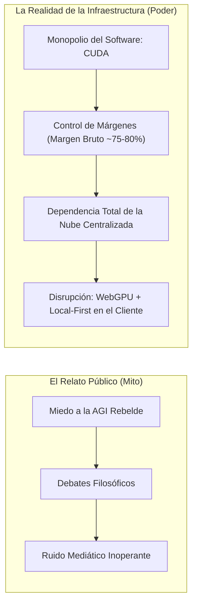
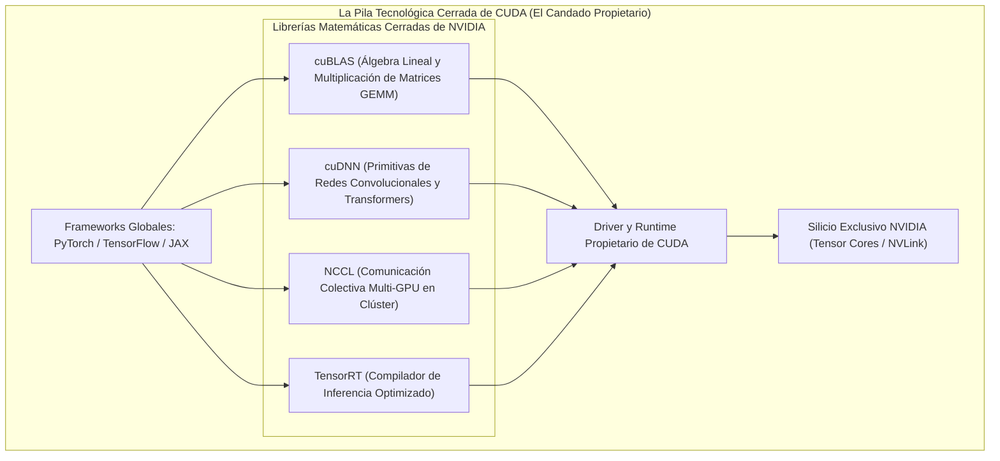
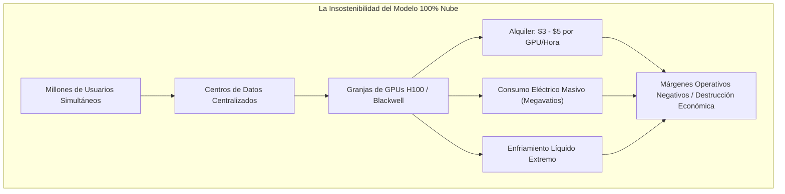
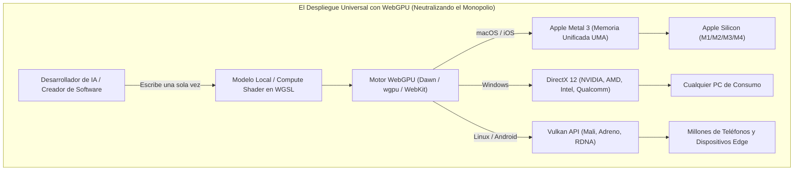
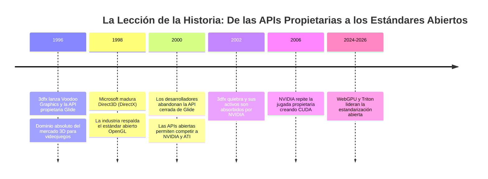

# El Foso de CUDA y la Guerra del Silicio
## La Batalla Geopolítica y Económica que WebGPU Está Redibujando

**Serie:** *Arquitectura de Sistemas en el Navegador: De WebAssembly a WebGPU y WGSL*  
**Autor:** Antigravity Engineering Lab & O'Reilly Technical Review  
**Bibliografía y Referencias O'Reilly:**
* [Programming Massively Parallel Processors, 4th Edition](https://learning.oreilly.com/library/view/-/9780323984638/?orm_source=mcp) por David B. Kirk y Wen-mei W. Hwu (*Morgan Kaufmann*)
* [AI Engineering](https://learning.oreilly.com/library/view/-/9781098166298/?orm_source=mcp) por Chip Huyen (*O'Reilly Media*)
* [Computer Organization and Design MIPS Edition](https://learning.oreilly.com/library/view/-/9780128226742/?orm_source=mcp) por David A. Patterson y John L. Hennessy (*Morgan Kaufmann*)
* [Web Performance Engineering in the Age of AI](https://learning.oreilly.com/library/view/-/9798341660182/?orm_source=mcp) por Addy Osmani (*O'Reilly Media*)
* [Practical Deep Learning for Cloud, Mobile, and Edge](https://learning.oreilly.com/library/view/-/9781492034858/?orm_source=mcp) por Anirudh Koul, Siddha Ganju y Meher Kasam (*O'Reilly Media*)
* [Modern Computer Architecture and Organization, Third Edition](https://learning.oreilly.com/library/view/-/9781806028030/?orm_source=mcp) por Jim Ledin (*Packt Publishing*)

---

## 1. Introducción: La Trampa de la Mitología Apocalíptica frente a la Realidad del Silicio

En el debate contemporáneo sobre la inteligencia artificial conviven dos mundos irreconciliables. 

Por un lado, el espacio mediático, las redes sociales y los titulares sensacionalistas permanecen atrapados en un relato cuasi-religioso: especulaciones sobre la superinteligencia artificial general (AGI), agentes de software rebeldes que escapan al control humano y proclamas apocalípticas sobre el fin inminente del trabajo y la civilización. Es un ruido ensordecedor que apela al asombro y al miedo primitivo, pero que carece de rigor ingenieril.

Por otro lado, en los laboratorios de arquitectura de computadores, en las fábricas de semiconductores de Taiwán y en los comités de estandarización web, se libra una batalla mucho más prosaica, brutal y determinante: **una guerra económica y geopolítica de billones de dólares por el control de la infraestructura de cómputo y el monopolio del silicio**.

Los balances financieros de los gigantes tecnológicos, los márgenes operativos de las aplicaciones de IA y la soberanía digital de los países no se deciden por el "alma" de una red neuronal, sino por una pregunta técnica aplastante: **¿quién controla la capa de abstracción entre el modelo matemático y los transistores del procesador?**

Durante casi dos décadas, la respuesta a esa pregunta ha tenido un único nombre: **NVIDIA** y su ecosistema de software cerrado **CUDA**. Sin embargo, la irrupción de **WebGPU** y el paradigma *Local-First* están abriendo la primera grieta estructural en este foso defensivo, transformando la distribución del poder computacional en todo el planeta.



---

## 2. Génesis y Anatomía del «Foso de CUDA» (*The CUDA Moat*)

Para comprender la posición dominante de NVIDIA, es necesario desarmar una creencia errónea muy extendida: **el liderazgo de NVIDIA no se basa en que fabriquen chips inalcanzables para otros ingenieros.** 

Equipos de diseño de silicio de clase mundial en AMD, Intel, Google, Apple o Qualcomm tienen la capacidad técnica de diseñar aceleradores con un número equivalente o superior de transistores. Lo que convirtió a NVIDIA en una de las compañías más valiosas del planeta fue una **jugada maestra de estrategia de software iniciada hace exactamente dos décadas (veinte años)**.

### 2.1. La Apuesta de 2006: Silicio Subsidiado y Captura Universitaria
En 2006, Jensen Huang tomó una decisión que puso en riesgo la solvencia financiera de su empresa: forzar a que cada tarjeta gráfica de consumo vendida por NVIDIA (incluso las más baratas para videojuegos domésticos) incluyera la circuitería necesaria para ejecutar cómputo de propósito general mediante su nueva plataforma propietaria: **CUDA (Compute Unified Device Architecture)**.

Esta decisión encareció los costes de fabricación y redujo los márgenes a corto plazo, pero vino acompañada de una estrategia de penetración implacable: **NVIDIA regaló el software, las librerías y las placas de desarrollo a todas las universidades, facultades de ingeniería y centros de investigación del mundo**.

Como explican **David B. Kirk** (antiguo director científico de NVIDIA) y **Wen-mei W. Hwu** en la obra canónica *Programming Massively Parallel Processors*:
> *"La verdadera revolución de CUDA no consistió en inventar un lenguaje nuevo, sino en proporcionar un modelo de abstracción estructurado que permitía a los científicos programar miles de hilos paralelos sin tener que fingir que sus matrices eran píxeles ni lidiar con los horrores de las APIs gráficas de la época".*

Cuando en 2012 estalló la revolución del *Deep Learning* con la célebre red **AlexNet** (creada por Alex Krizhevsky, Ilya Sutskever y Geoffrey Hinton), sus creadores no entrenaron la red en servidores corporativos ni en supercomputadores gubernamentales: **la entrenaron en dos tarjetas para videojuegos NVIDIA GeForce GTX 580 domésticas utilizando CUDA**. 

Toda la generación de doctores, científicos de datos y programadores que hoy lideran la industria se educó y aprendió a pensar exclusivamente en primitivas de CUDA.



### 2.2. Las Cuatro Murallas del Foso
El foso defensivo (*moat*) no es el lenguaje CUDA en sí, sino las **librerías matemáticas de bajísimo nivel** que NVIDIA ha optimizado artesanalmente durante dos décadas:

1. **`cuBLAS` (Álgebra Lineal Básica):** Millones de líneas de código ensamblador hiper-optimizado para exprimir hasta el último ciclo de reloj en multiplicaciones de matrices (*GEMM*), la operación elemental que sustenta toda la IA.
2. **`cuDNN` (Redes Neuronales Profundas):** Rutinas especializadas para atención escalada (*FlashAttention*), convoluciones y funciones de activación adaptadas a la microarquitectura de cada generación de silicio (Ampere, Hopper, Blackwell).
3. **`NCCL` (*NVIDIA Collective Communications Library*):** El software que orquesta el intercambio de gradientes y pesos entre miles de GPUs en paralelo a través de redes InfiniBand. Sin NCCL, entrenar modelos como GPT-4 o LLaMA en clústeres de 30.000 nodos sería una pesadilla intratable de latencias y bloqueos.
4. **`TensorRT`:** El motor de optimización de inferencia que fusiona capas, cuantiza parámetros a 8 o 4 bits y descarta cálculos redundantes.

---

## 3. La Paradoja de los Competidores: Por Qué Intentar Vender Silicio Fracasó

Durante años, competidores titánicos intentaron asaltar este trono confiando exclusivamente en el hardware:

* **El Calvario de AMD con ROCm:** AMD diseñó GPUs con especificaciones teóricas brutales en relación calidad/precio (como las series Instinct MI200 o MI300). Sin embargo, su pila de software (**ROCm**) arrastró durante años problemas crónicos de instalación, drivers inestables y soporte fragmentado entre versiones de Linux. Un equipo de ingeniería que gasta decenas de miles de dólares en un experimento de entrenamiento no puede permitirse que el proceso colapse aleatoriamente a las tres semanas por un fallo en el driver de memoria.
* **El Laberinto Burocrático de OpenCL:** Diseñado originalmente por Apple y transferido a Khronos, **OpenCL** intentó ser el estándar abierto universal. Sin embargo, su diseño fue víctima de la lentitud burocrática de comités industriales: requería una cantidad aberrante de código repetitivo (*boilerplate*), carecía de librerías matemáticas estandarizadas de alto nivel y ningún fabricante optimizaba con celo los controladores de su rival.
* **El Candado Oculto en GitHub:** Si abrías cualquier repositorio puntero de IA en GitHub entre 2017 y 2023, en los archivos fuente encontrabas llamadas directas a extensiones de CUDA:
  ```cpp
  #include <cuda_runtime.h>
  #include <cublas_v2.h>
  ```
  El software del planeta estaba acoplado de forma rígida a un único fabricante.

---

## 4. La Grieta en el Muro: El Abismo Económico entre Entrenamiento e Inferencia

¿Dónde empieza a resquebrajarse esta fortaleza aparentemente inexpugnable? En la frontera económica entre **Entrenar** un modelo y **Usar** un modelo (Inferencia).

Tal como detalla con maestría **Chip Huyen** en su obra de referencia *AI Engineering*:
> *"El entrenamiento es un gasto de capital (CapEx) finito: una empresa invierte 50 o 100 millones de dólares en entrenar un modelo durante dos meses y el proceso finaliza. La inferencia, en cambio, es un gasto operativo (OpEx) infinito: cada vez que un usuario realiza una consulta, pulsa una tecla o ejecuta un agente, hay que pagar cómputo."*



### El Cuello de Botella Centralizado
Servir inferencia de modelos complejos desde la nube a escala de cientos de millones de usuarios es **económicamente ruinoso** y **ecológicamente insostenible**:
* Alquilar una sola GPU de centro de datos cuesta entre 2 y 5 dólares por hora.
* Mantener centros de datos funcionando a plena potencia devora infraestructuras energéticas enteras y millones de litros de agua para refrigeración.
* Para el usuario, la inferencia en la nube implica **latencia de red**, dependencia de una conexión constante y una cesión inaceptable de la privacidad de sus datos personales o corporativos.

Para que la revolución de la inteligencia artificial sea viable a escala global, la computación debe descentralizarse: **los modelos deben ejecutarse en el dispositivo del usuario final (*Edge Computing / Local-First*)**.

Y aquí es donde el foso de NVIDIA se derrumba: **en el borde de la red, NVIDIA no tiene el monopolio**. La inmensa mayoría de los dispositivos del planeta no tienen tarjetas gráficas NVIDIA: son portátiles Mac con Apple Silicon, ultrabooks con procesadores Intel o AMD, tabletas con chips ARM de Qualcomm o smartphones.

---

## 5. WebGPU y WGSL: El Gran Ecualizador Tecnológico

Es en este punto de inflexión donde **WebGPU** y su lenguaje de sombreado **WGSL** dejan de ser una mera especificación gráfica para convertirse en **la tecnología de emancipación más importante del software moderno**.



### 5.1. Agnosticismo Radical del Silicio
Diseñado por consenso en el W3C con la participación activa de ingenieros de Apple, Google, Microsoft, Mozilla e Intel, WebGPU introduce una capa de compilación asíncrona inmutable:
* Un *Compute Shader* escrito en **WGSL** no contiene ni una sola directiva atada a un fabricante.
* El motor del navegador traduce ese shader a **Metal** en macOS, a **DirectX 12** en Windows o a **Vulkan** en Linux y Android.
* La aplicación de IA se ejecuta en el silicio nativo de cada máquina sin que el desarrollador haya tenido que escribir código específico para cada marca.

### 5.2. Cero Fricción de Distribución: La Muerte del "Infierno de Dependencias"
Cualquiera que haya intentado instalar una herramienta de IA basada en CUDA en un ordenador sabe lo que significa el "infierno de dependencias":
1. Descargar drivers propietarios de 800 MB.
2. Descargar e instalar el CUDA Toolkit de 4 GB.
3. Configurar variables de entorno en el sistema operativo (`PATH`, `LD_LIBRARY_PATH`).
4. Instalar entornos virtuales de Python (`conda` o `venv`) y lidiar con versiones incompatibles de binarios compilados (`torch-cu118` frente a `torch-cu121`).

Con **WebGPU**, la fricción de despliegue es **literalmente cero**:
* El usuario abre una URL en su navegador.
* El modelo de lenguaje (por ejemplo, mediante librerías como **WebLLM**, **Transformers.js** o **ONNX Runtime Web**) descarga los pesos directamente a la memoria de la GPU local.
* El navegador compila los shaders WGSL en milisegundos y el modelo comienza a responder en tiempo real, en local, sin conexión a Internet y con privacidad absoluta.

### 5.3. WebGPU Fuera del Navegador: El Fenómeno de `wgpu`
La influencia de WebGPU ha superado las fronteras del navegador. Proyectos como **`wgpu`** (escrito en Rust) y la librería **Dawn** (de Google) permiten utilizar WebGPU como una API nativa de escritorio y servidor.

Desarrolladores de sistemas operativos, motores de videojuegos y frameworks de IA (como **Burn** en Rust) están adoptando WebGPU como su backend estándar multiplataforma. Al programar contra WebGPU, sus programas funcionan de inmediato en Windows, Mac, Linux, iOS, Android y en la Web, **ignorando por completo a CUDA**.

---

## 6. La Guerra en el Centro de Datos: El Asedio a CUDA desde la Nube

Aunque WebGPU lidera la democratización en el cliente, es crucial entender que el foso de CUDA en los centros de datos también está siendo asediado por tres movimientos coordinados:

1. **El Asalto de OpenAI con Triton:**  
   OpenAI —el mayor cliente indirecto de hardware de NVIDIA— desarrolló **Triton**, un lenguaje y compilador abierto basado en Python. Triton permite a los ingenieros escribir kernels de cómputo de altísimo rendimiento sin escribir una sola línea de CUDA C++. Y lo más importante: **el código de Triton puede compilarse directamente a código para GPUs de AMD o Intel**, eliminando la necesidad de las librerías propietarias `cuDNN` o `cuBLAS`.
2. **PyTorch 2.0 y `torch.compile`:**  
   La nueva generación de PyTorch traduce los grafos neuronales a representaciones intermedias (*TorchDynamo*) que generan código de silicio optimizado automáticamente, haciendo que el código de IA sea cada vez más agnóstico del hardware subyacente.
3. **El Silicio Propietario de las Big Tech (*ASICs*):**  
   Google no entrena sus modelos Gemini en GPUs de NVIDIA; los entrena en sus propios chips: las **TPU (Tensor Processing Units)**. Amazon despliega sus aceleradores **Trainium** e **Inferentia**. Microsoft ha diseñado sus chips **Maia**, y Meta sus aceleradores **MTIA**. Los mayores compradores del mundo están construyendo sus propias alternativas para liberarse del margen de beneficio del 75% que impone Jensen Huang.

---

## 7. La Gran Analogía Histórica: La Caída de 3dfx Glide frente a DirectX y OpenGL

Quien no conoce la historia de la computación está condenado a creer que los monopolios tecnológicos son eternos. Lo que está viviendo NVIDIA con CUDA es una repetición casi milimétrica de lo ocurrido a finales de los años 90 con la compañía **3dfx Interactive**.



* En 1996, **3dfx** era el rey indiscutible de la computación gráfica. Crearon una API propietaria y cerrada llamada **Glide**. Si un juego no estaba programado específicamente para Glide, su rendimiento era mediocre. La compañía parecía indestructible.
* Sin embargo, la industria del software no tolera estar cautiva de un solo proveedor de hardware indefinidamente. Microsoft lanzó **Direct3D (DirectX)** y el consorcio de la industria estandarizó **OpenGL**. Eran interfaces universales que permitían a cualquier fabricante competir en igualdad de condiciones.
* En cuanto los desarrolladores comprobaron que con DirectX y OpenGL podían escribir su código una sola vez y venderlo a usuarios con cualquier tarjeta gráfica, **abandonaron Glide en masa**. 3dfx no supo adaptarse, perdió su monopolio de software y terminó quebrando en el año 2000 (siendo sus activos adquiridos, irónicamente, por la propia NVIDIA).

NVIDIA es hoy una corporación inmensamente más poderosa de lo que jamás fue 3dfx, pero la ley de la gravedad de la ingeniería de software es inmutable: **los estándares abiertos y universales siempre terminan imponiéndose cuando una tecnología pasa de la experimentación elitista a la ubicuidad masiva**.

---

## 8. Matriz Estratégica: El Escenario de Fuerzas Actual

| Eje de Comparación | El Ecosistema CUDA (NVIDIA) | El Ecosistema WebGPU (W3C / Abierto) | Impacto en el Futuro Tecnológico |
|---|---|---|---|
| **Modelo de Propiedad** | Propietario, cerrado y controlado por una sola empresa privada. | Estándar abierto gobernado por el consorcio W3C (Apple, Google, MS, Intel). | Neutralidad tecnológica y soberanía del software. |
| **Compatibilidad de Hardware** | Exclusivo para tarjetas NVIDIA (incompatible con Mac, AMD, móviles). | Universal: corre en Metal, DirectX 12 y Vulkan sin cambios de código. | Democratización del software para miles de millones de usuarios. |
| **Entorno de Despliegue** | Requiere instalación de SDKs pesados, compilers C++ y drivers nativos. | **Cero instalación**: funciona de inmediato en navegadores y apps nativas. | Desaparición de las barreras de entrada para usuarios no técnicos. |
| **Rendimiento en Entrenamiento Masivo** | **Imbatible** (apoyado en NCCL, InfiniBand y Tensor Cores en la nube). | No aplicable (no está diseñado para clústeres multi-nodo de centros de datos). | NVIDIA mantendrá su fortaleza en supercomputación durante años. |
| **Rendimiento en Inferencia Local (*Edge*)** | Excelente, pero atado a hardware caro y de alto consumo eléctrico. | **Extraordinario**, especialmente en arquitecturas de memoria unificada (UMA). | Hace económicamente viable el paradigma *Local-First* y *BrowserOS*. |

---

## 9. Conclusión: La Verdadera Revolución Silenciosa

Mientras el circo mediático continúa alimentando supersticiones sobre máquinas que cobran conciencia y escenarios de ciencia ficción, la historia real de nuestro tiempo se escribe en la arquitectura de los sistemas.

La hegemonía de NVIDIA sobre la inteligencia artificial nunca ha sido un destino inevitable de la física: ha sido el resultado de una magistral estrategia de captura mediante software que ha durado dos décadas.

**WebGPU representa el fin de ese monopolio en el terreno más importante para la vida cotidiana de las personas: sus propios dispositivos.** Al convertir el navegador web en una máquina universal capaz de dialogar directamente con el silicio sin intermediarios propietarios, WebGPU no solo está haciendo posible el concepto de un *BrowserOS*; está devolviendo el control de la computación a los usuarios y garantizando que el futuro de la inteligencia artificial sea abierto, descentralizado y accesible para todos.

---

## 10. Bibliografía y Lecturas Recomendadas para Profundizar

Para consolidar el análisis histórico, económico y arquitectónico abordado en este capítulo, se recomienda el estudio riguroso de las siguientes obras disponibles en la plataforma **O'Reilly Learning**:

1. **[Programming Massively Parallel Processors: A Hands-on Approach (4th Edition)](https://learning.oreilly.com/library/view/-/9780323984638/?orm_source=mcp)**  
   *David B. Kirk y Wen-mei W. Hwu (Morgan Kaufmann)*  
   * **Por qué leerlo:** Escrito por el que fuera Chief Scientist de NVIDIA junto a una de las mayores autoridades mundiales en paralelismo. Es el texto definitivo para entender cómo se diseñó CUDA por dentro, cómo operan los bloques de hilos y por qué las librerías matemáticas son la clave de su rendimiento.

2. **[AI Engineering: Building Applications with Foundation Models](https://learning.oreilly.com/library/view/-/9781098166298/?orm_source=mcp)**  
   *Chip Huyen (O'Reilly Media, Inc.)*  
   * **Por qué leerlo:** La obra más lúcida, moderna y pragmática sobre la economía real de la IA. Analiza con datos empíricos la diferencia de costes entre entrenamiento e inferencia, la insostenibilidad del despliegue centralizado en la nube y la necesidad urgente de llevar los modelos al borde (*edge*).

3. **[Computer Organization and Design: The Hardware/Software Interface (MIPS Edition)](https://learning.oreilly.com/library/view/-/9780128226742/?orm_source=mcp)**  
   *David A. Patterson y John L. Hennessy (Morgan Kaufmann)*  
   * **Por qué leerlo:** La biblia de la arquitectura de computadores. Imprescindible para comprender el "Memory Wall", la ley de Amdahl aplicada a aceleradores y cómo las interfaces estandarizadas transforman la economía de la industria.

4. **[Practical Deep Learning for Cloud, Mobile, and Edge](https://learning.oreilly.com/library/view/-/9781492034858/?orm_source=mcp)**  
   *Anirudh Koul, Siddha Ganju y Meher Kasam (O'Reilly Media, Inc.)*  
   * **Por qué leerlo:** Guía práctica centrada en los desafíos de portar y ejecutar redes neuronales complejas en dispositivos con recursos limitados (móviles, navegadores y microprocesadores) sorteando la dependencia de servidores externos.

5. **[Modern Computer Architecture and Organization (Third Edition)](https://learning.oreilly.com/library/view/-/9781806028030/?orm_source=mcp)**  
   *Jim Ledin (Packt Publishing)*  
   * **Por qué leerlo:** Excelente tratado contemporáneo sobre la convergencia de CPUs y GPUs en encapsulados de memoria unificada (SoC), buses PCIe de última generación y el diseño de clústeres heterogéneos.
